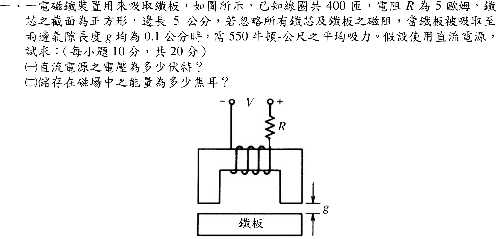

# 106 年電機機械第 1 題｜電磁鐵吸力與儲能

## 已知與所求

線圈 \(N=400\) 匝、\(R=5\ \Omega\)，鐵心截面為邊長 5 cm 的正方形（\(A=25\ \mathrm{cm^2}=2.5\times10^{-3}\ \mathrm{m^2}\)），兩邊氣隙均為 \(g=0.1\ \mathrm{cm}=10^{-3}\ \mathrm m\)，鐵心與鐵板磁阻忽略，鐵板吸到兩氣隙 0.1 cm 時需平均吸力 550（原題印「牛頓-公尺」，吸力單位應為 N，本解取 \(F=550\ \mathrm N\)）。直流電源，求（一）電源電壓；（二）磁場儲能。

## 考場標準作答

### （一）電源電壓

鐵心與鐵板磁阻忽略，磁場能量與吸力都集中在兩個氣隙。兩氣隙各受 \(B^2A/(2\mu_0)\) 的吸力，先由吸力求氣隙磁通密度：
\[
F=2\cdot\frac{B^2A}{2\mu_0}=\frac{B^2A}{\mu_0}\ \Rightarrow\ B=\sqrt{\frac{F\mu_0}{A}}=\sqrt{\frac{550(4\pi\times10^{-7})}{2.5\times10^{-3}}}=\sqrt{2.76\times10^{-1}}=5.26\times10^{-1}\ \mathrm T
\]
再用安培定律（磁路只含兩個氣隙，磁路長 \(2g\)）求所需安匝，除以匝數得電流：
\[
NI=\frac{B}{\mu_0}(2g)=\frac{5.26\times10^{-1}(2\times10^{-3})}{4\pi\times10^{-7}}=836.83\ \mathrm{A\cdot t},\qquad I=\frac{NI}{N}=\frac{836.83}{400}=2.09\ \mathrm A
\]
直流穩態線圈電感不產生壓降，電源電壓只需克服電阻壓降（以完整精度計算）：
\[
\boxed{V=IR=\frac{836.83}{400}(5)=10.46\ \mathrm V}
\]

### （二）磁場儲能

磁場能量等於兩氣隙體積乘以能量密度 \(B^2/(2\mu_0)\)（鐵心磁阻忽略，鐵心內無儲能）。先求能量密度與氣隙總體積，再相乘：
\[
u=\frac{B^2}{2\mu_0}=\frac{F}{2A}=\frac{550}{2(2.5\times10^{-3})}=1.10\times10^{5}\ \mathrm{J/m^3},\qquad
\mathrm{Vol}=2Ag=2(2.5\times10^{-3})(10^{-3})=5.00\times10^{-6}\ \mathrm{m^3}
\]
\[
\boxed{W=u\cdot\mathrm{Vol}=1.10\times10^{5}(5.00\times10^{-6})=550.00\ \mathrm{mJ}}
\]

## 驗算

電感法：\(L=\dfrac{\mu_0N^2A}{2g}=251.33\ \mathrm{mH}\)，\(\tfrac12LI^2=\tfrac12(251.33\times10^{-3})(2.09)^2=550.00\ \mathrm{mJ}\)（\(I\) 以完整精度代入）；吸力 \(F=\tfrac12I^2\left|\dfrac{dL}{dg}\right|=\dfrac{I^2L}{2g}=550.00\ \mathrm N\)，與題給吸力一致；亦符合 \(W=Fg=550(10^{-3})=550.00\ \mathrm{mJ}\)。磁鏈 \(LI=NBA=5.26\times10^{-1}\ \mathrm{Wb\cdot t}\)。

## 失分點

- 只算一個氣隙的吸力（\(F=B^2A/2\mu_0\)），\(B\) 變成 \(7.44\times10^{-1}\ \mathrm T\)，電壓變成 14.79 V。
- 安培定律的磁路長是兩個氣隙，共 \(2g=2\times10^{-3}\ \mathrm m\)；只用 \(g\) 會讓電流與電壓少一半（5.23 V）。
- 儲能誤用 \(\tfrac12Fg=275.00\ \mathrm{mJ}\)；兩氣隙總場能等於 \(Fg\)。
