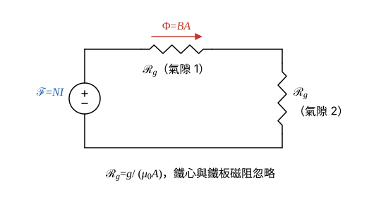

# 106 年電機機械第 1 題｜電磁鐵吸力與儲能

## 已知與所求

線圈 \(N=400\) 匝、\(R=5\ \Omega\)，鐵心截面為邊長 5 cm 的正方形（\(A=25\ \mathrm{cm^2}=2.5\times10^{-3}\ \mathrm{m^2}\)），兩邊氣隙均為 \(g=0.1\ \mathrm{cm}=10^{-3}\ \mathrm m\)，鐵心與鐵板磁阻忽略，鐵板吸到兩氣隙 0.1 cm 時需平均吸力 550（原題印「牛頓-公尺」，吸力單位應為 N，本解取 \(F=550\ \mathrm N\)）。直流電源，求（一）電源電壓；（二）磁場儲能。

## 考場標準作答

**解題邏輯**：鐵心與鐵板磁阻忽略，磁路只剩兩個串聯的氣隙，磁場能量與吸力都集中在氣隙。（一）由題給吸力反求氣隙磁通密度 \(B\)（兩個極面各受 \(B^2A/2\mu_0\)），再用磁路（安培定律）求所需安匝 \(NI\)，除以匝數得電流；直流穩態時線圈電感不產生壓降，電源電壓只克服電阻壓降 \(IR\)。（二）儲能＝能量密度 \(B^2/2\mu_0\) × 兩氣隙體積。前提：氣隙磁場均勻、不計邊緣效應與漏磁；550 為鐵板所受總吸力（單位應為 N）；直流穩態。

### 步驟 1：磁路與已知量

- 截面積：\(A=(0.05)^2=2.5\times10^{-3}\ \mathrm{m^2}\)；每個氣隙長 \(g=0.1\ \mathrm{cm}=10^{-3}\ \mathrm m\)；\(\mu_0=4\pi\times10^{-7}\ \mathrm{H/m}\)。
- 磁路：磁動勢 \(\mathcal F=NI\) 推動磁通 \(\Phi=BA\) 依序穿過氣隙 1、鐵板、氣隙 2 回到鐵心；鐵磁阻忽略，只剩兩個氣隙磁阻串聯，每個 \(\mathcal R_g=g/(\mu_0A)\)。
- 線圈電阻記為 \(R=5\ \Omega\)（與磁阻 \(\mathcal R_g\) 區分）。

### （一）直流電源之電壓（10 分）

**邏輯**：每個極面的吸力＝氣隙能量密度 × 面積＝\(B^2A/2\mu_0\)，兩極面合計等於題給吸力，由此反求 \(B\)；圖 1 磁路 \(NI=\Phi\cdot2\mathcal R_g\) 求安匝；直流穩態 \(L\,di/dt=0\)，\(V=IR\)。

兩個極面的總吸力：
\[
F=2\cdot\frac{B^2A}{2\mu_0}=\frac{B^2A}{\mu_0}\ \Rightarrow\ B=\sqrt{\frac{F\mu_0}{A}}
\]
代入：
\[
F\mu_0=550(4\pi\times10^{-7})=6.912\times10^{-4}\ \mathrm{N\cdot H/m}
\]
\[
\frac{F\mu_0}{A}=\frac{6.912\times10^{-4}}{2.5\times10^{-3}}=0.2765\ \mathrm{T^2}
\]
\[
B=\sqrt{0.2765}=0.5258\ \mathrm T
\]
磁路（兩氣隙串聯）求安匝：
\[
NI=\Phi(2\mathcal R_g)=BA\cdot\frac{2g}{\mu_0A}=\frac{2Bg}{\mu_0}
\]
\[
2Bg=2(0.5258)(10^{-3})=1.0516\times10^{-3}\ \mathrm{T\cdot m}
\]
\[
NI=\frac{1.0516\times10^{-3}}{4\pi\times10^{-7}}=836.8\ \mathrm{A\cdot t}
\]
線圈電流：
\[
I=\frac{NI}{N}=\frac{836.8}{400}=2.092\ \mathrm A
\]
直流穩態電源電壓：
\[
V=IR=2.092(5)
\]
\[
\boxed{V=10.46\ \mathrm V}
\]

### （二）磁場儲能（10 分）

**邏輯**：鐵心磁阻忽略（\(\mu\to\infty\)，鐵中 \(H\approx0\)），鐵心內不儲能，能量全在兩個氣隙；氣隙能量密度 \(u=B^2/2\mu_0\)，乘兩氣隙總體積即為儲能。

由（一）的 \(F=B^2A/\mu_0\) 得 \(B^2/\mu_0=F/A\)，能量密度：
\[
u=\frac{B^2}{2\mu_0}=\frac{F}{2A}=\frac{550}{2(2.5\times10^{-3})}=\frac{550}{5\times10^{-3}}=1.1\times10^{5}\ \mathrm{J/m^3}
\]
兩氣隙總體積：
\[
\mathrm{Vol}=2Ag=2(2.5\times10^{-3})(10^{-3})=5\times10^{-6}\ \mathrm{m^3}
\]
儲能：
\[
W=u\cdot\mathrm{Vol}=(1.1\times10^{5})(5\times10^{-6})
\]
\[
\boxed{W=0.55\ \mathrm J}
\]
（即 550 mJ。）

## 驗算

電感法：\(L=\dfrac{\mu_0N^2A}{2g}=\dfrac{(4\pi\times10^{-7})(400^2)(2.5\times10^{-3})}{2\times10^{-3}}=0.2513\ \mathrm H\)，\(\tfrac12LI^2=\tfrac12(0.2513)(2.092)^2=0.5499\ \mathrm J\approx0.55\ \mathrm J\)。虛功法：\(F=\tfrac12I^2\left|\dfrac{dL}{dg}\right|=\dfrac{W}{g}=\dfrac{0.55}{10^{-3}}=550\ \mathrm N\)，與題給吸力一致。磁鏈 \(LI=NBA=400(0.5258)(2.5\times10^{-3})=0.5258\ \mathrm{Wb\cdot t}\)。

## 失分點

- 只算一個極面的吸力（\(F=B^2A/2\mu_0\)），\(B\) 變成 \(\sqrt2(0.5258)=0.7436\ \mathrm T\)，電壓變成 14.79 V。
- 安培定律的磁路長是兩個氣隙，共 \(2g=2\times10^{-3}\ \mathrm m\)；只用 \(g\) 會讓電流與電壓少一半（5.23 V）。
- 儲能誤用 \(\tfrac12Fg=0.275\ \mathrm J\)；兩氣隙總場能 \(W=Fg=550(10^{-3})=0.55\ \mathrm J\)。
