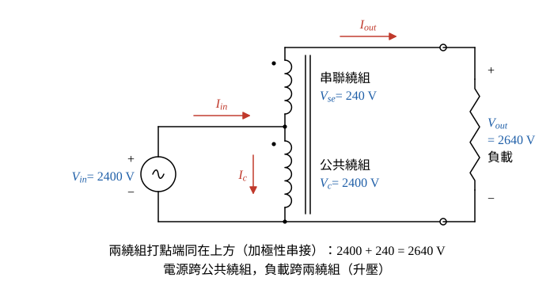

# 106 年電機機械第 2 題｜雙繞組變壓器改接自耦變壓器

## 已知與所求

2400/240 V、50 kVA、60 Hz 雙繞組變壓器，滿載 PF 1.0 時效率 98%。改接為由 2400 V 電源供應 2640 V 負載的自耦變壓器。求自耦變壓器（一）額定 kVA；（二）效率。（每小題 10 分）

## 考場標準作答

**解題邏輯**：先判定接法：\(2640=2400+240\)，所以 2400 V 繞組當公共繞組接電源，240 V 繞組以加極性串在其上當串聯繞組，負載跨兩繞組（升壓）。（一）自耦容量由「各繞組額定電流」決定：負載電流全部流過串聯繞組，取 \(I_{out}=\) 240 V 繞組額定電流，\(S_{auto}=V_{out}I_{out}\)，再用 KCL 檢查公共繞組電流不超過額定。（二）改接後兩繞組的電壓、電流仍恰為原額定值，銅損與鐵損都與原雙繞組滿載時相同，所以由 98% 反求損失，再以自耦輸出計效率。前提：理想自耦關係（忽略激磁電流與漏阻抗壓降）、負載 PF 1.0。

### 步驟 1：接線與各繞組額定電流

- 2400 V 繞組為公共繞組，電源跨在它兩端（\(V_{in}=2400\ \mathrm V\)）。
- 240 V 繞組的非打點端接公共繞組的打點端（兩打點端同在上方，電壓相加），負載跨兩繞組：\(V_{out}=2400+240=2640\ \mathrm V\)。
- 參考方向：\(I_{in}\) 由電源流入分接點，\(I_{out}\) 由分接點經串聯繞組流向負載，\(I_c\) 在公共繞組中由分接點向下（圖 1）。

串聯繞組（240 V）額定電流：
\[
I_{se}=\frac{S_{2w}}{V_{se}}=\frac{50\,000}{240}=208.33\ \mathrm A
\]
公共繞組（2400 V）額定電流：
\[
I_{c,rated}=\frac{S_{2w}}{V_c}=\frac{50\,000}{2400}=20.83\ \mathrm A
\]

### （一）額定容量（10 分）

**邏輯**：負載電流 \(I_{out}\) 全部流過串聯繞組，所以 \(I_{out}\) 的上限就是串聯繞組額定電流；自耦容量＝輸出電壓 × 輸出電流上限，再以 KCL 確認公共繞組也沒有過載。

輸出電流上限：
\[
I_{out}=I_{se}=\frac{50\,000}{240}\ \mathrm A
\]
自耦容量（保留分數，避免 208.33 的捨入誤差）：
\[
S_{auto}=V_{out}I_{out}=2640\left(\frac{50\,000}{240}\right)
\]
\[
S_{auto}=11(50\,000)=550\,000\ \mathrm{VA}
\]
\[
\boxed{S_{auto}=550\text{ kVA}}
\]
公共繞組檢查：輸入電流
\[
I_{in}=\frac{S_{auto}}{V_{in}}=\frac{550\,000}{2400}=229.17\ \mathrm A
\]
分接點 KCL（\(I_{in}=I_{out}+I_c\)），把 \(I_{out}\) 化成同分母 \(500\,000/2400\)：
\[
I_c=I_{in}-I_{out}=\frac{550\,000-500\,000}{2400}=\frac{50\,000}{2400}=20.83\ \mathrm A=I_{c,rated}
\]
兩繞組同時恰為額定，550 kVA 即為額定容量。

### （二）效率（10 分）

**邏輯**：效率＝輸出／（輸出＋損失）；改接後各繞組的電壓與電流都等於原額定值，銅損（看電流）與鐵損（看電壓）都不變，所以損失沿用雙繞組滿載時的值，只有輸出放大成自耦容量。

雙繞組滿載輸出（PF 1.0）：
\[
P_{out,2w}=S_{2w}\cos\theta=50(1.0)=50\ \mathrm{kW}
\]
雙繞組滿載輸入：
\[
P_{in,2w}=\frac{P_{out,2w}}{\eta_{2w}}=\frac{50}{0.98}=51.020\ \mathrm{kW}
\]
滿載總損失：
\[
P_{loss}=P_{in,2w}-P_{out,2w}=51.020-50=1.020\ \mathrm{kW}
\]
自耦輸出（PF 1.0）：
\[
P_{out,auto}=S_{auto}\cos\theta=550(1.0)=550\ \mathrm{kW}
\]
自耦輸入：
\[
P_{in,auto}=P_{out,auto}+P_{loss}=550+1.020=551.020\ \mathrm{kW}
\]
\[
\eta_{auto}=\frac{P_{out,auto}}{P_{in,auto}}=\frac{550}{551.020}=0.998149
\]
\[
\boxed{\eta_{auto}=99.81\%}
\]

## 驗算

容量比公式：\(S_{auto}/S_{2w}=V_{out}/(V_{out}-V_{in})=2640/240=11\)，\(50\times11=550\ \mathrm{kVA}\)，與（一）相同。損失比例：\(1-\eta_{auto}=1.020/551.020=0.1851\%\)，\(100\%-0.1851\%=99.8149\%\approx99.81\%\)。

## 失分點

- 以 2400 V 繞組電流 20.83 A 乘 2640 V，得 55 kVA（限制負載電流的是串聯 240 V 繞組的 208.33 A）。
- 把 98% 直接當成自耦效率；損失不變、輸出變 11 倍，效率提高到 99.81%。
- 損失用 \(50(1-0.98)=1.0\ \mathrm{kW}\)：98% 效率是輸出對輸入，損失為 \(50/0.98-50=1.020\ \mathrm{kW}\)。
