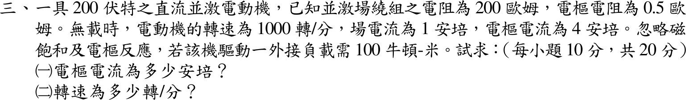
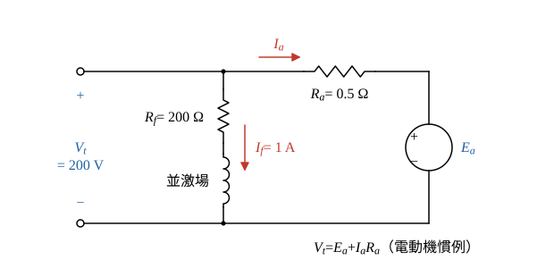

# 106 年電機機械第 3 題｜並激馬達外接負載轉矩

## 已知與所求

200 V 直流並激電動機，\(R_f=200\ \Omega\)、\(R_a=0.5\ \Omega\)；無載時轉速 1000 rpm、場電流 1 A、電樞電流 4 A；忽略磁飽和與電樞反應。驅動一外接負載需 100 N·m。求（一）電樞電流；（二）轉速。（每小題 10 分）

## 考場標準作答

### 步驟 1：等效電路與 \(K\Phi\)

並激場跨在 200 V 上，\(I_f=200/200=1\ \mathrm A\) 固定；忽略飽和與電樞反應，\(K\Phi\) 為常數。題面未給損失隨轉速的模型，假設空載損失轉矩近似不變（若改採忽略旋轉損失，\(T_e=100\ \mathrm{N\cdot m}\)，得 \(I_a=52.89\ \mathrm A\)、\(n=876.54\ \mathrm{rpm}\)，見條件與疑義，不可混用）。

- 端電壓 \(V_t=200\ \mathrm V\) 兩端並接：場支路 \(R_f=200\ \Omega\)（\(I_f\) 向下）與電樞支路 \(R_a=0.5\ \Omega\) 串聯反電勢 \(E_a\)。
- 參考方向（電動機慣例）：\(I_a\) 由 \(V_t\) 正端經 \(R_a\) 流入 \(E_a\) 正端。

場電流（驗證題給 1 A，磁通固定）：
\[
I_f=\frac{V_t}{R_f}=\frac{200}{200}=1\ \mathrm A
\]
無載反電勢（電樞 KVL，\(I_{a0}=4\ \mathrm A\)）：
\[
E_{a0}=V_t-I_{a0}R_a=200-4(0.5)=200-2=198\ \mathrm V
\]
無載角速度：
\[
\omega_0=\frac{2\pi n_0}{60}=\frac{2\pi(1000)}{60}=104.7198\ \mathrm{rad/s}
\]
機械常數（後面要除它並求轉速到兩位小數，故保留 6 位有效數字）：
\[
K\Phi=\frac{E_{a0}}{\omega_0}=\frac{198}{104.7198}=1.89076\ \mathrm{V\cdot s/rad}
\]

### （一）電樞電流（10 分）

穩速時電磁轉矩＝外接負載轉矩＋旋轉損失轉矩，損失轉矩取無載值 \(K\Phi I_{a0}\)。

無載損失轉矩：
\[
T_{loss}=K\Phi I_{a0}=1.89076(4)=7.56304\ \mathrm{N\cdot m}
\]
負載時電磁轉矩：
\[
T_e=T_L+T_{loss}=100+7.56304=107.56304\ \mathrm{N\cdot m}
\]
電樞電流：
\[
I_a=\frac{T_e}{K\Phi}=\frac{107.56304}{1.89076}=56.8888\ \mathrm A
\]
\[
\boxed{I_a=56.89\ \mathrm A}
\]

### （二）轉速（10 分）

磁通固定，\(n=n_0E_a/E_{a0}\)；負載時須以 KVL 重算反電勢，不可沿用無載的 198 V。

電樞電阻壓降：
\[
I_aR_a=56.8888(0.5)=28.4444\ \mathrm V
\]
負載反電勢：
\[
E_a=V_t-I_aR_a=200-28.4444=171.5556\ \mathrm V
\]
按比例求轉速：
\[
n=n_0\frac{E_a}{E_{a0}}=1000\frac{171.5556}{198}=866.44\ \mathrm{rpm}
\]
\[
\boxed{n=866.44\ \mathrm{rpm}}
\]

## 驗算

轉矩–轉速直線 \(\omega=(V_t-R_aT_e/K\Phi)/K\Phi\)：代 \(T_e=107.56304\ \mathrm{N\cdot m}\) 得 \(\omega=(200-28.4444)/1.89076=90.7337\ \mathrm{rad/s}\)，即 \(90.7337(60)/(2\pi)=866.44\ \mathrm{rpm}\)；代無載 \(T_e=7.56304\ \mathrm{N\cdot m}\) 得 \(\omega=(200-2)/1.89076=104.7198\ \mathrm{rad/s}\)，回到 1000 rpm，吻合無載點。

## 失分點

- 直接用 200 V 除以無載角速度求 \(K\Phi\)，漏掉無載電樞壓降 \(4(0.5)=2\ \mathrm V\)（正確 \(E_{a0}=198\ \mathrm V\)）。
- 求得 \(I_a\) 後仍用 198 V 算轉速，沒有重算負載反電勢。
- 把外接負載轉矩直接當電磁轉矩，卻又承認無載有 4 A 損失電流；要先寫明採用哪一種損失模型。

## 條件與疑義

題面只說忽略磁飽和與電樞反應，沒有說忽略旋轉損失，也沒有給損失轉矩隨轉速的關係；無載點只能固定該點的損失，不能單獨推出其在所有轉速的函數，因此沒有唯一數值解；與無載點相容的模型不只一種。

| 模型 | 電樞電流 | 轉速 |
| --- | --- | --- |
| 空載損失轉矩近似不變（主解） | 56.89 A | 866.44 rpm |
| 旋轉損失忽略（\(T_e=100\ \mathrm{N\cdot m}\)） | 52.89 A | 876.54 rpm |
| 旋轉損失功率 792 W 不變 | 57.51 A | 864.86 rpm |
