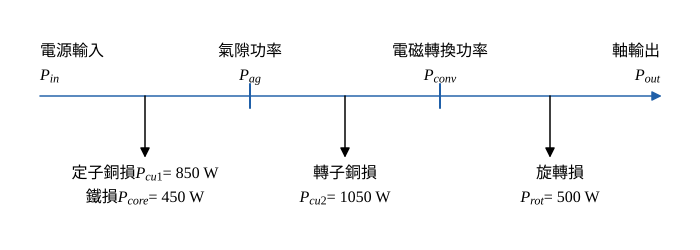

# 106 年電機機械第 4 題｜三相感應電動機功率與效率

## 已知與所求

三相感應電動機 230 V、60 Hz、25 hp；PF 0.866 落後時線電流 60 A。定子銅損 850 W、鐵損 450 W、轉子銅損 1050 W、旋轉損 500 W。求（一）機械輸出功率（W）；（二）效率。（每小題 10 分）

## 考場標準作答

**解題邏輯**：感應電動機的功率流是逐級扣除損失：電源輸入 \(P_{in}\) 扣定子銅損與鐵損得氣隙功率 \(P_{ag}\)，再扣轉子銅損得電磁轉換功率 \(P_{conv}\)，最後扣旋轉損得軸輸出 \(P_{out}\)。先由三相功率公式求 \(P_{in}\)（步驟 1），再沿功率流依序相減得（一），最後用 \(\eta=P_{out}/P_{in}\) 得（二）。前提：230 V、60 A 為線電壓與線電流；題給四項即全部損失（雜散損未另列，不計）；25 hp 只是銘牌額定，不是本運轉點的輸出。

### 步驟 1：功率流與輸入功率

- 功率流方向：電源 → 定子（扣 \(P_{cu1}\)、\(P_{core}\)）→ 氣隙 → 轉子（扣 \(P_{cu2}\)）→ 電磁轉換 → 軸（扣 \(P_{rot}\)）。
- 本題把鐵損歸在定子側（在氣隙之前扣除），旋轉損（摩擦、風阻）在電磁轉換之後扣除。

三相輸入功率：
\[
P_{in}=\sqrt3\,V_LI_L\cos\theta
\]
代入 \(V_L=230\ \mathrm V\)、\(I_L=60\ \mathrm A\)、\(\cos\theta=0.866\)：
\[
P_{in}=\sqrt3(230)(60)(0.866)
\]
\[
\sqrt3(230)(60)=23\,902.30\ \mathrm{VA}
\]
\[
P_{in}=23\,902.30(0.866)=20\,699.39\ \mathrm W
\]

### （一）機械輸出功率（10 分）

**邏輯**：題目問的是軸上的機械輸出，必須沿圖 1 扣到最後一級（旋轉損之後），不能停在 \(P_{conv}\)。

扣定子銅損與鐵損，得氣隙功率：
\[
P_{ag}=P_{in}-P_{cu1}-P_{core}
\]
\[
P_{ag}=20\,699.39-850-450=19\,399.39\ \mathrm W
\]
扣轉子銅損，得電磁轉換功率：
\[
P_{conv}=P_{ag}-P_{cu2}
\]
\[
P_{conv}=19\,399.39-1050=18\,349.39\ \mathrm W
\]
扣旋轉損，得軸輸出功率：
\[
P_{out}=P_{conv}-P_{rot}
\]
\[
P_{out}=18\,349.39-500
\]
\[
\boxed{P_{out}=17\,849.39\ \mathrm W}
\]
換算馬力（1 hp = 746 W）供對照：
\[
\frac{17\,849.39}{746}=23.93\ \mathrm{hp}
\]

### （二）效率（10 分）

**邏輯**：效率是功率流終點與起點之比，\(P_{out}\) 已扣除全部四項損失，直接用（一）的 \(P_{out}\) 與步驟 1 的 \(P_{in}\)。

\[
\eta=\frac{P_{out}}{P_{in}}
\]
\[
\eta=\frac{17\,849.39}{20\,699.39}=0.8623
\]
\[
\boxed{\eta=86.23\%}
\]

## 驗算

總損失法：\(P_{loss}=850+450+1050+500=2850\ \mathrm W\)，\(P_{out}=20\,699.39-2850=17\,849.39\ \mathrm W\)；\(\eta=1-2850/20\,699.39=1-0.1377=86.23\%\)。滑差檢查：\(s=P_{cu2}/P_{ag}=1050/19\,399.39=0.05413\)，\(P_{conv}/P_{ag}=18\,349.39/19\,399.39=0.9459=1-0.05413\)，符合 \(P_{conv}=(1-s)P_{ag}\)。

## 失分點

- 把 \(P_{conv}=18\,349.39\ \mathrm W\) 當輸出，沒有再扣旋轉損 500 W；它是電磁轉換功率，不是軸輸出。
- 輸入功率漏乘 \(\sqrt3\) 或用 \(\sin\theta\)（0.5）取代功因 0.866。
- 將 25 hp 銘牌（18 650 W）當作實際輸出；本題實際輸出 17 849.39 W（23.93 hp）。
