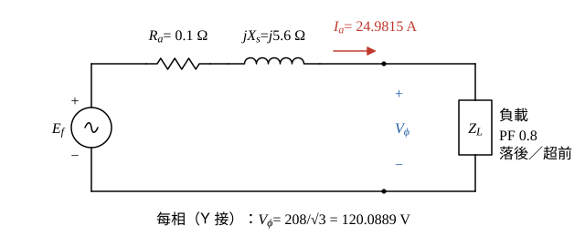
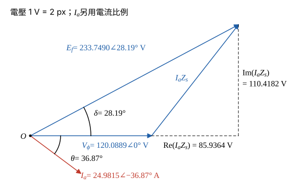
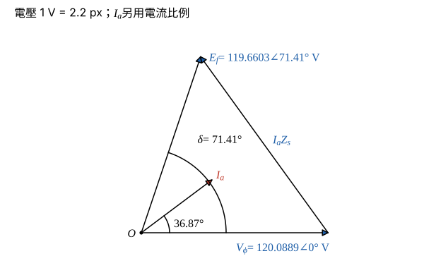

# 106 年電機機械第 5 題｜同步發電機電壓調整率

## 已知與所求

9 kVA、208 V、Y 接三相同步發電機，\(R_a=0.1\ \Omega\)/相、\(X_s=5.6\ \Omega\)/相。滿載、端電壓為額定值時，求（一）PF 0.8 落後；（二）PF 0.8 超前的電壓調整率。（每小題 10 分）

## 考場標準作答

**解題邏輯**：電壓調整率 \(\mathrm{VR}=(|E_f|-V_\phi)/V_\phi\)：滿載時端電壓為額定 \(V_\phi\)，卸載後（場電流與轉速不變）端電壓升到 \(|E_f|\)。所以兩小題都是由每相等效電路 KVL \(\underline E_f=\underline V_\phi+\underline I_a(R_a+jX_s)\) 求 \(|E_f|\)；兩者只差在電流相角（落後 \(-36.87^\circ\)、超前 \(+36.87^\circ\)）。前提：題目未寫負載大小，依電壓調整率的定義取額定（滿載）電流 9 kVA；Y 接，相電流＝線電流；\(\underline V_\phi\) 取為相位參考 \(0^\circ\)。超前時 \(|E_f|\) 與 \(V_\phi\) 只差約 0.43 V，所以這條計算鏈保留 4 位小數，避免 VR 失真。

### 步驟 1：每相等效電路與額定每相量

- 每相等效電路：內電勢 \(\underline E_f\) 串聯 \(R_a=0.1\ \Omega\) 與 \(jX_s=j5.6\ \Omega\) 接到端點 \(\underline V_\phi\)，再接 PF 0.8 負載。
- 參考方向：\(\underline I_a\) 由發電機流向負載，KVL 得 \(\underline E_f=\underline V_\phi+\underline I_a\underline Z_s\)，\(\underline Z_s=R_a+jX_s=0.1+j5.6\ \Omega\)。

每相端電壓（Y 接）：
\[
V_\phi=\frac{V_L}{\sqrt3}=\frac{208}{\sqrt3}=120.0889\ \mathrm V
\]
額定電樞電流：
\[
I_a=\frac{S}{\sqrt3V_L}=\frac{9000}{\sqrt3(208)}=\frac{9000}{360.2666}=24.9815\ \mathrm A
\]
PF 0.8 時 \(\cos\theta=0.8\)、\(\sin\theta=0.6\)，電流的兩個分量大小：
\[
I_a\cos\theta=24.9815(0.8)=19.9852\ \mathrm A,\qquad I_a\sin\theta=24.9815(0.6)=14.9889\ \mathrm A
\]

### （一）PF 0.8 落後（10 分）

**邏輯**：落後時電流在 \(\underline V_\phi\) 下方 \(36.87^\circ\)，\(\underline I_a=19.9852-j14.9889\ \mathrm A\)；乘上 \(\underline Z_s\) 得壓降，與 \(\underline V_\phi\) 相加取大小即 \(|E_f|\)，代入 VR 定義。

\[
\underline I_a=24.9815\angle-36.87^\circ=19.9852-j14.9889\ \mathrm A
\]
壓降 \(\underline I_a\underline Z_s=(19.9852-j14.9889)(0.1+j5.6)\)，實部（\(-j\cdot j=+1\)）：
\[
19.9852(0.1)+14.9889(5.6)=1.99852+83.93784=85.93636\ \mathrm V
\]
虛部：
\[
19.9852(5.6)-14.9889(0.1)=111.91712-1.49889=110.41823\ \mathrm V
\]
與 \(\underline V_\phi=120.0889\angle0^\circ\) 相加：
\[
\underline E_f=(120.0889+85.9364)+j110.4182=206.0253+j110.4182\ \mathrm V
\]
大小：
\[
|E_f|=\sqrt{206.0253^2+110.4182^2}=\sqrt{42\,446.42+12\,192.18}=\sqrt{54\,638.60}=233.7490\ \mathrm V
\]
相角（功率角）：
\[
\delta=\tan^{-1}\frac{110.4182}{206.0253}=28.19^\circ
\]

電壓調整率：
\[
\mathrm{VR}=\frac{|E_f|-V_\phi}{V_\phi}\times100\%=\frac{233.7490-120.0889}{120.0889}\times100\%=\frac{113.6601}{120.0889}\times100\%=94.6466\%
\]
\[
\boxed{\mathrm{VR}=94.65\%}
\]

### （二）PF 0.8 超前（10 分）

**邏輯**：超前時電流在 \(\underline V_\phi\) 上方 \(36.87^\circ\)，\(\underline I_a=19.9852+j14.9889\ \mathrm A\)；\(jX_s\underline I_a\) 的實部變成負值，抵銷大部分 \(V_\phi\)，\(|E_f|\) 可能小於 \(V_\phi\)，VR 為負。

\[
\underline I_a=24.9815\angle+36.87^\circ=19.9852+j14.9889\ \mathrm A
\]
壓降 \(\underline I_a\underline Z_s=(19.9852+j14.9889)(0.1+j5.6)\)，實部（\(j\cdot j=-1\)）：
\[
19.9852(0.1)-14.9889(5.6)=1.99852-83.93784=-81.93932\ \mathrm V
\]
虛部：
\[
19.9852(5.6)+14.9889(0.1)=111.91712+1.49889=113.41601\ \mathrm V
\]
與 \(\underline V_\phi\) 相加：
\[
\underline E_f=(120.0889-81.9393)+j113.4160=38.1496+j113.4160\ \mathrm V
\]
大小：
\[
|E_f|=\sqrt{38.1496^2+113.4160^2}=\sqrt{1455.39+12\,863.19}=\sqrt{14\,318.58}=119.6603\ \mathrm V
\]
相角：
\[
\delta=\tan^{-1}\frac{113.4160}{38.1496}=71.41^\circ
\]

電壓調整率：
\[
\mathrm{VR}=\frac{119.6603-120.0889}{120.0889}\times100\%=\frac{-0.4286}{120.0889}\times100\%=-0.3569\%
\]
\[
\boxed{\mathrm{VR}=-0.36\%}
\]
（四位有效數字：\(\mathrm{VR}=-0.3569\%\)。）

## 驗算

純量式（不經相量乘法）：\(|E_f|^2=V_\phi^2+2V_\phi I_a(R_a\cos\theta\pm X_s\sin\theta)+I_a^2(R_a^2+X_s^2)\)，其中 \(V_\phi I_a=9000/3=3000\ \mathrm{VA}\)、\(V_\phi^2=208^2/3=14\,421.33\)、\(I_a^2(R_a^2+X_s^2)=624.0755(31.37)=19\,577.25\)。落後取＋：\(R_a\cos\theta+X_s\sin\theta=0.08+3.36=3.44\)，\(|E_f|^2=14\,421.33+6000(3.44)+19\,577.25=54\,638.58\)；超前取－：\(0.08-3.36=-3.28\)，\(|E_f|^2=14\,421.33-6000(3.28)+19\,577.25=14\,318.58\)，與上面兩個平方和一致（落後差 0.02 為四捨五入）。

## 失分點

- 超前時 \(\sin\theta\) 取錯號：電流相角 \(+36.87^\circ\)，\(jX_s\underline I_a\) 的實部是 \(-83.94\ \mathrm V\)，不是 \(+83.94\ \mathrm V\)。
- 漏掉 \(R_a\)，或 VR 分母用 \(|E_f|\)；分母是額定端電壓 \(V_\phi\)。
- 中間值只留兩位（如 \(I_a=25.0\ \mathrm A\)）：超前 VR 只有 \(-0.36\%\)，會被進位誤差吃掉（\(25.0\ \mathrm A\) 得約 \(-0.31\%\)）。
