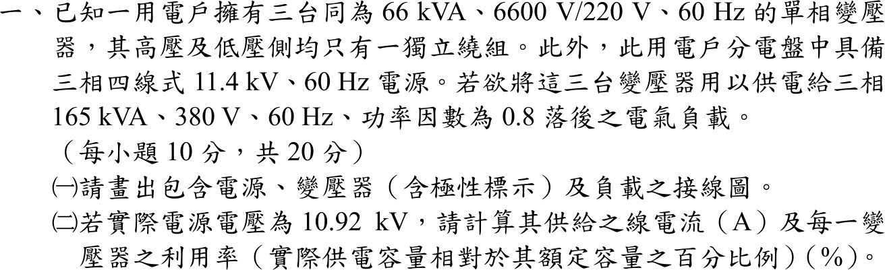
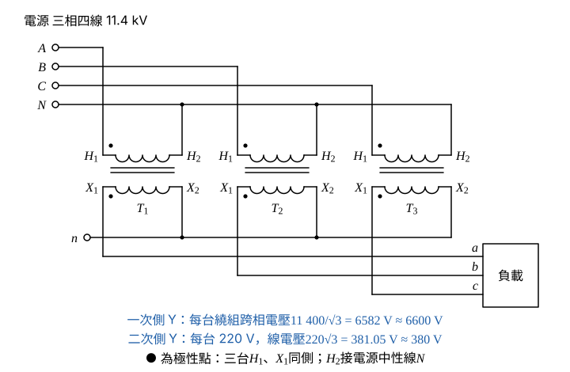

# 107 年電機機械第 1 題｜三相變壓器供電與利用率

## 已知與所求

三台單相 66 kVA、6600/220 V、60 Hz 變壓器（高低壓側各一獨立繞組），電源為三相四線 11.4 kV、60 Hz，負載為三相 165 kVA、380 V、PF 0.8 落後。求（一）含電源、變壓器（標極性）與負載的接線圖；（二）實際電源 10.92 kV 時的供給線電流及每台變壓器利用率。（每小題 10 分）

## 考場標準作答

**解題邏輯**：前提：理想變壓器、三相平衡；負載模型採「仍取用 165 kVA」（題目未指明，另一讀法見條件與疑義）。
1. （一）接線由「繞組額定電壓要對上它實際承受的電壓」決定：電源相電壓 \(11.4\ \mathrm{kV}/\sqrt3\approx6600\ \mathrm V\)，所以一次側接 Y（三台 \(H_2\) 接電源中性線）。
2. 二次每台 220 V，Y 接後線電壓 \(220\sqrt3\approx380\ \mathrm V\)，所以二次側也接 Y；三台極性同向，三相電壓才保持 120° 對稱。
3. （二）三相平衡負載的線電流 \(I_L=S/(\sqrt3V_{LL})\)，以實際電源線電壓 10.92 kV 計。
4. 利用率＝每台實際供電 kVA／額定 kVA，以視在功率計，所以 PF 0.8 不進入計算。

### （一）接線圖（10 分）

**邏輯**：每台繞組要接在與其額定電壓相符的電壓上：一次 6600 V 繞組對應電源相電壓（Y 接），二次 220 V 繞組 Y 接後線電壓才接近 380 V。

電源相電壓（一次側 Y 時每台繞組承受的電壓）：
\[
V_{P\phi}=\frac{V_{P,LL}}{\sqrt3}=\frac{11\,400}{\sqrt3}=6582\ \mathrm V\approx6600\ \mathrm V
\]
二次側 Y 接的線電壓：
\[
V_{S,LL}=\sqrt3\,V_{S\phi}=\sqrt3(220)=381.05\ \mathrm V\approx380\ \mathrm V
\]
若一次接 Δ，每台繞組要承受 11 400 V，超過 6600 V 額定；若二次接 Δ，線電壓只有 220 V，不足 380 V。所以接成 Y–Y。

畫法：

- 電源 \(A\)、\(B\)、\(C\) 三線各接一台的 \(H_1\)，三台 \(H_2\) 共接成中性點並接電源中性線 \(N\)。
- 二次側三台 \(X_1\) 依序引出 \(a\)、\(b\)、\(c\) 接負載，三台 \(X_2\) 共接成中性點 \(n\)。
- 極性點（●）標在每台 \(H_1\) 與 \(X_1\)，三台同側；二次電壓與一次電壓同相位，\(a\)、\(b\)、\(c\) 相序與 \(A\)、\(B\)、\(C\) 相同。

\[
\boxed{\text{一次側 Y（中性點接電源中性線）、二次側 Y，三台極性同向}}
\]

### （二）線電流與利用率（10 分）

**邏輯**：三相平衡功率 \(S=\sqrt3V_{LL}I_L\)，以實際電源線電壓求一次側供給的線電流（Y 接一次側線電流＝每台一次繞組電流）；三台平均分擔負載，利用率＝每台分擔的 kVA／66 kVA。

實際電源線電壓 \(V_{LL}=10.92\ \mathrm{kV}=10\,920\ \mathrm V\)，負載視在功率 \(S_L=165\ \mathrm{kVA}\)：
\[
I_L=\frac{S_L}{\sqrt3V_{LL}}=\frac{165\times10^3}{\sqrt3(10\,920)}
\]
分母：
\[
\sqrt3(10\,920)=18\,914\ \mathrm V
\]
\[
I_L=\frac{165\,000}{18\,914}=8.7237\ \mathrm A
\]
\[
\boxed{I_L=8.72\ \mathrm A}
\]
每台分擔的視在功率：
\[
S_{unit}=\frac{S_L}{3}=\frac{165}{3}=55\ \mathrm{kVA}
\]
利用率：
\[
U=\frac{S_{unit}}{S_{rated}}=\frac{55}{66}=0.8333
\]
\[
\boxed{U=83.33\%}
\]

## 驗算

以二次側反推（Y–Y 變比 \(6600/220=30\)）：二次線電壓 \(10\,920/30=364\ \mathrm V\)，二次線電流 \(165\,000/(\sqrt3\cdot364)=165\,000/630.47=261.71\ \mathrm A\)，折回一次側 \(261.71/30=8.72\ \mathrm A\)，與主解相同；261.71 A 低於每台額定二次電流 \(66\,000/220=300\ \mathrm A\)，8.72 A 低於額定一次電流 \(66\,000/6600=10\ \mathrm A\)。總容量 \(3\times66=198\ \mathrm{kVA}\ge165\ \mathrm{kVA}\)。

## 失分點

- 接成 Δ 或 V–V：Y 一次側相電壓 6582 V 才對應 6600 V 繞組。
- 線電流用單相公式 \(S/V\) 或漏除 \(\sqrt3\)，得 15.11 A。
- 把功因 0.8 乘進視在功率：利用率以 kVA 計，應為 55/66，不是 44/66。

## 條件與疑義

題目沒有說明電壓降到 10.92 kV 時負載是定視在功率還是定阻抗。若負載為額定 165 kVA、380 V 的定阻抗，二次線電壓為 \(10\,920/30=364\ \mathrm V\)，負載實際只吃 \(S=165(364/380)^2=151.40\ \mathrm{kVA}\)，則 \(I_L=151.40\times10^3/(\sqrt3\cdot10\,920)=8.00\ \mathrm A\)，利用率 \(151.40/198=76.46\%\)。另外，「其供給之線電流」也可解讀為二次側供給負載的線電流：定 165 kVA 為 261.71 A，定阻抗為 \(151.40\times10^3/(\sqrt3\cdot364)=240.14\ \mathrm A\)。本解主答案採定 165 kVA 的一次側線電流；各模型答案不同，須依命題口徑擇一。
