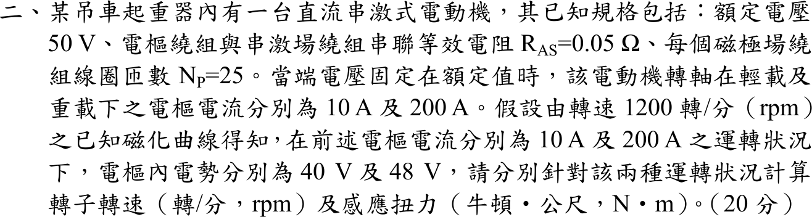
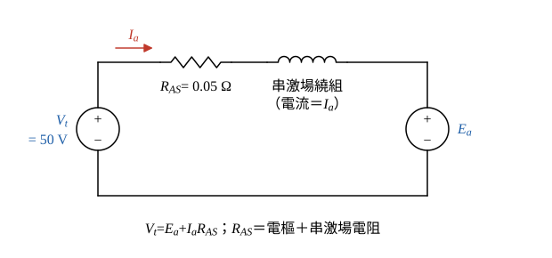

# 107 年電機機械第 2 題｜直流串激電動機工作點

## 已知與所求

串激式直流電動機：額定電壓 \(V_t=50\ \mathrm V\)、電樞加串激場總電阻 \(R_{AS}=0.05\ \Omega\)、每極線圈 \(N_p=25\) 匝。端電壓維持額定，輕載與重載電樞電流分別為 10 A 與 200 A。由 1200 rpm 磁化曲線，這兩個電流下的內電勢（1200 rpm）分別為 \(E_{a0}=40\ \mathrm V\)、\(48\ \mathrm V\)。求兩種狀況的轉速與感應轉矩。（本題 20 分，未分小題）

## 考場標準作答

### 步驟 1：等效電路與兩條關係式

題目問感應轉矩，不另扣題面未給的旋轉損失。題目已直接給出兩電流對應的曲線值，每極匝數 \(N_p=25\) 不需使用。

- 端電壓 \(V_t=50\ \mathrm V\)（上正下負）經 \(R_{AS}=0.05\ \Omega\)（電樞＋串激場電阻）與串激場繞組，接到反電勢 \(E_a\)。
- 參考方向（電動機慣例）：\(I_a\) 由 \(V_t\) 正端流出、流入 \(E_a\) 正端；串激場電流也是 \(I_a\)。

電樞迴路 KVL：
\[
E_a=V_t-I_aR_{AS}
\]
同一 \(I_a\)（同一磁通）下反電勢與轉速成正比：
\[
\frac{E_a}{E_{a0}}=\frac{n}{1200}\quad\Rightarrow\quad n=1200\frac{E_a}{E_{a0}}
\]
感應轉矩（轉換功率 ÷ 機械角速度）：
\[
T_{ind}=\frac{E_aI_a}{\omega_m},\qquad \omega_m=\frac{2\pi n}{60}
\]

### 輕載 \(I_a=10\ \mathrm A\)（曲線值 \(E_{a0}=40\ \mathrm V\)）

電阻壓降與反電勢：
\[
I_aR_{AS}=10(0.05)=0.5\ \mathrm V
\]
\[
E_a=50-0.5=49.50\ \mathrm V
\]
轉速比：
\[
\frac{E_a}{E_{a0}}=\frac{49.50}{40}=1.2375
\]
\[
n=1200\frac{49.50}{40}=1485\ \mathrm{rpm}
\]
\[
\boxed{n=1485\,\mathrm{rpm}}
\]
機械角速度：
\[
\omega_m=\frac{2\pi(1485)}{60}=49.5\pi=155.51\ \mathrm{rad/s}
\]
轉換功率：
\[
E_aI_a=49.50(10)=495.0\ \mathrm W
\]
感應轉矩：
\[
T_{ind}=\frac{495.0}{155.51}=3.1831\ \mathrm{N\cdot m}
\]
\[
\boxed{T_{ind}=3.18\,\mathrm{N\cdot m}}
\]

### 重載 \(I_a=200\ \mathrm A\)（曲線值 \(E_{a0}=48\ \mathrm V\)）

磁通不同，改用 200 A 對應的 48 V 曲線值。

電阻壓降與反電勢：
\[
I_aR_{AS}=200(0.05)=10\ \mathrm V
\]
\[
E_a=50-10=40.00\ \mathrm V
\]
轉速比：
\[
\frac{E_a}{E_{a0}}=\frac{40.00}{48}=\frac56
\]
\[
n=1200\left(\frac56\right)=1000\ \mathrm{rpm}
\]
\[
\boxed{n=1000\,\mathrm{rpm}}
\]
機械角速度：
\[
\omega_m=\frac{2\pi(1000)}{60}=104.72\ \mathrm{rad/s}
\]
轉換功率：
\[
E_aI_a=40.00(200)=8000\ \mathrm W
\]
感應轉矩：
\[
T_{ind}=\frac{8000}{104.72}=76.394\ \mathrm{N\cdot m}
\]
\[
\boxed{T_{ind}=76.39\,\mathrm{N\cdot m}}
\]

## 驗算

轉矩只與磁通和電流有關，可直接用曲線點算：\(T=E_{a0}I_a/\omega_0\)，\(\omega_0=2\pi(1200)/60=125.66\ \mathrm{rad/s}\)。輕載 \(40(10)/125.66=3.18\ \mathrm{N\cdot m}\)，重載 \(48(200)/125.66=76.39\ \mathrm{N\cdot m}\)，與上面相同。

## 失分點

- 把曲線值 40 V、48 V 當成工作點反電勢，漏掉 \(I_aR_{AS}\) 的 0.5 V 與 10 V 壓降。
- 兩工作點用同一曲線值（例如重載也用 40 V），重載會得 \(n=1200(40/40)=1200\ \mathrm{rpm}\)；串激機磁通隨電流變，重載須用 48 V 得 1000 rpm。
- 以 rpm 直接除功率求轉矩，漏 \(2\pi/60\)。
