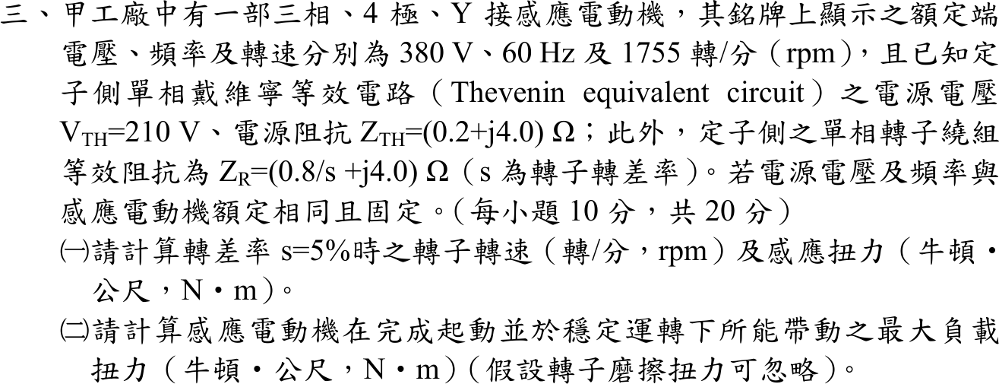
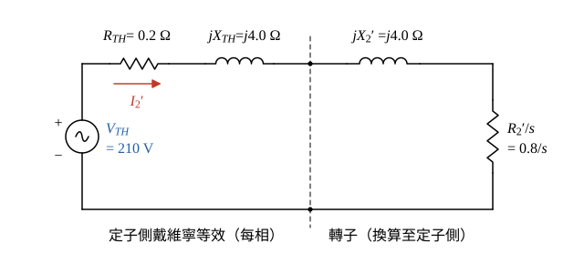
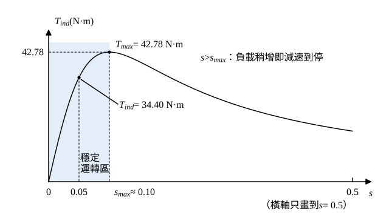

# 107 年電機機械第 3 題｜感應電動機戴維寧等效與轉矩

## 已知與所求

三相、4 極、Y 接感應電動機，額定 380 V、60 Hz、1755 rpm。定子側單相戴維寧等效：\(V_{TH}=210\ \mathrm V\)、\(Z_{TH}=0.2+j4.0\ \Omega\)；轉子單相等效阻抗 \(Z_R=0.8/s+j4.0\ \Omega\)。求（一）\(s=5\%\) 的轉子轉速與感應轉矩；（二）完成起動並穩定運轉時所能帶動的最大負載轉矩（轉子摩擦忽略）。（每小題 10 分）

## 考場標準作答

**解題邏輯**：題目已把定子側化成戴維寧等效（\(V_{TH}\)、\(Z_{TH}\)），所以每相電路只剩一個迴路：\(V_{TH}\) 經 \(Z_{TH}\) 驅動轉子阻抗 \(Z_R=R_2'/s+jX_2'\)（\(R_2'=0.8\ \Omega\)、\(X_2'=4.0\ \Omega\)）。（一）由 \(n_s=120f/P\) 與滑差求轉速；迴路電流 \(I_2'\) 求得後，氣隙功率 \(P_{ag}=3I_2'^2R_2'/s\)，感應轉矩 \(T_{ind}=P_{ag}/\omega_s\)。（二）穩定運轉區是 \(0<s<s_{max}\)，負載轉矩最多只能到崩潰轉矩 \(T_{max}\)，用戴維寧最大轉矩公式求。前提：\(V_{TH}=210\ \mathrm V\) 為每相值（略小於相電壓 \(380/\sqrt3=219.39\ \mathrm V\)，正是激磁支路分壓的結果），三相功率與轉矩乘 3；轉子摩擦忽略，負載轉矩＝感應轉矩；銘牌 1755 rpm 只是額定轉速，本題滑差已給定，不用它。

### 步驟 1：每相戴維寧等效迴路與同步角速度

- 左側 \(V_{TH}=210\ \mathrm V\) 串聯 \(R_{TH}=0.2\ \Omega\)、\(jX_{TH}=j4.0\ \Omega\)，再串聯轉子 \(jX_2'=j4.0\ \Omega\) 與 \(R_2'/s=0.8/s\)。
- 參考方向：\(I_2'\) 由 \(V_{TH}\) 正端流出、繞迴路一圈（圖 1）。

同步轉速（4 極、60 Hz）：
\[
n_s=\frac{120f}{P}=\frac{120(60)}{4}=1800\ \mathrm{rpm}
\]
同步角速度：
\[
\omega_s=\frac{2\pi n_s}{60}=\frac{2\pi(1800)}{60}=60\pi=188.50\ \mathrm{rad/s}
\]

### （一）\(s=5\%\) 的轉速與感應轉矩（10 分）

**邏輯**：轉子轉速 \(n=(1-s)n_s\)；單一迴路以歐姆定律求 \(I_2'\)，再由 \(R_2'/s\) 上的三相功率（氣隙功率）除以同步角速度得感應轉矩。

轉子轉速：
\[
n=(1-s)n_s=(1-0.05)(1800)=0.95(1800)
\]
\[
\boxed{n=1710\ \mathrm{rpm}}
\]
轉子等效電阻：
\[
\frac{R_2'}{s}=\frac{0.8}{0.05}=16\ \Omega
\]
迴路總電阻與總電抗：
\[
R_{TH}+\frac{R_2'}{s}=0.2+16=16.2\ \Omega,\qquad X_{TH}+X_2'=4.0+4.0=8.0\ \Omega
\]
迴路阻抗大小：
\[
|Z|=\sqrt{16.2^2+8.0^2}=\sqrt{262.44+64}=\sqrt{326.44}=18.0677\ \Omega
\]
轉子電流：
\[
I_2'=\frac{V_{TH}}{|Z|}=\frac{210}{18.0677}=11.6230\ \mathrm A
\]
氣隙功率（三相）：
\[
P_{ag}=3I_2'^2\frac{R_2'}{s}=3(11.6230)^2(16)=3(135.0941)(16)=6484.5\ \mathrm W
\]
感應轉矩：
\[
T_{ind}=\frac{P_{ag}}{\omega_s}=\frac{6484.5}{188.50}=34.401\text{ N}\cdot\text{m}
\]
\[
\boxed{T_{ind}=34.40\text{ N}\cdot\text{m}}
\]

### （二）穩定運轉的最大負載轉矩（10 分）

**邏輯**：\(T_{ind}(s)\) 在 \(s<s_{max}\) 段隨 \(s\) 增加而上升，負載稍增時轉子減速、\(s\) 變大、轉矩跟著變大而重新平衡，所以是穩定區；超過 \(s_{max}\) 後轉矩反而下降，電動機會一路減速到停。因此穩定運轉能帶的最大負載轉矩就是崩潰轉矩 \(T_{max}\)（摩擦忽略）。最大轉矩發生在 \(R_2'/s\) 等於其餘迴路阻抗大小時（最大功率轉移）。

最大轉矩滑差：
\[
s_{max}=\frac{R_2'}{\sqrt{R_{TH}^2+(X_{TH}+X_2')^2}}
\]
根號內：
\[
\sqrt{0.2^2+8.0^2}=\sqrt{0.04+64}=\sqrt{64.04}=8.0025\ \Omega
\]
\[
s_{max}=\frac{0.8}{8.0025}=0.09997\approx0.10
\]
最大轉矩公式：
\[
T_{max}=\frac{3V_{TH}^2}{2\omega_s\left[R_{TH}+\sqrt{R_{TH}^2+(X_{TH}+X_2')^2}\right]}
\]
分子：
\[
3V_{TH}^2=3(210)^2=3(44\,100)=132\,300\ \mathrm{V^2}
\]
分母：
\[
2\omega_s\left[R_{TH}+8.0025\right]=2(188.50)(0.2+8.0025)=377.00(8.2025)=3092.34
\]
相除：
\[
T_{max}=\frac{132\,300}{3092.34}=42.783\text{ N}\cdot\text{m}
\]
\[
\boxed{T_{max}=42.78\text{ N}\cdot\text{m}}
\]

## 驗算

直接以迴路在 \(s=s_{max}\) 計算：\(R_2'/s=0.8/0.09997=8.0025\ \Omega\)，\(|Z|^2=8.2025^2+8.0^2=67.2810+64=131.2810\)，\(I_2'^2=44\,100/131.2810=335.92\ \mathrm{A^2}\)，\(T=3(335.92)(8.0025)/188.50=42.78\text{ N}\cdot\text{m}\)，與公式一致。堵轉（\(s=1\)）時 \(I_2'^2=44\,100/(1.0^2+8.0^2)=678.46\ \mathrm{A^2}\)，\(T=3(678.46)(0.8)/188.50=8.64\text{ N}\cdot\text{m}\)，起動轉矩遠小於 \(T_{max}\)，題目說「完成起動」後才可帶到 42.78 N·m。

## 失分點

- 同步轉速用 3600 rpm（忘記 4 極），或轉子轉速誤寫 1755 rpm（那是額定轉速，不是 5% 滑差）。
- 氣隙功率用 \(R_2'=0.8\ \Omega\) 而非 \(R_2'/s=16\ \Omega\)；或轉矩除以轉子角速度（應除 \(\omega_s\)）。
- 最大轉矩漏掉 \(R_{TH}\) 或 \(X_2'\)；\(s_{max}\) 與 \(T_{max}\) 的根號內都要含 \(X_{TH}+X_2'=8.0\ \Omega\)。
