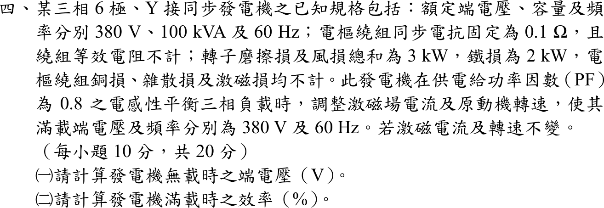
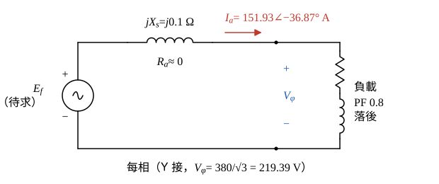
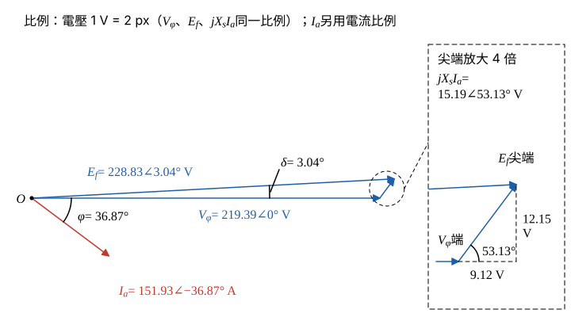

# 107 年電機機械第 4 題｜同步發電機無載電壓與滿載效率

## 已知與所求

三相 6 極 Y 接同步發電機：380 V、100 kVA、60 Hz，\(X_s=0.1\ \Omega\)，電阻不計；磨擦與風損合計 3 kW，鐵損 2 kW，電樞銅損、雜散損及激磁損均不計。供 PF 0.8 落後平衡負載且滿載端電壓 380 V、60 Hz，之後激磁電流與轉速維持不變。求（一）無載端電壓；（二）滿載效率。（每小題 10 分）

## 考場標準作答

### 步驟 1：每相等效電路與滿載每相量

- Y 接，每相等效電路：內電勢 \(\underline E_f\) 串聯 \(jX_s=j0.1\ \Omega\)（\(R_a\) 不計）到端點，端點接 PF 0.8 落後負載。
- 參考方向：\(\underline I_a\) 由發電機流向負載；以 \(\underline V_\phi\) 為相位參考 \(0^\circ\)。

每相端電壓（Y 接，相電壓＝線電壓／\(\sqrt3\)）：
\[
V_\phi=\frac{V_L}{\sqrt3}=\frac{380}{\sqrt3}=219.39\ \mathrm V
\]
滿載電樞電流（Y 接，相電流＝線電流）：
\[
I_a=\frac{S}{\sqrt3\,V_L}=\frac{100\ \mathrm{kVA}}{\sqrt3\times380\ \mathrm V}=151.93\ \mathrm A
\]
PF 0.8 落後，電流落後電壓 \(\varphi=\cos^{-1}0.8=36.87^\circ\)，\(\sin\varphi=0.6\)：
\[
\underline I_a=151.93\angle-36.87^\circ\ \mathrm A
\]

### （一）無載端電壓（10 分）

\(E_f\) 只由激磁電流與轉速決定，兩者不變則 \(|E_f|\) 不變；無載時 \(I_a=0\)，\(jX_sI_a\) 壓降消失，每相端電壓＝\(|E_f|\)。

對圖 1 迴路寫 KVL：
\[
\underline E_f=\underline V_\phi+jX_s\underline I_a
\]
同步電抗壓降（乘 \(j\) 使相角加 \(90^\circ\)：\(-36.87^\circ+90^\circ=53.13^\circ\)）：
\[
jX_s\underline I_a=(0.1\angle90^\circ)(151.93\angle-36.87^\circ)=15.19\angle53.13^\circ\ \mathrm V
\]
化成直角座標（\(\cos53.13^\circ=0.6\)、\(\sin53.13^\circ=0.8\)）：
\[
15.19\angle53.13^\circ=15.19(0.6)+j15.19(0.8)=9.12+j12.15\ \mathrm V
\]
與 \(\underline V_\phi=219.39\angle0^\circ\) 相加：
\[
\underline E_f=(219.39+9.12)+j12.15=228.51+j12.15\ \mathrm V
\]
取大小與功率角：
\[
|E_f|=\sqrt{228.51^2+12.15^2}=228.83\ \mathrm V,\qquad \delta=\tan^{-1}\frac{12.15}{228.51}=3.04^\circ
\]

相量圖畫法（圖 2，三個電壓相量用同一比例）：

- \(\underline V_\phi\) 沿水平軸畫 219.39 V。
- \(\underline I_a\) 自原點畫在水平軸下方 \(36.87^\circ\)（落後）。
- 自 \(\underline V_\phi\) 尖端畫 \(jX_s\underline I_a\)，方向比 \(\underline I_a\) 超前 \(90^\circ\)，即 \(+53.13^\circ\)，長 15.19 V（水平分量 \(X_sI_a\sin\varphi=9.12\) V、垂直分量 \(X_sI_a\cos\varphi=12.15\) V）。
- 原點連到 \(jX_s\underline I_a\) 尖端即 \(\underline E_f=228.83\angle3.04^\circ\ \mathrm V\)。

無載每相端電壓＝\(|E_f|=228.83\ \mathrm V\)；題目問端電壓（線電壓），Y 接乘 \(\sqrt3\)：
\[
V_{L,0}=\sqrt3\,|E_f|=\sqrt3(228.83)
\]
\[
\boxed{V_{L,0}=396.35\,\mathrm V}
\]

### （二）滿載效率（10 分）

題目指定只計磨擦風損 3 kW 與鐵損 2 kW（電樞銅損、雜散損、激磁損皆不計），故機械輸入＝電輸出＋5 kW。

滿載電輸出（額定容量乘功率因數）：
\[
P_{out}=S\cos\varphi=100(0.8)=80\ \mathrm{kW}
\]
計入的損失：
\[
P_{loss}=P_{f\&w}+P_{core}=3+2=5\ \mathrm{kW}
\]
機械輸入：
\[
P_{in}=P_{out}+P_{loss}=80+5=85\ \mathrm{kW}
\]
\[
\boxed{\eta=\frac{P_{out}}{P_{in}}=\frac{80}{85}=94.12\%}
\]

## 驗算

純量公式：\(E_f=\sqrt{(V_\phi+X_sI_a\sin\varphi)^2+(X_sI_a\cos\varphi)^2}=\sqrt{(219.39+9.12)^2+12.15^2}=228.83\ \mathrm V\)，與相量相加一致。功率角檢查：\(3V_\phi E_f\sin\delta/X_s=3(219.39)(228.83)\sin3.04^\circ/0.1=80.00\ \mathrm{kW}\)，與（二）的輸出功率相同。

## 失分點

- 把 PF 0.8 落後的 \(jX_sI_a\) 當成與 \(V_\phi\) 同相或反向，只做代數相加：\(219.39+15.19=234.59\ \mathrm V\)，無載電壓變成 406.32 V。
- 計入電樞銅損：題目已明示電樞電阻與銅損皆不計，效率分母只加 3 kW＋2 kW。
- 無載電壓忘記乘回 \(\sqrt3\)，答成 228.83 V（相電壓）。
