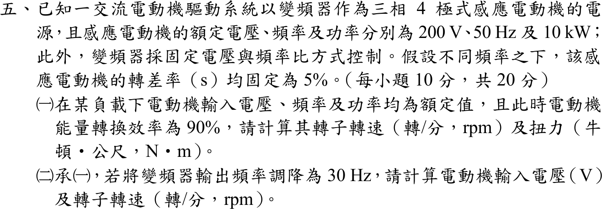

# 107 年電機機械第 5 題｜感應電動機 V/f 控制

## 已知與所求

三相 4 極感應電動機，額定 200 V、50 Hz、10 kW，由變頻器以固定 V/f 供電，各頻率下轉差率固定 \(s=5\%\)。（一）輸入電壓、頻率、功率均為額定且能量轉換效率 90% 時，求轉子轉速與扭力；（二）承（一），頻率調為 30 Hz 時，求輸入電壓與轉子轉速。（每小題 10 分）

## 考場標準作答

**解題邏輯**：轉子轉速由同步轉速與轉差率決定：\(n=(1-s)n_s\)，\(n_s=120f/P\)。扭力＝機械輸出功率／轉子機械角速度，機械輸出＝效率 × 輸入功率。固定 V/f 時電壓與頻率成正比（一次方），再用新頻率的同步轉速與同一轉差率求轉速。前提：題目「功率 10 kW」為輸入功率（題目說輸入電壓、頻率及功率均為額定值）；效率 90% 已涵蓋全部損失，\(0.9\times10\ \mathrm{kW}\) 即軸輸出，扭力指軸上扭力。

### （一）額定電壓、頻率時的轉速與扭力（10 分）

**邏輯**：先由 \(f=50\ \mathrm{Hz}\)、4 極求同步轉速，再乘 \((1-s)\) 得轉子轉速；扭力用 \(T=P_{out}/\omega_m\)，\(\omega_m\) 是轉子（不是同步）機械角速度。

同步轉速：
\[
n_s=\frac{120f}{P}=\frac{120(50)}{4}=1500\ \mathrm{rpm}
\]
轉子轉速：
\[
n=(1-s)n_s=(1-0.05)(1500)
\]
\[
\boxed{n=1425\,\mathrm{rpm}}
\]
機械輸出功率（效率 × 輸入）：
\[
P_{out}=\eta P_{in}=0.90(10)=9\ \mathrm{kW}
\]
轉子機械角速度：
\[
\omega_m=\frac{2\pi n}{60}=\frac{2\pi(1425)}{60}=149.23\ \mathrm{rad/s}
\]
扭力：
\[
T=\frac{P_{out}}{\omega_m}=\frac{9000}{149.23}
\]
\[
\boxed{T=60.31\ \mathrm{N\cdot m}}
\]

### （二）30 Hz 時的電壓與轉速（10 分）

**邏輯**：固定 V/f 使氣隙磁通維持定值，電壓與頻率同比例改變；轉差率仍為 5%，只要換成 30 Hz 的同步轉速。

V/f 比值（額定點）：
\[
\frac{V}{f}=\frac{200}{50}=4\ \mathrm{V/Hz}
\]
30 Hz 的輸入電壓：
\[
V_2=\frac{V}{f}\,f_2=4(30)
\]
\[
\boxed{V_2=120\,\mathrm V}
\]
30 Hz 的同步轉速：
\[
n_{s2}=\frac{120f_2}{P}=\frac{120(30)}{4}=900\ \mathrm{rpm}
\]
轉子轉速：
\[
n_2=(1-s)n_{s2}=(1-0.05)(900)
\]
\[
\boxed{n_2=855\,\mathrm{rpm}}
\]

## 驗算

氣隙功率法（在「效率已含全部損失、無另計旋轉損」的前提下 \(P_{conv}=P_{out}\)）：\(P_{ag}=P_{out}/(1-s)=9000/0.95=9473.68\ \mathrm W\)，\(\omega_s=2\pi(1500)/60=157.08\ \mathrm{rad/s}\)，\(T=P_{ag}/\omega_s=9473.68/157.08=60.31\ \mathrm{N\cdot m}\)，與軸功率法相同。V/f 檢查：\(200/50=120/30=4\ \mathrm{V/Hz}\)；轉差率 \(1-855/900=0.05\)。

## 失分點

- 把 10 kW 當軸功率（漏乘效率 90%）得 67.01 N·m；或用同步轉速 1500 rpm 當轉子轉速得 57.30 N·m。
- 以 \(V\propto f^2\) 算 \(V_2\)；固定 V/f 是一次方比例。
- 30 Hz 時改變轉差率：題目明示各頻率 \(s\) 固定為 5%。
