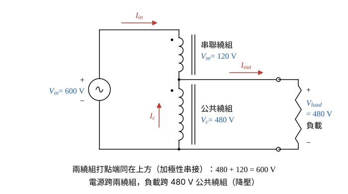

# 108 年電機機械第 1 題｜480/120 V 降壓自耦變壓器

## 已知與所求

單相 480/120 V、5 kVA 雙繞組變壓器改接為自耦變壓器，一次側接 600 V 電源，二次側供 480 V 負載。求（一）自耦變壓器 kVA；（二）接線圖；（三）優點；（四）缺點。（每小題 5 分）

## 考場標準作答

### 步驟 1：接線判定與各繞組額定電流

設為理想自耦關係（忽略激磁電流與漏阻抗壓降），只用銘牌資料。由 \(600=480+120\)，一次側接 $600\,\mathrm{V}$ 電源跨在兩繞組兩端（加極性相加），二次側 480 V 負載只跨公共繞組（降壓）。

- 480 V 與 120 V 只有相加才能得到 600 V，且負載 480 V 必須直接取自 480 V 繞組，所以 480 V 繞組為公共繞組（\(V_c=480\ \mathrm V\)）、120 V 繞組為串聯繞組（\(V_{se}=120\ \mathrm V\)）。
- 120 V 繞組的非打點端接 480 V 繞組的打點端（兩打點端同在上方，電壓相加）；電源跨兩繞組，負載跨公共繞組。
- 參考方向：\(I_{in}\) 由電源經串聯繞組流向分接點，\(I_{out}\) 由分接點流向負載，\(I_c\) 在公共繞組中由下往上流向分接點（圖 1）。

各繞組額定電流：
\[
I_{480}=\frac{S_{2w}}{V_{480}}=\frac{5000}{480}=10.42\ \mathrm A,\qquad I_{120}=\frac{S_{2w}}{V_{120}}=\frac{5000}{120}=41.67\ \mathrm A
\]

### （一）自耦變壓器 kVA（5 分）

輸入電流 \(I_{in}\) 全部流過 120 V 串聯繞組，上限為 \(I_{120}\)；再由分接點 KCL 確認公共繞組電流不超過 \(I_{480}\)。

輸入電流上限：
\[
I_{in}=I_{120}=\frac{5000}{120}\ \mathrm A
\]
自耦容量（保留分數，避免 41.67 的捨入誤差）：
\[
S_{auto}=V_{in}I_{in}=600\left(\frac{5000}{120}\right)=5(5000)=25\,000\ \mathrm{VA}
\]
負載電流（輸出功率等於輸入功率）：
\[
I_{out}=\frac{S_{auto}}{V_{load}}=\frac{25\,000}{480}=52.08\ \mathrm A
\]
分接點 KCL（\(I_{out}=I_{in}+I_c\)），把 \(I_{in}\) 化成同分母 \(20\,000/480\)：
\[
I_c=I_{out}-I_{in}=\frac{25\,000-20\,000}{480}=\frac{5000}{480}=10.42\ \mathrm A=I_{480}
\]
兩繞組同時達額定，兩側功率相同：
\[
S_{auto}=600 I_{in}=480 I_{out}=25.00\,\mathrm{kVA}
\]
\[
\boxed{S_{auto}=25.00\ \mathrm{kVA}}
\]
其中經磁路感應的容量（串聯繞組電壓 × 其電流）：
\[
S_{ind}=V_{se}I_{in}=120(41.67)=5.00\ \mathrm{kVA}
\]
直接傳導的容量：
\[
S_{cond}=V_{load}I_{in}=480(41.67)=20.00\,\mathrm{kVA}
\]

### （二）接線圖（5 分）

接線圖即步驟 1 的圖 1：兩繞組串成同一迴路且極性相加，電源與負載共用公共繞組。

畫法：

- 先畫 480 V 公共繞組，打點端在上。
- 120 V 串聯繞組的非打點端接到公共繞組的打點端上方，打點端也在上，兩繞組電壓相加：\(480+120=600\ \mathrm V\)。
- 600 V 電源接在串聯繞組上端與公共繞組下端；480 V 負載接在分接點與公共繞組下端。

\[
\boxed{\text{120 V 串聯繞組與 480 V 公共繞組同極性串聯；電源跨兩繞組，負載跨 480 V 繞組（圖 1）}}
\]

### （三）優點（5 分）

只有串聯繞組那部分功率經磁路感應轉換，其餘直接導通，故同一鐵心與銅線可傳送較大容量。

感應部分所占比例：
\[
\frac{S_{ind}}{S_{auto}}=\frac{5.00}{25.00}=20\%
\]
容量放大倍數：
\[
\frac{S_{auto}}{S_{2w}}=\frac{25.00}{5}=5
\]
\[
\boxed{\text{同樣鐵心與銅線可傳送 5 倍容量；體積、重量、成本小，損失小而效率高，電壓調整率較佳}}
\]
因為只有 20% 功率經磁路感應轉換，其餘 80% 直接導通，損失（銅損、鐵損）只對應 5 kVA 的繞組。

### （四）缺點（5 分）

缺點來自一、二次側共用同一繞組（有電氣連接）：沒有隔離；兩側之間的漏阻抗只剩串聯繞組部分，以自耦容量為基準的標么阻抗變小，短路電流變大。

以自耦容量為基準，標么漏阻抗縮小的比例：
\[
\frac{Z_{pu,auto}}{Z_{pu,2w}}=\frac{V_{in}-V_{load}}{V_{in}}=\frac{600-480}{600}=\frac{1}{5}
\]
\[
\boxed{\text{一、二次側有電氣連接而無隔離；標么阻抗只剩 1/5，短路電流大；變比愈大優勢愈小}}
\]
高壓側的過電壓或接地故障可直接傳到 480 V 負載側；若公共繞組斷線，負載經串聯繞組直接承受接近 600 V 的電源電壓。

## 驗算

容量比公式：\(S_{auto}=S_{2w}\dfrac{V_{in}}{V_{in}-V_{load}}=5\cdot\dfrac{600}{120}=25.00\ \mathrm{kVA}\)；感應＋傳導：\(5.00+20.00=25.00\ \mathrm{kVA}\)。公共繞組電壓 480 V、串聯繞組電壓 \(600-480=120\ \mathrm V\)，與原繞組額定電壓一致，電流 41.67 A 與 10.42 A 均恰為額定值，沒有繞組過載。

## 失分點

- 把 480 V 與 120 V 做成相減（480−120）或把負載接在 600 V 端：此題 600 V 是 480＋120 的相加串聯。
- 直接用 5 kVA 當自耦容量，漏掉傳導部分；或用 480 V 繞組電流 10.42 A 乘 600 V，得 6.25 kVA（受限繞組是 120 V 串聯繞組）。
- 優缺點只寫「效率高」「不安全」而沒有指出本題 5 倍容量與無隔離、短路電流大的具體理由。
