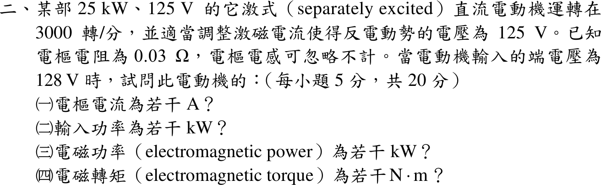
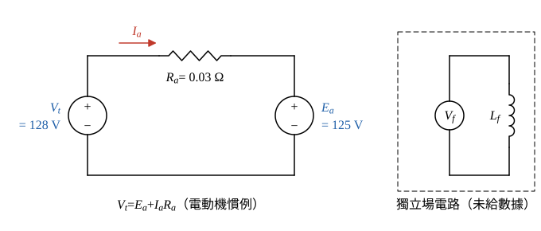

# 108 年電機機械第 2 題｜他激直流電動機功率平衡

## 已知與所求

他激式直流電動機 25 kW、125 V，運轉在 3000 rpm 且反電勢 \(E_a=125\ \mathrm V\)；\(R_a=0.03\ \Omega\)，電樞電感忽略。端電壓 \(V_t=128\ \mathrm V\) 時求（一）電樞電流；（二）輸入功率；（三）電磁功率；（四）電磁轉矩。（每小題 5 分）

## 考場標準作答

**解題邏輯**：他激電動機的電樞迴路就是端電壓 \(V_t\) 經 \(R_a\) 供給反電勢 \(E_a\)（電感忽略，穩態直流）。（一）用電樞 KVL 求 \(I_a\)；（二）輸入功率＝端電壓×電樞電流；（三）電磁功率＝反電勢×電樞電流（電能在 \(E_a\) 處轉成機械能）；（四）電磁轉矩＝電磁功率÷機械角速度。前提：題目說運轉在 3000 rpm 且反電勢 125 V，端電壓 128 V 時即以此工作點計算；銘牌 25 kW、125 V 只是額定值，不參與計算；激磁由獨立電源供給、題未給其數據，輸入功率只計電樞端。

### 步驟 1：電樞等效電路

- 左側端電壓 \(V_t=128\ \mathrm V\)（上正下負），經 \(R_a=0.03\ \Omega\) 接反電勢 \(E_a=125\ \mathrm V\)（上正下負）。
- 參考方向（電動機慣例）：\(I_a\) 由 \(V_t\) 正端流出、經 \(R_a\) 流入 \(E_a\) 正端。
- 場繞組由另一電源激磁，與電樞迴路無電氣連接。

### （一）電樞電流（5 分）

**邏輯**：沿圖 1 電樞迴路寫 KVL，\(V_t=E_a+I_aR_a\)；端電壓比反電勢高的部分全落在 \(R_a\) 上。

\(R_a\) 上的壓降：
\[
V_t-E_a=128-125=3\ \mathrm V
\]
電樞電流：
\[
I_a=\frac{V_t-E_a}{R_a}=\frac{128-125}{0.03}=100\ \mathrm A
\]
\[
\boxed{I_a=100\ \mathrm A}
\]

### （二）輸入功率（5 分）

**邏輯**：電源送進電樞端的功率＝端電壓×流入電流。

\[
P_{in}=V_tI_a
\]
\[
P_{in}=128(100)=12\,800\ \mathrm W
\]
\[
\boxed{P_{in}=12.80\ \mathrm{kW}}
\]

### （三）電磁功率（5 分）

**邏輯**：輸入功率中 \(I_a^2R_a\) 在電阻上變熱，其餘在反電勢處轉成機械功率，即 \(E_aI_a\)。

\[
P_{em}=E_aI_a
\]
代入（V×A＝W，再以 kW 表示）：
\[
P_{em}=E_aI_a=125(100)=12.50\ \mathrm{kW}
\]
\[
\boxed{P_{em}=12.50\ \mathrm{kW}}
\]

### （四）電磁轉矩（5 分）

**邏輯**：電磁功率＝電磁轉矩×機械角速度，\(T_{em}=P_{em}/\omega_m\)，轉速須先換成 rad/s。

機械角速度：
\[
\omega_m=\frac{2\pi n}{60}=\frac{2\pi(3000)}{60}=100\pi=314.16\ \mathrm{rad/s}
\]
電磁轉矩：
\[
T_{em}=\frac{P_{em}}{\omega_m}=\frac{12\,500}{314.16}=39.789\ \mathrm{N\cdot m}
\]
\[
\boxed{T_{em}=39.79\,\mathrm{N\cdot m}}
\]

## 驗算

功率平衡：電樞銅損 \(I_a^2R_a=100^2(0.03)=300\ \mathrm W\)，\(P_{in}-I_a^2R_a=12\,800-300=12\,500\ \mathrm W=P_{em}\)。轉矩常數法：\(K\phi=E_a/\omega_m=125/314.16=0.39789\ \mathrm{V\cdot s/rad}\)，\(T_{em}=K\phi I_a=0.39789(100)=39.79\ \mathrm{N\cdot m}\)。

## 失分點

- 套用發電機式 \(E_a=V_t+I_aR_a\)，得 \(I_a=-100\ \mathrm A\) 或方向錯。
- 以 3000 rpm 直接代入 \(T=P/n\)，漏 \(2\pi/60\)。
- 把 12.80 kW 當電磁功率，忘記扣電樞銅損 0.30 kW。
