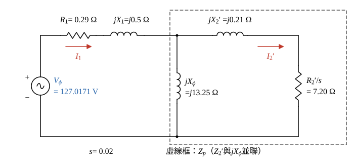

# 108 年電機機械第 3 題｜感應電動機工作點

## 已知與所求

三相 Y 接、線電壓 220 V、60 Hz、6 極感應電動機，每相（折算至定子側）\(R_1=0.29\ \Omega\)、\(R_2=0.144\ \Omega\)、\(X_1=0.5\ \Omega\)、\(X_2=0.21\ \Omega\)、\(X_\phi=13.25\ \Omega\)；摩擦、風損與鐵損合計 403 W 且與負載無關。\(s=0.02\) 時求（一）轉子機械轉速；（二）氣隙功率；（三）輸出機械轉矩；（四）效率。

## 考場標準作答

**解題邏輯**：題目要的是 \(s=0.02\) 這個工作點的轉速、氣隙功率、軸轉矩與效率。轉速只由同步轉速與滑差決定；其餘三問都要先由每相「精確」等效電路（\(R_1+jX_1\) 串聯後，激磁支路 \(jX_\phi\) 與轉子支路 \(R_2'/s+jX_2'\) 並聯）求出定子電流 \(I_1\) 與轉子電流 \(I_2'\)（步驟 1、2），再沿功率流 \(P_{in}\to P_{ag}\to P_{conv}\to P_{out}\) 逐段扣損失。前提：Y 接，每相電壓＝線電壓／\(\sqrt3\)；題給 \(R_2\)、\(X_2\) 已換算至定子側，下文記為 \(R_2'\)、\(X_2'\)；電路中沒有鐵損電阻，題給 403 W（摩擦＋風損＋鐵損，與負載無關）整筆從轉換功率中扣除。

### 步驟 1：每相等效電路與輸入阻抗

- 每相電源 \(\underline V_\phi\) 取為相位參考 \(0^\circ\)；\(\underline I_1\) 由電源流入定子，\(\underline I_2'\) 流經轉子支路（參考方向如圖 1）。
- 定子 \(R_1+jX_1\) 串聯；其後激磁支路 \(jX_\phi\) 與轉子支路 \(\underline Z_2'=R_2'/s+jX_2'\) 並聯，合成 \(\underline Z_p\)。

每相電壓：
\[
V_\phi=\frac{V_L}{\sqrt3}=\frac{220}{\sqrt3}=127.0171\ \mathrm V
\]
轉子支路（\(R_2'/s=0.144/0.02=7.20\ \Omega\)）：
\[
\underline Z_2'=\frac{R_2'}{s}+jX_2'=7.20+j0.21\ \Omega
\]

並聯公式：
\[
\underline Z_p=\frac{\underline Z_2'(jX_\phi)}{\underline Z_2'+jX_\phi}
\]
分子（\(j^2=-1\)）：
\[
(7.20+j0.21)(j13.25)=j95.40+j^2(2.7825)=-2.7825+j95.40\ \Omega^2
\]
分母：
\[
\underline Z_2'+jX_\phi=7.20+j(0.21+13.25)=7.20+j13.46\ \Omega
\]
分母大小平方（乘共軛用）：
\[
7.20^2+13.46^2=51.84+181.1716=233.0116\ \Omega^2
\]
分子乘分母共軛 \((7.20-j13.46)\)，實部：
\[
-2.7825(7.20)+95.40(13.46)=-20.034+1284.084=1264.05
\]
虛部：
\[
2.7825(13.46)+95.40(7.20)=37.45245+686.88=724.33245
\]
相除：
\[
\underline Z_p=\frac{1264.05}{233.0116}+j\frac{724.33245}{233.0116}=5.4248+j3.1086\ \Omega
\]
加上定子阻抗：
\[
\underline Z_{in}=(0.29+5.4248)+j(0.5+3.1086)=5.7148+j3.6086\ \Omega
\]
大小：
\[
|Z_{in}|=\sqrt{5.7148^2+3.6086^2}=\sqrt{32.6589+13.0220}=\sqrt{45.6809}=6.7588\ \Omega
\]
相角：
\[
\theta_{in}=\tan^{-1}\frac{3.6086}{5.7148}=32.27^\circ
\]

### 步驟 2：定子電流與轉子電流

定子電流（歐姆定律）：
\[
\underline I_1=\frac{\underline V_\phi}{\underline Z_{in}}=\frac{127.0171\angle0^\circ}{6.7588\angle32.27^\circ}
\]
大小與相角：
\[
|I_1|=\frac{127.0171}{6.7588}=18.7928\ \mathrm A,\qquad \angle I_1=0^\circ-32.27^\circ=-32.27^\circ
\]
轉子電流用分流（\(\underline I_1\) 在 \(jX_\phi\) 與 \(\underline Z_2'\) 間分配，流入 \(\underline Z_2'\) 的比例是對面支路阻抗／兩支路和）：
\[
\underline I_2'=\underline I_1\frac{jX_\phi}{\underline Z_2'+jX_\phi}
\]
取大小，先求分母大小：
\[
|\underline Z_2'+jX_\phi|=\sqrt{233.0116}=15.2647\ \Omega
\]
分流比：
\[
\frac{X_\phi}{|\underline Z_2'+jX_\phi|}=\frac{13.25}{15.2647}=0.86802
\]
\[
|I_2'|=18.7928(0.86802)=16.3125\ \mathrm A
\]

### （一）轉子機械轉速（5 分）

**邏輯**：轉子轉速比同步轉速慢 \(s\) 的比例，\(n_m=(1-s)n_s\)，\(n_s=120f/P\)。

同步轉速：
\[
n_s=\frac{120f}{P}=\frac{120(60)}{6}=1200\ \mathrm{rpm}
\]
轉子轉速：
\[
n_m=(1-s)n_s=(1-0.02)(1200)=0.98(1200)
\]
\[
\boxed{n_m=1176\ \mathrm{rpm}}
\]

### （二）氣隙功率（5 分）

**邏輯**：氣隙功率是跨過氣隙送進轉子的功率，在等效電路中等於三相轉子電流流過 \(R_2'/s\) 所吸收的功率。

公式：
\[
P_{ag}=3|I_2'|^2\frac{R_2'}{s}
\]
轉子電流平方：
\[
|I_2'|^2=16.3125^2=266.0977\ \mathrm{A^2}
\]
代入：
\[
P_{ag}=3(266.0977)(7.20)=5747.7\ \mathrm W
\]
\[
\boxed{P_{ag}=5.75\ \mathrm{kW}}
\]

### （三）輸出機械轉矩（5 分）

**邏輯**：轉換成機械的功率 \(P_{conv}=(1-s)P_{ag}\)，扣掉與負載無關的 403 W 才是軸輸出；軸轉矩＝\(P_{out}/\omega_m\)，\(\omega_m\) 用轉子實際轉速 1176 rpm。

轉換功率：
\[
P_{conv}=(1-s)P_{ag}=0.98(5747.7)=5632.7\ \mathrm W
\]
軸輸出功率：
\[
P_{out}=P_{conv}-P_{rot}=5632.7-403=5229.7\ \mathrm W
\]
轉子角速度：
\[
\omega_m=\frac{2\pi n_m}{60}=\frac{2\pi(1176)}{60}=123.15\ \mathrm{rad/s}
\]
軸轉矩：
\[
T_{out}=\frac{P_{out}}{\omega_m}=\frac{5229.7}{123.15}=42.466\ \mathrm{N\cdot m}
\]
\[
\boxed{T_{out}=42.47\,\mathrm{N\cdot m}}
\]

### （四）效率（5 分）

**邏輯**：效率＝軸輸出／電輸入。電路中沒有鐵損電阻，輸入功率就是三相電流流過輸入阻抗實部 \(R_{in}=\mathrm{Re}(\underline Z_{in})\) 的功率；鐵損已含在 403 W 裡從 \(P_{conv}\) 扣掉，不可再扣一次。

公式：
\[
P_{in}=3|I_1|^2R_{in}
\]
電流平方：
\[
|I_1|^2=18.7928^2=353.1693\ \mathrm{A^2}
\]
代入：
\[
P_{in}=3(353.1693)(5.7148)=6054.9\ \mathrm W
\]
效率：
\[
\eta=\frac{P_{out}}{P_{in}}=\frac{5229.7}{6054.9}=0.86371
\]
\[
\boxed{\eta=86.37\%}
\]

## 驗算

損失逐項相加回到輸入：定子銅損 \(3(353.1693)(0.29)=307.26\ \mathrm W\)，轉子銅損 \(3(266.0977)(0.144)=114.95\ \mathrm W\)（也等於 \(sP_{ag}=0.02(5747.7)=114.95\ \mathrm W\)），\(5229.7+307.26+114.95+403=6054.91\ \mathrm W\approx P_{in}=6054.9\ \mathrm W\)。戴維寧法（\(\underline V_{th}=\underline V_\phi\,jX_\phi/[R_1+j(X_1+X_\phi)]\)、\(\underline Z_{th}=(R_1+jX_1)\parallel jX_\phi\)，\(I_2'=V_{th}/|\underline Z_{th}+\underline Z_2'|\)）同樣得 \(P_{ag}=5747.7\ \mathrm W\)。

## 失分點

- Y 接把線電壓 220 V 當相電壓，電流與功率都會錯。
- 氣隙功率用 \(R_2'=0.144\ \Omega\) 而非 \(R_2'/s=7.20\ \Omega\)；或把 \(P_{ag}\) 當軸輸出，未乘 \(1-s\) 再扣 403 W。
- 轉矩用同步角速度 \(\omega_s=125.66\ \mathrm{rad/s}\)：\(5229.7/125.66=41.62\ \mathrm{N\cdot m}\)；軸轉矩須用 1176 rpm 的 \(\omega_m\)。
