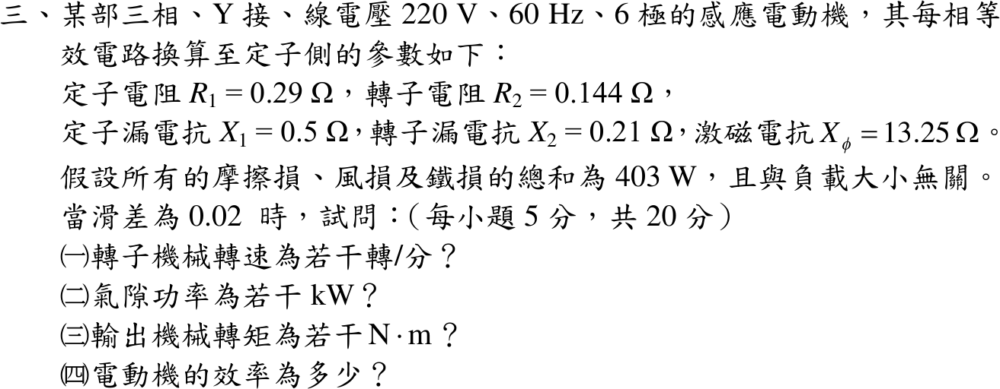

# 108 年電機機械第 3 題｜感應電動機工作點

## 已知與所求

三相 Y 接、線電壓 220 V、60 Hz、6 極感應電動機，每相（折算至定子側）\(R_1=0.29\ \Omega\)、\(R_2=0.144\ \Omega\)、\(X_1=0.5\ \Omega\)、\(X_2=0.21\ \Omega\)、\(X_\phi=13.25\ \Omega\)；摩擦、風損與鐵損合計 403 W 且與負載無關。\(s=0.02\) 時求（一）轉子機械轉速；（二）氣隙功率；（三）輸出機械轉矩；（四）效率。

## 考場標準作答

### （一）轉速

觀念：轉子機械轉速由同步轉速與滑差決定，\(n_m=(1-s)n_s\)，\(n_s=120f/p\)。

\[
n_s=\frac{120(60)}{6}=1200\ \mathrm{rpm},\qquad
\boxed{n_m=(1-0.02)(1200)=1176\ \mathrm{rpm}}
\]

### （二）氣隙功率

觀念：用單相等效電路（\(R_1+jX_1\) 串聯，其後轉子支路 \(R_2/s+jX_2\) 與激磁支路 \(jX_\phi\) 並聯），先求輸入電流，再分流得轉子電流；氣隙功率就是轉子電阻 \(R_2/s\) 上吸收的三相功率。

\[
V_\phi=\frac{220}{\sqrt3}=127.02\ \mathrm V
\]
轉子支路與激磁支路並聯（激磁支路在 \(R_1+jX_1\) 之後，精確等效電路）：
\[
Z_2=\frac{0.144}{0.02}+j0.21=7.20+j0.21\ \Omega,\qquad
Z_p=Z_2\parallel jX_\phi=\frac{Z_2(j13.25)}{Z_2+j13.25}=5.42+j3.11\ \Omega
\]
\[
Z_{in}=R_1+jX_1+Z_p=0.29+j0.5+Z_p=5.71+j3.61\ \Omega,\qquad |Z_{in}|=6.76\ \Omega
\]
\[
|I_1|=\frac{V_\phi}{|Z_{in}|}=\frac{127.02}{6.76}=18.79\ \mathrm A
\]
電流分流到轉子支路：
\[
|I_2'|=|I_1|\frac{X_\phi}{|Z_2+jX_\phi|}=18.79\cdot\frac{13.25}{|7.20+j13.46|}=16.31\ \mathrm A
\]
\[
\boxed{P_{ag}=3|I_2'|^2\frac{R_2'}s=5747.72\,\mathrm W=5.75\ \mathrm{kW}}
\]

### （三）輸出機械轉矩

觀念：轉換的機械功率為 \((1-s)P_{ag}\)，再扣掉與負載無關的 403 W 旋轉與鐵損才是軸輸出；轉矩 \(=P_{out}/\omega_m\)，要用轉子實際角速度。

\[
P_{dev}=(1-s)P_{ag}=0.98(5747.72)=5632.76\ \mathrm W
\]
\[
P_{out}=P_{dev}-403=5632.76-403=5229.76\ \mathrm W
\]
\[
\omega_m=\frac{2\pi(1176)}{60}=123.15\ \mathrm{rad/s}
\]
\[
\boxed{T_{out}=\frac{P_{out}}{\omega_m}=\frac{5229.76}{123.15}=42.47\,\mathrm{N\cdot m}}
\]

### （四）效率

觀念：效率 \(=P_{out}/P_{in}\)。403 W（含鐵損）已自 \(P_{dev}\) 扣除，故 \(P_{in}\) 直接取自電路（激磁支路只有 \(X_\phi\)，不含鐵損電阻）。

\[
P_{in}=3\,\mathrm{Re}(V_\phi I_1^*)=3\,\mathrm{Re}\!\left[(127.02\angle0^\circ)(18.79\angle-32.27^\circ)\right]=6054.98\ \mathrm W
\]
\[
\boxed{\eta=\frac{P_{out}}{P_{in}}=\frac{5229.76}{6054.98}=86.37\%}
\]

## 驗算

戴維寧法：\(V_{th}=V_\phi\dfrac{jX_\phi}{R_1+j(X_1+X_\phi)}\)、\(Z_{th}=(R_1+jX_1)\parallel jX_\phi\)，\(I_2'=V_{th}/(Z_{th}+Z_2)\) 同樣得 \(P_{ag}=5747.72\ \mathrm W\)。損耗相加：\(P_{out}+3I_1^2R_1+3I_2'^2R_2+403=5229.76+307.26+114.95+403=6054.97\ \mathrm W\approx P_{in}\)（四捨五入差 < 0.02 W）。

## 失分點

- Y 接把線電壓 220 V 當相電壓，電流與功率差 3 倍。
- 氣隙功率漏用 \(R_2'/s=7.20\ \Omega\)（誤用 0.144 Ω）；或把 \(P_{ag}\) 當軸輸出，未乘 \(1-s\) 再扣 403 W。
- 轉矩用 1200 rpm 同步角速度：\(P_{out}/\omega_s=41.62\ \mathrm{N\cdot m}\)，軸轉矩須用 1176 rpm。
