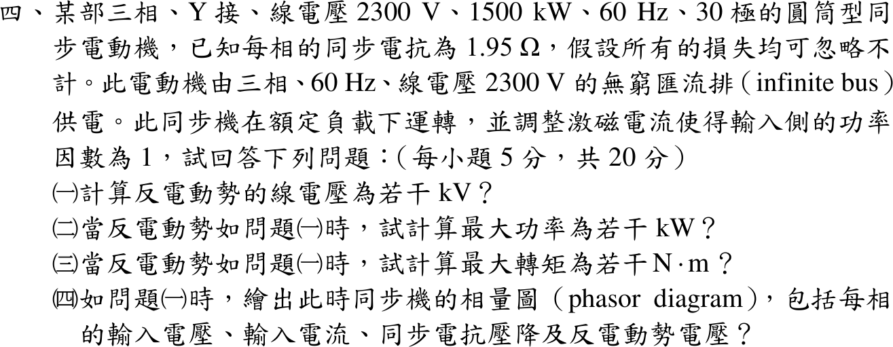

# 108 年電機機械第 4 題｜同步電動機功角與最大轉矩



## 已知與所求

三相 Y 接、2300 V、1500 kW、60 Hz、30 極圓筒型同步電動機，\(X_s=1.95\ \Omega\)/相，損失全忽略，接 2300 V 無窮匯流排，額定負載、功因 1。求（一）反電勢線電壓；（二）此反電勢下最大功率；（三）最大轉矩；（四）相量圖。

## 考場標準作答

### （一）反電勢

觀念：圓筒型同步電動機每相等效電路為 \(\underline V_\phi=\underline E_f+jX_s\underline I_a\)（電流流入，損失忽略），功因 1 表示 \(\underline I_a\) 與 \(\underline V_\phi\) 同相，故先由額定功率求 \(I_a\)，再解 \(\underline E_f\)。

\[
V_\phi=\frac{V_L}{\sqrt3}=\frac{2300}{\sqrt3}=1327.91\ \mathrm V
\]
\[
I_a=\frac{P}{\sqrt3V_L}=\frac{1.5\times10^6}{\sqrt3(2300)}=376.53\ \mathrm A,\ \text{與 }V_\phi\text{ 同相}
\]
\[
X_sI_a=1.95(376.53)=734.24\ \mathrm V
\]
電動機方程（電流流入）：
\[
\underline E_f=\underline V_\phi-jX_s\underline I_a=1327.91-j734.24\ \mathrm V
\]
\[
|E_f|=\sqrt{1327.91^2+734.24^2}=1517.38\ \mathrm{V/相},\qquad \delta=-\tan^{-1}\frac{734.24}{1327.91}=-28.94^\circ
\]
\[
\boxed{E_{LL}=\sqrt3|E_f|=\sqrt3(1517.38)=2628.18\,\mathrm V=2.63\ \mathrm{kV}}
\]

### （二）最大功率

觀念：圓筒型電機的功率角特性 \(P=\dfrac{3V_\phi E_f}{X_s}\sin|\delta|\)，\(E_f\) 固定時以 \(|\delta|=90^\circ\) 最大（穩定極限）。

\[
P_{max}=\frac{3V_\phi E_f}{X_s}
\]
\[
\boxed{P_{max}=\frac{3(1327.91)(1517.38)}{1.95}=3.10\,\mathrm{MW}=3099.90\ \mathrm{kW}}
\]

### （三）最大轉矩

觀念：同步電動機以同步角速度旋轉，轉矩 \(T=P/\omega_s\)；\(\omega_s\) 由 30 極與 60 Hz 決定。

\[
n_s=\frac{120f}{p}=\frac{120(60)}{30}=240\ \mathrm{rpm},\qquad \omega_s=\frac{2\pi(240)}{60}=25.13\ \mathrm{rad/s}
\]
\[
\boxed{T_{max}=\frac{P_{max}}{\omega_s}=\frac{3099.90\times10^3}{25.13}=1.23\times10^5\ \mathrm{N\cdot m}}
\]

### （四）相量圖

觀念：相量圖就是 \(\underline V_\phi=\underline E_f+jX_s\underline I_a\) 的向量三角形。畫法：以 \(V_\phi\) 為參考畫在 0°；\(I_a\) 與它同向（功因 1）；\(jX_sI_a\) 垂直 \(I_a\) 向上（90°）；從 \(V_\phi\) 箭頭反向減去 \(jX_sI_a\) 即得 \(E_f\)，位於 \(V_\phi\) 之下（落後，\(\delta<0\)）。

代入（沿用（一）的數值）：
\[
jX_s\underline I_a=j1.95(376.53\angle0^\circ)=734.24\angle90^\circ\ \mathrm V
\]
\[
\underline E_f=1327.91\angle0^\circ-734.24\angle90^\circ=1327.91-j734.24=1517.38\angle-28.94^\circ\ \mathrm V
\]
\[
\boxed{V_\phi=1327.91\angle0^\circ\ \mathrm V,\quad I_a=376.53\angle0^\circ\ \mathrm A,\quad jX_sI_a=734.24\angle90^\circ\ \mathrm V,\quad E_f=1517.38\angle-28.94^\circ\ \mathrm V}
\]

```text
  O ───────────────────────────→ V_φ = 1327.91∠0°（I_a = 376.53∠0° 與 V_φ 同方向）
   ╲                            ↑
    ╲ E_f = 1517.38∠−28.94°     │ jX_sI_a = 734.24∠90°
     ╲                          │
      ╲_________________________│   （E_f 端點加 jX_sI_a 等於 V_φ 端點）
```

## 驗算

額定點功率：\(\sqrt3(2300)(376.53)=1500.00\ \mathrm{kW}\)，且 \(\dfrac{3V_\phi E_f}{X_s}\sin28.94^\circ=1500.00\ \mathrm{kW}\)，與功率角特性一致。幾何關係：\(1517.38^2=1327.91^2+734.24^2\)。對 \(\delta\) 由 0° 到 180° 掃描功率角曲線，最大值確實在 90°。

## 失分點

- 把 2300 V 當作每相電壓（漏除 \(\sqrt3\)），\(I_a\) 與 \(E_f\) 都會錯。
- 用發電機方程 \(\underline E_f=\underline V+jX_s\underline I\)：功因 1 時 \(|E_f|\) 雖相同，但得 \(\delta=+28.94^\circ\)，相量圖的 \(E_f\) 方向畫反。
- 以 30 極算同步轉速誤成 3600 rpm 或用 \(377\ \mathrm{rad/s}\) 算機械轉矩。
