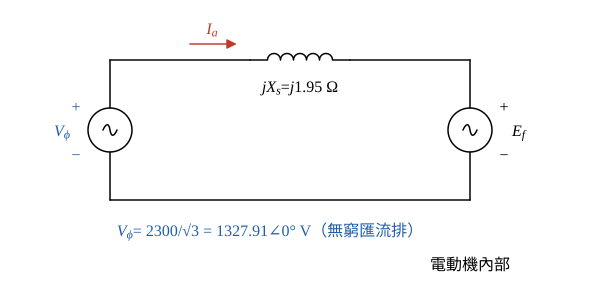
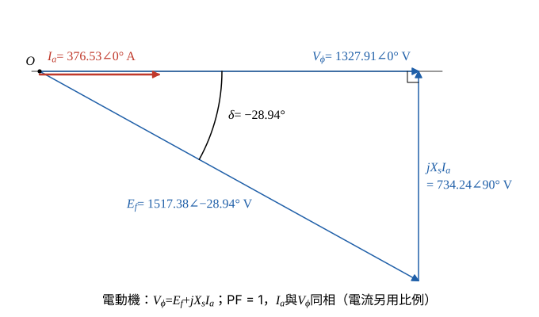

# 108 年電機機械第 4 題｜同步電動機功角與最大轉矩

## 已知與所求

三相 Y 接、線電壓 2300 V、1500 kW、60 Hz、30 極圓筒型同步電動機，每相 \(X_s=1.95\ \Omega\)，損失全部忽略；由 2300 V 無窮匯流排供電，額定負載下調整激磁使輸入功因為 1。求（一）反電動勢的線電壓（kV）；（二）此反電動勢下的最大功率（kW）；（三）最大轉矩（N·m）；（四）相量圖（每相輸入電壓、輸入電流、同步電抗壓降、反電動勢）。（每小題 5 分）

## 考場標準作答

**解題邏輯**：圓筒型同步電動機每相用電動機慣例（電流流入），KVL 為 \(\underline V_\phi=\underline E_f+jX_s\underline I_a\)。前提：無窮匯流排使 \(V_\phi\) 固定；以 \(\underline V_\phi\) 為相位參考 \(0^\circ\)。
1. 損失全忽略，輸入＝額定 1500 kW；功因 1 表示 \(\underline I_a\) 與 \(\underline V_\phi\) 同相，先求 \(I_a\)（步驟 1）。
2. （一）再相量相減得 \(\underline E_f\)。
3. （二）\(E_f\) 固定時功率角特性 \(P=3V_\phi E_f\sin|\delta|/X_s\) 在 \(|\delta|=90^\circ\) 最大。
4. （三）同步電動機轉速固定為同步轉速，最大轉矩＝最大功率÷同步角速度。
5. （四）相量圖就是（一）的 KVL 向量三角形。

### 步驟 1：每相等效電路、相電壓與電樞電流

- 每相：匯流排 \(\underline V_\phi\) 經 \(jX_s=j1.95\ \Omega\) 接到反電勢 \(\underline E_f\)（\(R_a\) 忽略）。
- 參考方向：\(\underline I_a\) 由匯流排流入電動機。

相電壓：
\[
V_\phi=\frac{V_L}{\sqrt3}=\frac{2300}{\sqrt3}=1327.91\ \mathrm V
\]
電樞電流（無損，輸入＝1500 kW；PF＝1）：
\[
I_a=\frac{P}{\sqrt3V_L\,\mathrm{PF}}=\frac{1\,500\,000}{\sqrt3(2300)(1)}=376.5328\ \mathrm A
\]
功因 1，電流與相電壓同相：
\[
\underline I_a=376.5328\angle0^\circ\ \mathrm A
\]

### （一）反電動勢的線電壓（5 分）

**邏輯**：由電動機 KVL \(\underline E_f=\underline V_\phi-jX_s\underline I_a\) 做相量相減；\(\underline I_a\) 在 \(0^\circ\)，\(jX_s\underline I_a\) 在 \(+90^\circ\)，相減後取大小，再乘 \(\sqrt3\) 換成線電壓。

同步電抗壓降：
\[
jX_s\underline I_a=j1.95(376.5328)=j734.2390\ \mathrm V\approx734.24\angle90^\circ\ \mathrm V
\]
電動機 KVL：
\[
\underline E_f=\underline V_\phi-jX_s\underline I_a=1327.91-j734.24\ \mathrm V
\]
大小：
\[
|E_f|=\sqrt{1327.91^2+734.24^2}=\sqrt{1\,763\,345.0+539\,108.4}=\sqrt{2\,302\,453.4}=1517.38\ \mathrm{V/相}
\]
角度（虛部為負，\(\underline E_f\) 落後 \(\underline V_\phi\)）：
\[
\delta=-\tan^{-1}\frac{734.24}{1327.91}=-\tan^{-1}0.5529=-28.94^\circ
\]
線電壓（Y 接乘 \(\sqrt3\)）：
\[
E_{LL}=\sqrt3|E_f|=\sqrt3(1517.38)=2628.18\ \mathrm V
\]
\[
\boxed{E_{LL}=2628.18\,\mathrm V=2.63\ \mathrm{kV}}
\]

### （二）最大功率（5 分）

**邏輯**：\(E_f\)、\(V_\phi\)、\(X_s\) 都固定，\(P=\dfrac{3V_\phi E_f}{X_s}\sin|\delta|\) 只隨 \(\delta\) 變，\(\sin|\delta|=1\)（\(|\delta|=90^\circ\)，靜態穩定極限）時最大。

最大功率公式（\(3V_\phi E_f=3\cdot\frac{V_L}{\sqrt3}\cdot\frac{E_{LL}}{\sqrt3}=V_LE_{LL}\)）：
\[
P_{max}=\frac{3V_\phi E_f}{X_s}=\frac{V_LE_{LL}}{X_s}
\]
代入：
\[
P_{max}=\frac{2300(2628.18)}{1.95}=\frac{6\,044\,814}{1.95}=3\,099\,904.6\ \mathrm W
\]
\[
\boxed{P_{max}=3099.90\ \mathrm{kW}\approx3.10\,\mathrm{MW}}
\]

### （三）最大轉矩（5 分）

**邏輯**：同步電動機穩態轉速固定為同步轉速，轉矩＝功率÷同步機械角速度；同步轉速由 60 Hz、30 極決定。

同步轉速：
\[
n_s=\frac{120f}{P}=\frac{120(60)}{30}=240\ \mathrm{rpm}
\]
同步機械角速度：
\[
\omega_s=\frac{2\pi n_s}{60}=\frac{2\pi(240)}{60}=8\pi=25.1327\ \mathrm{rad/s}
\]
最大轉矩：
\[
T_{max}=\frac{P_{max}}{\omega_s}=\frac{3\,099\,904.6}{25.1327}=123\,341\ \mathrm{N\cdot m}
\]
\[
\boxed{T_{max}=123\,341\ \mathrm{N\cdot m}\approx1.23\times10^5\ \mathrm{N\cdot m}}
\]

### （四）相量圖（5 分）

**邏輯**：相量圖就是 \(\underline V_\phi=\underline E_f+jX_s\underline I_a\) 的向量三角形；功因 1 時 \(jX_s\underline I_a\) 垂直 \(\underline V_\phi\)，三角形是直角三角形。

畫法（圖 2，電壓同一比例，電流另用比例）：

- \(\underline V_\phi=1327.91\angle0^\circ\ \mathrm V\) 沿水平軸。
- \(\underline I_a=376.53\angle0^\circ\ \mathrm A\) 與 \(\underline V_\phi\) 同方向（功因 1）。
- \(\underline E_f=1517.38\angle-28.94^\circ\ \mathrm V\) 自原點畫在水平軸下方 \(28.94^\circ\)。
- 自 \(\underline E_f\) 尖端垂直向上畫 \(jX_s\underline I_a=734.24\angle90^\circ\ \mathrm V\)，尖端恰好落在 \(\underline V_\phi\) 尖端。

\[
\boxed{V_\phi=1327.91\angle0^\circ\ \mathrm V,\quad I_a=376.53\angle0^\circ\ \mathrm A,\quad jX_sI_a=734.24\angle90^\circ\ \mathrm V,\quad E_f=1517.38\angle-28.94^\circ\ \mathrm V}
\]

## 驗算

額定點功率：\(\sqrt3(2300)(376.5328)=1\,500\,000\ \mathrm W=1500.00\ \mathrm{kW}\)。功率角式：\(E_f\sin|\delta|\) 就是相量圖的垂直分量 734.24 V，\(\dfrac{3V_\phi(E_f\sin|\delta|)}{X_s}=\dfrac{3V_\phi(X_sI_a)}{X_s}=3(1327.91)(376.5328)=1500.00\ \mathrm{kW}\)，與額定一致。對 \(\delta\) 由 \(0^\circ\) 到 \(180^\circ\) 掃描功率角曲線，最大值確實在 \(90^\circ\)。

## 失分點

- 把 2300 V 當作每相電壓（漏除 \(\sqrt3\)），\(I_a\) 與 \(E_f\) 都會錯。
- 用發電機方程 \(\underline E_f=\underline V+jX_s\underline I\)：功因 1 時 \(|E_f|\) 雖相同，但得 \(\delta=+28.94^\circ\)，相量圖的 \(E_f\) 方向畫反。
- 以 30 極算同步轉速誤成 3600 rpm，或用 \(377\ \mathrm{rad/s}\) 算機械轉矩。
