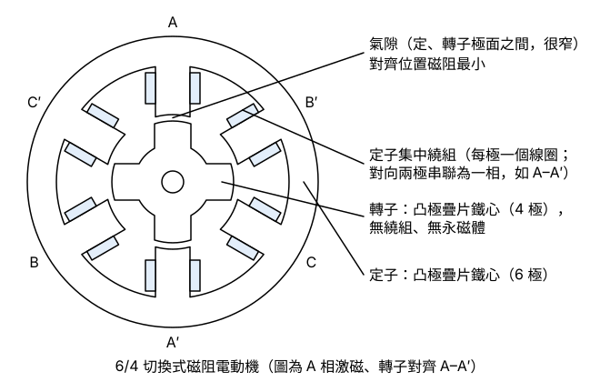
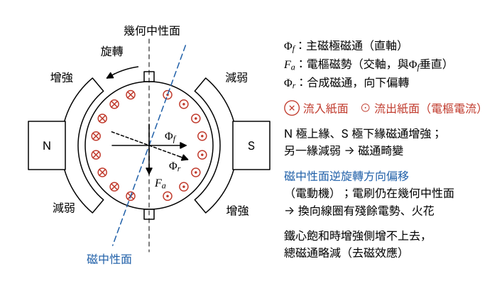
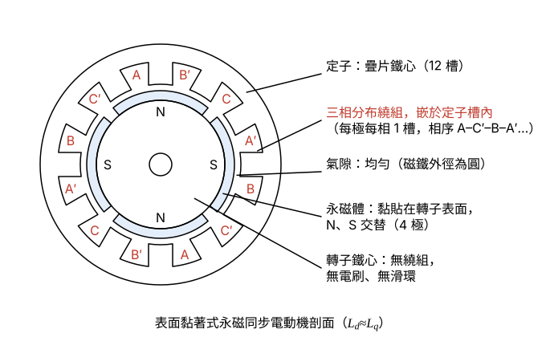

# 108 年電機機械第 5 題｜特殊電機與電樞反應

## 已知與所求

（一）繪出切換式磁阻電動機（SRM，亦稱可變磁阻電動機）的結構，包括定子、轉子、氣隙及繞組；（二）說明步進電動機的優點及缺點；（三）繪圖並解釋直流電動機的電樞反應，及說明改善方法；（四）繪出表面黏著式永磁同步電動機（SPMSM）的結構，包括定子、轉子、氣隙及繞組。（每小題 5 分，共 20 分）

## 考場標準作答

### （一）切換式磁阻電動機結構（5 分）

SRM 的轉矩來自磁阻轉矩：激磁相把最近的轉子凸極拉到磁阻最小（電感最大）的對齊位置，故轉子不需繞組或磁鐵，只要定子集中繞組依轉子位置輪流激磁。

畫法（圖 1，以常見的 6/4 SRM 為例）：

- 定子：疊片鐵心，向內 6 個凸極。
- 繞組：每個定子極套一個集中線圈，對向兩極串聯為一相（A–A′、B–B′、C–C′），共三相。
- 轉子：疊片鐵心，向外 4 個凸極；無繞組、無永磁體。定、轉子極數不同，才能在任何位置都有一相可產生轉矩。
- 氣隙：定子極面與轉子極面之間的窄間隙，對齊時磁阻最小。

\[
\boxed{\text{定子與轉子皆為凸極疊片鐵心；只有定子極有集中線圈，轉子無繞組、無永磁體；兩者間為窄氣隙}}
\]

轉矩式（磁共能對轉子角度微分）：
\[
T_e=\frac{\partial W'}{\partial\theta}=\frac12i^2\frac{dL}{d\theta}
\]
與電流方向無關，只看 \(dL/d\theta\) 的正負，所以各相須在電感上升區間（\(dL/d\theta>0\)）通電，換相時機依轉子位置決定。

### （二）步進電動機的優缺點（5 分）

步進電動機依序激磁各相，每個脈波使轉子轉過一個固定步距角並停在該位置，優缺點皆由此而來。

- 優點：脈波數決定轉角、脈波頻率決定轉速，開迴路即可精確定位；誤差不累積；低速及停止時保持轉矩大；結構簡單、可靠、易與數位控制介面。
- 缺點：轉速升高時繞組電流來不及建立，轉矩下降；特定脈波頻率會共振；負載超過保持或牽入轉矩時失步，而開迴路控制器不知道實際位置；步進運動使振動與噪音較大；不適合高速大功率。

\[
\boxed{\text{優點：開迴路定位、脈波數定位置、頻率定速度、低速保持轉矩大、結構簡單；缺點：高速轉矩下降、易共振與失步、振動噪音大}}
\]

### （三）直流電動機電樞反應與改善（5 分）

以兩極直流電動機、電刷位於幾何中性面說明。N 極下導體電流同向、S 極下反向，電樞磁勢 \(F_a\) 落在交軸，與主磁通 \(\Phi_f\) 垂直；兩者合成使磁通偏轉，產生畸變、中性面偏移與去磁三種效應。

畫法（圖 2）：

- 兩極：N 在左、S 在右，主磁通 \(\Phi_f\) 由左向右（直軸）。
- 電樞導體：N 極下流入紙面（⊗）、S 極下流出紙面（⊙），電刷位於上下的幾何中性面。
- 安培右手定則：\(F_a\) 指向下方（交軸）；由 \(\mathbf F=i\boldsymbol\ell\times\mathbf B\)（佛來明左手定則），左側受力向下、右側向上，電動機逆時針旋轉。
- 主磁勢 \(F_f\)（沿 \(\Phi_f\) 方向）與電樞磁勢 \(F_a\) 合成 \(F_r=F_f+F_a\)，合成磁通 \(\Phi_r\) 沿 \(F_r\) 方向向右下偏轉；與它垂直的磁中性面由幾何中性面順時針偏轉，即逆旋轉方向偏移。

三種效應：

- 磁通畸變：同一極面下一側的電樞磁勢與主磁通同向而增強（N 極上緣、S 極下緣），另一側反向而減弱。
- 中性面偏移：磁中性面逆旋轉方向偏移，但電刷仍在幾何中性面，換向中的線圈仍切割磁通、有殘餘電勢，產生火花。
- 去磁效應：增強側鐵心飽和，增加量小於減弱側的減少量，每極總磁通略為下降，電動機轉速上升、轉矩常數下降。

\[
\boxed{\text{改善：加換向極（裝在幾何中性軸、與電樞串聯）、極面補償繞組（嵌於主極極面、與電樞串聯且電流反向）、電動機電刷逆旋轉方向移到磁中性面}}
\]

### （四）表面黏著式永磁同步電動機結構（5 分）

SPMSM 的轉子磁場由貼在轉子表面的永磁體提供，磁鐵導磁率接近空氣，故 \(d\)、\(q\) 軸磁阻相同、\(L_d\approx L_q\)，轉矩幾乎只有永磁轉矩；定子三相分布繞組產生旋轉磁場。

畫法（圖 3，以 12 槽 4 極為例）：

- 定子：疊片鐵心，內圓開 12 槽，槽內嵌三相分布繞組（相序 A–C′–B–A′–C–B′）。
- 轉子：鐵心表面黏貼 4 片弧形永磁體，N、S 交替；無繞組、無電刷與滑環。
- 氣隙：磁鐵外徑與定子內徑之間，均勻。

\[
\boxed{\text{定子為疊片鐵心加三相分布繞組；轉子表面黏貼永磁體（N、S 相間），氣隙均勻；無轉子繞組、電刷與滑環}}
\]

轉矩（\(L_d\approx L_q\)，磁阻轉矩項消失）：
\[
T_e=\frac32p\,\psi_fi_q
\]
其中 \(p\) 為極對數、\(\psi_f\) 為永磁磁鏈、\(i_q\) 為交軸（\(q\) 軸）定子電流。

## 驗算

SRM：對 \(W'=\tfrac12L(\theta)i^2\) 取 \(\partial/\partial\theta\) 得 \(T_e=\tfrac12i^2\,dL/d\theta\)，符號隨 \(dL/d\theta\) 改變，負斜率區通電會產生制動轉矩。SPMSM：一般式 \(T_e=\tfrac32p[\psi_fi_q+(L_d-L_q)i_di_q]\) 令 \(L_d=L_q\)，磁阻項消失，只剩永磁轉矩，與表面黏著式結構（氣隙均勻）一致。電樞反應方向：圖 2 的 \(F_a\) 與 \(\Phi_f\) 垂直，合成磁通向右下，磁中性面順時針偏轉，而轉子逆時針轉，符合「電動機中性面逆旋轉方向偏移」。

## 失分點

- SRM 轉子畫成有繞組或永磁體，會變成其他電機；定、轉子極數畫成相同也不對。
- 說步進電動機「不會失步」：開迴路只是不需回授，超過保持或牽入轉矩仍會失步。
- 電樞反應只寫「磁通減弱」，漏掉畸變、中性面偏移與換向火花，也沒指出換向極與補償繞組各自裝在哪裡。
