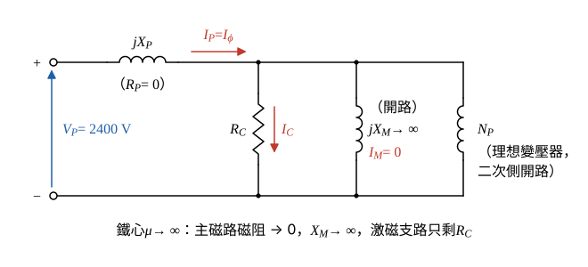

# 109 年電機機械第 1 題｜變壓器激磁電流與漏磁電抗

## 已知與所求

50 kVA、2400:240 V、60 Hz 雙繞組變壓器，\(N_P=1000\)、\(N_S=100\)；鐵心導磁係數趨近無限大，繞組電阻為 0，額定操作時鐵損 500 W；漏磁路徑磁阻 \(\mathcal R_P=4\times10^8\)、\(\mathcal R_S=5\times10^6\ \mathrm{A\cdot t/Wb}\)。依題附等效電路，求（一）參考一次側的磁化（激磁）電流 \(I_\phi\)；（二）一次側漏磁電抗 \(X_P\)。（共 20 分，未分配）

## 考場標準作答

**解題邏輯**：前提：\(R_P=0\)，\(I_\phi\) 在 \(jX_P\) 上的壓降（約 0.2 V）相對 2400 V 可忽略，激磁支路兩端取額定一次電壓 2400 V；二次側開路（或只看激磁支路），一次電流即 \(I_\phi\)。
1. （一）用題附等效電路的激磁支路 \(R_C\parallel jX_M\)：鐵心 \(\mu\to\infty\) 使主磁路磁阻 \(\mathcal R_M\to0\)，\(X_M=\omega N_P^2/\mathcal R_M\to\infty\)（開路），激磁電流只剩鐵損分量。
2. 由額定電壓與鐵損求 \(R_C\) 後得 \(I_\phi\)。
3. （二）漏磁路徑以磁阻 \(\mathcal R_P\) 表示，漏電感 \(L_P=N_P^2/\mathcal R_P\)。
4. 乘 \(\omega\) 得 \(X_P\)。

### （一）磁化電流 \(I_\phi\)

**邏輯**：\(I_\phi=I_C+I_M\)（激磁支路 KCL）；\(X_M\to\infty\) 使 \(I_M=0\)，所以 \(I_\phi=I_C=V_P/R_C\)，而 \(R_C\) 由「額定電壓下 \(R_C\) 消耗的功率＝鐵損」求得。

- 圖 1 由題附等效電路取一次側：\(R_P=0\) 不畫，\(jX_P\) 串聯後接激磁支路 \(R_C\parallel jX_M\)，再接理想變壓器 \(N_P\)。
- 參考方向：\(I_\phi\) 由 + 端流入，分成 \(I_C\)（流經 \(R_C\)）與 \(I_M\)（流經 \(jX_M\)）。

主磁路磁阻與磁化電抗：
\[
\mathcal R_M=\frac{l}{\mu A}\to0\quad\Rightarrow\quad X_M=\frac{\omega N_P^2}{\mathcal R_M}\to\infty\quad\Rightarrow\quad I_M=\frac{V_P}{X_M}=0
\]
鐵損等效電阻（\(P_{core}=V_P^2/R_C\)）：
\[
R_C=\frac{V_P^2}{P_{core}}=\frac{2400^2}{500}=\frac{5\,760\,000}{500}=11\,520\ \Omega
\]
激磁電流（只剩鐵損分量）：
\[
I_\phi=I_C=\frac{V_P}{R_C}=\frac{2400}{11\,520}=0.20833\ \mathrm A
\]
\[
\boxed{I_\phi=208.33\ \mathrm{mA}\ (\text{與 }V_P\text{ 同相})}
\]

### （二）一次側漏磁電抗 \(X_P\)

**邏輯**：一次側漏磁通 \(\phi_{LP}=N_Pi_P/\mathcal R_P\) 只交鏈一次繞組，磁鏈 \(N_P\phi_{LP}=(N_P^2/\mathcal R_P)i_P\)，所以 \(L_P=N_P^2/\mathcal R_P\)；用一次匝數配一次漏磁阻 \(\mathcal R_P\)，\(\mathcal R_S\) 屬二次側，不用。

一次側漏電感：
\[
L_P=\frac{N_P^2}{\mathcal R_P}=\frac{1000^2}{4\times10^8}=\frac{10^6}{4\times10^8}=2.5\times10^{-3}\ \mathrm H
\]
電源角頻率：
\[
\omega=2\pi f=2\pi(60)=376.99\ \mathrm{rad/s}
\]
漏磁電抗：
\[
X_P=\omega L_P=376.99(2.5\times10^{-3})=0.9425\ \Omega
\]
\[
\boxed{X_P=0.94\ \Omega}
\]
（4 位有效數字：\(X_P=0.9425\ \Omega\)。）

## 驗算

功率回代：\(V_PI_\phi=2400(0.20833)=500.0\ \mathrm W\)，等於鐵損。壓降假設：\(I_\phi X_P=0.20833(0.9425)=0.1964\ \mathrm V\)，僅為 2400 V 的 0.008%，取 \(V_P\) 為激磁支路電壓合理。匝數用法另驗：二次漏抗 \(X_S=\omega N_S^2/\mathcal R_S=376.99(100^2)/(5\times10^6)=0.7540\ \Omega\)，折算一次側 \(a^2X_S=10^2(0.7540)=75.40\ \Omega\)，與 \(\omega N_P^2/\mathcal R_S=376.99(10^6)/(5\times10^6)=75.40\ \Omega\) 一致，確認 \(L=N^2/\mathcal R\) 的匝數配法。

## 失分點

- 以為 \(\mu\to\infty\) 時激磁電流為 0；磁化分量為 0，但鐵損分量 208.33 mA 仍在。
- 用二次電壓 240 V 算 \(R_C\)，得 2.08 A（那是參考二次側的值）。
- 漏感寫成 \(N_P/\mathcal R_P\) 漏掉平方，或把 \(\mathcal R_S\) 配 \(N_P\) 當成一次側漏抗。
