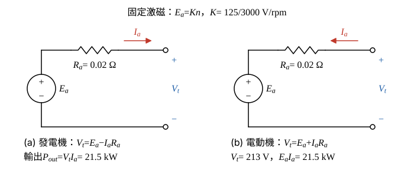

# 109 年電機機械第 2 題｜他激直流機發電與電動模式

## 已知與所求

固定激磁的他激直流機，\(R_a=0.02\ \Omega\)；發電機模式 3000 rpm 時開路端電壓 125 V（全題 25 分）。求（一）轉速 4000 rpm、輸出 21.5 kW 時的輸出端電壓；（二）改作馬達、機械負載 21.5 kW、端電壓 213 V 時的電樞電流 \(I_a\)；（三）此時的輸出轉矩。

## 考場標準作答

**解題邏輯**：固定激磁表示磁通不變，反電勢 \(E_a=Kn\) 與轉速成正比；開路時 \(I_a=0\)，端電壓就是 \(E_a\)，由 3000 rpm、125 V 定出 \(K\)，發電與電動兩種模式共用。（一）發電機電流由 \(E_a\) 正端流出，\(V_t=E_a-I_aR_a\)，輸出 \(P=V_tI_a\)，得 \(I_a\) 的二次式；（二）電動機電流流入，\(V_t=E_a+I_aR_a\)，機械負載功率＝轉換功率 \(E_aI_a\)，同樣得二次式；兩者都取正常工作點的小電流根。（三）由 \(E_a\) 反推轉速，轉矩＝機械功率÷角速度。前提：題目只計 \(R_a\) 的損失（旋轉損失、電刷壓降不計），故機械負載 21.5 kW 即電磁轉換功率，也是輸出功率。

### 步驟 1：反電勢與轉速的比例、兩種模式的電樞迴路

開路 \(I_a=0\)，\(E_a=125\ \mathrm V\) 於 3000 rpm：
\[
K=\frac{E_a}{n}=\frac{125}{3000}\ \mathrm{V/rpm}
\]
- 發電機（圖 1(a)）：\(I_a\) 由 \(E_a\) 正端流出經 \(R_a\) 到端點，KVL \(V_t=E_a-I_aR_a\)。
- 電動機（圖 1(b)）：\(I_a\) 由端點流入經 \(R_a\) 進 \(E_a\) 正端，KVL \(V_t=E_a+I_aR_a\)。

### （一）發電機 4000 rpm、輸出 21.5 kW 的端電壓

**邏輯**：先按轉速比例求 4000 rpm 的 \(E_a\)；輸出功率 \(P_{out}=V_tI_a=(E_a-I_aR_a)I_a\) 只含 \(I_a\) 一個未知數，解二次式取正常工作點的根，再由 \(V_t=P_{out}/I_a\) 得端電壓。

4000 rpm 的反電勢：
\[
E_a=Kn=\frac{125}{3000}(4000)=\frac{500}{3}=166.6667\ \mathrm V
\]
輸出功率代入 KVL：
\[
P_{out}=V_tI_a=(E_a-R_aI_a)I_a\ \Rightarrow\ R_aI_a^2-E_aI_a+P_{out}=0
\]
代入數值：
\[
0.02I_a^2-166.6667I_a+21\,500=0
\]
判別式：
\[
\Delta=\left(\frac{500}{3}\right)^2-4(0.02)(21\,500)=27\,777.78-1720=26\,057.78
\]
\[
\sqrt\Delta=161.4242
\]
大根：
\[
I_a=\frac{166.6667+161.4242}{2(0.02)}=\frac{328.0909}{0.04}=8202.27\ \mathrm A
\]
小根（公式分子是兩接近數相減，分子分母同乘 \(E_a+\sqrt\Delta\) 改用等價式）：
\[
I_a=\frac{2P_{out}}{E_a+\sqrt\Delta}=\frac{2(21\,500)}{328.0909}=\frac{43\,000}{328.0909}=131.0612\ \mathrm A
\]
取根：大根時 \(V_t=166.6667-0.02(8202.27)=2.62\ \mathrm V\)、銅損 \(0.02(8202.27)^2=1.35\ \mathrm{MW}\)，不是正常工作點；取小根 \(I_a=131.06\text{ A}\)（另一根 \(8202.27\text{ A}\) 捨去）。

端電壓：
\[
V_t=\frac{P_{out}}{I_a}=\frac{21\,500}{131.0612}=164.0455\ \mathrm V
\]
\[
\boxed{V_t=164.05\ \mathrm V}
\]

### （二）馬達模式的電樞電流

**邏輯**：電動機 KVL \(E_a=V_t-I_aR_a\)；機械負載 21.5 kW 等於轉換功率 \(E_aI_a\)，代入後得 \(I_a\) 的二次式，取小根。

轉換功率代入 KVL：
\[
P_{conv}=E_aI_a=(V_t-R_aI_a)I_a\ \Rightarrow\ R_aI_a^2-V_tI_a+P_{conv}=0
\]
代入數值：
\[
0.02I_a^2-213I_a+21\,500=0
\]
判別式：
\[
\Delta=213^2-4(0.02)(21\,500)=45\,369-1720=43\,649
\]
\[
\sqrt\Delta=208.9234
\]
大根：
\[
I_a=\frac{213+208.9234}{2(0.02)}=\frac{421.9234}{0.04}=10\,548.09\ \mathrm A
\]
此時 \(E_a=213-0.02(10\,548.09)=2.04\ \mathrm V\)，幾乎全部電壓降在 \(R_a\) 上，不是正常工作點，捨去。小根（同樣用等價式）：
\[
I_a=\frac{2P_{conv}}{V_t+\sqrt\Delta}=\frac{43\,000}{421.9234}=101.9142\ \mathrm A
\]
\[
\boxed{I_a=101.91\text{ A}}
\]

### （三）輸出轉矩

**邏輯**：由 KVL 求馬達的 \(E_a\)，以 \(E_a=Kn\) 反推轉速；題目只計 \(R_a\) 損失，所以軸上輸出功率就是 21.5 kW，轉矩＝21.5 kW÷\(\omega_m\)。

反電勢（\(0.02(101.9142)=2.0383\ \mathrm V\)）：
\[
E_a=V_t-I_aR_a=213-2.0383=210.9617\ \mathrm V
\]
轉速：
\[
n=\frac{E_a}{K}=3000\times\frac{210.9617}{125}=5063.08\ \mathrm{rpm}
\]
機械角速度：
\[
\omega_m=\frac{2\pi n}{60}=\frac{2\pi(5063.08)}{60}=530.2045\ \mathrm{rad/s}
\]
輸出轉矩：
\[
T=\frac{P}{\omega_m}=\frac{21\,500}{530.2045}=40.5504\ \mathrm{N\cdot m}
\]
\[
\boxed{T=40.55\ \mathrm{N\cdot m}}
\]

## 驗算

轉矩常數法：\(K\phi=\dfrac{125}{3000(2\pi/60)}=\dfrac{125}{314.1593}=0.397887\ \mathrm{V\cdot s}\)，\(T=K\phi I_a=0.397887(101.9142)=40.55\ \mathrm{N\cdot m}\)，與功率法一致。（一）KVL：\(E_a-I_aR_a=166.6667-0.02(131.0612)=166.6667-2.6212=164.0455\ \mathrm V\)，與 \(P_{out}/I_a\) 相同。

## 失分點

- 4000 rpm 仍用 125 V 當 \(E_a\)；他激固定磁通時 \(E_a\) 與轉速成正比。
- 發電機式寫成 \(V_t=E_a+I_aR_a\)，或馬達式寫成 \(V_t=E_a-I_aR_a\)，方向顛倒。
- （三）用輸入功率 \(213\times101.91\) 除以 \(\omega_m\)；題目的 21.5 kW 已是機械功率。
