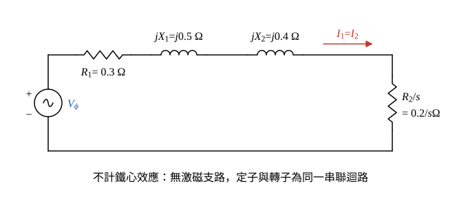

# 109 年電機機械第 3 題｜感應馬達起動轉矩與負載轉矩

## 已知與所求

三相 Y 接、220 V、60 Hz、7.5 kW、六極感應馬達，每相 \(R_1=0.3\)、\(X_1=0.5\)、\(R_2=0.2\)、\(X_2=0.4\ \Omega\)（轉子量已換算至定子側），不計鐵心效應。求（一）起動轉矩；（二）以 1188 rpm 穩態運轉時的負載轉矩（N·m）。（共 20 分，未分配）

## 考場標準作答

**解題邏輯**：不計鐵心效應即等效電路沒有激磁支路，定子與轉子成為單一串聯迴路，\(I_1=I_2\)。電磁轉矩＝氣隙功率／同步角速度，\(T=3I_2^2(R_2/s)/\omega_s\)；兩小題只差在轉差率：起動 \(s=1\)，1188 rpm 時 \(s=0.01\)。先在步驟 1 求共用的相電壓平方與同步角速度，再分別代入。前提：穩態負載轉矩＝電磁轉矩（題目未給機械損，不計旋轉損）；7.5 kW 為銘牌額定，不參與計算。

### 步驟 1：每相等效電路與共用量

- 每相等效電路：\(V_\phi\) 串 \(R_1\)、\(jX_1\)、\(jX_2\)、\(R_2/s\)，無激磁支路（圖 1）。
- 參考方向：\(I_1=I_2\) 由電源 + 端流出，順時針流過迴路。

Y 接相電壓的平方（轉矩式只用 \(V_\phi^2\)，保留精確值）：
\[
V_\phi^2=\left(\frac{220}{\sqrt3}\right)^2=\frac{48\,400}{3}=16\,133.33\ \mathrm{V^2}
\]
同步轉速與同步角速度（六極、60 Hz）：
\[
n_s=\frac{120f}{P}=\frac{120(60)}{6}=1200\ \mathrm{rpm}
\]
\[
\omega_s=\frac{2\pi n_s}{60}=\frac{2\pi(1200)}{60}=125.66\ \mathrm{rad/s}
\]
迴路電流與轉矩的通式：
\[
I_2^2=\frac{V_\phi^2}{(R_1+R_2/s)^2+(X_1+X_2)^2},\qquad T=\frac{P_{ag}}{\omega_s}=\frac{3I_2^2\,(R_2/s)}{\omega_s}
\]
電抗和：
\[
X_1+X_2=0.5+0.4=0.9\ \Omega
\]

### （一）起動轉矩

**邏輯**：起動瞬間轉子靜止，\(s=1\)，\(R_2/s=R_2\)；代入通式得起動電流與起動轉矩。

起動時轉子電阻項與迴路電阻：
\[
\frac{R_2}{s}=\frac{0.2}{1}=0.2\ \Omega,\qquad R_1+\frac{R_2}{s}=0.3+0.2=0.5\ \Omega
\]
阻抗大小的平方：
\[
|Z|^2=0.5^2+0.9^2=0.25+0.81=1.06\ \Omega^2
\]
電流平方與電流：
\[
I_2^2=\frac{16\,133.33}{1.06}=15\,220.12\ \mathrm{A^2},\qquad I_2=\sqrt{15\,220.12}=123.37\ \mathrm A
\]
氣隙功率：
\[
P_{ag}=3I_2^2\frac{R_2}{s}=3(15\,220.12)(0.2)=9132.07\ \mathrm W
\]
起動轉矩：
\[
T_{st}=\frac{P_{ag}}{\omega_s}=\frac{9132.07}{125.66}
\]
\[
\boxed{T_{st}=72.67\text{ N}\cdot\text{m}}
\]

### （二）1188 rpm 的負載轉矩

**邏輯**：先由轉速求轉差率，再同法求電磁轉矩；穩態時轉速不變，負載轉矩與電磁轉矩平衡（不計旋轉損）。

轉差率：
\[
s=\frac{n_s-n}{n_s}=\frac{1200-1188}{1200}=\frac{12}{1200}=0.01
\]
轉子電阻項與迴路電阻：
\[
\frac{R_2}{s}=\frac{0.2}{0.01}=20\ \Omega,\qquad R_1+\frac{R_2}{s}=0.3+20=20.3\ \Omega
\]
阻抗大小的平方：
\[
|Z|^2=20.3^2+0.9^2=412.09+0.81=412.90\ \Omega^2
\]
電流平方與電流：
\[
I_2^2=\frac{16\,133.33}{412.90}=39.073\ \mathrm{A^2},\qquad I_2=\sqrt{39.073}=6.251\ \mathrm A
\]
氣隙功率：
\[
P_{ag}=3I_2^2\frac{R_2}{s}=3(39.073)(20)=2344.38\ \mathrm W
\]
電磁轉矩＝負載轉矩：
\[
T_L=\frac{P_{ag}}{\omega_s}=\frac{2344.38}{125.66}
\]
\[
\boxed{T_L=18.66\text{ N}\cdot\text{m}}
\]

## 驗算

機械功率法：\(P_{conv}=(1-s)P_{ag}=0.99(2344.38)=2320.94\ \mathrm W\)，\(\omega_m=2\pi(1188)/60=124.41\ \mathrm{rad/s}\)，\(T=2320.94/124.41=18.66\ \mathrm{N\cdot m}\)，與氣隙功率法相同。量級：2.32 kW 低於 7.5 kW 額定，屬輕載；起動電流 123.37 A 約為 1188 rpm 時 6.251 A 的 20 倍，符合直接起動大電流的特性。

## 失分點

- 轉矩用 \(P_{ag}\) 卻除以轉子角速度 \(\omega_m\)（或用 \(P_{conv}\) 卻除以 \(\omega_s\)），兩者混用。
- 用線電壓 220 V 當相電壓，轉矩變成 3 倍。
- 六極 60 Hz 同步轉速誤為 1800 rpm，使 \(s=0.34\)。
