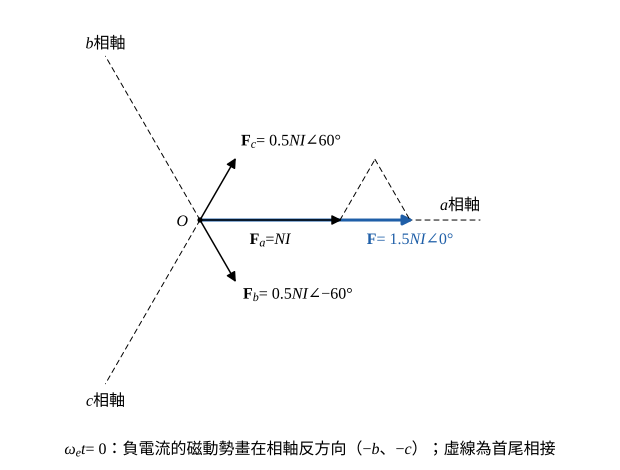
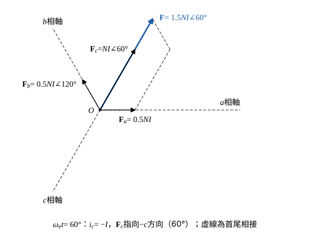

# 109 年電機機械第 4 題｜三相旋轉磁動勢

## 已知與所求

定子 a、b、c 相軸分別在 \(0^\circ\)（向右）、\(120^\circ\)、\(240^\circ\)（逆時針量角）；\(i_a=I\cos\omega_et\)、\(i_b=I\cos(\omega_et-120^\circ)\)、\(i_c=I\cos(\omega_et-240^\circ)\)，\(\omega_e=100\pi\ \mathrm{rad/s}\)；每相 \(N\) 匝，各相磁動勢 \(F=Ni\) 沿各自相軸。（一）畫出 \(t=0\) 的合成磁動勢；（二）畫出 \(\omega_et=60^\circ\) 的合成磁動勢；（三）求旋轉頻率。（共 15 分，未分配）

## 考場標準作答

**解題邏輯**：各相磁動勢是空間向量：大小 \(N|i|\)，方向在該相相軸上，電流為正時指向相軸正方向、為負時指向反方向（角度加 \(180^\circ\)）。某一瞬間的合成磁動勢＝三相磁動勢向量和：先代入該瞬間求三相電流，再把三個向量化成直角分量相加，最後寫出大小與角度。（三）由一般時刻的合成向量角度隨時間變化的速率得旋轉頻率。記號：\(\mathbf F_a,\mathbf F_b,\mathbf F_c\) 為各相磁動勢向量，\(\mathbf F\) 為合成。

### （一）\(t=0\) 的合成磁動勢

**邏輯**：\(t=0\) 時 \(i_a\) 為正最大、\(i_b=i_c\) 為負，b、c 兩相磁動勢指向 \(-b\)、\(-c\) 方向，兩者的垂直分量互相抵消、水平分量與 \(\mathbf F_a\) 同向相加。

三相電流：
\[
i_a=I\cos0^\circ=I,\qquad i_b=I\cos(-120^\circ)=-\tfrac12I,\qquad i_c=I\cos(-240^\circ)=-\tfrac12I
\]
各相磁動勢向量（負電流角度加 \(180^\circ\)：\(120^\circ-180^\circ=-60^\circ\)，\(240^\circ-180^\circ=60^\circ\)）：
\[
\mathbf F_a=NI\angle0^\circ,\qquad \mathbf F_b=\tfrac12NI\angle-60^\circ,\qquad \mathbf F_c=\tfrac12NI\angle60^\circ
\]
化成直角分量（\(\cos60^\circ=\tfrac12\)、\(\sin60^\circ=\tfrac{\sqrt3}{2}\)）：
\[
\mathbf F_a=NI(1+j0),\qquad \mathbf F_b=NI\left(\tfrac14-j\tfrac{\sqrt3}{4}\right),\qquad \mathbf F_c=NI\left(\tfrac14+j\tfrac{\sqrt3}{4}\right)
\]
三者相加：
\[
\mathbf F=NI\left[\left(1+\tfrac14+\tfrac14\right)+j\left(0-\tfrac{\sqrt3}{4}+\tfrac{\sqrt3}{4}\right)\right]=NI(1.5+j0)
\]
大小與角度：
\[
|\mathbf F|=\sqrt{(1.5NI)^2+0^2}=1.5NI,\qquad \theta=\tan^{-1}\frac{0}{1.5}=0^\circ
\]
\[
\boxed{\mathbf F(0)=1.5 N I \angle 0^\circ\ \text{（沿 a 相軸）}}
\]

作圖：

- 畫 a、b、c 三相軸（\(0^\circ\)、\(120^\circ\)、\(240^\circ\)）。
- 自原點畫 \(\mathbf F_a\)（長 \(NI\)，沿 a 軸）、\(\mathbf F_b\)（長 \(0.5NI\)，沿 \(-b\) 即 \(-60^\circ\)）、\(\mathbf F_c\)（長 \(0.5NI\)，沿 \(-c\) 即 \(60^\circ\)）。
- 首尾相接（虛線）：\(\mathbf F_a\) 尖端接 \(\mathbf F_c\)，再接 \(\mathbf F_b\)，終點在 a 軸上 \(1.5NI\) 處，原點連到終點即 \(\mathbf F\)。

### （二）\(\omega_et=60^\circ\) 的合成磁動勢

**邏輯**：同（一）的疊加：先算 \(\omega_et=60^\circ\) 的瞬時電流，此時 \(i_c\) 為負最大，\(\mathbf F_c\) 指向 \(-c\) 方向（\(60^\circ\)），再與 \(\mathbf F_a\)、\(\mathbf F_b\) 相加。

三相電流：
\[
i_a=I\cos60^\circ=\tfrac12I,\qquad i_b=I\cos(60^\circ-120^\circ)=I\cos(-60^\circ)=\tfrac12I,\qquad i_c=I\cos(60^\circ-240^\circ)=I\cos(-180^\circ)=-I
\]
各相磁動勢向量（\(i_c<0\)：\(240^\circ-180^\circ=60^\circ\)）：
\[
\mathbf F_a=\tfrac12NI\angle0^\circ,\qquad \mathbf F_b=\tfrac12NI\angle120^\circ,\qquad \mathbf F_c=NI\angle60^\circ
\]
化成直角分量（\(\cos120^\circ=-\tfrac12\)、\(\sin120^\circ=\tfrac{\sqrt3}{2}\)）：
\[
\mathbf F_a=NI\left(\tfrac12+j0\right),\qquad \mathbf F_b=NI\left(-\tfrac14+j\tfrac{\sqrt3}{4}\right),\qquad \mathbf F_c=NI\left(\tfrac12+j\tfrac{\sqrt3}{2}\right)
\]
三者相加：
\[
\mathbf F=NI\left[\left(\tfrac12-\tfrac14+\tfrac12\right)+j\left(0+\tfrac{\sqrt3}{4}+\tfrac{\sqrt3}{2}\right)\right]=NI\left(\tfrac34+j\tfrac{3\sqrt3}{4}\right)=NI(0.75+j1.299)
\]
大小：
\[
|\mathbf F|=NI\sqrt{\left(\tfrac34\right)^2+\left(\tfrac{3\sqrt3}{4}\right)^2}=NI\sqrt{\tfrac{9}{16}+\tfrac{27}{16}}=NI\sqrt{\tfrac{36}{16}}=1.5NI
\]
角度：
\[
\theta=\tan^{-1}\frac{3\sqrt3/4}{3/4}=\tan^{-1}\sqrt3=60^\circ
\]
\[
\boxed{\mathbf F(60^\circ)=1.5 N I \angle 60^\circ}
\]

作圖：自原點畫 \(\mathbf F_a\)（\(0.5NI\)，a 軸）、\(\mathbf F_b\)（\(0.5NI\)，b 軸 \(120^\circ\)）、\(\mathbf F_c\)（\(NI\)，\(-c\) 方向 \(60^\circ\)），首尾相接後合成向量長 \(1.5NI\)、指向 \(60^\circ\)：與（一）相比大小不變，方向逆時針轉了 \(60^\circ\)，恰等於 \(\omega_et\) 的增量。

### （三）旋轉頻率

**邏輯**：寫出任意時刻的合成向量：大小固定 \(1.5NI\)、角度等於 \(\omega_et\)，所以合成磁動勢以電角速度 \(\omega_e\) 逆時針（a→b→c）旋轉，每秒轉數＝\(\omega_e/2\pi\)。

任意時刻的直角分量（三相向量和的一般式）：
\[
F_x=N\left[i_a-\tfrac12(i_b+i_c)\right]=\tfrac32NI\cos\omega_et,\qquad F_y=\tfrac{\sqrt3}{2}N(i_b-i_c)=\tfrac32NI\sin\omega_et
\]
所以
\[
\mathbf F(t)=1.5NI\angle\omega_et
\]
旋轉頻率：
\[
f=\frac{\omega_e}{2\pi}=\frac{100\pi}{2\pi}
\]
\[
\boxed{f=50\text{ Hz}}
\]
圖示為兩極繞組，每電氣週期轉一圈，即每秒 50 轉（3000 rpm）。

## 驗算

用（三）的一般式回代：\(\omega_et=0\) 得 \((F_x,F_y)=(1.5NI,0)\)；\(\omega_et=60^\circ\) 得 \((1.5NI\cos60^\circ,1.5NI\sin60^\circ)=(0.75NI,1.299NI)\)，與（一）、（二）逐相相加的結果相同。由（一）到（二）時間經過 \(\Delta t=(\pi/3)/(100\pi)=1/300\ \mathrm s\)，向量轉 \(60^\circ\)＝\(1/6\) 圈，轉速 \((1/6)/(1/300)=50\) 圈／秒，與（三）一致。

## 失分點

- 合成大小寫成 \(3NI\) 或 \(NI\)；三相平衡的合成磁動勢為單相峰值 \(NI\) 的 1.5 倍。
- 負電流仍畫在正相軸方向，導致 \(t=0\) 合成為 0 或方向錯。
- 旋轉頻率寫成 \(100\pi\ \mathrm{Hz}\) 或 \(100\ \mathrm{Hz}\)；\(\omega_e=2\pi f\)。
