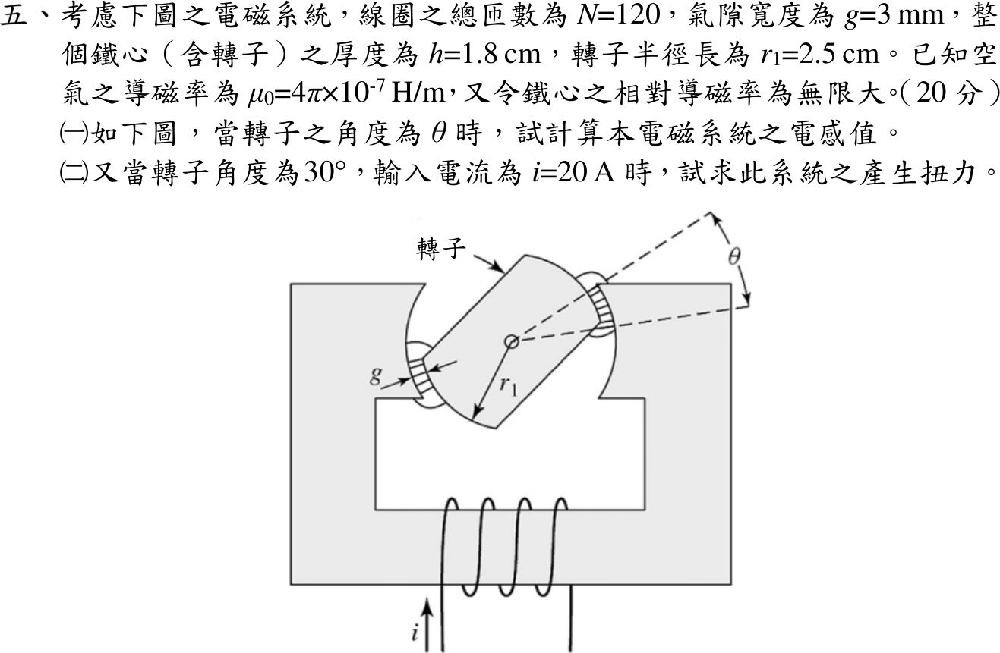
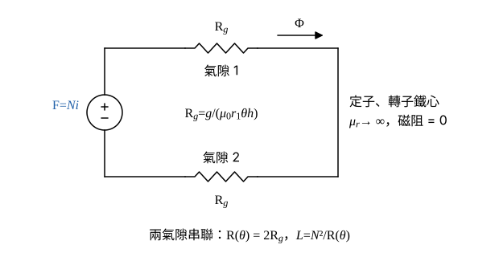

# 109 年電機機械第 5 題｜可變磁阻電感與電磁扭力

## 已知與所求

線圈 \(N=120\)，氣隙 \(g=3\ \mathrm{mm}\)（轉子兩端各一），鐵心厚度 \(h=1.8\ \mathrm{cm}\)，轉子半徑 \(r_1=2.5\ \mathrm{cm}\)，\(\mu_0=4\pi\times10^{-7}\ \mathrm{H/m}\)，鐵心 \(\mu_r\to\infty\)；\(\theta\) 為轉子極面與定子極面的重疊角。求（一）\(L(\theta)\)；（二）\(\theta=30^\circ\)、\(i=20\ \mathrm A\) 的扭力。（兩小題合計 20 分）

## 考場標準作答

### （一）電感 \(L(\theta)\)

設鐵心 \(\mu_r\to\infty\)、忽略邊緣效應與漏磁，氣隙面積以轉子半徑 \(r_1\) 計（\(g\ll r_1\)）；\(\theta\) 以弧度計，且在部分重疊範圍內（重疊面積與 \(\theta\) 成正比）。兩氣隙磁阻串聯，\(\mathcal R=2\mathcal R_g\)，\(L=N\Phi/i=N^2/\mathcal R\)。

畫法（圖 1）：線圈為磁動勢源 \(\mathcal F=Ni\)；串聯兩個氣隙磁阻 \(\mathcal R_g\)；定子與轉子鐵心磁阻為零，畫成導線；磁通 \(\Phi\) 沿迴路流動。

每個氣隙的有效面積（重疊弧長乘厚度）：
\[
A(\theta)=r_1\theta h
\]
每個氣隙的磁阻：
\[
\mathcal R_g=\frac{g}{\mu_0A(\theta)}=\frac{g}{\mu_0r_1h\theta}
\]
兩氣隙串聯：
\[
\mathcal R(\theta)=2\mathcal R_g=\frac{2g}{\mu_0r_1h\theta}
\]
電感：
\[
L(\theta)=\frac{N^2}{\mathcal R(\theta)}=\frac{\mu_0N^2r_1h}{2g}\,\theta
\]
代入數值，先算 \(\mu_0N^2\)（\(N^2=120^2=14\,400\)）：
\[
\mu_0N^2=(4\pi\times10^{-7})(14\,400)=0.018096\ \mathrm{H/m}
\]
乘上 \(r_1h=(0.025)(0.018)=4.5\times10^{-4}\ \mathrm{m^2}\)：
\[
\mu_0N^2r_1h=0.018096(4.5\times10^{-4})=8.1432\times10^{-6}\ \mathrm{H\cdot m}
\]
除以 \(2g=2(0.003)=0.006\ \mathrm m\)：
\[
\frac{dL}{d\theta}=\frac{\mu_0N^2r_1h}{2g}=\frac{8.1432\times10^{-6}}{0.006}=1.3572\times10^{-3}\ \mathrm{H/rad}
\]
\[
\boxed{L(\theta)=1.36 \times 10^{-3}\,\theta\ \mathrm H\quad(\theta\text{ 以 rad 計})}
\]
（4 位有效數字：\(L(\theta)=1.357\times10^{-3}\,\theta\ \mathrm H\)。）

### （二）扭力

磁路線性，用共能 \(W'=\tfrac12L(\theta)i^2\)，固定電流下對 \(\theta\) 微分；\(L\) 對 \(\theta\) 為線性，\(dL/d\theta\) 是常數，故扭力與 \(30^\circ\) 無關。

扭力公式：
\[
T=\frac{\partial W'}{\partial\theta}\bigg|_{i}=\frac12i^2\frac{dL}{d\theta}
\]
\(\tfrac12i^2\)：
\[
\frac12i^2=\frac12(20)^2=200\ \mathrm{A^2}
\]
代入（一）的 \(dL/d\theta\)：
\[
T=200(1.357\times10^{-3})=0.2714\ \mathrm{N\cdot m}
\]
\[
\boxed{T=0.27\text{ N}\cdot\text{m}\ \text{（使重疊角增大的方向）}}
\]
（4 位有效數字：\(T=0.2714\ \mathrm{N\cdot m}\)。）\(dL/d\theta>0\)，扭力朝電感增大、重疊角 \(\theta\) 增大（轉子與定子極面對齊）的方向。此時 \(\theta=30^\circ=\pi/6=0.5236\ \mathrm{rad}\)，\(L=1.357\times10^{-3}(0.5236)=0.7105\ \mathrm{mH}\)，只供參考，不影響扭力。

## 驗算

定磁鏈能量法：\(W=\lambda^2/2L(\theta)\)，\(T=-\partial W/\partial\theta|_\lambda=\dfrac{\lambda^2}{2L^2}\dfrac{dL}{d\theta}\)，代 \(\lambda=Li\) 得 \(\tfrac12i^2\,dL/d\theta=0.2714\ \mathrm{N\cdot m}\)，與共能法相同。單位：\(\mathrm{H/rad\cdot A^2}=\mathrm{J/rad}=\mathrm{N\cdot m}\)。

## 失分點

- 只算一個氣隙（\(\mathcal R=g/\mu_0A\)），\(L\) 與 \(T\) 都多 2 倍。
- \(\theta\) 用度代入 \(L(\theta)\)，得 \(L(30)=1.357\times10^{-3}(30)=40.71\ \mathrm{mH}\)；必須用弧度。
- 用 \(T=\tfrac12Li^2\) 或 \(L(30^\circ)\) 直接算扭力；扭力取決於 \(dL/d\theta\)。

## 條件與疑義

題目只給轉子半徑 \(r_1\)，本解以 \(r_1\theta h\) 為氣隙面積。若改用氣隙平均半徑 \(r_1+g/2=2.65\ \mathrm{cm}\)，係數為 \(1.3572\times10^{-3}(2.65/2.5)=1.4386\times10^{-3}\ \mathrm{H/rad}\)、\(T=200(1.4386\times10^{-3})=0.2877\ \mathrm{N\cdot m}\)（約大 6%）；邊緣效應另忽略。
