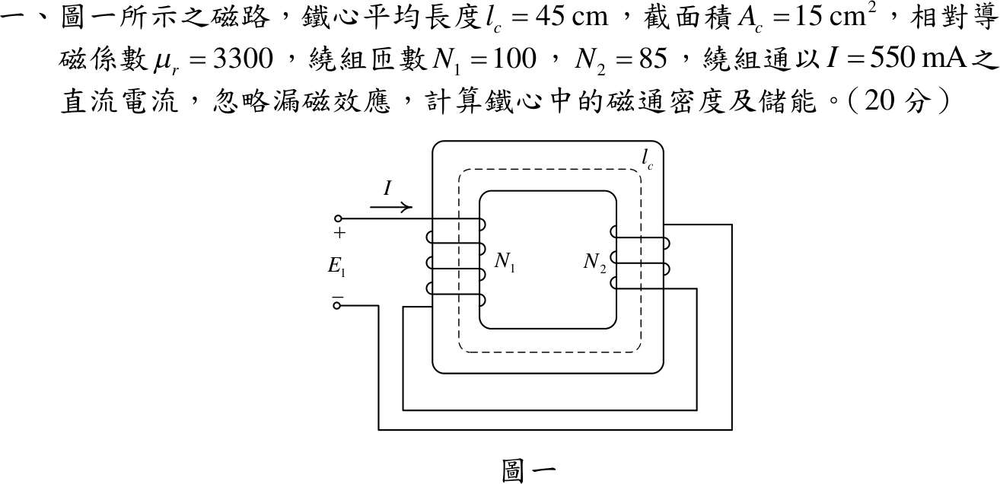
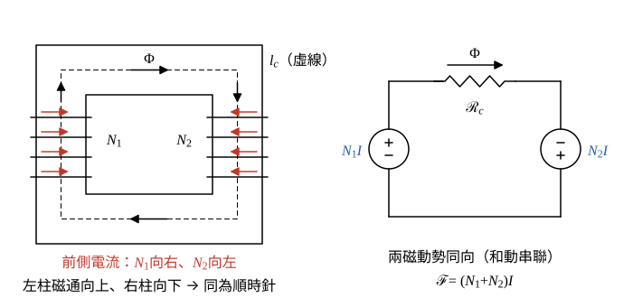

# 110 年電機機械第 1 題｜串聯繞組磁路

## 已知與所求

鐵心平均長度 \(l_c=45\ \mathrm{cm}\)、截面積 \(A_c=15\ \mathrm{cm^2}\)、\(\mu_r=3300\)；左柱繞組 \(N_1=100\)、右柱繞組 \(N_2=85\)，兩繞組依圖一串聯，通直流 \(I=550\ \mathrm{mA}\)，忽略漏磁。求鐵心中的磁通密度 \(B\) 與儲能 \(W_m\)。（20 分）

## 考場標準作答

**解題邏輯**：兩繞組串聯通同一電流，總磁動勢是相加還是相減取決於兩者在磁路迴圈上產生的磁通方向，所以先依圖追線判定繞向（步驟 1）。和動時 \(\mathcal F=(N_1+N_2)I\)；鐵心為單一磁路，\(\Phi=\mathcal F/\mathcal R_c\)，\(B=\Phi/A_c\)；線性磁路儲能 \(W_m=\tfrac12\mathcal F\Phi\)。前提：鐵心線性（\(\mu_r\) 定值、未飽和）、無漏磁、無氣隙，磁通全部沿平均路徑 \(l_c\)，截面處處為 \(A_c\)。

### 步驟 1：繞向判定（和動或差動）

依圖一逐段追線（以紙面朝外為前側；圖中橫跨鐵心柱的直線段為前側導線，柱緣弧線表示繞到背面）：

- 電流由 \(+\) 端沿最上方引線進入 \(N_1\)，在 \(N_1\) 中由上往下繞，前側直線段電流向右；繞完由左柱外側下方引出。
- 引出線經外圍底部接到右側，再接 \(N_2\) 的**下端**，電流在 \(N_2\) 中由下往上繞，前側直線段電流向左；由上端引出回到 \(-\) 端。
- 右手定則（四指沿電流環繞柱、拇指為磁通）：\(N_1\) 前側向右 → 左柱磁通向上；\(N_2\) 前側向左 → 右柱磁通向下。
- 左柱向上、右柱向下，在磁路迴圈上同為順時針，兩磁動勢同向，為和動串聯。若改把直線段視為背側，兩柱磁通同時反向，仍為同向。

### 步驟 2：總磁動勢與鐵心磁阻

單位換算：\(I=550\ \mathrm{mA}=0.55\ \mathrm A\)。和動串聯總磁動勢：
\[
\mathcal F=(N_1+N_2)I=(100+85)(0.55)=185(0.55)=101.75\ \mathrm{A\cdot t}
\]
單位換算：\(l_c=0.45\ \mathrm m\)，\(A_c=15\ \mathrm{cm^2}=15\times10^{-4}\ \mathrm{m^2}=1.5\times10^{-3}\ \mathrm{m^2}\)。鐵心導磁係數：
\[
\mu=\mu_r\mu_0=3300(4\pi\times10^{-7})=4.1469\times10^{-3}\ \mathrm{H/m}
\]
鐵心磁阻：
\[
\mathcal R_c=\frac{l_c}{\mu A_c}=\frac{0.45}{(4.1469\times10^{-3})(1.5\times10^{-3})}=\frac{0.45}{6.2204\times10^{-6}}=72\,343\ \mathrm{A\cdot t/Wb}
\]

### 磁通密度

**邏輯**：單一磁路的磁歐姆定律 \(\Phi=\mathcal F/\mathcal R_c\)，再除以截面積得 \(B\)。

鐵心磁通：
\[
\Phi=\frac{\mathcal F}{\mathcal R_c}=\frac{101.75}{72\,343}=1.4065\times10^{-3}\ \mathrm{Wb}
\]
磁通密度：
\[
B=\frac{\Phi}{A_c}=\frac{1.4065\times10^{-3}}{1.5\times10^{-3}}=0.9377\ \mathrm T
\]
\[
\boxed{B=0.94\ \mathrm T}
\]

### 儲能

**邏輯**：線性磁路的磁能 \(W_m=\tfrac12\mathcal F\Phi\)（等同 \(\tfrac12LI^2\)）；\(\Phi\) 用上一段的 \(1.4065\times10^{-3}\ \mathrm{Wb}\)（保留 5 位，使本行照字面相乘即得框內值）。

\[
W_m=\tfrac12\mathcal F\Phi=\tfrac12(101.75)(1.4065\times10^{-3})
\]
\[
W_m=0.071556\ \mathrm J
\]
\[
\boxed{W_m=71.56\ \mathrm{mJ}}
\]

## 驗算

能量密度法：\(H=\mathcal F/l_c=101.75/0.45=226.11\ \mathrm{A/m}\)，\(B=\mu H=(4.1469\times10^{-3})(226.11)=0.9377\ \mathrm T\)；\(W_m=\tfrac12BH\,(A_cl_c)=\tfrac12(0.9377)(226.11)(6.75\times10^{-4})=0.071558\ \mathrm J\approx71.56\ \mathrm{mJ}\)。電感法：\(L=(N_1+N_2)^2/\mathcal R_c=34\,225/72\,343=0.4731\ \mathrm H\)，\(\tfrac12LI^2=\tfrac12(0.4731)(0.55)^2=0.071556\ \mathrm J\)。量級：\(B\approx0.94\ \mathrm T\) 在矽鋼未飽和範圍內，線性假設合理。

## 失分點

- 誤以為 \(N_1\) 下端接 \(N_2\) 上端而判成差動串聯：\(\mathcal F=(100-85)(0.55)=8.25\ \mathrm{A\cdot t}\)，得 \(B=0.07603\ \mathrm T\)、\(W_m=0.4704\ \mathrm{mJ}\)。
- 只比較兩線圈「同在柱上向上／向下」而忘了兩柱位於磁路迴圈的對邊：左柱向上與右柱向下才是同一環繞方向。
- 截面積換算 \(15\ \mathrm{cm^2}=1.5\times10^{-3}\ \mathrm{m^2}\) 錯成 \(1.5\times10^{-4}\)。
