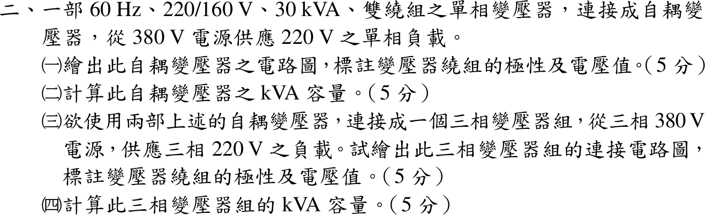
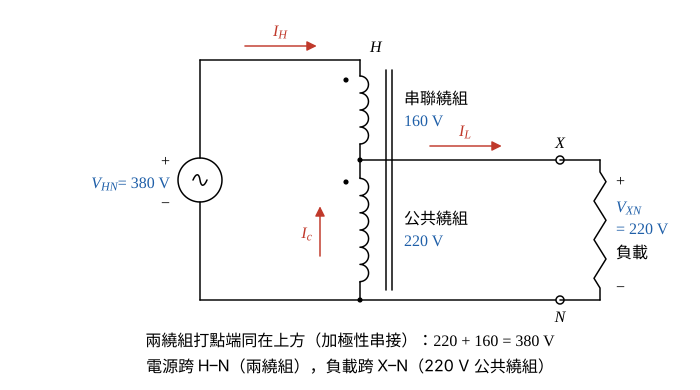
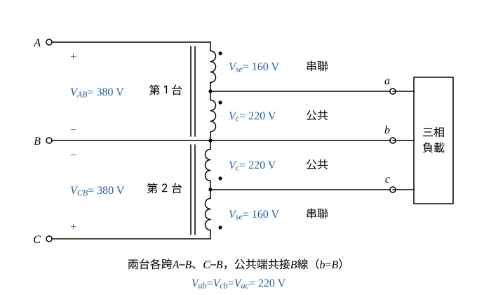

# 110 年電機機械第 2 題｜自耦變壓器與 V–V 容量

## 已知與所求

60 Hz、220/160 V、30 kVA 雙繞組單相變壓器改接為自耦變壓器，由 380 V 供 220 V 單相負載。求（一）電路圖（極性、電壓）；（二）kVA 容量；（三）兩台組成 380 V → 220 V 三相組的接線圖；（四）三相組容量。（每小題 5 分）

## 考場標準作答

### （一）單相自耦接線（5 分）

設理想自耦關係（忽略激磁電流與漏阻抗壓降）、三相平衡負載。兩繞組電壓相加才得 380 V（\(380=160+220\)），220 V 負載須直接取自 220 V 繞組，故 220 V 為公共繞組、160 V 為串聯繞組，串聯繞組的非打點端接公共繞組的打點端（加極性）。

畫法：

- 公共繞組 220 V 打點端在上，下端為共同端 \(N\)。
- 串聯繞組 160 V 的非打點端接公共繞組的打點端（分接點 \(X\)），其打點端為高壓端 \(H\)。
- 380 V 電源跨 \(H\)–\(N\)，220 V 負載跨 \(X\)–\(N\)。
- 參考方向：\(I_H\) 由 \(H\) 流入串聯繞組，\(I_L\) 由 \(X\) 流向負載，\(I_c\) 在公共繞組中由 \(N\) 往上流向 \(X\)（圖 1）。

兩繞組電壓相加：
\[
V_{HN}=V_{se}+V_c=160+220=380\ \mathrm V,\qquad V_{XN}=V_c=220\ \mathrm V
\]
\[
\boxed{\text{160 V 串聯繞組與 220 V 公共繞組加極性串接，380 V 跨 H–N、220 V 取自 X–N}}
\]

### （二）單相自耦容量（5 分）

\(I_H\) 全部流過 160 V 串聯繞組，上限為串聯繞組額定電流；負載電流由功率相等求出，再由分接點 KCL 確認公共繞組不超過額定。

串聯繞組額定電流：
\[
I_{se}=\frac{S_{2w}}{V_{se}}=\frac{30\ \mathrm{kVA}}{160\ \mathrm V}=187.50\ \mathrm A
\]
公共繞組額定電流：
\[
I_{c,rated}=\frac{S_{2w}}{V_c}=\frac{30\ \mathrm{kVA}}{220\ \mathrm V}=136.36\ \mathrm A
\]
輸入電流上限 \(I_H=I_{se}=187.50\ \mathrm A\)，自耦容量：
\[
S_{auto}=V_HI_H=380\ \mathrm V\times187.50\ \mathrm A=71.25\ \mathrm{kVA}
\]
\[
\boxed{S_{auto}=71.25\ \mathrm{kVA}}
\]
負載電流（輸出功率等於輸入功率）：
\[
I_L=\frac{S_{auto}}{V_{XN}}=\frac{71.25\ \mathrm{kVA}}{220\ \mathrm V}=323.86\ \mathrm A
\]
分接點 KCL（\(I_L=I_H+I_c\)），公共繞組電流：
\[
I_c=I_L-I_H=323.86-187.50=136.36\ \mathrm A=I_{c,rated}
\]
兩繞組同時恰為額定。

### （三）三相 V–V（開放三角）自耦接線（5 分）

兩台自耦變壓器各跨一個高壓線電壓（\(A\)–\(B\)、\(C\)–\(B\)），公共端共接 \(B\) 線；每台把所跨的線電壓按 \(220/380\) 縮小，第三個線電壓由相量差得到，三線間皆 220 V。

畫法：

- 第 1 台跨 \(A\)–\(B\)：串聯繞組打點端接 \(A\)，分接點引出 \(a\)，公共繞組打點端在分接點 \(a\)、另一端接 \(B\)。
- 第 2 台跨 \(C\)–\(B\)：串聯繞組打點端接 \(C\)，分接點引出 \(c\)，公共繞組打點端在分接點 \(c\)、另一端接 \(B\)。
- \(B\) 線直通為低壓 \(b\) 線；\(a\)、\(b\)、\(c\) 接三相 220 V 負載（圖 2）。

每台分接點電壓（以 \(B\) 為共同端，\(k=220/380\)）：
\[
\underline V_a-\underline V_B=k(\underline V_A-\underline V_B),\qquad \underline V_c-\underline V_B=k(\underline V_C-\underline V_B)
\]
因此 \(\underline V_{ab}=k\underline V_{AB}\)、\(\underline V_{cb}=k\underline V_{CB}\)；第三個線電壓兩式相減：
\[
\underline V_{ac}=\underline V_a-\underline V_c=k(\underline V_A-\underline V_C)=k\underline V_{AC}
\]
大小：
\[
|\underline V_{ab}|=|\underline V_{cb}|=|\underline V_{ac}|=\frac{220}{380}(380)=220\ \mathrm V
\]
\[
\boxed{\text{兩台自耦變壓器 V–V 接於 A–B、C–B，共用 B 線，380 V 降為三相 220 V}}
\]

### （四）三相組容量（5 分）

每台的安匝平衡與單相時相同，兩繞組同時達額定時，低壓線電流上限仍為（二）的 \(I_L=323.86\ \mathrm A\)，\(S_{3\phi}=\sqrt3V_{LL}I_L\)。

參考方向：\(I_A\) 由 \(A\) 流入第 1 台串聯繞組，\(I_a\) 由分接點 \(a\) 流出到負載，公共繞組電流 \(I_a-I_A\) 由 \(B\) 往上流向 \(a\)；\(I_A\) 與 \(I_a\) 同相，所以可直接以大小相減。第 1 台安匝平衡：
\[
160I_A=220(I_a-I_A)\ \Rightarrow\ 380I_A=220I_a\ \Rightarrow\ I_A=\frac{220}{380}I_a=kI_a
\]
高壓線電流（第 1 台串聯繞組電流）：
\[
I_A=kI_a=\frac{220}{380}(323.86)=187.50\ \mathrm A=I_{se}
\]
公共繞組電流 \(I_a-I_A=323.86-187.50=136.36\ \mathrm A\)，恰為額定。三相容量：
\[
S_{3\phi}=\sqrt3V_{LL}I_L=\sqrt3(220)(323.86)
\]
\[
\sqrt3(220)=381.05\ \mathrm V,\qquad 381.05\ \mathrm V\times323.86\ \mathrm A=123.41\ \mathrm{kVA}
\]
等效寫法（\(220\times323.86=V_HI_H=71.25\ \mathrm{kVA}\)）：
\[
S_{3\phi}=\sqrt3\times71.25=123.41\ \mathrm{kVA}
\]
\[
\boxed{S_{3\phi}=123.41\ \mathrm{kVA}}
\]

## 驗算

功率守恆：\(220\times323.86=71.249\ \mathrm{kVA}\approx380\times187.50=71.250\ \mathrm{kVA}\)；其中變壓器感應傳送 \(160\times187.50=30\ \mathrm{kVA}\)（即原額定）、傳導 \(220\times187.50=41.25\ \mathrm{kVA}\)，合計 71.25 kVA。三相組：\(123.41/(2\times71.25)=0.866=\sqrt3/2\)，與開放三角的利用率一致。

## 失分點

- 以雙繞組 30 kVA 當自耦容量，或用公共繞組電流算成 \(380\times136.36=51.82\ \mathrm{kVA}\)；限制輸入電流的是 160 V 串聯繞組的 187.50 A。
- 兩繞組減極性串接只得 \(220-160=60\ \mathrm V\)，不是 380 V。
- V–V 容量寫成 \(2\times71.25=142.50\ \mathrm{kVA}\)；開放三角只有 \(\sqrt3\) 倍單台容量。
