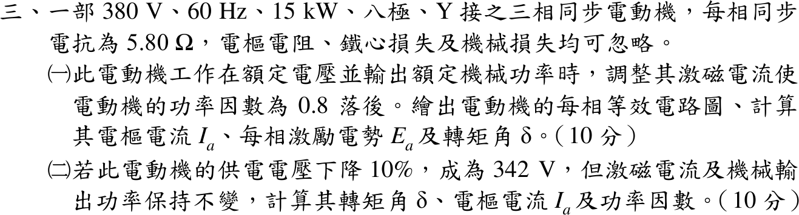
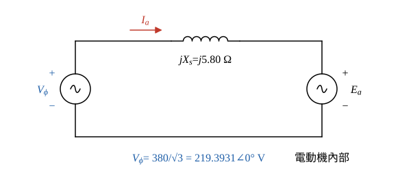
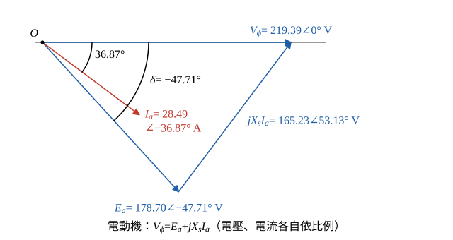

# 110 年電機機械第 3 題｜同步電動機轉矩角與電壓下降

## 已知與所求

380 V、60 Hz、15 kW、八極、Y 接三相同步電動機，每相 \(X_s=5.80\ \Omega\)，電樞電阻、鐵損、機械損均忽略。求（一）額定電壓、額定輸出、PF 0.8 落後時的每相等效電路、\(I_a\)、每相 \(E_a\)、轉矩角 \(\delta\)（10 分）；（二）供電降為 342 V、激磁電流與機械輸出不變時的 \(\delta\)、\(I_a\)、功率因數（10 分）。

## 考場標準作答

**解題邏輯**：前提為以 \(\underline V_\phi\) 為相位參考 \(0^\circ\)，八極只決定同步轉速 900 rpm，不影響電路計算。
1. 同步電動機用電動機慣例（電流由電源流入），每相 KVL 為 \(\underline V_\phi=\underline E_a+jX_s\underline I_a\)，所以 \(\underline E_a=\underline V_\phi-jX_s\underline I_a\)。
2. （一）損失全忽略，輸入功率＝輸出 15 kW，由 \(P=\sqrt3V_LI_a\,\mathrm{PF}\) 求 \(I_a\)，配上落後角代入 KVL 得 \(\underline E_a\) 與 \(\delta\)（\(\underline E_a\) 相對 \(\underline V_\phi\) 的角，負值表示落後）。
3. （二）激磁電流不變→\(|E_a|\) 不變（轉速固定為同步轉速）。
4. 輸出不變→由功率角公式 \(P=3V_\phi E_a\sin|\delta|/X_s\) 求新 \(\delta'\)，再回到 KVL 求 \(\underline I_a'\) 與功因。

### 步驟 1：每相等效電路與相電壓

- 每相：電源 \(\underline V_\phi\) 經 \(jX_s=j5.80\ \Omega\) 接到內生電勢 \(\underline E_a\)（\(R_a\) 忽略）。
- 參考方向：\(\underline I_a\) 由電源流入電動機。

Y 接，相電壓＝線電壓／\(\sqrt3\)：
\[
V_\phi=\frac{380}{\sqrt3}=219.3931\ \mathrm V
\]

### （一）額定運轉的 \(I_a\)、\(E_a\)、\(\delta\)（10 分）

**邏輯**：無損，輸入三相功率＝15 kW，先求電流大小與相角；再用電動機 KVL \(\underline E_a=\underline V_\phi-jX_s\underline I_a\) 做相量相減，取大小與角度。

電樞電流大小：
\[
I_a=\frac{P}{\sqrt3V_L\,\mathrm{PF}}=\frac{15\,000}{\sqrt3(380)(0.8)}=\frac{15\,000}{526.5434}=28.4877\ \mathrm A
\]
\[
\boxed{I_a=28.49\ \mathrm A}
\]
PF 0.8 落後：\(\varphi=\cos^{-1}0.8=36.87^\circ\)，\(\sin\varphi=0.6\)，
\[
\underline I_a=28.4877\angle-36.87^\circ\ \mathrm A
\]
化成直角座標：
\[
\underline I_a=28.4877(0.8)-j28.4877(0.6)=22.7902-j17.0926\ \mathrm A
\]
同步電抗壓降（\(j\cdot(-j17.0926)=+17.0926\)）：
\[
jX_s\underline I_a=j5.8(22.7902-j17.0926)=5.8(17.0926)+j5.8(22.7902)=99.1371+j132.1832\ \mathrm V
\]
電動機 KVL：
\[
\underline E_a=\underline V_\phi-jX_s\underline I_a=(219.3931-99.1371)-j132.1832=120.2560-j132.1832\ \mathrm V
\]
大小：
\[
|E_a|=\sqrt{120.2560^2+132.1832^2}=\sqrt{14\,461.51+17\,472.40}=\sqrt{31\,933.91}=178.7006\ \mathrm V
\]
\[
\boxed{E_a=178.70\text{ V/相}}
\]
角度（虛部為負，\(\underline E_a\) 落後 \(\underline V_\phi\)）：
\[
\delta=-\tan^{-1}\frac{132.1832}{120.2560}=-\tan^{-1}1.0992=-47.71^\circ
\]
\[
\boxed{\delta=-47.71^\circ}
\]

相量圖畫法（圖 2）：\(\underline V_\phi\) 沿水平軸；\(\underline I_a\) 落後 \(36.87^\circ\)；\(\underline E_a\) 在水平軸下方 \(47.71^\circ\)；自 \(\underline E_a\) 尖端畫 \(jX_s\underline I_a\)（大小 \(5.8(28.4877)=165.23\ \mathrm V\)，角度 \(-36.87^\circ+90^\circ=53.13^\circ\)）剛好到 \(\underline V_\phi\) 尖端。

### （二）電壓降為 342 V（10 分）

**邏輯**：激磁電流不變→\(|E_a|=178.70\ \mathrm V\) 不變；機械輸出不變、無損→輸入仍為 15 kW。圓筒型同步機 \(P=3V_\phi E_a\sin|\delta|/X_s\) 中只剩 \(\delta'\) 未知，先解 \(\delta'\)；再由 \(\underline I_a'=(\underline V_\phi'-\underline E_a')/(jX_s)\) 求電流與功因。

新相電壓：
\[
V_\phi'=\frac{342}{\sqrt3}=197.4538\ \mathrm V
\]
功率角公式解 \(\sin|\delta'|\)：
\[
\sin|\delta'|=\frac{PX_s}{3V_\phi'E_a}=\frac{15\,000(5.8)}{3(197.4538)(178.70)}=\frac{87\,000}{105\,855.0}=0.821879
\]
\[
|\delta'|=\sin^{-1}0.821879=55.27^\circ\quad(\text{取 }|\delta'|<90^\circ\text{ 的穩定解，捨去 }124.73^\circ)
\]
\[
\boxed{\delta'=-55.27^\circ}
\]
\(\cos|\delta'|=\sqrt{1-0.821879^2}=\sqrt{0.324515}=0.569662\)，新內生電勢（落後，虛部取負）：
\[
\underline E_a'=178.70(0.569662)-j178.70(0.821879)=101.7986-j146.8698\ \mathrm V
\]
\(jX_s\) 上的電壓：
\[
\underline V_\phi'-\underline E_a'=(197.4538-101.7986)+j146.8698=95.6552+j146.8698\ \mathrm V
\]
除以 \(jX_s\)（除以 \(j\) 等於乘 \(-j\)）：
\[
\underline I_a'=\frac{95.6552+j146.8698}{j5.8}=\frac{146.8698-j95.6552}{5.8}=25.3224-j16.4923\ \mathrm A
\]
大小：
\[
|I_a'|=\sqrt{25.3224^2+16.4923^2}=\sqrt{641.2240+271.9960}=\sqrt{913.2200}=30.2195\ \mathrm A
\]
\[
\boxed{I_a'=30.22\ \mathrm A}
\]
角度（虛部為負，電流落後）：
\[
\theta'=-\tan^{-1}\frac{16.4923}{25.3224}=-33.08^\circ
\]
功率因數：
\[
\mathrm{PF}=\frac{\mathrm{Re}(\underline I_a')}{|I_a'|}=\frac{25.3224}{30.2195}=0.8379
\]
\[
\boxed{\mathrm{PF}=0.84\text{ 落後}}
\]

## 驗算

功率回代：\(3V_\phi\,\mathrm{Re}(\underline I_a)=3(219.3931)(22.7902)=15.00\,\mathrm{kW}\)；\(3V_\phi'\,\mathrm{Re}(\underline I_a')=3(197.4538)(25.3224)=15.00\,\mathrm{kW}\)。功率角式回查（一）：\(\sin47.71^\circ=0.7397\)，\(3(219.3931)(178.70)(0.7397)/5.8=15.00\,\mathrm{kW}\)。八極同步轉速 \(n_s=120(60)/8=900\ \mathrm{rpm}\)，\(\omega_s=2\pi(900)/60=94.25\ \mathrm{rad/s}\)，轉矩 \(15\,000/94.25=159.15\ \mathrm{N\cdot m}\) 前後不變。

## 失分點

- 電動機誤用發電機式 \(\underline E=\underline V+jX_s\underline I\)，得 \(|E_a|=344.87\ \mathrm V\)、\(\delta\) 為正。
- （二）沿用原電流 28.49 A 或原功因；應固定 \(|E_a|\) 與 \(P\) 先解 \(\delta'\)，再求 \(\underline I_a'\)。
- \(\sin\delta\) 式中誤用線電壓而漏乘 3，或用 \(V_L\) 搭配相電壓 \(E_a\)。
