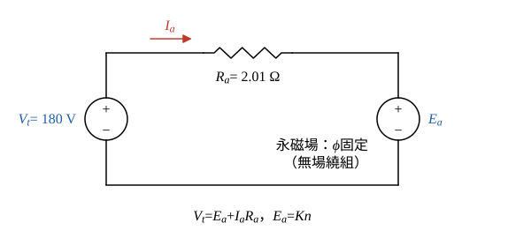

# 110 年電機機械第 4 題｜永磁式直流電動機額定工作點

## 已知與所求

3 hp、180 V 永磁式直流電動機，\(R_a=2.01\ \Omega\)，無載轉速 4200 rpm；機械損、鐵損及無載電樞電流均忽略。以 180 V 供電、輸出額定機械功率時，求（一）等效電路、\(E_a\)、\(I_a\)（10 分）；（二）轉速與轉矩（10 分）。

## 考場標準作答

### （一）等效電路、\(E_a\) 與 \(I_a\)（10 分）

設 1 hp＝746 W，機械損、鐵損與電刷壓降不計，故 \(P_{out}=E_aI_a\)；與 KVL \(V_t=E_a+I_aR_a\) 聯立得 \(I_a\) 的二次式，取額定運轉的小電流根。

等效電路畫法（圖 1）：

- 左側直流電源 \(V_t=180\ \mathrm V\)（上正下負），經 \(R_a=2.01\ \Omega\) 接到電樞反電勢 \(E_a\)（上正下負），再回電源負端。
- 永磁場沒有場繞組，磁通 \(\phi\) 固定，不畫場電路。
- 參考方向：\(I_a\) 由電源正端流出、經 \(R_a\) 流入 \(E_a\) 正端。

輸出功率（題目給額定 3 hp）：
\[
P_{out}=3(746)=2238\ \mathrm W
\]
電樞 KVL：
\[
E_a=V_t-I_aR_a=180-2.01I_a
\]
功率關係 \(P_{out}=E_aI_a\)，代入 \(E_a\)：
\[
(180-2.01I_a)I_a=2238
\]
展開移項：
\[
2.01I_a^2-180I_a+2238=0
\]
判別式：
\[
\Delta=180^2-4(2.01)(2238)=32\,400-17\,993.52=14\,406.48
\]
\[
\sqrt\Delta=120.0270
\]
兩根：
\[
I_a=\frac{180\mp120.0270}{2(2.01)}=\frac{180\mp120.0270}{4.02}
\]
小根：
\[
I_a=\frac{59.9730}{4.02}=14.9187\ \mathrm A
\]
大根：
\[
I_a=\frac{300.0270}{4.02}=74.6336\ \mathrm A
\]
取根：大根時 \(E_a=180-2.01(74.6336)=29.99\ \mathrm V\)，銅損 \(2.01(74.6336)^2=11\,196\ \mathrm W\) 遠大於輸出 2238 W（效率只有 \(2238/(180\times74.6336)=16.66\%\)），不可能是額定運轉點；取小根。
\[
\boxed{I_a=14.92\ \mathrm A}
\]
反電勢（KVL 回代，\(2.01(14.9187)=29.9866\ \mathrm V\)）：
\[
E_a=180-29.9866=150.0134\ \mathrm V
\]
\[
\boxed{E_a=150.01\ \mathrm V}
\]

### （二）轉速與轉矩（10 分）

磁通固定，\(E_a=Kn\)，由無載點（\(I_a=0\)，\(E_a=180\ \mathrm V\) 對 4200 rpm）按比例換算轉速。

無載點定比例常數：
\[
K=\frac{180}{4200}\ \mathrm{V/rpm}
\]
轉速：
\[
n=\frac{E_a}{K}=4200\times\frac{150.0134}{180}=3500.31\ \mathrm{rpm}
\]
\[
\boxed{n=3500.31\ \mathrm{rpm}}
\]
機械角速度：
\[
\omega_m=\frac{2\pi n}{60}=\frac{2\pi(3500.31)}{60}=366.5516\ \mathrm{rad/s}
\]
轉矩：
\[
T=\frac{P_{out}}{\omega_m}=\frac{2238}{366.5516}=6.1056\ \mathrm{N\cdot m}
\]
\[
\boxed{T=6.11\ \mathrm{N\cdot m}}
\]

## 驗算

轉矩常數法：\(K_T=\dfrac{180}{4200(2\pi/60)}=\dfrac{180}{439.8230}=0.4093\ \mathrm{N\cdot m/A}\)，\(T=K_TI_a=0.4093(14.9187)=6.11\ \mathrm{N\cdot m}\)，與功率法一致。KVL：\(150.0134+29.9866=180.0000\ \mathrm V\)。功率平衡（\(I_a=14.91866\ \mathrm A\)）：輸入 \(180(14.91866)=2685.36\ \mathrm W\)＝輸出 2238 W＋銅損 \(2.01(14.91866)^2=447.36\ \mathrm W\)。

## 失分點

- 把 \(P_{out}=2238\ \mathrm W\) 當輸入功率，算成 \(I_a=2238/180=12.43\ \mathrm A\)，漏掉 \(I_a^2R_a\)。
- 二次式取大根 74.63 A，得 699.69 rpm、30.54 N·m。
- 轉矩用 rpm 直接除：\(T=P/n\)；須換成 \(\omega_m=2\pi n/60\)。
