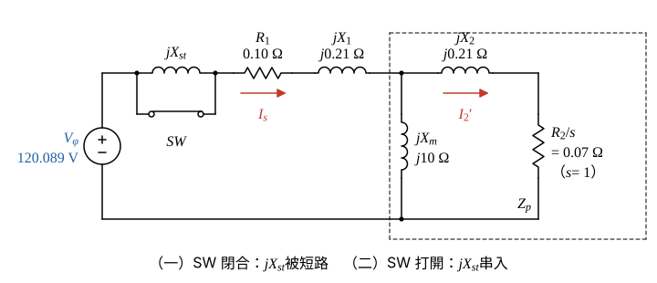

# 110 年電機機械第 5 題｜感應電動機啟動電抗器

## 已知與所求

60 Hz、208 V、Y 接、30 hp 三相六極鼠籠式感應電動機，每相 \(R_1=0.10\)、\(R_2=0.07\)、\(X_1=X_2=0.21\)、\(X_m=10\ \Omega\)；\(jX_{st}\) 串在電源與 \(R_1\) 之間，SW 閉合時短路。求（一）不用 \(X_{st}\) 的啟動電流與轉矩；（二）使啟動電流降為 \(1/\sqrt3\) 的 \(X_{st}\) 與啟動轉矩。

## 考場標準作答

**解題邏輯**：前提為額定電壓直接加在端子（電源無內阻抗）、等效電路參數不隨轉差改變；題目未給鐵損電阻 \(R_c\)，激磁支路只有 \(jX_m\)；30 馬力為銘牌額定，計算用不到。
1. 啟動瞬間轉子靜止，\(s=1\)，轉子支路電阻 \(R_2/s=R_2\)；用每相等效電路（\(R_1+jX_1\) 串接 \(Z_p=jX_m\parallel(R_2+jX_2)\)）求總阻抗 \(Z\)，\(I_s=V_\phi/|Z|\)。
2. 再以分流求轉子電流 \(I_2'\)，啟動轉矩＝氣隙功率／同步角速度 \(T=3I_2'^2(R_2/s)/\omega_s\)。
3. （二）\(jX_{st}\) 串在電源與 \(R_1\) 之間，電流降為 \(1/\sqrt3\) 等於總阻抗大小增為 \(\sqrt3\) 倍，對 \(X_{st}\) 解阻抗大小方程式。
4. \(X_{st}\) 在分流點之前，分流比不變，轉矩隨電流平方降為 \(1/3\)。

### 步驟 1：每相電壓、同步角速度與等效電路

- Y 接，每相等效電路如圖 1；\(s=1\) 時 \(R_2/s=0.07\ \Omega\)。
- 參考方向：\(I_s\) 由電源流入 \(R_1\)，\(I_2'\) 由激磁分流點流向 \(R_2/s\)。

每相電壓（Y 接，相電壓＝線電壓／\(\sqrt3\)）：
\[
V_\phi=\frac{V_L}{\sqrt3}=\frac{208}{\sqrt3}=120.089\ \mathrm V
\]
同步轉速（6 極、60 Hz）：
\[
n_s=\frac{120f}{P}=\frac{120(60)}{6}=1200\ \mathrm{rpm}
\]
同步角速度：
\[
\omega_s=\frac{2\pi n_s}{60}=\frac{2\pi(1200)}{60}=125.664\ \mathrm{rad/s}
\]

### （一）直接啟動的電流與轉矩（10 分）

**邏輯**：SW 閉合使 \(jX_{st}\) 被短路，電源直接接 \(R_1+jX_1+Z_p\)；先求並聯阻抗 \(Z_p\)，再串聯得 \(Z\)，歐姆定律求 \(I_s\)，分流求 \(I_2'\)，最後用氣隙功率求轉矩。

激磁支路與轉子支路並聯：
\[
Z_p=\frac{jX_m(R_2+jX_2)}{R_2+j(X_m+X_2)}
\]
代入：
\[
Z_p=\frac{j10(0.07+j0.21)}{0.07+j(10+0.21)}
\]
分子展開（\(j^2=-1\)）：
\[
j10(0.07+j0.21)=j0.7+j^2(2.1)=-2.1+j0.7\ \Omega^2
\]
分母：
\[
0.07+j10.21\ \Omega
\]
分子分母同乘分母共軛 \(0.07-j10.21\)；分母大小平方：
\[
0.07^2+10.21^2=0.0049+104.2441=104.249\ \Omega^2
\]
分子乘共軛：
\[
(-2.1+j0.7)(0.07-j10.21)=-0.147+j21.441+j0.049+7.147=7.000+j21.490\ \Omega^3
\]
相除（以下阻抗改用 \(\mathrm{m\Omega}\) 並保留三位小數，使 \(I_s\) 照字面算得到框內值）：
\[
Z_p=\frac{7.000+j21.490}{104.249}=0.067147+j0.206141\ \Omega=67.147+j206.141\ \mathrm{m\Omega}
\]
與 \(R_1+jX_1=100+j210\ \mathrm{m\Omega}\) 串聯：
\[
Z=(100+67.147)+j(210+206.141)=167.147+j416.141\ \mathrm{m\Omega}
\]
大小：
\[
|Z|=\sqrt{167.147^2+416.141^2}=\sqrt{27\,938.1+173\,173.3}=\sqrt{201\,111.4}=448.454\ \mathrm{m\Omega}
\]
角度：
\[
\theta_Z=\tan^{-1}\frac{416.141}{167.147}=\tan^{-1}2.4897=68.12^\circ
\]
啟動電流（大小；相位落後 \(V_\phi\) \(68.12^\circ\)）：
\[
I_s=\frac{V_\phi}{|Z|}=\frac{120.089}{0.448454}=267.784\ \mathrm A
\]
\[
\boxed{I_{st}=267.78\ \mathrm A}
\]
轉子電流（分流：\(jX_m\) 與 \(R_2+jX_2\) 並聯，流入轉子支路的比例為 \(jX_m/[R_2+j(X_m+X_2)]\)）：
\[
I_2'=I_s\left|\frac{jX_m}{R_2+j(X_m+X_2)}\right|=I_s\frac{X_m}{\sqrt{R_2^2+(X_m+X_2)^2}}
\]
分流比大小：
\[
\frac{10}{\sqrt{104.249}}=\frac{10}{10.2102}=0.97941
\]
\[
I_2'=267.784(0.97941)=262.270\ \mathrm A
\]
氣隙功率（三相，\(s=1\)）：
\[
P_{ag}=\frac{3I_2'^2R_2}{s}=3(262.270)^2(0.07)
\]
\[
P_{ag}=3(68\,785.6)(0.07)=14\,445.0\ \mathrm W
\]
啟動轉矩：
\[
T_{st}=\frac{P_{ag}}{\omega_s}=\frac{14\,445.0}{125.664}=114.949\ \mathrm{N\cdot m}
\]
\[
\boxed{T_{st}=114.95\ \mathrm{N\cdot m}}
\]

### （二）啟動電抗器 \(X_{st}\) 與啟動轉矩（10 分）

**邏輯**：SW 打開，\(jX_{st}\) 串入，總阻抗 \(Z+jX_{st}\)；電壓不變而電流降為 \(1/\sqrt3\)，所以 \(|Z+jX_{st}|=\sqrt3|Z|\)；\(X_{st}\) 只加在虛部，解出虛部即得 \(X_{st}\)。

所需的總阻抗大小：
\[
|Z+jX_{st}|=\sqrt3|Z|=\sqrt3(448.454)=776.745\ \mathrm{m\Omega}
\]
寫成實部、虛部（\(R=167.147\)、\(X=416.141\ \mathrm{m\Omega}\)）：
\[
R^2+(X+X_{st})^2=776.745^2
\]
\[
167.147^2+(X+X_{st})^2=603\,332.8
\]
\[
(X+X_{st})^2=603\,332.8-27\,938.1=575\,394.7
\]
取正根：
\[
X+X_{st}=\sqrt{575\,394.7}=758.548\ \mathrm{m\Omega}
\]
\[
X_{st}=758.548-416.141=342.407\ \mathrm{m\Omega}
\]
\[
\boxed{X_{st}=342.41\ \mathrm{m\Omega}}
\]
（即 \(0.3424\ \Omega\)。）

啟動轉矩：\(X_{st}\) 在激磁分流點之前，分流比 \(0.97941\) 不變，轉子電流同降為 \(1/\sqrt3\)：
\[
I_2''=\frac{I_2'}{\sqrt3}=\frac{262.270}{\sqrt3}=151.422\ \mathrm A
\]
轉矩與 \(I_2'^2\) 成正比，降為 \(1/3\)：
\[
T_{st}'=\frac{T_{st}}{3}=\frac{114.949}{3}=38.316\ \mathrm{N\cdot m}
\]
\[
\boxed{T_{st}'=38.32\text{ N}\cdot\text{m}}
\]

## 驗算

戴維寧法：\(\underline V_{th}=120.089\dfrac{j10}{0.10+j10.21}\)、\(Z_{th}=\dfrac{(0.10+j0.21)(j10)}{0.10+j10.21}\)，\(T=\dfrac{3|V_{th}|^2R_2}{\omega_s|Z_{th}+0.07+j0.21|^2}=114.95\ \mathrm{N\cdot m}\)，與直接法相同。加 \(X_{st}\) 後 \(I_s'=120.089/0.776745=154.605\ \mathrm A=267.784/\sqrt3\)；\(3(151.422)^2(0.07)/125.664=38.32\ \mathrm{N\cdot m}\)。

## 失分點

- 忽略 \(X_m\) 並聯而只用串聯阻抗 \(0.17+j0.42\ \Omega\)，啟動電流與轉矩都略偏大。
- 把 \(X_{st}\) 直接取 \((\sqrt3-1)|Z|=328.29\ \mathrm{m\Omega}\)：阻抗是相量，\(X_{st}\) 只加在虛部，大小不能直接相加。
- 啟動轉矩只降為 \(1/\sqrt3\)；轉矩與電流平方成正比，應為 \(1/3\)。
