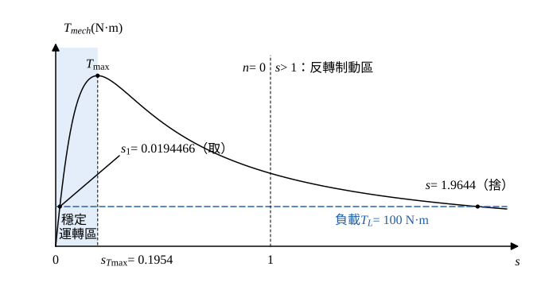

# 111 年電機機械第 2 題｜繞線式感應馬達轉矩與轉差率

## 已知與所求

三相、60 Hz、四極繞線式感應馬達，\(T_{mech}=\dfrac{207.63s}{s^2+0.0925s+0.0382}\ \mathrm{N\cdot m}\)，提示式 \(T_{mech}=\dfrac1{\omega_s}\dfrac{3V_{1,eq}^2(R_2/s)}{(R_{1,eq}+R_2/s)^2+(X_{1,eq}+X_2)^2}\)。負載 \(T_L=100\ \mathrm{N\cdot m}\)。求（一）轉速（5 分）；（二）\(R_2\) 加倍、負載不變時轉速如何變化（10 分）；（三）加轉子電阻使轉速降為 1700 rpm 的 \(R_2'/R_2\)（10 分）。

## 考場標準作答

**解題邏輯**：穩態時馬達轉矩等於負載轉矩，令題給 \(T_{mech}(s)=100\) 解出轉差率，取穩定運轉區 \(0<s<s_{T\max}\) 的根，再用 \(n=n_s(1-s)\) 換成轉速。由提示式，轉子電阻只以 \(R_2/s\) 的形式出現：電源電壓、頻率與其他參數不變時，同一負載轉矩對應同一個 \(R_2/s\)，所以 \(s\) 與 \(R_2\) 成正比，（二）（三）都由這個比例求得。前提：題給 \(T_{mech}(s)\) 即作用在負載上的轉矩（旋轉損失不另計），轉子外加電阻只改變 \(R_2\)。

### 步驟 1：同步轉速

四極、60 Hz：
\[
n_s=\frac{120f}{P}=\frac{120(60)}{4}=1800\ \mathrm{rpm}
\]

### （一）帶動 100 N·m 時的轉速（5 分）

**邏輯**：轉矩平衡 \(T_{mech}(s)=T_L\) 是 \(s\) 的二次方程式，有兩根；馬達運轉點必須落在 \(0<s<s_{T\max}\) 的穩定區，取該根再換算轉速。

轉矩平衡：
\[
\frac{207.63s}{s^2+0.0925s+0.0382}=100
\]
兩邊乘分母：
\[
207.63s=100s^2+9.25s+3.82
\]
移項（\(207.63-9.25=198.38\)）：
\[
100s^2-198.38s+3.82=0
\]
判別式：
\[
\Delta=198.38^2-4(100)(3.82)=39\,354.6244-1528=37\,826.6244
\]
\[
\sqrt\Delta=194.4907
\]
大根：
\[
s=\frac{198.38+\sqrt\Delta}{2(100)}=\frac{198.38+194.4907}{200}=\frac{392.8707}{200}=1.9644
\]
小根的公式分子 \(198.38-194.4907\) 是兩個接近數相減，會丟失有效位數；分子分母同乘 \(198.38+\sqrt\Delta\)，改用等價式：
\[
s_1=\frac{198.38-\sqrt\Delta}{200}=\frac{2(3.82)}{198.38+\sqrt\Delta}=\frac{7.64}{392.8707}=0.0194466
\]
取根：題給式的分子為 \(s\)、分母為 \(s^2+bs+c\)，對 \(s\) 微分令其為零得 \(s^2=0.0382\)，最大轉矩轉差率
\[
s_{T\max}=\sqrt{0.0382}=0.1954
\]
\(s_1=0.0194466<s_{T\max}\) 在穩定區；\(s=1.9644>1\) 表示轉子反轉（逆相制動區），不是馬達運轉點，捨去。

轉速（\(n_ss_1=1800(0.0194466)=35.0039\ \mathrm{rpm}\)）：
\[
n_1=n_s(1-s_1)=1800-35.0039=1764.9961\ \mathrm{rpm}
\]
\[
\boxed{n_1=1765.00\ \mathrm{rpm}}
\]

### （二）\(R_2\) 加倍、負載不變（10 分）

**邏輯**：提示式中 \(R_2\) 與 \(s\) 只以 \(R_2/s\) 出現，其餘參數不變；負載仍為 100 N·m，所以運轉點的 \(R_2/s\) 必須與（一）相同，\(R_2\) 加倍則 \(s\) 加倍。

\(R_2/s\) 不變：
\[
\frac{R_2}{s_1}=\frac{2R_2}{s_2}\ \Rightarrow\ s_2=2s_1
\]
代入：
\[
s_2=2(0.0194466)=0.0388932
\]
轉速（\(n_ss_2=1800(0.0388932)=70.0078\ \mathrm{rpm}\)）：
\[
n_2=n_s(1-s_2)=1800-70.0078=1729.9922\ \mathrm{rpm}
\]
轉速變化：
\[
\Delta n=n_2-n_1=1729.9922-1764.9961=-35.0039\ \mathrm{rpm}
\]
\[
\boxed{\text{轉速降為 }1\,729.99\ \mathrm{rpm}\text{（下降 }35.00\ \mathrm{rpm}\text{）}}
\]
新的最大轉矩轉差率也隨 \(R_2\) 加倍：\(2(0.1954)=0.3908\)，\(s_2=0.0388932\) 仍在穩定區；\(T_{\max}\) 本身與 \(R_2\) 無關，不變。

### （三）降速至 1700 rpm 所需 \(R_2'/R_2\)（10 分）

**邏輯**：負載仍為 100 N·m，同（二）的理由，新電阻 \(R_2'\) 與新轉差率 \(s_3\) 必須滿足 \(R_2'/s_3=R_2/s_1\)，即 \(R_2'/R_2=s_3/s_1\)；先由目標轉速求 \(s_3\)。

目標轉差率：
\[
s_3=\frac{n_s-n_3}{n_s}=\frac{1800-1700}{1800}=\frac1{18}=0.0555556
\]
\(R_2/s\) 不變：
\[
\frac{R_2'}{s_3}=\frac{R_2}{s_1}\ \Rightarrow\ \frac{R_2'}{R_2}=\frac{s_3}{s_1}
\]
代入：
\[
\frac{R_2'}{R_2}=\frac{0.0555556}{0.0194466}=2.8568
\]
\[
\boxed{\frac{R_2'}{R_2}=2.86}
\]
比值大於 1，表示要在轉子回路串入外加電阻才能降速。

## 驗算

回代（一）：分子 \(207.63(0.0194466)=4.0377\)；分母 \(s_1^2+0.0925s_1+0.0382=0.00037817+0.00179881+0.0382=0.0403770\)；\(T=4.0377/0.040377=100.00\ \mathrm{N\cdot m}\)。\(R_2\) 加倍時新轉矩函數為 \(T_{new}(s)=T(s/2)\)，故 \(T_{new}(s_2)=T(s_1)=100.00\ \mathrm{N\cdot m}\)。（三）的新最大轉矩轉差率 \(2.8568(0.1954)=0.5582\)，\(s_3=0.0555556\) 仍在穩定區。

## 失分點

- 二次式取到 \(s=1.9644\) 而得負轉速；馬達帶負載應取穩定區的小根。
- 誤認 \(R_2\) 加倍轉速不變；\(R_2\) 不改變的是最大轉矩 \(T_{\max}\)，同一負載下 \(s\) 與 \(R_2\) 成正比。
- （三）把比值寫成 \(s_1/s_3=0.35\)；加電阻降速時 \(R_2'/R_2>1\)。
