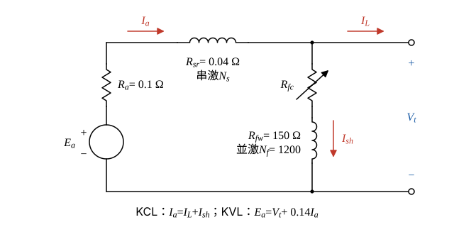
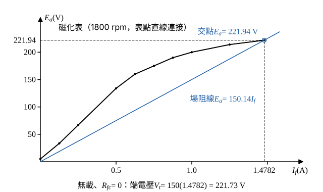

# 111 年電機機械第 3 題｜複激直流發電機磁化曲線

## 已知與所求

20 kW、200 V、1800 rpm 直流發電機，\(R_a=0.1\ \Omega\)、並激繞組 \(R_{fw}=150\ \Omega\)、場控電阻 \(R_{fc}\) 可調、串激繞組 \(R_{sr}=0.04\ \Omega\)；改為圖 (b) 長分路積複激。1800 rpm 磁化表：

| \(I_f\) (A) | 0 | 0.125 | 0.25 | 0.5 | 0.625 | 0.75 | 0.875 | 1.0 | 1.25 | 1.48 |
|---|---|---|---|---|---|---|---|---|---|---|
| \(E_a\) (V) | 5 | 33.5 | 67 | 134 | 160 | 175 | 190 | 200 | 214 | 222 |

求（一）無載最大端電壓；（二）額定滿載時相當於磁化表的總激磁電流；（三）\(N_f=1200\) 匝／極，無載與滿載端電壓皆 200 V 時的串激匝數 \(N_s\)。

## 考場標準作答

**解題邏輯**：前提為轉速固定 1800 rpm；不計電樞反應與電刷壓降；無載時串激安匝 \(N_sI_{sh}\)（約 3 安匝，相對 1200 安匝）可略。磁化表是 1800 rpm 下「等效場電流 \(I_f\) → 電樞電勢 \(E_a\)」的關係，表點之間以直線內插。
1. 長分路積複激時，並激繞組（\(R_{fw}+R_{fc}\)）跨在端點，串激繞組 \(R_{sr}\) 與電樞串聯。
2. 電樞迴路 KVL 給 \(E_a=V_t+I_a(R_a+R_{sr})\)，總激磁以並激安匝表示為 \(I_{f,eq}=I_{sh}+\dfrac{N_s}{N_f}I_a\)（步驟 1）。
3. （一）無載時 \(R_{fc}=0\) 的場阻線與磁化曲線交點電壓最高。
4. （二）滿載由 KVL 求 \(E_a\)，查表反求相當的總激磁電流。
5. （三）無載 200 V 定出並激電流，滿載仍 200 V 時，不足的激磁由串激安匝補足，求 \(N_s\)。

### 步驟 1：長分路複激電路關係

- 電路（圖 1）：電樞 \(E_a\) 經 \(R_a\)、串激繞組 \(R_{sr}\) 到正端點；並激支路 \(R_{fc}+R_{fw}\) 直接跨在端點電壓 \(V_t\) 上。
- 參考方向：發電機 \(I_a\) 由電樞流出，在正端點分成負載電流 \(I_L\) 與並激電流 \(I_{sh}\)，KCL：\(I_a=I_L+I_{sh}\)。

電樞迴路串聯電阻：
\[
R_a+R_{sr}=0.1+0.04=0.14\ \Omega
\]
電樞迴路 KVL 與並激支路：
\[
E_a=V_t+0.14I_a,\qquad V_t=(R_{fw}+R_{fc})I_{sh}=(150+R_{fc})I_{sh}
\]
積複激的總激磁（以並激繞組電流表示，才能查磁化表）：
\[
I_{f,eq}=I_{sh}+\frac{N_s}{N_f}I_a
\]

### （一）無載最大端電壓（5 分）

**邏輯**：無載 \(I_L=0\)，電樞電流全部流經並激繞組（\(I_a=I_{sh}\)）；端電壓由場阻線與磁化曲線的交點決定，場路電阻越小、場阻線越平，交點越高，所以取 \(R_{fc}=0\)。串激安匝在無載時極小，查表用 \(I_f=I_{sh}\)。

\(R_{fc}=0\) 的端電壓與電勢（以 \(I_f=I_{sh}=I_a\) 表示）：
\[
V_t=150I_f,\qquad E_a=V_t+0.14I_f=150.14I_f
\]
找交點所在區段：\(I_f=1.25\ \mathrm A\) 時 \(150.14(1.25)=187.68<214\)（曲線在上）；\(I_f=1.48\ \mathrm A\) 時 \(150.14(1.48)=222.21>222\)（直線在上），交點在 1.25–1.48 A 段。該段內插式（斜率 \(8/0.23=34.7826\ \mathrm{V/A}\)）：
\[
E_a=214+34.7826(I_f-1.25)
\]
令兩式相等：
\[
150.14I_f=214+34.7826I_f-34.7826(1.25)=214+34.7826I_f-43.4783
\]
移項：
\[
(150.14-34.7826)I_f=214-43.4783\ \Rightarrow\ 115.3574I_f=170.5217
\]
\[
I_f=\frac{170.5217}{115.3574}=1.4782\ \mathrm A
\]
交點電勢：
\[
E_a=150.14(1.4782)=221.94\ \mathrm V
\]
端電壓（扣電樞迴路壓降 \(0.14(1.4782)=0.21\ \mathrm V\)）：
\[
V_{0,\max}=150I_f=150(1.4782)
\]
\[
\boxed{V_{0,\max}=221.73\ \mathrm V\ (\approx222\ \mathrm V)}
\]

### （二）滿載的等效總激磁電流（10 分）

**邏輯**：磁化表把「總激磁」與 \(E_a\) 一一對應，所以先用滿載 KVL 求出 \(E_a\)，再反查表即得相當的總激磁電流（串、並激加總效應）。第（二）題本身未給場控電阻 \(R_{fc}\)，\(I_{sh}\) 只能給出範圍，再說明範圍內的答案都落在 1.25 A 表格點。

額定負載電流：
\[
I_L=\frac{P}{V_t}=\frac{20\,000}{200}=100\ \mathrm A
\]
電樞電流（KCL）與電勢（KVL）：
\[
I_a=I_L+I_{sh}=100+I_{sh}
\]
\[
E_a=200+0.14(100+I_{sh})=214+0.14I_{sh}\ \mathrm V
\]
\(I_{sh}=200/(150+R_{fc})\le200/150=1.3333\ \mathrm A\)，所以
\[
214<E_a\le214+0.14(1.3333)=214.19\ \mathrm V
\]
在 1.25–1.48 A 段反查（每伏 \(0.23/8=0.02875\ \mathrm A\)）：
\[
I_{f,eq}=1.25+0.02875(E_a-214)\le1.25+0.02875(0.19)=1.2555\ \mathrm A
\]
範圍 1.25–1.2555 A，在題表精度下就是 214 V 對應的表格點：
\[
\boxed{I_{f,eq}\approx1.25\ \mathrm A}
\]
若沿用第（三）題「無載 200 V」得 \(I_{sh}=1.0\ \mathrm A\)，則 \(E_a=214.14\ \mathrm V\)，
\[
I_{f,eq}=1.25+0.02875(0.14)=1.25+0.004025=1.254025\ \mathrm A
\]
這是附加條件下的精細近似，不是第（二）題單獨可定的唯一值。

### （三）平複激的串激匝數（10 分）

**邏輯**：無載 200 V 決定並激支路的 \(R_{fc}\)，滿載端電壓仍 200 V，所以並激電流不變；滿載所需總激磁（由 KVL 與磁化表求）比並激電流多出的部分，必須由串激安匝 \(N_sI_a\) 補足：\(N_fI_{f,eq}=N_fI_{sh}+N_sI_a\)。

無載 200 V：查表 \(E_a=200\ \mathrm V\) 對應 \(I_f=1.0\ \mathrm A\)，故 \(I_{sh}=1.0\ \mathrm A\)，場控電阻：
\[
R_{fc}=\frac{V_t}{I_{sh}}-R_{fw}=\frac{200}{1.0}-150=50\ \Omega
\]
滿載 \(V_t=200\ \mathrm V\)，並激電流不變 \(I_{sh}=200/(150+50)=1.0\ \mathrm A\)；電樞電流：
\[
I_a=I_L+I_{sh}=100+1.0=101\ \mathrm A
\]
滿載電勢：
\[
E_a=200+0.14(101)=200+14.14=214.14\ \mathrm V
\]
查表反求所需總激磁（1.25–1.48 A 段）：
\[
I_{f,eq}=1.25+0.02875(214.14-214)=1.25+0.004025=1.254025\ \mathrm A
\]
串激繞組須補的部分（安匝平衡除以 \(I_a\)）：
\[
N_s=\frac{N_f(I_{f,eq}-I_{sh})}{I_a}=\frac{1200(1.254025-1.0)}{101}=\frac{1200(0.254025)}{101}=\frac{304.83}{101}=3.0181
\]
\[
\boxed{N_s=3.02\approx3\ \text{匝/極}}
\]

## 驗算

無載自洽：\(N_s=3.02\)、\(I_{sh}=1.0\ \mathrm A\) 時 \(E_a=200+0.14(1.0)=200.14\ \mathrm V\)，在 1.0–1.25 A 段（56 V/A）需 \(I_f=1.0+0.14/56=1.0025\ \mathrm A\)；而 \(I_{sh}(1+N_s/N_f)=1.0(1+3.02/1200)=1.0025\ \mathrm A\)，兩者相等，忽略無載串激安匝不影響結果。滿載回代：\(I_{f,eq}=1.0+3.02(101)/1200=1.0+305.02/1200=1.2542\ \mathrm A\)，查表 \(E_a=214+34.7826(0.0042)=214.15\ \mathrm V\)，扣 \(14.14\ \mathrm V\) 得端電壓 200.01 V（≈200 V）。二分法同時解兩條件亦得 \(I_{sh}=1.00\ \mathrm A\)、\(N_s=3.02\)。

## 失分點

- 無載直接把表上最大值 222 V 當端電壓而不與場阻線求交點；最大值發生在 \(R_{fc}=0\) 的場阻線交點。
- 長分路滿載漏加並激電流，寫成 \(I_a=I_L=100\ \mathrm A\)。
- 積複激卻把串、並激安匝相減，或把 \(I_{f,eq}\) 當成實際並激支路電流。
