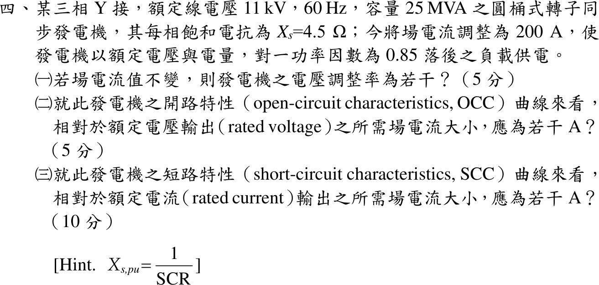
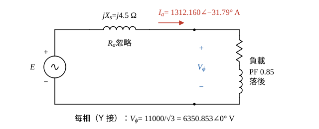
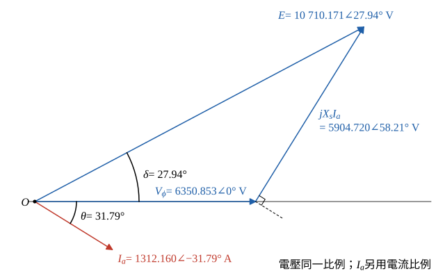
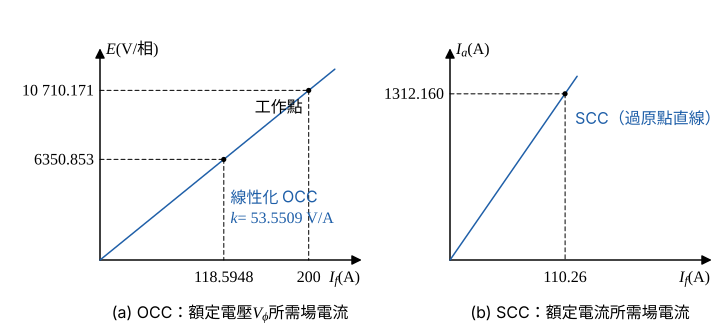

# 111 年電機機械第 4 題｜同步發電機電壓調整率與短路比

## 已知與所求

三相 Y 接、11 kV、60 Hz、25 MVA 圓桶式同步發電機，每相飽和同步電抗 \(X_s=4.5\ \Omega\)（忽略 \(R_a\)）。場電流 \(I_f=200\ \mathrm A\) 時以額定電壓、額定電流供 0.85 落後負載。提示 \(X_{s,pu}=1/\mathrm{SCR}\)。求（一）場電流不變時的電壓調整率；（二）OCC 上額定電壓所需場電流；（三）SCC 上額定電流所需場電流。

## 考場標準作答

### 步驟 1：每相等效電路與額定每相量

題幹的 200 A 為滿載 0.85 落後、額定電壓時的場電流（不是無載額定電壓的場電流）；\(R_a\) 忽略；\(X_s\) 為飽和同步電抗，視為定值；Y 接，相電流＝線電流，取 \(\underline V_\phi\) 為相位參考 \(0^\circ\)。

- 每相等效電路：內生電壓 \(\underline E\) 串聯 \(jX_s=j4.5\ \Omega\) 接到端點，端電壓 \(\underline V_\phi\)，接 PF 0.85 落後負載。
- 參考方向：\(\underline I_a\) 由發電機流向負載（輸出方向），KVL 得 \(\underline E=\underline V_\phi+jX_s\underline I_a\)。

每相端電壓（Y 接）：
\[
V_\phi=\frac{V_L}{\sqrt3}=\frac{11\ \mathrm{kV}}{\sqrt3}=6.350853\ \mathrm{kV}=6350.853\ \mathrm V
\]
額定電樞電流：
\[
I_a=\frac{S}{\sqrt3V_L}=\frac{25\ \mathrm{MVA}}{\sqrt3\times11\ \mathrm{kV}}=\frac{25\ \mathrm{MVA}}{19.05256\ \mathrm{kV}}=1.312160\ \mathrm{kA}=1312.160\ \mathrm A
\]
PF 0.85 落後，電流落後 \(\underline V_\phi\) 的角度：
\[
\theta=\cos^{-1}0.85=31.79^\circ,\qquad \sin\theta=\sqrt{1-0.85^2}=\sqrt{0.2775}=0.5267827
\]
\[
\underline I_a=1312.160\angle-31.79^\circ\ \mathrm A
\]

### （一）電壓調整率（5 分）

場電流 200 A 不變則 \(|E|\) 不變，卸載後 \(I_a=0\)、端電壓＝\(|E|\)，\(\mathrm{VR}=(|E|-V_\phi)/V_\phi\)。

電流化成直角座標：
\[
\underline I_a=1312.160(0.85)-j1312.160(0.5267827)=1115.336-j691.223\ \mathrm A
\]
同步電抗壓降（\(j\cdot(-j)=+1\)）：
\[
jX_s\underline I_a=j4.5(1115.336-j691.223)=4.5(691.223)+j4.5(1115.336)=3110.504+j5019.012\ \mathrm V
\]
與 \(\underline V_\phi=6350.853\angle0^\circ\) 相加：
\[
\underline E=(6350.853+3110.504)+j5019.012=9461.357+j5019.012\ \mathrm V
\]
大小：
\[
|E|=\sqrt{9461.357^2+5019.012^2}=\sqrt{89\,517\,276.28+25\,190\,481.46}=\sqrt{114\,707\,757.74}=10\,710.171\ \mathrm V
\]
相角（功率角）：
\[
\delta=\tan^{-1}\frac{5019.012}{9461.357}=\tan^{-1}0.530475=27.94^\circ
\]

相量圖畫法（圖 2，三個電壓相量同一比例）：

- \(\underline V_\phi\) 沿水平軸；\(\underline I_a\) 自原點畫在水平軸下方 \(31.79^\circ\)。
- 自 \(\underline V_\phi\) 尖端畫 \(jX_s\underline I_a\)，方向比 \(\underline I_a\) 超前 \(90^\circ\)，即 \(+58.21^\circ\)，長 \(4.5(1312.160)=5904.720\ \mathrm V\)。
- 原點連到 \(jX_s\underline I_a\) 尖端即 \(\underline E=10\,710.171\angle27.94^\circ\ \mathrm V\)。

電壓調整率（卸載後端電壓＝\(|E|\)）：
\[
\mathrm{VR}=\frac{|E|-V_\phi}{V_\phi}\times100\%=\frac{10\,710.171-6350.853}{6350.853}\times100\%=\frac{4359.318}{6350.853}\times100\%=68.641\%
\]
\[
\boxed{68.64\%}
\]

### （二）OCC 上額定電壓的場電流（5 分）

題目只給飽和同步電抗、沒有 OCC 數據，取通過已知工作點（\(I_f=200\ \mathrm A\) 產生 \(|E|=10\,710.171\ \mathrm V\)）的線性化 OCC \(E\propto I_f\)，求 \(E=V_\phi\) 所需的場電流。

線性化 OCC 斜率：
\[
k=\frac{|E|}{I_f}=\frac{10\,710.171}{200}=53.5509\ \mathrm{V/A}
\]
額定電壓所需場電流（比例式）：
\[
I_{f,\mathrm{OCC}}=200\times\frac{V_\phi}{|E|}=200\times\frac{6350.853}{10\,710.171}=118.5948\ \mathrm A
\]
\[
\boxed{118.59\ \mathrm A}
\]
（下一小題沿用 118.5948 A 計算，不用四捨五入後的 118.59 A。）

### （三）SCC 上額定電流的場電流（10 分）

\(\mathrm{SCR}=I_{f,\mathrm{OCC}}/I_{f,\mathrm{SCC}}\)，由提示 \(X_{s,pu}=1/\mathrm{SCR}\)，故 \(I_{f,\mathrm{SCC}}=X_{s,pu}\,I_{f,\mathrm{OCC}}\)。

基準阻抗（\(\mathrm{kV}^2/\mathrm{MVA}\)）：
\[
Z_b=\frac{V_L^2}{S}=\frac{11^2}{25}=\frac{121}{25}=4.84\ \Omega
\]
標么同步電抗：
\[
X_{s,pu}=\frac{X_s}{Z_b}=\frac{4.5}{4.84}=0.929752\ (\approx0.93)
\]
短路比：
\[
\mathrm{SCR}=\frac{1}{X_{s,pu}}=\frac{1}{0.929752}=1.076
\]
SCC 額定電流所需場電流：
\[
I_{f,\mathrm{SCC}}=\frac{I_{f,\mathrm{OCC}}}{\mathrm{SCR}}=X_{s,pu}\,I_{f,\mathrm{OCC}}=0.929752(118.5948)=110.2638\ \mathrm A
\]
\[
\boxed{110.26\ \mathrm A}
\]

## 驗算

短路法：三相短路時端電壓為零，額定電流所需內生電壓 \(E_{sc}=X_sI_a=4.5(1312.160)=5904.720\ \mathrm V\)，以同一斜率 \(k=53.5509\ \mathrm{V/A}\) 得 \(I_f=5904.720/53.5509=110.26\ \mathrm A\)，與 SCR 法一致。功率角檢查：\(|E|\sin\delta=X_sI_a\cos\theta=4.5(1115.336)=5019.012\ \mathrm V\)，與 \(\underline E\) 虛部相同。

## 失分點

- 用發電機式卻寫成 \(\underline E=\underline V-jX_s\underline I\)，得 \(|E|\) 偏小、VR 錯。
- 把題目的 200 A 當成 OCC 額定電壓場電流；200 A 是滿載 0.85 落後時的場電流，若它在無載也只產生額定電壓，第（一）題 VR 會是 0。
- SCR 寫反成 \(I_{f,\mathrm{SCC}}/I_{f,\mathrm{OCC}}\)，得 \(I_{f,\mathrm{SCC}}>I_{f,\mathrm{OCC}}\)。

## 條件與疑義

- 官方裁切圖未附完整曲線資料（無 OCC／SCC 圖或數據），第（二）（三）小題只能在「飽和同步電抗對應的線性化 OCC」假設下得唯一值；若另給實際 OCC，應以曲線讀值取代 118.59 A。
- 參考書主解：\(I_a=1312.16\angle-31.8^\circ\ \mathrm A\)、\(E_f=10710.78\angle27.94^\circ\) V/相、VR = 68.87%，\(I_{f,\mathrm{OCC}}=200\ \mathrm A\)，\(I_{f,\mathrm{SCC}}=0.93\times200\)，即 186 A。與獨立解不一致處：其 \(E_f\) 代回 \((10710.78-6350.85)/6350.85=68.65\%\)，非 68.87%；其 OCC 取 200 A 與第（一）題「200 A 時無載電壓為 10.71 kV/相」互相矛盾，186 A 隨之偏高。參考書數值僅作對照。
