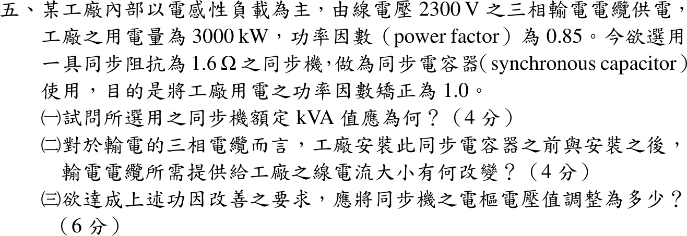
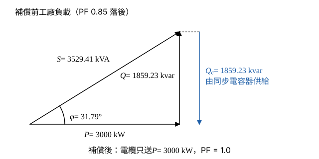
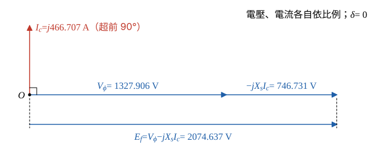

# 111 年電機機械第 5 題｜同步電容器功率因數改善

## 已知與所求

線電壓 2300 V 三相供電，工廠 3000 kW、PF 0.85 落後；同步機（同步阻抗 1.6 Ω，視為每相 \(X_s\)，忽略 \(R_a\) 與損失）作同步電容器，將 PF 改善為 1.0。求（一）同步機額定 kVA；（二）安裝前後電纜線電流；（三）所需電樞（內生）電壓。

## 考場標準作答

**解題邏輯**：功因改善為 1.0 表示工廠的落後無效功率全部改由同步電容器就地供應：（一）由 \(P\tan\varphi\) 求需補償的無效功率，同步電容器不送實功率，其額定 kVA 就等於這個 kvar；（二）由 \(P=\sqrt3V_LI_L\cos\varphi\) 分別求補償前（PF 0.85）與補償後（PF 1.0）的線電流；（三）同步機以電動機慣例寫每相方程 \(\underline E_f=\underline V_\phi-jX_s\underline I_c\)，電容器電流超前 \(V_\phi\) \(90^\circ\)，相量相減得所需電樞（內生）電壓。前提：工廠負載 3000 kW、PF 0.85 落後維持不變，供電線電壓 2300 V 不變；同步機損失與 \(R_a\) 忽略（只吸收無效功率、不吸收實功率）；題目的「同步阻抗 1.6 Ω」視為每相同步電抗 \(X_s\)；三相平衡，以 Y 接每相等效計算。

### （一）同步機額定容量（4 分）

**邏輯**：PF 改到 1.0，電纜要送的無效功率為零，工廠原本的落後無效功率 \(Q=P\tan\varphi\) 全部由同步電容器供給；同步電容器實功率為零，所以視在功率＝無效功率。

功因角與三角函數：
\[
\varphi=\cos^{-1}0.85=31.79^\circ
\]
\[
\sin\varphi=\sqrt{1-0.85^2}=\sqrt{0.2775}=0.526783
\]
\[
\tan\varphi=\frac{\sin\varphi}{\cos\varphi}=\frac{0.526783}{0.85}=0.619744
\]
工廠的落後無效功率：
\[
Q=P\tan\varphi=3000(0.619744)=1859.23\ \mathrm{kvar}
\]
補償前工廠視在功率（作圖用）：
\[
S=\frac{P}{\cos\varphi}=\frac{3000}{0.85}=3529.41\ \mathrm{kVA}
\]
同步電容器供給全部 \(Q\)、不供實功率：
\[
\boxed{S_{sc}=Q_c=1859.23\ \mathrm{kVA}}
\]

### （二）電纜線電流（4 分）

**邏輯**：電纜送的實功率 3000 kW 不變，三相線電流 \(I_L=P/(\sqrt3V_L\cos\varphi)\)；安裝前 \(\cos\varphi=0.85\)，安裝後無效功率由同步電容器就地供應，電纜只送實功率，\(\cos\varphi=1\)。

共用分母：
\[
\sqrt3V_L=\sqrt3(2300)=3983.717\ \mathrm V
\]
安裝前（PF 0.85）：
\[
I_{\text{前}}=\frac{P}{\sqrt3V_L\cos\varphi}=\frac{3\,000\,000}{3983.717(0.85)}=\frac{3\,000\,000}{3386.159}=885.96\ \mathrm A
\]
安裝後（PF 1.0）：
\[
I_{\text{後}}=\frac{P}{\sqrt3V_L}=\frac{3\,000\,000}{3983.717}=753.07\ \mathrm A
\]
減少量與比例：
\[
\Delta I=885.96-753.07=132.89\ \mathrm A,\qquad \frac{132.89}{885.96}=0.1500
\]
\[
\boxed{885.96\ \mathrm A\rightarrow753.07\ \mathrm A,\ \text{減少 }132.89\ \mathrm A\ (15\%)}
\]

### （三）電樞電壓（6 分）

**邏輯**：同步電容器是無載的同步電動機，用電動機慣例 \(\underline E_f=\underline V_\phi-jX_s\underline I_c\)（\(\underline I_c\) 流入同步機）；要送出無效功率，電流須超前 \(\underline V_\phi\) \(90^\circ\)，此時 \(-jX_s\underline I_c\) 落在正實軸，與 \(\underline V_\phi\) 同向相加，所以只要求出電流大小、乘 \(X_s\) 再加上 \(V_\phi\)。

每相電壓（取為相位參考 \(0^\circ\)）：
\[
V_\phi=\frac{V_L}{\sqrt3}=\frac{2300}{\sqrt3}=1327.906\ \mathrm V
\]
同步機電流（只有無效分量；\(Q_c=1\,859\,230\ \mathrm{var}\)）：
\[
I_c=\frac{Q_c}{\sqrt3V_L}=\frac{1\,859\,230}{3983.717}=466.707\ \mathrm A
\]
超前 \(90^\circ\)：
\[
\underline I_c=466.707\angle90^\circ=j466.707\ \mathrm A
\]
電抗壓降（\(-j\cdot j=+1\)）：
\[
-jX_s\underline I_c=-j1.6(j466.707)=1.6(466.707)=746.731\ \mathrm V
\]
電動機方程：
\[
\underline E_f=\underline V_\phi-jX_s\underline I_c=1327.906+746.731=2074.637\ \mathrm V
\]
\[
\boxed{E_f=2074.64\ \mathrm{V/相}}
\]
換成線間值：
\[
\sqrt3E_f=\sqrt3(2074.637)=3593.38\ \mathrm V
\]
\(E_f>V_\phi\)，為過激磁運轉（同步機才會送出無效功率）。

## 驗算

匯流排 KCL：工廠負載電流 \(885.96\angle-31.79^\circ=885.96(0.85)-j885.96(0.526783)=753.07-j466.71\ \mathrm A\)，加上同步機的 \(j466.71\ \mathrm A\) 得 \(753.07\angle0^\circ\ \mathrm A\)，與（二）一致。同步機無效功率另算：
\[
Q=\frac{3V_\phi(E_f-V_\phi)}{X_s}=\frac{3(1327.906)(746.731)}{1.6}=1\,859\,229\ \mathrm{var}\approx1859.23\ \mathrm{kvar}
\]
與（一）相同。

## 失分點

- 以 \(P/0.85=3529.41\ \mathrm{kVA}\) 當同步機容量；同步電容器只承擔無效功率 1859.23 kvar。
- 電動機式寫成 \(\underline E=\underline V+jX_s\underline I\) 且電流取超前，得 \(E_f=1327.906-746.731=581.18\ \mathrm V\)（欠激磁），與「當電容器」矛盾。
- 相電壓與線電壓混用：用 2300 V 直接加 \(X_sI_c\)，答成 3046.73 V。
