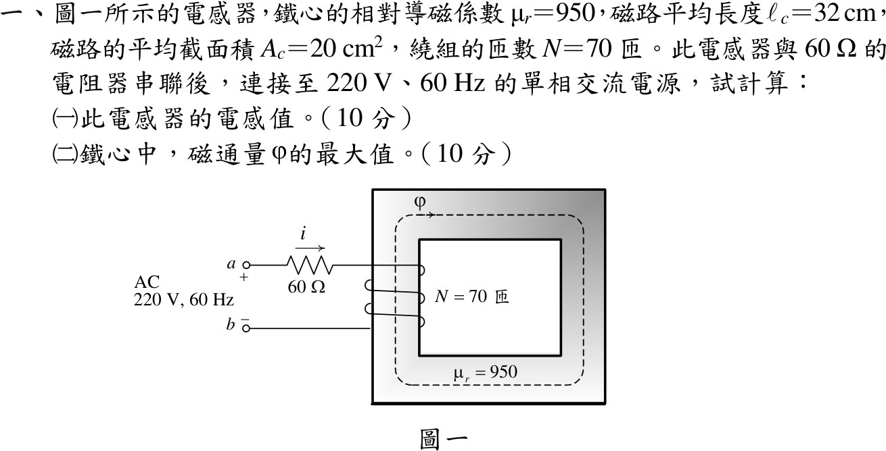
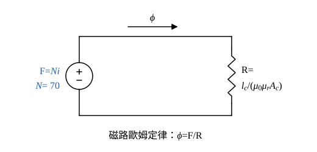
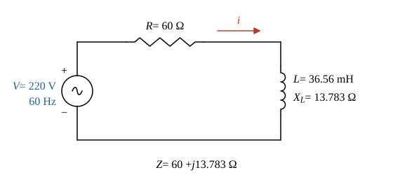

# 112 年電機機械第 1 題｜鐵心電感器與磁通峰值

## 已知與所求

\(\mu_r=950\)、\(\ell_c=32\ \mathrm{cm}\)、\(A_c=20\ \mathrm{cm^2}\)、\(N=70\)；電感器串聯 \(60\ \Omega\) 接 220 V、60 Hz。求（一）電感；（二）鐵心磁通最大值。

## 考場標準作答

### （一）電感值（10 分）

設鐵心線性未飽和（\(\mu_r\) 為定值）、無漏磁，忽略鐵損與繞組電阻（電感器視為純電感），電源 220 V 為有效值。磁動勢 \(Ni\) 驅動磁通 \(\phi\) 通過鐵心磁阻 \(\mathcal R\)（圖 1），\(\lambda=N\phi=N^2i/\mathcal R\)，故 \(L=N^2/\mathcal R\)。

單位換算：\(\ell_c=32\ \mathrm{cm}=0.32\ \mathrm m\)，\(A_c=20\ \mathrm{cm^2}=20\times10^{-4}\ \mathrm{m^2}=2\times10^{-3}\ \mathrm{m^2}\)。

鐵心導磁係數：
\[
\mu=\mu_0\mu_r=(4\pi\times10^{-7})(950)=1.19381\times10^{-3}\ \mathrm{H/m}
\]
\(\mu A_c\)：
\[
\mu A_c=(1.19381\times10^{-3})(2\times10^{-3})=2.38762\times10^{-6}\ \mathrm{H\cdot m}
\]
磁阻：
\[
\mathcal R=\frac{\ell_c}{\mu A_c}=\frac{0.32}{2.38762\times10^{-6}}=134\,025\ \mathrm{A\cdot t/Wb}
\]
電感：
\[
L=\frac{N^2}{\mathcal R}=\frac{70^2}{134\,025}=\frac{4900}{134\,025}=0.036560\ \mathrm H
\]
\[
\boxed{L=36.56\ \mathrm{mH}}
\]

### （二）鐵心磁通最大值（10 分）

線性鐵心的磁通與電流同相、成正比（\(\phi=Li/N\)），故 \(\phi_{max}=LI_{max}/N\)，\(I_{max}=\sqrt2I\)。

角頻率：
\[
\omega=2\pi f=2\pi(60)=376.991\ \mathrm{rad/s}
\]
感抗：
\[
X_L=\omega L=376.991(0.036560)=13.783\ \Omega
\]

串聯阻抗 \(Z=R+jX_L=60+j13.783\ \Omega\)，大小：
\[
|Z|=\sqrt{60^2+13.783^2}=\sqrt{3600+189.97}=\sqrt{3789.97}=61.563\ \Omega
\]
角度（電流落後電壓的角度，本題只需大小）：
\[
\theta=\tan^{-1}\frac{13.783}{60}=12.94^\circ
\]
電流有效值：
\[
I=\frac{V}{|Z|}=\frac{220}{61.563}=3.5736\ \mathrm A
\]
電流峰值：
\[
I_{max}=\sqrt2I=\sqrt2(3.5736)=5.0538\ \mathrm A
\]
磁通最大值（\(N\phi=Li\) 在電流峰值時）：
\[
\phi_{max}=\frac{LI_{max}}{N}=\frac{(36.560\ \mathrm{mH})(5.0538\ \mathrm A)}{70}
\]
\[
\phi_{max}=\frac{184.77\ \mathrm{mWb}}{70}=2.6396\ \mathrm{mWb}
\]
\[
\boxed{\phi_{max}=2.64\ \mathrm{mWb}}
\]

## 驗算

法拉第定律：電感端電壓 \(V_L=IX_L=3.5736(13.783)=49.255\ \mathrm V\)，\(\phi_{max}=\sqrt2V_L/(\omega N)=69.657/(376.991\times70)=2.6396\ \mathrm{mWb}\)。安培定律：\(B_{max}=\mu_0\mu_rN\sqrt2I/\ell_c=1.3198\ \mathrm T\)，\(B_{max}A_c=1.3198(2\times10^{-3})=2.6396\ \mathrm{mWb}\)，三法一致。

## 失分點

- 把 220 V 全部當成電感電壓：\(220\sqrt2/(376.991\times70)=11.79\ \mathrm{mWb}\)，忽略 60 Ω 分壓。
- 用電流有效值求磁通，少乘 \(\sqrt2\)，得 \(1.87\ \mathrm{mWb}\)。
- 面積換算 \(20\ \mathrm{cm^2}\) 誤寫成 \(2\times10^{-2}\ \mathrm{m^2}\)，電感大 10 倍。
