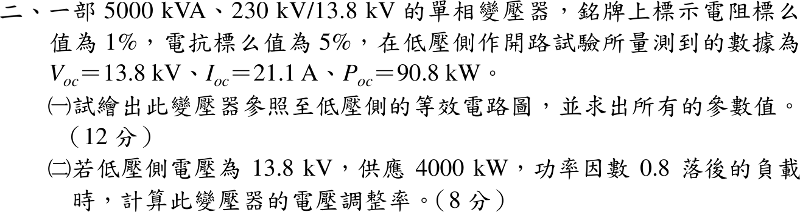
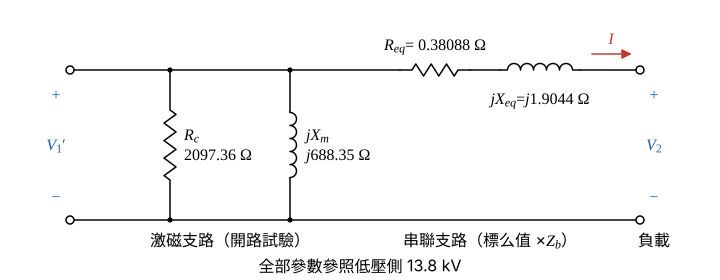

# 112 年電機機械第 2 題｜變壓器低壓側等效電路與電壓調整率

## 已知與所求

單相 5000 kVA、230 kV/13.8 kV，\(R_{pu}=1\%\)、\(X_{pu}=5\%\)；低壓側開路試驗 \(V_{oc}=13.8\ \mathrm{kV}\)、\(I_{oc}=21.1\ \mathrm A\)、\(P_{oc}=90.8\ \mathrm{kW}\)。求（一）參照低壓側的等效電路與參數；（二）低壓側 13.8 kV 供 4000 kW、PF 0.8 落後時的電壓調整率。

## 考場標準作答

### （一）低壓側等效電路與參數（12 分）

採近似等效電路，激磁支路 \(R_c\parallel jX_m\) 移到電源端、不影響串聯壓降，全部參照低壓側；銘牌 1%、5% 為一、二次合計的串聯標么值，無法再拆成兩側；230 kV 用不到（所求為低壓側）。基準取低壓側 \(V_b=13.8\ \mathrm{kV}\)、\(S_b=5000\ \mathrm{kVA}\)，\(R_{eq},X_{eq}\) 直接為低壓側值；開路試驗在低壓側額定電壓下做，量到的實功率全是鐵損（\(V^2/R_c\)），無效功率為激磁無效功率（\(V^2/X_m\)）。

低壓側基準阻抗：
\[
Z_{b,LV}=\frac{V_{LV}^2}{S}=\frac{13\,800^2}{5\,000\,000}=\frac{190\,440\,000}{5\,000\,000}=38.088\ \Omega
\]
串聯電阻與電抗（標么值×基準阻抗）：
\[
R_{eq}=R_{pu}Z_{b,LV}=0.01(38.088)=0.38088\ \Omega
\]
\[
X_{eq}=X_{pu}Z_{b,LV}=0.05(38.088)=1.9044\ \Omega
\]
鐵損電阻（開路實功率全由 \(R_c\) 消耗）：
\[
R_c=\frac{V_{oc}^2}{P_{oc}}=\frac{190\,440\,000}{90\,800}=2097.36\ \Omega
\]
開路視在功率：
\[
S_{oc}=V_{oc}I_{oc}=13\,800(21.1)=291\,180\ \mathrm{VA}=291.18\ \mathrm{kVA}
\]
激磁無效功率（功率三角形）：
\[
Q_{oc}=\sqrt{S_{oc}^2-P_{oc}^2}=\sqrt{291.18^2-90.8^2}=\sqrt{84\,785.79-8244.64}=\sqrt{76\,541.15}=276.66\ \mathrm{kvar}
\]
磁化電抗：
\[
X_m=\frac{V_{oc}^2}{Q_{oc}}=\frac{190\,440\,000}{276\,660}=688.35\ \Omega
\]
\[
\boxed{R_{eq}=0.38\ \Omega,\ X_{eq}=1.90\ \Omega,\ R_c=2097.36\ \Omega,\ X_m=688.35\ \Omega}
\]
（\(R_{eq}\)、\(X_{eq}\) 的精確值為 0.38088 Ω、1.9044 Ω，圖與（二）都用精確值。）

等效電路畫法（圖 1）：

- 左端為一次側折算到低壓側的電壓 \(\underline V_1'\)，端點間並聯 \(R_c\) 與 \(jX_m\)（激磁支路）。
- 上方導線串聯 \(R_{eq}\) 與 \(jX_{eq}\) 到右端負載，負載電壓 \(\underline V_2\)；負載電流 \(\underline I\) 由左向右流。

### （二）電壓調整率（8 分）

取 \(\underline V_2=13.8\ \mathrm{kV}\angle0^\circ\) 為參考；激磁支路在電源端，負載電流只流過串聯阻抗，\(\underline V_1'=\underline V_2+\underline I(R_{eq}+jX_{eq})\)。卸載後（一次電壓不變）二次端電壓升到 \(|V_1'|\)，故 \(\mathrm{VR}=(|V_1'|-V_2)/V_2\)。

負載電流大小：
\[
I=\frac{P}{V_2\cos\varphi}=\frac{4\,000\,000}{13\,800(0.8)}=\frac{4\,000\,000}{11\,040}=362.32\ \mathrm A
\]
額定（基準）電流：
\[
I_b=\frac{S}{V_{LV}}=\frac{5\,000\,000}{13\,800}=362.32\ \mathrm A
\]
兩者相等（\(4000/0.8=5000\ \mathrm{kVA}\)），即 \(I=1\ \mathrm{pu}\)。PF 0.8 落後，\(\varphi=\cos^{-1}0.8=36.87^\circ\)、\(\sin\varphi=0.6\)：
\[
\underline I=362.32\angle-36.87^\circ=362.32(0.8)-j362.32(0.6)=289.86-j217.39\ \mathrm A
\]
串聯壓降：因 \(I_bZ_{b,LV}=V_{LV}=13\,800\ \mathrm V\)，
\[
\underline I(R_{eq}+jX_{eq})=I_bZ_{b,LV}(0.8-j0.6)(0.01+j0.05)=13\,800(0.8-j0.6)(0.01+j0.05)
\]
展開複數乘積：
\[
(0.8-j0.6)(0.01+j0.05)=0.008+j0.04-j0.006+0.03=0.038+j0.034
\]
\[
\underline I(R_{eq}+jX_{eq})=13\,800(0.038+j0.034)=524.4+j469.2\ \mathrm V
\]
一次側折算電壓：
\[
\underline V_1'=\underline V_2+\underline I(R_{eq}+jX_{eq})=(13\,800+524.4)+j469.2=14\,324.4+j469.2\ \mathrm V
\]
大小：
\[
|V_1'|=\sqrt{14\,324.4^2+469.2^2}=\sqrt{205\,188\,435.36+220\,148.64}=\sqrt{205\,408\,584}=14\,332.08\ \mathrm V
\]
電壓調整率：
\[
\mathrm{VR}=\frac{|V_1'|-V_2}{V_2}=\frac{14\,332.08-13\,800}{13\,800}=\frac{532.08}{13\,800}=0.03856
\]
\[
\boxed{\mathrm{VR}=3.86\%}
\]

## 驗算

用實際電流與歐姆值直接算串聯壓降的實部：\(289.86(0.38088)+217.39(1.9044)=110.40+414.00=524.40\ \mathrm V\)，與標么值算法相同。開路支路回代：\(13\,800/2097.36=6.580\ \mathrm A\)（鐵損電流）、\(13\,800/688.35=20.048\ \mathrm A\)（磁化電流），\(\sqrt{6.580^2+20.048^2}=\sqrt{43.30+401.92}=\sqrt{445.22}=21.10\ \mathrm A\)，等於 \(I_{oc}\)。

## 失分點

- 以 \(V_{oc}/I_{oc}=654\ \Omega\) 當 \(X_m\)，忽略鐵損分量。
- 用高壓側 230 kV 求基準阻抗（\(Z_b=10.58\ \mathrm{k\Omega}\)），卻把參數畫在低壓側。
- 把 \(\underline I\) 當成與 \(\underline V_2\) 同相，串聯壓降只剩 \(13\,800(0.01+j0.05)\)，VR 只有 1.12%。
