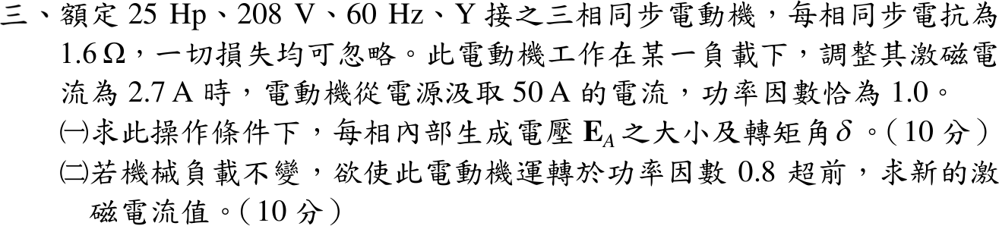
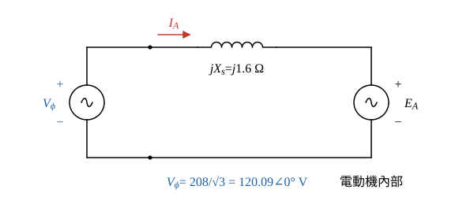
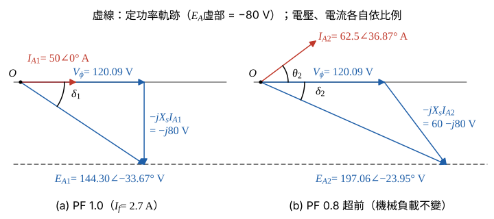

# 112 年電機機械第 3 題｜同步電動機激磁調整

## 已知與所求

25 hp、208 V、60 Hz、Y 接同步電動機，\(X_s=1.6\ \Omega\)，損失忽略；\(I_f=2.7\ \mathrm A\) 時取 50 A、PF 1.0。求（一）\(E_A\) 與轉矩角 \(\delta\)；（二）負載不變、PF 0.8 超前時的激磁電流。

## 考場標準作答

**解題邏輯**：前提為 Y 接，相電流＝線電流，\(\mathbf V_\phi\) 取為相位參考 \(0^\circ\)；端電壓 208 V 不變；電樞電阻與一切損失忽略；題目未給磁化曲線，\(E_A\propto I_f\)（未飽和）。25 hp 為額定值，本題工作點由電流給定，不必用到。
1. 用同步電動機每相等效電路 \(\mathbf E_A=\mathbf V_\phi-jX_s\mathbf I_A\)（電流流入電動機）。
2. （一）由 50 A、PF 1.0 寫出 \(\mathbf I_A\)，相量相減得 \(\mathbf E_A\)，取大小與相角（轉矩角 \(\delta\)）。
3. （二）機械負載不變且無損失，輸入實功率不變，由 PF 0.8 超前求新電流 \(\mathbf I_A\)，再求新的 \(|E_A|\)。
4. 激磁電流與 \(|E_A|\) 成正比，按比例得新激磁電流。

### 步驟 1：每相等效電路與相電壓

- 每相等效電路：端電壓 \(\mathbf V_\phi\) 經 \(jX_s=j1.6\ \Omega\) 接到內部生成電壓 \(\mathbf E_A\)。
- 參考方向：\(\mathbf I_A\) 由電源流入電動機，KVL 得 \(\mathbf V_\phi=jX_s\mathbf I_A+\mathbf E_A\)，即 \(\mathbf E_A=\mathbf V_\phi-jX_s\mathbf I_A\)。

每相電壓（Y 接）：
\[
V_\phi=\frac{V_L}{\sqrt3}=\frac{208}{\sqrt3}=120.09\ \mathrm V
\]

### （一）內部生成電壓與轉矩角（10 分）

**邏輯**：PF 1.0 表示 \(\mathbf I_A\) 與 \(\mathbf V_\phi\) 同相；代入電動機方程，同步電抗壓降 \(-jX_s\mathbf I_A\) 垂直向下，與 \(\mathbf V_\phi\) 相加後取大小得 \(|E_A|\)、取相角得 \(\delta\)。

電流相量（PF 1.0，記為 \(\mathbf I_{A1}\)）：
\[
\mathbf I_{A1}=50\angle0^\circ=50\ \mathrm A
\]
電抗壓降：
\[
-jX_s\mathbf I_{A1}=-j1.6(50)=-j80\ \mathrm V
\]
電動機方程：
\[
\mathbf E_{A1}=\mathbf V_\phi-jX_s\mathbf I_{A1}=120.09-j80\ \mathrm V
\]
大小：
\[
|E_{A1}|=\sqrt{120.09^2+80^2}=\sqrt{14\,421.61+6400}=\sqrt{20\,821.61}
\]
\[
\boxed{|E_{A1}|=144.30\ \mathrm{V/相}}
\]
相角（\(\mathbf E_{A1}\) 落後 \(\mathbf V_\phi\)，電動機的 \(\delta_1<0\)）：
\[
\delta_1=\tan^{-1}\frac{-80}{120.09}=\tan^{-1}(-0.6662)
\]
\[
\boxed{\delta_1=-33.67^\circ}
\]

### （二）新的激磁電流（10 分）

**邏輯**：無損失，輸入實功率＝機械輸出，負載不變則 \(3V_\phi I_A\cos\theta\) 不變；\(V_\phi\) 不變，所以 \(I_A\cos\theta\) 不變，由此得新電流大小。新電流超前 \(36.87^\circ\)，同樣代入 \(\mathbf E_A=\mathbf V_\phi-jX_s\mathbf I_A\) 求新的 \(|E_A|\)，最後依 \(E_A\propto I_f\) 按比例換算激磁電流。

實功率不變（\(V_\phi\) 相同，兩邊約去 \(3V_\phi\)）：
\[
I_{A2}\cos\theta_2=I_{A1}\cos\theta_1\ \Rightarrow\ I_{A2}(0.8)=50(1.0)
\]
\[
I_{A2}=\frac{50}{0.8}=62.5\ \mathrm A
\]
超前角 \(\theta_2=\cos^{-1}0.8=36.87^\circ\)（\(\sin\theta_2=0.6\)），化成直角座標：
\[
\mathbf I_{A2}=62.5\angle36.87^\circ=62.5(0.8)+j62.5(0.6)=50+j37.5\ \mathrm A
\]
電抗壓降（\(-j\cdot j37.5=+37.5\)）：
\[
-jX_s\mathbf I_{A2}=-j1.6(50+j37.5)=-j80+60=60-j80\ \mathrm V
\]
電動機方程：
\[
\mathbf E_{A2}=\mathbf V_\phi-jX_s\mathbf I_{A2}=(120.09+60)-j80=180.09-j80\ \mathrm V
\]
大小：
\[
|E_{A2}|=\sqrt{180.09^2+80^2}=\sqrt{32\,432.41+6400}=\sqrt{38\,832.41}=197.06\ \mathrm V
\]
相角：
\[
\delta_2=\tan^{-1}\frac{-80}{180.09}=\tan^{-1}(-0.4442)=-23.95^\circ
\]

相量圖畫法（圖 2，電壓與電流各用一個比例）：

- \(\mathbf V_\phi=120.09\angle0^\circ\) 沿水平軸；\(\mathbf I_{A1}=50\angle0^\circ\) 與它同方向，\(\mathbf I_{A2}=62.5\angle36.87^\circ\) 在水平軸上方。
- 自 \(\mathbf V_\phi\) 尖端畫 \(-jX_s\mathbf I_A\)（比 \(\mathbf I_A\) 落後 \(90^\circ\)）：\(\mathbf I_{A1}\) 時為垂直向下 80 V；\(\mathbf I_{A2}\) 時為 \(60-j80\ \mathrm V\)。
- 兩個 \(\mathbf E_A\) 尖端都落在虛部 \(-80\ \mathrm V\) 的水平線上：這條線就是定功率軌跡（\(E_A\sin|\delta|=X_sI_A\cos\theta\) 不變）。

激磁電流與 \(|E_A|\) 成正比：
\[
I_{f2}=I_{f1}\frac{|E_{A2}|}{|E_{A1}|}=2.7\times\frac{197.06}{144.30}=2.7(1.3656)
\]
\[
\boxed{I_{f2}=3.69\ \mathrm A}
\]

## 驗算

定功率檢查：\(P=3V_\phi E_A\sin|\delta|/X_s\)，兩工作點 \(E_A\sin|\delta|\) 都等於虛部大小 80 V，故
\[
P=\frac{3(120.09)(80)}{1.6}=18\,013.5\ \mathrm W,\qquad 3V_\phi I_{A1}(1.0)=3(120.09)(50)=18\,013.5\ \mathrm W
\]
兩式相同，且 \(3(120.09)(62.5)(0.8)=18\,013.5\ \mathrm W\)，PF 0.8 超前時輸入功率確實不變。

## 失分點

- 用發電機方程 \(\mathbf V+jX\mathbf I\)，使 \(\delta\) 變號、（二）的 \(|E_A|\) 變小。
- PF 改變後仍取 50 A，違反定負載條件。
- 超前電流化直角座標時虛部取負號（當成落後），\(|E_A|\) 反而變小，激磁電流方向算反。

## 條件與疑義

題目未給磁化曲線，（二）採未飽和線性關係 \(E_A\propto I_f\)；若鐵心已飽和，所需激磁電流會大於 3.69 A。
