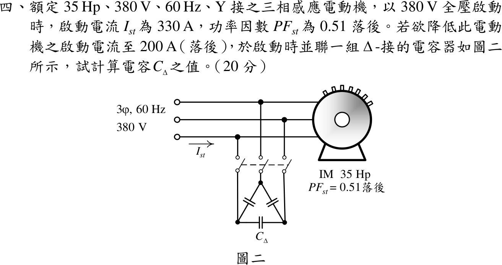
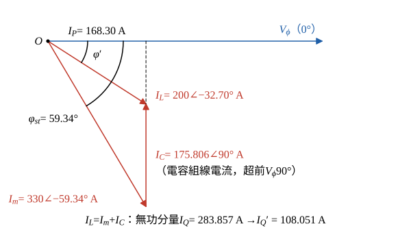

# 112 年電機機械第 4 題｜Δ 接電容降低感應電動機啟動電流

## 已知與所求

35 hp、380 V、60 Hz、Y 接感應電動機，全壓啟動 \(I_{st}=330\ \mathrm A\)、\(PF_{st}=0.51\) 落後；啟動時並聯 Δ 接電容，使線電流降為 200 A（仍落後）。求每支路電容 \(C_\Delta\)。

## 考場標準作答

**解題邏輯**：前提為電源為無限匯流排，加電容後端電壓仍為 380 V，馬達啟動電流不變；電容為理想（無損失）；題目「200 A（落後）」取落後根。35 hp 為銘牌額定，計算用不到。
1. 以 a 相相電壓 \(\underline V_\phi\) 為 \(0^\circ\) 參考，把馬達啟動電流分成有功分量與無功（落後）分量。
2. 並聯電容只提供超前 \(90^\circ\) 的無功電流，不改變有功分量，所以補償後的線電流 200 A 由「有功分量不變」解出新的無功分量，兩者之差就是電容組的線電流 \(I_C\)。
3. Δ 接電容每支路跨線電壓 380 V、支路電流 \(I_\Delta=I_C/\sqrt3\)。
4. 再由 \(I_\Delta=\omega C_\Delta V_{LL}\) 求 \(C_\Delta\)。

### 步驟 1：馬達啟動電流的有功與無功分量

功率因數角：
\[
\varphi_{st}=\cos^{-1}0.51=59.34^\circ
\]
\[
\sin\varphi_{st}=\sqrt{1-0.51^2}=\sqrt{0.7399}=0.860174
\]
有功分量（與 \(\underline V_\phi\) 同相）：
\[
I_P=I_{st}\cos\varphi_{st}=330(0.51)=168.30\ \mathrm A
\]
無功分量（落後 \(90^\circ\)）：
\[
I_Q=I_{st}\sin\varphi_{st}=330(0.860174)=283.857\ \mathrm A
\]
\[
\underline I_m=168.30-j283.857\ \mathrm A=330\angle-59.34^\circ\ \mathrm A
\]

### 步驟 2：補償後的無功分量與電容組線電流

電容電流超前 \(\underline V_\phi\) \(90^\circ\)（純虛數 \(+jI_C\)），所以補償後線電流 \(\underline I_L=\underline I_m+jI_C\) 的實部仍為 168.30 A。由 \(|\underline I_L|=200\ \mathrm A\)：
\[
I_P^2+I_Q'^2=200^2
\]
\[
I_Q'^2=200^2-168.30^2=40\,000-28\,324.89=11\,675.11
\]
\[
I_Q'=\sqrt{11\,675.11}=108.051\ \mathrm A
\]
「落後」取虛部為負，大小與角度：
\[
\underline I_L=168.30-j108.051\ \mathrm A,\qquad |\underline I_L|=200\ \mathrm A,\qquad \varphi'=\cos^{-1}\frac{168.30}{200}=\cos^{-1}0.8415=32.70^\circ
\]
電容組線電流（虛部的差）：
\[
I_C=I_Q-I_Q'=283.857-108.051=175.806\ \mathrm A
\]

### 每支路電容 \(C_\Delta\)（20 分）

**邏輯**：Δ 接平衡電容組的線電流是支路電流的 \(\sqrt3\) 倍；每支路跨在線電壓 380 V 上，支路電流 \(I_\Delta=V_{LL}/X_C=\omega C_\Delta V_{LL}\)，解出 \(C_\Delta\)。

Δ 支路電流：
\[
I_\Delta=\frac{I_C}{\sqrt3}=\frac{175.806}{\sqrt3}=101.5016\ \mathrm A
\]
（多保留一位，使下一行照字面算得框內值。）

角頻率與 \(\omega V_{LL}\)：
\[
\omega=2\pi(60)=376.991\ \mathrm{rad/s},\qquad \omega V_{LL}=376.991(380)=143\,256.6\ \mathrm{V/s}
\]
由 \(I_\Delta=\omega C_\Delta V_{LL}\)：
\[
C_\Delta=\frac{I_\Delta}{\omega V_{LL}}=\frac{101.5016}{143\,256.6}=7.0853\times10^{-4}\ \mathrm F
\]
\[
\boxed{C_\Delta=708.53\ \mu\mathrm F}
\]

## 驗算

無功功率平衡：馬達 \(Q_m=\sqrt3(380)(283.857)=186.829\ \mathrm{kvar}\)，補償後 \(Q'=\sqrt3(380)(108.051)=71.117\ \mathrm{kvar}\)；電容須供 \(186.829-71.117=115.712\ \mathrm{kvar}=3V_{LL}^2\omega C_\Delta\)，\(C_\Delta=115\,712/[3(380^2)(376.991)]=708.53\ \mu\mathrm F\)，一致。

## 失分點

- 把線電流 \(175.806\ \mathrm A\) 直接當 Δ 支路電流，\(C\) 大 \(\sqrt3\) 倍（\(1227.21\ \mu\mathrm F\)）。
- 取正根 \(+108.051\ \mathrm A\)（超前），\(I_C=283.857+108.051=391.908\ \mathrm A\)，電容變為 \(1579.46\ \mu\mathrm F\)，違反「落後」條件。
- 直接用電流大小相減 \(330-200=130\ \mathrm A\) 當電容電流：電流是相量，電容只能抵銷無功分量。
