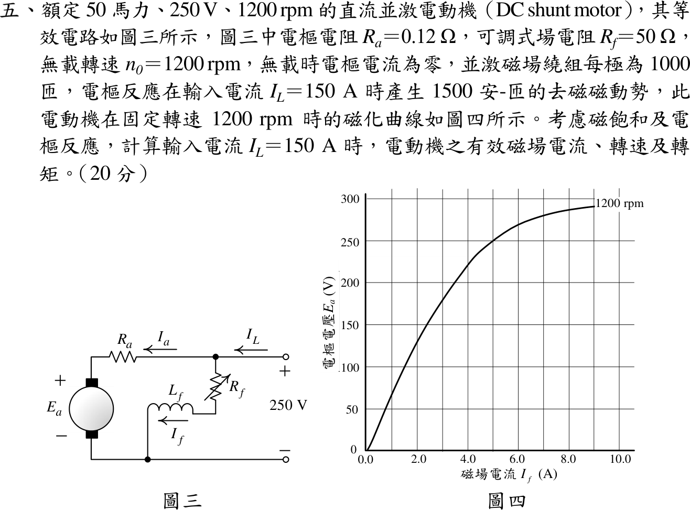
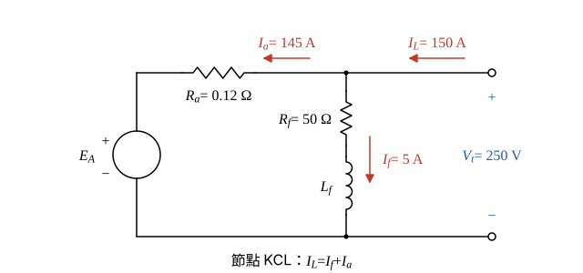

# 112 年電機機械第 5 題｜直流並激電動機（飽和與電樞反應）

## 已知與所求

50 hp、250 V、1200 rpm 並激電動機：\(R_a=0.12\ \Omega\)、場電阻 \(R_f=50\ \Omega\)，無載 1200 rpm、\(I_a=0\)；場繞組每極 1000 匝；\(I_L=150\ \mathrm A\) 時電樞反應去磁 1500 A·t；圖四為 1200 rpm 磁化曲線。求 \(I_L=150\ \mathrm A\) 時有效磁場電流、轉速、轉矩。

## 考場標準作答

**解題邏輯**：並激電動機的場繞組直接跨在 250 V 端電壓上，先用 KCL 把輸入電流 \(I_L\) 分成場電流 \(I_f\) 與電樞電流 \(I_a\)（步驟 1）。電樞反應的去磁磁動勢以安匝計，從場繞組磁動勢扣掉後除以匝數，得「有效磁場電流」\(I_f^*\)，才能拿去查 1200 rpm 磁化曲線；磁通相同時反電勢與轉速成正比，故由曲線讀值 \(E_{A0}\) 與電樞 KVL 求得的實際 \(E_A\) 相比得轉速；最後由電磁功率 \(E_AI_a\) 除以機械角速度得轉矩。前提：端電壓維持 250 V、\(R_f=50\ \Omega\) 不調；電刷壓降與旋轉損失題目未給，不計（所求轉矩為電磁轉矩）；磁化曲線已含飽和效應，故用查圖而非線性比例；50 hp 為額定值，本題工作點由 \(I_L=150\ \mathrm A\) 給定，不必用到。

### 步驟 1：並激電路的 KCL 分流

- 電路（圖三）：端點 \(+\) 節點同時接場支路 \(R_f\)（含 \(L_f\)）與電樞支路 \(R_a\)–\(E_A\)，兩支路並聯在 \(V_t=250\ \mathrm V\) 上。
- 參考方向：\(I_L\) 由電源流入節點，\(I_f\) 流入場支路，\(I_a\) 流入電樞（電動機慣例），所以節點 KCL 為 \(I_L=I_f+I_a\)。

場電流（場支路直接跨端電壓）：
\[
I_f=\frac{V_t}{R_f}=\frac{250}{50}=5\ \mathrm A
\]
電樞電流（KCL）：
\[
I_a=I_L-I_f=150-5=145\ \mathrm A
\]

### 有效磁場電流

**邏輯**：磁化曲線的橫軸是「場電流」，代表的是場繞組產生的淨磁動勢；電樞反應去磁 1500 A·t 抵消了一部分場磁動勢，所以把淨磁動勢 \(N_fI_f-\mathcal F_{AR}\) 除以每極匝數 \(N_f\)，換回等效的場電流再查圖。

淨磁動勢：
\[
\mathcal F_{net}=N_fI_f-\mathcal F_{AR}=1000(5)-1500=5000-1500=3500\ \mathrm{A\cdot t}
\]
換回等效場電流：
\[
I_f^*=\frac{\mathcal F_{net}}{N_f}=\frac{3500}{1000}
\]
\[
\boxed{I_f^*=3.50\ \mathrm A}
\]

### 轉速

**邏輯**：圖四是 1200 rpm 下 \(E_A\)–\(I_f\) 曲線；有效磁場電流相同代表磁通 \(\phi\) 相同，由 \(E_A=K\phi\omega\) 得 \(E_A/E_{A0}=n/n_0\)。所以查圖得 1200 rpm 時的 \(E_{A0}\)，再用電樞迴路 KVL 求出負載時實際的 \(E_A\)，兩者之比乘 1200 rpm 即轉速。

查圖四：橫軸 \(I_f^*=3.50\ \mathrm A\)（3.0 與 4.0 A 格線的中點）往上到曲線，向左讀縱軸，落在 200 V 格線上：
\[
E_{A0}\approx200\ \mathrm V\quad(n_0=1200\ \mathrm{rpm})
\]
電樞迴路 KVL（電動機：端電壓＝反電勢＋電阻壓降）：
\[
E_A=V_t-I_aR_a=250-145(0.12)=250-17.4=232.6\ \mathrm V
\]
磁通相同，反電勢與轉速成正比：
\[
n=n_0\frac{E_A}{E_{A0}}=1200\times\frac{232.6}{200}=1200(1.163)
\]
\[
\boxed{n=1395.60\ \mathrm{rpm}}
\]
（比 1200 rpm 高：去磁使磁通下降，要更高轉速才能產生 232.6 V 反電勢。）

### 轉矩

**邏輯**：旋轉損失不計，電樞吸收的電磁功率 \(P_{conv}=E_AI_a\) 全部轉成機械功率；轉矩＝功率÷機械角速度，角速度用上一小題的轉速換算。

電磁功率：
\[
P_{conv}=E_AI_a=232.6(145)=33\,727\ \mathrm W
\]
機械角速度（取 4 位小數，避免除法後末位不符）：
\[
\omega_m=\frac{2\pi n}{60}=\frac{2\pi(1395.6)}{60}=146.1469\ \mathrm{rad/s}
\]
電磁轉矩：
\[
T=\frac{P_{conv}}{\omega_m}=\frac{33\,727}{146.1469}
\]
\[
\boxed{T=230.77\ \mathrm{N\cdot m}}
\]

## 驗算

以 \(K\phi\) 求轉矩（與轉速無關的另一路）：1200 rpm 的角速度 \(\omega_0=2\pi(1200)/60=40\pi=125.6637\ \mathrm{rad/s}\)，
\[
K\phi=\frac{E_{A0}}{\omega_0}=\frac{200}{125.6637}=1.591549\ \mathrm{V\cdot s/rad},\qquad T=K\phi I_a=1.591549(145)=230.77\ \mathrm{N\cdot m}
\]
與上面一致。讀圖基準：圖四在 \(I_f=5\ \mathrm A\) 約 250 V，與「無載 \(I_a=0\)、1200 rpm、端電壓 250 V」相符。

## 失分點

- 忽略電樞反應，用 \(I_f=5\ \mathrm A\) 讀 250 V，得 \(n=1200(232.6/250)=1116.48\ \mathrm{rpm}\)；去磁使磁通下降，轉速應上升。
- 把磁化曲線讀值 200 V 直接當負載 \(E_A\)；\(E_A\) 須由電樞 KVL 求得 232.6 V。
- \(I_a\) 寫成 150 A（漏扣場電流 5 A）。

## 條件與疑義

\(E_{A0}\) 由圖讀取，約 \(\pm2\ \mathrm V\) 的讀圖誤差會使轉速變動約 \(\pm1\%\)（約 1382–1410 rpm），轉矩隨 \(K\phi\) 同比例變動。
