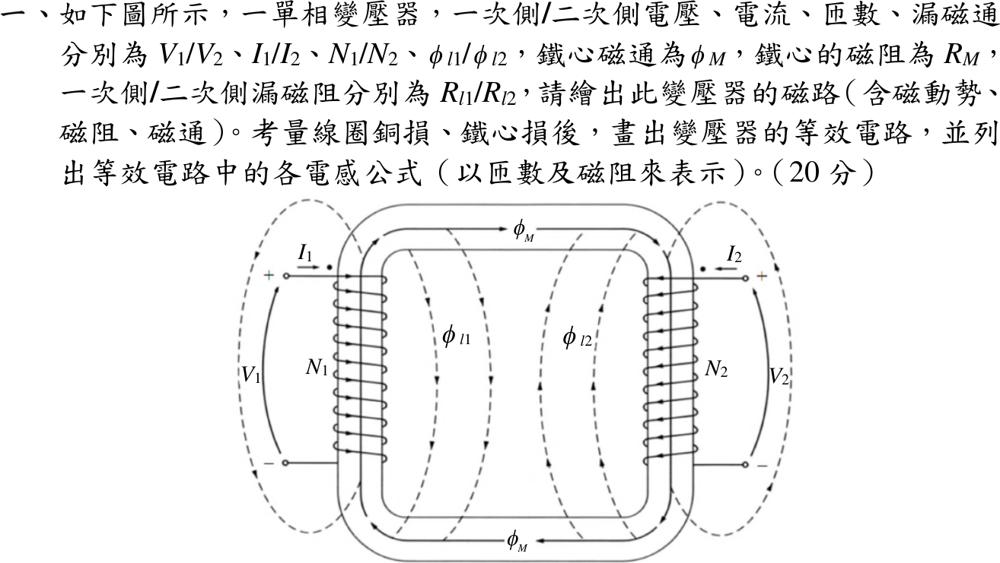
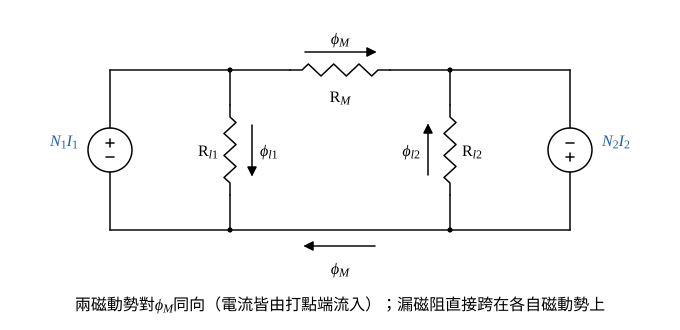
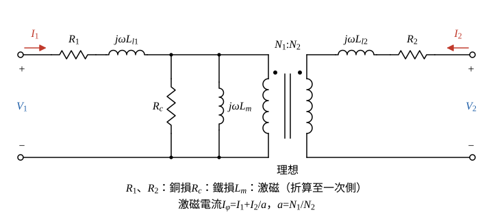

# 113 年電機機械第 1 題｜變壓器磁路與等效電路電感

## 已知與所求

單相變壓器 \(V_1/V_2\)、\(I_1/I_2\)、\(N_1/N_2\)，漏磁通 \(\phi_{l1}/\phi_{l2}\)、鐵心磁通 \(\phi_M\)；鐵心磁阻 \(\mathcal R_M\)，漏磁阻 \(\mathcal R_{l1}/\mathcal R_{l2}\)。圖中 \(I_1\)、\(I_2\) 皆由打點端流入。求磁路、含銅損與鐵損的等效電路，以及各電感（以匝數與磁阻表示）。

## 考場標準作答

### 磁路（含磁動勢、磁阻、磁通）

設鐵心與漏磁路線性（磁阻為定值）；\(I_1\)、\(I_2\) 皆由打點端流入，兩磁動勢對 \(\phi_M\) 同向相加。漏磁通只由自身繞組驅動、只經漏磁阻，故漏磁阻直接跨在自身磁動勢兩端；主磁通由兩磁動勢串聯驅動經 \(\mathcal R_M\)。

畫法：

- 左、右各一個磁動勢源 \(N_1I_1\)、\(N_2I_2\)；兩電流都由打點端流入，兩者在鐵心迴路上推動 \(\phi_M\) 的方向相同（圖 1 皆為順時針）。
- \(\mathcal R_{l1}\) 直接並在 \(N_1I_1\) 兩端，\(\mathcal R_{l2}\) 直接並在 \(N_2I_2\) 兩端。
- \(\mathcal R_M\)（整個鐵心路徑的磁阻）把兩側連成主磁路。

主磁路迴圈（兩磁動勢串聯相加）：
\[
\phi_M=\frac{N_1I_1+N_2I_2}{\mathcal R_M}
\]
兩漏磁路（各自磁動勢直接跨在漏磁阻上）：
\[
\phi_{l1}=\frac{N_1I_1}{\mathcal R_{l1}},\qquad \phi_{l2}=\frac{N_2I_2}{\mathcal R_{l2}}
\]

### 步驟 1：磁鏈與端電壓方程

以下以瞬時值 \(i_1\)、\(i_2\) 推導（\(\lambda\) 要對時間微分）；圖 2 的相量形式對應 \(I_1\)、\(I_2\)，\(d/dt\to j\omega\)。

一次繞組交鏈 \(\phi_{l1}\) 與 \(\phi_M\)：
\[
\lambda_1=N_1(\phi_{l1}+\phi_M)=\frac{N_1^2}{\mathcal R_{l1}}i_1+\frac{N_1(N_1i_1+N_2i_2)}{\mathcal R_M}
\]
令 \(a=N_1/N_2\)、\(i_2'=i_2/a=(N_2/N_1)i_2\)，第二項提出 \(N_1^2/\mathcal R_M\)：
\[
\lambda_1=\frac{N_1^2}{\mathcal R_{l1}}i_1+\frac{N_1^2}{\mathcal R_M}\left(i_1+i_2'\right)
\]
一次側端電壓（繞組電阻壓降＋磁鏈變化率）：
\[
v_1=R_1i_1+\frac{d\lambda_1}{dt}=R_1i_1+\frac{N_1^2}{\mathcal R_{l1}}\frac{di_1}{dt}+\frac{N_1^2}{\mathcal R_M}\frac{d(i_1+i_2')}{dt}
\]
二次繞組交鏈 \(\phi_{l2}\) 與 \(\phi_M\)：
\[
\lambda_2=N_2(\phi_{l2}+\phi_M)=\frac{N_2^2}{\mathcal R_{l2}}i_2+\frac{N_2(N_1i_1+N_2i_2)}{\mathcal R_M}
\]
第二項提出 \(N_1^2/\mathcal R_M\)（\(N_2(N_1i_1+N_2i_2)=\frac{N_2}{N_1}N_1^2\left(i_1+\frac{N_2}{N_1}i_2\right)\)）：
\[
\lambda_2=\frac{N_2^2}{\mathcal R_{l2}}i_2+\frac{N_2}{N_1}\cdot\frac{N_1^2}{\mathcal R_M}\left(i_1+i_2'\right)
\]
二次側端電壓：
\[
v_2=R_2i_2+\frac{N_2^2}{\mathcal R_{l2}}\frac{di_2}{dt}+\frac{1}{a}\cdot\frac{N_1^2}{\mathcal R_M}\frac{d(i_1+i_2')}{dt}
\]
兩式的最後一項都來自 \(\phi_M\)：一次側為 \(e_1=N_1\,d\phi_M/dt=\frac{N_1^2}{\mathcal R_M}\frac{d(i_1+i_2')}{dt}\)，二次側為 \(e_2=e_1/a\)，正是匝比 \(N_1:N_2\) 的理想變壓器。

### 等效電路（含銅損與鐵損）

銅損以繞組電阻 \(R_1\)、\(R_2\) 表示；\(\phi_M\) 項為跨在理想變壓器一次側的激磁電感，\(i_1+i_2'\) 即激磁電流；鐵損與 \(e_1^2\) 成正比，以 \(R_c\) 並聯在激磁支路（\(R_c\) 不能由磁阻求得）。

畫法（圖 2，相量形式 \(X=\omega L\)）：

- 一次側：\(V_1\) → \(R_1\)（一次銅損）→ \(j\omega L_{l1}\)（一次漏感）→ 激磁支路 \(R_c\parallel j\omega L_m\) 跨接。
- 理想變壓器 \(N_1:N_2\)，兩側打點端在上，\(I_1\)、\(I_2\) 都由打點端流入（與題圖相同）。
- 二次側：理想變壓器二次 → \(j\omega L_{l2}\)（二次漏感）→ \(R_2\)（二次銅損）→ \(V_2\)。
- 激磁電流 \(I_\varphi=I_1+I_2/a\)，流經 \(R_c\parallel j\omega L_m\)。

若把二次側折算到一次側，則 \(R_2\to a^2R_2\)、\(L_{l2}\to a^2L_{l2}\)、\(V_2\to aV_2\)、\(I_2\to I_2/a\)，得一般的 T 型等效電路。

### 各電感公式（以匝數與磁阻表示）

比對步驟 1 端電壓方程中 \(di/dt\) 的係數，各電感皆為交鏈匝數平方／所經磁阻。

一次漏感（\(\phi_{l1}\) 只交鏈 \(N_1\)）：
\[
L_{l1}=\frac{N_1^2}{\mathcal R_{l1}}
\]
二次漏感（\(\phi_{l2}\) 只交鏈 \(N_2\)）；折算至一次側乘 \(a^2\)：
\[
L_{l2}=\frac{N_2^2}{\mathcal R_{l2}},\qquad a^2L_{l2}=\frac{N_1^2}{N_2^2}\cdot\frac{N_2^2}{\mathcal R_{l2}}=\frac{N_1^2}{\mathcal R_{l2}}
\]
激磁電感（以一次側為準）：
\[
L_m=\frac{N_1^2}{\mathcal R_M}
\]
\[
\boxed{L_{l1}=\frac{N_1^2}{\mathcal R_{l1}},\quad L_{l2}=\frac{N_2^2}{\mathcal R_{l2}}\ \Big(a^2L_{l2}=\frac{N_1^2}{\mathcal R_{l2}}\Big),\quad L_m=\frac{N_1^2}{\mathcal R_M}}
\]
自感與互感（耦合電感寫法）：\(L_{11}=N_1^2/\mathcal R_{l1}+N_1^2/\mathcal R_M=L_{l1}+L_m\)、\(L_{22}=N_2^2/\mathcal R_{l2}+N_2^2/\mathcal R_M\)、\(M=N_1N_2/\mathcal R_M=L_m/a\)。

## 驗算

由端點方程反推：\(\partial\lambda_1/\partial i_1=N_1^2/\mathcal R_{l1}+N_1^2/\mathcal R_M=L_{l1}+L_m\)，\(\partial\lambda_1/\partial i_2=N_1N_2/\mathcal R_M=L_m/a\)，代入 \(i_2=ai_2'\) 即得 \(L_m\,d(i_1+i_2')/dt\) 項；二次側乘 \(a\) 後漏感為 \(a^2N_2^2/\mathcal R_{l2}=N_1^2/\mathcal R_{l2}\)，與 T 型電路一致。極限：\(\mathcal R_M\to0\)（理想鐵心）時 \(L_m\to\infty\)，激磁支路開路，只剩漏感與銅損，符合理想鐵心變壓器的近似。

## 失分點

- 激磁電感寫成 \(N_1N_2/\mathcal R_M\)（那是互感 \(M\)）；以一次側為準的 \(L_m\) 為 \(N_1^2/\mathcal R_M\)。
- 鐵損電阻 \(R_c\) 畫成串聯；它應與 \(j\omega L_m\) 並聯在激磁支路。
- 磁路把漏磁阻串在主磁路上：漏磁通只由自身繞組驅動，漏磁阻應直接跨在自身磁動勢兩端。
