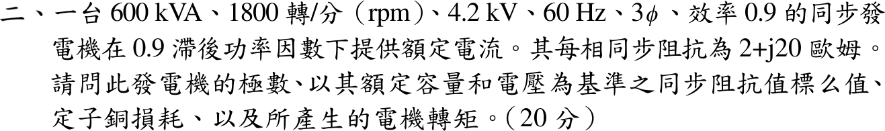
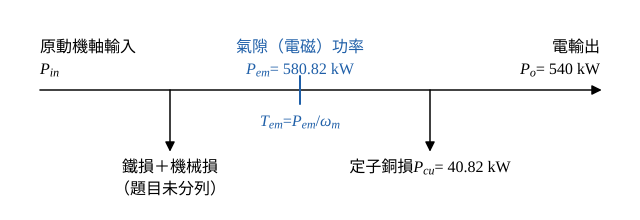

# 113 年電機機械第 2 題｜同步發電機標么阻抗、銅損與轉矩

## 已知與所求

三相同步發電機 600 kVA、1800 rpm、4.2 kV、60 Hz、效率 0.9，於 0.9 滯後功因供額定電流；每相同步阻抗 \(Z_s=2+j20\ \Omega\)。求極數、以額定容量與電壓為基準的同步阻抗標么值、定子銅損與所產生的電機轉矩。（20 分）

## 考場標準作答

### 步驟 1：額定電流

「所產生的電機轉矩」取電磁（感應）轉矩；4.2 kV 為線電壓、600 kVA 為三相容量；定子視為 Y 接每相等效（相電流＝線電流）；效率 0.9 只用於條件與疑義的軸轉矩對照。

三相視在功率 \(S_{3\phi}=\sqrt3V_{LL}I_a\)：
\[
I_a=\frac{S_{3\phi}}{\sqrt3\,V_{LL}}=\frac{600\,000}{\sqrt3(4200)}=82.48\ \mathrm A
\]
銅損要用電流平方，直接由公式平方（避免用四捨五入後的 82.48 再平方）：
\[
I_a^2=\frac{S_{3\phi}^2}{3V_{LL}^2}=\frac{600\,000^2}{3(4200)^2}=\frac{360\,000\,000\,000}{52\,920\,000}=6802.72\ \mathrm A^2
\]

### 極數

\[
P=\frac{120f}{n_s}=\frac{120(60)}{1800}=\frac{7200}{1800}
\]
\[
\boxed{P=4\ \text{極}}
\]

### 同步阻抗標么值

基準阻抗：
\[
Z_b=\frac{V_{LL}^2}{S_{3\phi}}=\frac{4200^2}{600\,000}=\frac{17\,640\,000}{600\,000}=29.40\ \Omega
\]
實部與虛部分別除以 \(Z_b\)：
\[
R_{pu}=\frac{2}{29.40}=0.06803\ \mathrm{pu},\qquad X_{pu}=\frac{20}{29.40}=0.6803\ \mathrm{pu}
\]
\[
\boxed{Z_{s,pu}=0.07+j0.68\ \mathrm{pu}}
\]
（四位有效：\(0.06803+j0.6803\ \mathrm{pu}\)。）

### 定子銅損

同步阻抗 \(2+j20\ \Omega\) 中只有實部 \(R_a=2\ \Omega\) 耗實功。

\[
P_{cu}=3I_a^2R_a=3(6802.72)(2)=40\,816.32\ \mathrm W
\]
\[
\boxed{P_{cu}=40.82\ \mathrm{kW}}
\]

### 所產生的電機轉矩

發電機的電磁功率一部分成為電輸出、一部分在定子電阻變成銅損，故 \(P_{em}=P_o+P_{cu}\)，再除以同步機械角速度 \(\omega_m\)。

額定輸出實功：
\[
P_o=S_{3\phi}\cos\varphi=600\,000(0.9)=540\,000\ \mathrm W
\]
電磁功率：
\[
P_{em}=P_o+P_{cu}=540\,000+40\,816.32=580\,816.32\ \mathrm W
\]

同步機械角速度：
\[
\omega_m=\frac{2\pi n_s}{60}=\frac{2\pi(1800)}{60}=60\pi=188.4956\ \mathrm{rad/s}
\]
\[
T_{em}=\frac{P_{em}}{\omega_m}=\frac{580\,816.32}{188.4956}
\]
\[
\boxed{T_{em}=3081.33\ \mathrm{N\cdot m}}
\]

## 驗算

標么法求銅損：額定電流 \(I_{pu}=1\)，\(P_{cu}=I_{pu}^2R_{pu}S_b=(1)^2(0.06803)(600)=40.82\ \mathrm{kW}\)，與步驟計算一致。功率平衡：效率 0.9 對應機械輸入 \(540/0.9=600\ \mathrm{kW}\)，\(600-540-40.82=19.18\ \mathrm{kW}\) 為題目未分列的鐵損與機械損，非負，數據自洽。

## 失分點

- 以相電壓 \(4200/\sqrt3\) 配三相容量求基準，\(Z_b\) 錯為 9.80 Ω。
- 用 \(|Z_s|=20.10\ \Omega\) 算銅損；銅損只取實部 \(R_a=2\ \Omega\)。
- 轉矩用電氣角頻率 \(377\ \mathrm{rad/s}\)，或只用 \(P_o\) 而漏加銅損。

## 條件與疑義

題目給總效率 0.9，但未分列鐵損、機械損，「所產生的電機轉矩」可有兩種解讀：主解為電磁轉矩 3081.33 N·m；若指原動機軸端輸入轉矩，\(T_{shaft}=(540\,000/0.9)/188.4956=600\,000/188.4956=3183.10\ \mathrm{N\cdot m}\)。作答時應寫明採用的定義。
