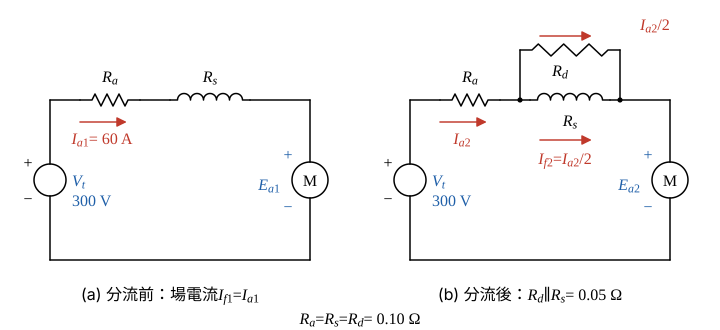

# 113 年電機機械第 3 題｜串激直流馬達分流與效率

## 已知與所求

串激直流馬達 300 V、60 A、1800 rpm，電樞電阻 \(R_a=0.10\ \Omega\)、串激場電阻 \(R_s=0.10\ \Omega\)；將 \(R_d=0.10\ \Omega\) 並聯於場繞組後扭矩增加一倍。忽略電樞反應與旋轉損失，求分流後的電樞電流、轉速、效率。（20 分）

## 考場標準作答

**解題邏輯**：前提為忽略電樞反應與旋轉損失、電刷壓降不計；線電流＝電樞電流（串激）；磁化曲線 \(\Phi(I_f)\) 為單調遞增（題目未給曲線）。串激馬達的場電流就是流過場繞組的電流，扭矩 \(T=K\Phi(I_f)I_a\)、反電勢 \(E_a=K\Phi(I_f)\omega\)。
1. 先寫出分流前的工作點與分流後場電流的分流關係 \(I_{f2}=I_{a2}/2\)（步驟 1）。
2. 由「扭矩加倍」列方程解 \(I_{a2}\)，發現場電流回到 60 A、磁通不變。
3. 再用 KVL 求分流前後反電勢，磁通相同時 \(n\propto E_a\) 得轉速。
4. 效率＝輸出 \(E_aI_a\)（忽略旋轉損失）÷輸入 \(V_tI_a\)。

### 步驟 1：分流前工作點與分流關係

分流前電樞與場繞組串聯，迴路電阻 \(R_a+R_s\)，KVL：
\[
E_{a1}=V_t-I_{a1}(R_a+R_s)=300-60(0.10+0.10)=300-12=288\ \mathrm V
\]
分流前場電流＝電樞電流：
\[
I_{f1}=I_{a1}=60\ \mathrm A
\]
分流後，電樞電流 \(I_{a2}\) 流到場繞組 \(R_s\) 與分流電阻 \(R_d\) 的並聯組合，依分流定則：
\[
I_{f2}=I_{a2}\frac{R_d}{R_s+R_d}=I_{a2}\frac{0.10}{0.10+0.10}=\frac{I_{a2}}{2}
\]
分流後串聯迴路的等效電阻（場繞組與分流電阻並聯）：
\[
R_s\parallel R_d=\frac{R_sR_d}{R_s+R_d}=\frac{0.10(0.10)}{0.10+0.10}=0.05\ \Omega
\]

### 電樞電流

**邏輯**：扭矩 \(T=K\Phi(I_f)I_a\)，分流後場電流只有 \(I_{a2}/2\)，所以扭矩加倍的條件是 \(\Phi(I_{a2}/2)\,I_{a2}=2\Phi(60)\times60\)；用試代法找出滿足的 \(I_{a2}\)，並以單調性說明解唯一，因此不需要磁化曲線。

扭矩比：
\[
\frac{T_2}{T_1}=\frac{K\Phi(I_{f2})I_{a2}}{K\Phi(I_{f1})I_{a1}}=2
\]
代入 \(I_{f2}=I_{a2}/2\)、\(I_{f1}=I_{a1}=60\ \mathrm A\)：
\[
\Phi\!\left(\frac{I_{a2}}{2}\right)I_{a2}=2\,\Phi(60)\times60=\Phi(60)\times120
\]
試 \(I_{a2}=120\ \mathrm A\)：左式 \(=\Phi(120/2)\times120=\Phi(60)\times120\)，恰等於右式。左式 \(\Phi(I_a/2)\,I_a\) 隨 \(I_a\) 嚴格遞增（兩因子都遞增），所以解唯一，對任何單調磁化曲線都成立：
\[
\boxed{I_{a2}=120\ \mathrm A}
\]
此時場電流與磁通：
\[
I_{f2}=\frac{120}{2}=60\ \mathrm A=I_{f1}\ \Rightarrow\ \Phi_2=\Phi_1
\]
（線性模型 \(\Phi\propto I_f\) 下即 \(I_{a2}^2/2=2(60^2)=7200\)，\(I_{a2}^2=14\,400\)，\(I_{a2}=120\ \mathrm A\)，結果相同。）

### 轉速

**邏輯**：\(E_a=K\Phi\omega\)，分流前後 \(\Phi_2=\Phi_1\)，所以轉速與反電勢成正比 \(n_2/n_1=E_{a2}/E_{a1}\)；分流後迴路電阻由 \(R_a+R_s\) 變為 \(R_a+R_s\parallel R_d\)，用 KVL 求 \(E_{a2}\)。

分流後 KVL：
\[
E_{a2}=V_t-I_{a2}(R_a+R_s\parallel R_d)=300-120(0.10+0.05)=300-120(0.15)=300-18=282\ \mathrm V
\]
轉速比例（\(\Phi_2=\Phi_1\)）：
\[
n_2=n_1\frac{E_{a2}}{E_{a1}}\frac{\Phi_1}{\Phi_2}=1800\times\frac{282}{288}\times1=\frac{507\,600}{288}
\]
\[
\boxed{n_2=1762.50\ \mathrm{rpm}}
\]

### 效率

**邏輯**：忽略旋轉損失，軸輸出功率＝電磁功率 \(E_{a2}I_{a2}\)；輸入功率＝端電壓×線電流，串激馬達線電流即 \(I_{a2}\)，場繞組與分流電阻的銅損都包含在輸入與輸出的差額中。

輸出功率：
\[
P_{out}=E_{a2}I_{a2}=282(120)=33\,840\ \mathrm W
\]
輸入功率：
\[
P_{in}=V_tI_{a2}=300(120)=36\,000\ \mathrm W
\]
\[
\boxed{\eta=\frac{P_{out}}{P_{in}}=\frac{33\,840}{36\,000}=94.00\%}
\]

## 驗算

逐元件損失：電樞 \(120^2(0.1)=1440\ \mathrm W\)，場繞組 \(60^2(0.1)=360\ \mathrm W\)，分流電阻 \(60^2(0.1)=360\ \mathrm W\)，合計 \(1440+360+360=2160\ \mathrm W\)；\(36\,000-2160=33\,840\ \mathrm W=282\times120\)，與 \(E_{a2}I_{a2}\) 相符。

## 失分點

- 忘記分流後場電流只剩 \(I_a/2\)，直接用 \(T\propto I_a^2\) 得 \(I_{a2}=84.85\ \mathrm A\)。
- 分流後電樞迴路電阻應為 \(0.1+0.1\parallel0.1=0.15\ \Omega\)，不是 0.2 Ω。
- 轉速只用反電勢比，卻沒有交代 \(\Phi_2=\Phi_1\)；若磁通改變，必須再乘 \(\Phi_1/\Phi_2\)。

## 條件與疑義

- 題目未給磁化曲線，也未聲明未飽和。但分流後場電流恰回到 \(60\ \mathrm A\)，\(I_{a2}=120\ \mathrm A\) 對任何單調磁化曲線都滿足扭矩加倍，磁通不變，故三個答案不依賴線性假設；前提是題示「忽略電樞反應」。
