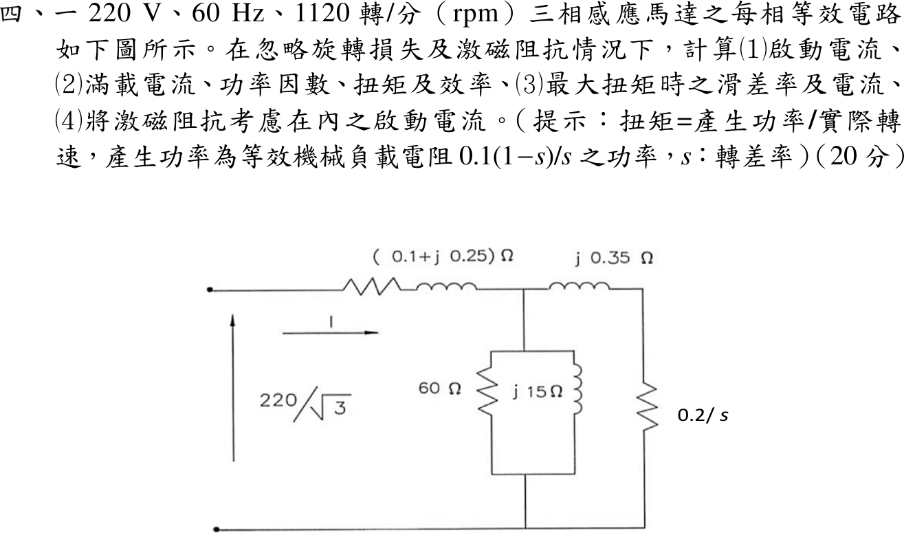
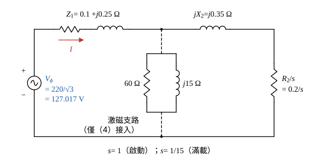

# 113 年電機機械第 4 題｜三相感應馬達等效電路與轉矩

## 已知與所求

220 V、60 Hz、1120 rpm 三相感應馬達，每相等效電路：\(Z_1=0.1+j0.25\ \Omega\)，激磁支路 \(60\ \Omega\parallel j15\ \Omega\)，轉子支路 \(j0.35\ \Omega\) 串 \(0.2/s\ \Omega\)，相電壓 \(220/\sqrt3\)。忽略旋轉損失與激磁阻抗，求（1）啟動電流；（2）滿載電流、功因、扭矩、效率；（3）最大扭矩時滑差與電流；（4）計入激磁阻抗的啟動電流。提示：扭矩＝產生功率／實際轉速，產生功率為 \(0.1(1-s)/s\) 上的功率。

## 考場標準作答

**解題邏輯**：全題用題給每相等效電路（相電壓 \(V_\phi=220/\sqrt3\)）。先由 1120 rpm 判定 6 極、同步轉速 1200 rpm，求出滑差 \(s\)（步驟 1）；（1）～（3）忽略激磁支路，電路化成單一串聯迴路 \(Z=(R_1+R_2/s)+j(X_1+X_2)\)，電流＝\(V_\phi/|Z|\)；扭矩依題目提示＝機械負載電阻 \(R_2(1-s)/s\) 上的三相功率÷實際機械角速度；效率＝機械輸出÷輸入，最大扭矩用最大功率轉移條件 \(R_2/s_{max}=|R_1+j(X_1+X_2)|\)。（4）把激磁支路並接到 \(Z_1\) 與轉子支路之間的節點，求並聯等效再串 \(Z_1\)。前提：主解依電路圖 \(R_2/s=0.2/s\)（\(R_2=0.2\ \Omega\)，機械負載電阻 \(0.2(1-s)/s\)），提示的 0.1 見條件與疑義；忽略旋轉損失與激磁阻抗（（4）除外）。

### 步驟 1：同步轉速、滑差與每相電壓

1120 rpm 略低於 1200 rpm，取 6 極（60 Hz 時 6 極同步轉速）：
\[
n_s=\frac{120f}{P}=\frac{120(60)}{6}=1200\ \mathrm{rpm}
\]
滑差：
\[
s=\frac{n_s-n}{n_s}=\frac{1200-1120}{1200}=\frac{80}{1200}=\frac1{15}=0.06667
\]
每相電壓（Y 等效相電壓，平方值後面要用）：
\[
V_\phi=\frac{220}{\sqrt3}=127.017\ \mathrm V,\qquad V_\phi^2=\frac{220^2}{3}=16\,133.33\ \mathrm V^2
\]

- 圖 1 畫法：\(Z_1=0.1+j0.25\ \Omega\) 串到中間節點；節點對地接激磁支路 \(60\ \Omega\parallel j15\ \Omega\)（（1）～（3）忽略，視為開路）；節點再串 \(jX_2=j0.35\ \Omega\) 與 \(R_2/s=0.2/s\ \Omega\) 回到底線。
- 參考方向：\(\underline I\) 由電源 \(+\) 端流入 \(Z_1\)，與題圖箭頭相同。

### （1）啟動電流

**邏輯**：啟動瞬間轉子靜止 \(s=1\)，轉子支路電阻 \(R_2/s=0.2\ \Omega\)；忽略激磁阻抗後只有一條串聯迴路，電流＝相電壓÷串聯總阻抗大小。

串聯總阻抗（\(s=1\)）：
\[
Z_{st}=(R_1+R_2)+j(X_1+X_2)=(0.1+0.2)+j(0.25+0.35)=0.30+j0.60\ \Omega
\]
\[
|Z_{st}|=\sqrt{0.30^2+0.60^2}=\sqrt{0.09+0.36}=\sqrt{0.45}=0.6708\ \Omega
\]
\[
|I_{st}|=\frac{V_\phi}{|Z_{st}|}=\frac{127.017}{0.6708}
\]
\[
\boxed{|I_{st}|=189.35\ \mathrm A}
\]

### （2）滿載電流、功率因數、扭矩與效率

**邏輯**：滿載 \(s=1/15\)，轉子支路電阻 \(R_2/s=3.00\ \Omega\)，串聯迴路的阻抗角餘弦就是功率因數；扭矩依提示＝機械負載電阻 \(R_L=R_2(1-s)/s\) 上的三相功率÷實際角速度；忽略旋轉損失與激磁，輸入實功只消耗在 \(R_1\) 與 \(R_2/s\)，效率＝\(R_L/(R_1+R_2/s)\)。

轉子支路電阻：
\[
\frac{R_2}{s}=0.2\times15=3.00\ \Omega
\]
串聯總阻抗：
\[
Z_{fl}=(0.1+3.00)+j(0.25+0.35)=3.10+j0.60\ \Omega
\]
\[
|Z_{fl}|=\sqrt{3.10^2+0.60^2}=\sqrt{9.61+0.36}=\sqrt{9.97}=3.1575\ \Omega
\]
滿載電流：
\[
|I_{fl}|=\frac{V_\phi}{|Z_{fl}|}=\frac{127.017}{3.1575}
\]
\[
\boxed{|I_{fl}|=40.23\ \mathrm A}
\]
功率因數（阻抗角餘弦，感性故滯後）：
\[
\mathrm{pf}=\cos\theta=\frac{R_1+R_2/s}{|Z_{fl}|}=\frac{3.10}{3.1575}
\]
\[
\boxed{\mathrm{pf}=0.98\ \text{滯後}}
\]
機械負載電阻：
\[
R_L=R_2\frac{1-s}{s}=0.2\times\frac{1-1/15}{1/15}=0.2(14)=2.80\ \Omega
\]
電流平方（用 \(V_\phi^2/|Z_{fl}|^2\)，避免用四捨五入的 40.23 再平方）：
\[
I_{fl}^2=\frac{V_\phi^2}{|Z_{fl}|^2}=\frac{16\,133.33}{9.97}=1618.188\ \mathrm A^2
\]
產生的機械功率（三相）：
\[
P_{mech}=3I_{fl}^2R_L=3(1618.188)(2.80)=4854.564(2.80)=13\,592.78\ \mathrm W
\]
實際機械角速度（1120 rpm）：
\[
\omega_m=\frac{2\pi n}{60}=\frac{2\pi(1120)}{60}=117.29\ \mathrm{rad/s}
\]
扭矩：
\[
\boxed{T=\frac{13\,592.78}{117.29}=115.89\ \mathrm{N\cdot m}}
\]
輸入功率 \(P_{in}=3I_{fl}^2(R_1+R_2/s)\)、輸出 \(P_{mech}=3I_{fl}^2R_L\)，相除時 \(3I_{fl}^2\) 約去：
\[
\eta=\frac{P_{mech}}{P_{in}}=\frac{3I_{fl}^2(2.80)}{3I_{fl}^2(3.10)}=\frac{2.80}{3.10}
\]
\[
\boxed{\eta=90.32\%}
\]

### （3）最大扭矩時的滑差與電流

**邏輯**：扭矩正比於氣隙功率 \(3I^2R_2/s\)，忽略激磁時這是「把功率送進可變電阻 \(R_2/s\)」的問題；由最大功率轉移，\(R_2/s\) 等於其餘串聯阻抗大小 \(|R_1+j(X_1+X_2)|\) 時氣隙功率（即扭矩）最大，解出 \(s_{max}\) 後代回迴路求電流。

最大扭矩條件：
\[
\frac{R_2}{s_{max}}=\sqrt{R_1^2+(X_1+X_2)^2}=\sqrt{0.10^2+0.60^2}=\sqrt{0.01+0.36}=\sqrt{0.37}=0.6083\ \Omega
\]
解滑差：
\[
s_{max}=\frac{R_2}{0.6083}=\frac{0.2}{0.6083}=0.3288
\]
\[
\boxed{s_{max}=0.33}
\]
此時串聯總阻抗：
\[
Z_{Tmax}=(0.10+0.6083)+j0.60=0.7083+j0.60\ \Omega
\]
\[
|Z_{Tmax}|=\sqrt{0.7083^2+0.60^2}=\sqrt{0.5017+0.36}=\sqrt{0.8617}=0.9283\ \Omega
\]
\[
|I_{Tmax}|=\frac{V_\phi}{|Z_{Tmax}|}=\frac{127.017}{0.9283}
\]
\[
\boxed{|I_{Tmax}|=136.83\ \mathrm A}
\]

### （4）計入激磁阻抗的啟動電流

**邏輯**：把激磁支路接回圖 1 的中間節點，它與啟動時（\(s=1\)）的轉子支路 \(0.2+j0.35\) 並聯，再與 \(Z_1\) 串聯；並聯用導納相加最直接：\(Y_p=1/60+1/(j15)+1/(0.2+j0.35)\)，取倒數得並聯阻抗。

轉子支路（\(s=1\)）導納：
\[
Y_r=\frac{1}{0.2+j0.35}=\frac{0.2-j0.35}{0.2^2+0.35^2}=\frac{0.2-j0.35}{0.1625}=1.2308-j2.1538\ \mathrm S
\]
激磁支路導納（\(60\ \Omega\) 與 \(j15\ \Omega\) 並聯）：
\[
Y_0=\frac1{60}+\frac1{j15}=0.01667-j0.06667\ \mathrm S
\]
節點並聯導納：
\[
Y_p=Y_r+Y_0=(1.2308+0.01667)-j(2.1538+0.06667)=1.2475-j2.2205\ \mathrm S
\]
取倒數（分子分母乘共軛）：
\[
Z_p=\frac{1.2475+j2.2205}{1.2475^2+2.2205^2}=\frac{1.2475+j2.2205}{1.5563+4.9306}=\frac{1.2475+j2.2205}{6.4869}=0.1923+j0.3423\ \Omega
\]
加上 \(Z_1\)：
\[
Z_{in}=(0.1+0.1923)+j(0.25+0.3423)=0.2923+j0.5923\ \Omega
\]
\[
|Z_{in}|=\sqrt{0.2923^2+0.5923^2}=\sqrt{0.08544+0.35082}=\sqrt{0.43626}=0.6605\ \Omega
\]
\[
|I_{st,m}|=\frac{V_\phi}{|Z_{in}|}=\frac{127.017}{0.6605}
\]
\[
\boxed{|I_{st,m}|=192.30\ \mathrm A}
\]

## 驗算

扭矩改由氣隙功率除以同步角速度 \(\omega_s=2\pi(1200)/60=125.664\ \mathrm{rad/s}\)：\(T=3I_{fl}^2(R_2/s)/\omega_s=3(1618.188)(3.00)/125.664=14\,563.69/125.664=115.89\ \mathrm{N\cdot m}\)，與 \(P_{mech}/\omega_m\) 相同。最大扭矩點：\(R_2/s_{max}=0.6083\ \Omega=|0.1+j0.6|\)，符合最大功率轉移條件。（4）的電流 192.30 A 略大於（1）的 189.35 A，因激磁支路與轉子支路並聯使阻抗變小，方向合理。

## 失分點

- 用電氣角頻率 \(377\ \mathrm{rad/s}\) 或同步轉速 1200 rpm 除機械功率；應用實際轉速 1120 rpm（或以氣隙功率除 \(\omega_s\)）。
- 效率分母只放 \(R_2/s\) 而漏掉 \(R_1\) 銅損。
- 用四捨五入後的 40.23 A 再平方，\(P_{mech}\) 與扭矩末位對不上；應用 \(V_\phi^2/|Z|^2\)。

## 條件與疑義

- 來源矛盾：圖示 0.2/s（\(R_2=0.2\ \Omega\)），提示文字卻寫機械負載電阻 0.1(1-s)/s（對應 \(R_2=0.1\ \Omega\)）。兩者不能同時成立。主解採電路圖。
- 若以提示為準，令 \(R_2=0.1\ \Omega\) 全面重算，完整重算的第二組結果：\(I_{st}=200.83\ \mathrm A\)、\(I_{fl}=74.33\ \mathrm A\)、pf \(0.94\) 滯後、\(T=197.85\ \mathrm{N\cdot m}\)、\(\eta=87.50\%\)、\(s_{max}=0.1644\)、\(I_{Tmax}=136.83\ \mathrm A\)、計入激磁之啟動電流 \(203.69\ \mathrm A\)。
- 參考書主解採混合慣例：電流用圖示 \(0.2/s\)（啟動電流 189.35 A、滿載 40.23 A、pf 0.98），機械功率卻用 \(0.1(1-s)/s\) 與 \(s=0.067\)，得 6761.30 W、轉矩 57.67 N·m、效率約 45%。此組違反功率平衡：氣隙功率 \(3(40.23)^2(3.0)=14.56\ \mathrm{kW}\)，轉子銅損 \(sP_{ag}=0.97\ \mathrm{kW}\) 加 6.76 kW 機械功率只有 7.73 kW，不宜作為考場答案。
