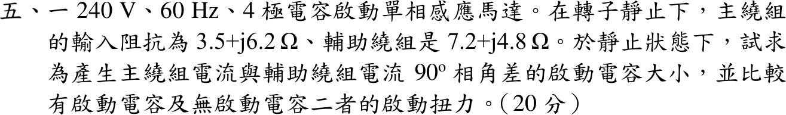

# 113 年電機機械第 5 題｜電容啟動單相感應馬達

## 已知與所求

240 V、60 Hz、4 極電容啟動單相感應馬達，靜止時主繞組 \(Z_m=3.5+j6.2\ \Omega\)、輔助繞組 \(Z_a=7.2+j4.8\ \Omega\)。求使兩繞組電流相差 \(90^\circ\) 的串聯啟動電容，並比較有、無電容的啟動扭力。

## 考場標準作答

### 啟動電容

觀念：兩繞組並聯接同一電源 \(V\)，各繞組電流 \(\underline I=V/Z\)，電流相角等於阻抗角的負值；要使 \(\angle I_a-\angle I_m=90^\circ\)，只能靠輔助繞組串聯電容 \(C\)（\(Z_{aC}=Z_a-jX_C\)）改變其阻抗角。取 \(V\) 為參考相角 0°，兩電流相量相差 90° 即成互相垂直。

主繞組電流相角：
\[
\angle I_m=-\tan^{-1}\frac{6.2}{3.5}=-60.55^\circ
\]
輔助繞組電流需超前 \(90^\circ\)：
\[
\angle I_a=-60.55^\circ+90^\circ=29.45^\circ\ \Rightarrow\ \angle Z_{aC}=-29.45^\circ
\]
\[
\tan\angle Z_{aC}=\frac{4.8-X_C}{7.2}=-\tan29.45^\circ=-\frac{3.5}{6.2}=-5.65\times10^{-1}
\]
\[
X_C=4.8+\frac{7.2(3.5)}{6.2}=8.86\ \Omega
\]
\[
\boxed{C=\frac{1}{2\pi(60)X_C}=\frac{1}{2\pi(60)(8.86)}=299.24\ \mu\mathrm F}
\]

### 啟動扭力比較

觀念：兩相繞組電流相位不同形成旋轉磁場，啟動扭力正比於 \(|I_m||I_a|\sin\alpha\)（\(\alpha\) 為兩電流相角差）；比較有、無電容時，須同時考慮 \(|I_a|\) 與 \(\alpha\) 的變化，\(|I_m|\) 不變可約去。

\[
|I_m|=\frac{240}{|Z_m|}=\frac{240}{7.12}=33.71\ \mathrm A\quad(\text{兩情形相同})
\]

- 無電容：\(|Z_a|=8.65\ \Omega\)，\(|I_a|=\dfrac{240}{8.65}=27.74\ \mathrm A\)，\(\angle Z_a=33.69^\circ\)，\(\alpha=60.55^\circ-33.69^\circ=26.86^\circ\)
- 有電容：\(Z_{aC}=7.2-j4.06\ \Omega\)，\(|Z_{aC}|=8.27\ \Omega\)，\(|I_a|=\dfrac{240}{8.27}=29.03\ \mathrm A\)，\(\alpha=90^\circ\)

\[
T_{st,0}\propto|I_m|(27.74)\sin26.86^\circ,\qquad T_{st,C}\propto|I_m|(29.03)\sin90^\circ
\]
\[
\boxed{\frac{T_{st,C}}{T_{st,0}}=\frac{29.03\sin90^\circ}{27.74\sin26.86^\circ}=2.32}
\]
有啟動電容的啟動扭力約為無電容時的 2.32 倍。

## 驗算

不用正切公式，直接對 \(X_C\) 數值求根使 \(\angle I_a-\angle I_m=90^\circ\)，得 \(X_C=8.86\ \Omega\)；扭力比改用 \(\operatorname{Im}(I_aI_m^*)\)（等於 \(|I_a||I_m|\sin\alpha\)）計算，比值同為 2.32。

## 失分點

- \(X_C=1/(\omega C)\) 誤用 \(\omega=60\) 而非 \(2\pi(60)\)，得 \(C=1.88\ \mathrm{mF}\)，大 \(2\pi\) 倍。
- 比較扭力時忘記電流大小也改變，只取 \(1/\sin26.86^\circ=2.21\)。
