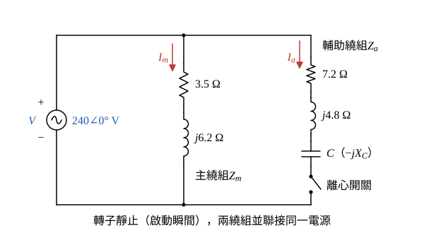
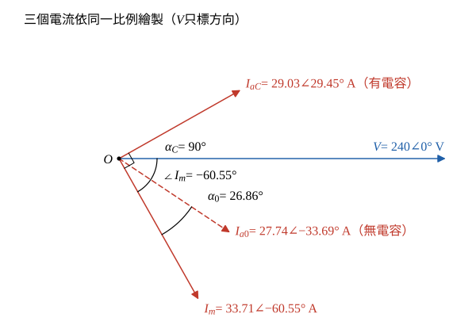

# 113 年電機機械第 5 題｜電容啟動單相感應馬達

## 已知與所求

240 V、60 Hz、4 極電容啟動單相感應馬達，轉子靜止時主繞組 \(Z_m=3.5+j6.2\ \Omega\)、輔助繞組 \(Z_a=7.2+j4.8\ \Omega\)。求使主、輔繞組電流相差 \(90^\circ\) 的啟動電容，並比較有、無啟動電容的啟動扭力。（20 分）

## 考場標準作答

**解題邏輯**：兩繞組並聯接同一電源 \(\underline V\)，各繞組電流 \(\underline I=\underline V/Z\)，電流相角＝阻抗角的負值。先求主繞組電流與其相角（步驟 1）、無電容時輔助繞組電流（步驟 2）；輔助繞組串聯電容 \(C\) 後阻抗變為 \(Z_a-jX_C\)，令其電流超前 \(\underline I_m\) 共 \(90^\circ\) 解出 \(X_C\)，再換成 \(C\)。啟動扭力 \(T_{st}=K|I_m||I_a|\sin\alpha\)（\(\alpha\) 為兩電流相角差），有、無電容兩情形 \(K\)、\(|I_m|\) 相同，相除即得比值。前提：轉子靜止（啟動瞬間）、兩繞組空間相隔 \(90^\circ\)、取 \(\underline V=240\angle0^\circ\) V 為相位參考；扭力常數 \(K\) 與電容無關。

### 步驟 1：主繞組電流

主繞組阻抗大小：
\[
|Z_m|=\sqrt{3.5^2+6.2^2}=\sqrt{12.25+38.44}=\sqrt{50.69}=7.120\ \Omega
\]
阻抗角：
\[
\angle Z_m=\tan^{-1}\frac{6.2}{3.5}=60.55^\circ
\]
主繞組電流（大小＝電壓／阻抗大小，相角＝\(-\angle Z_m\)）：
\[
|I_m|=\frac{240}{7.120}=33.71\ \mathrm A,\qquad \angle I_m=-60.55^\circ
\]

### 步驟 2：無電容時的輔助繞組電流

阻抗大小：
\[
|Z_a|=\sqrt{7.2^2+4.8^2}=\sqrt{51.84+23.04}=\sqrt{74.88}=8.653\ \Omega
\]
阻抗角：
\[
\angle Z_a=\tan^{-1}\frac{4.8}{7.2}=33.69^\circ
\]
電流：
\[
|I_{a0}|=\frac{240}{8.653}=27.74\ \mathrm A,\qquad \angle I_{a0}=-33.69^\circ
\]
兩電流相角差：
\[
\alpha_0=\angle I_{a0}-\angle I_m=-33.69^\circ-(-60.55^\circ)=26.86^\circ
\]

### 啟動電容大小

**邏輯**：\(Z_m\) 固定，只能靠輔助繞組串聯電容改變 \(\angle Z_{aC}\)；電流相角＝\(-\)阻抗角，所以「\(\underline I_a\) 超前 \(\underline I_m\) 共 \(90^\circ\)」等價於 \(\angle Z_{aC}=\angle Z_m-90^\circ\)，由正切關係解 \(X_C\)。

輔助繞組電流需要的相角：
\[
\angle I_{aC}=\angle I_m+90^\circ=-60.55^\circ+90^\circ=29.45^\circ
\]
所以串聯電容後的阻抗角：
\[
\angle Z_{aC}=-29.45^\circ
\]
\(Z_{aC}=7.2+j(4.8-X_C)\)，其正切（\(\tan29.45^\circ=\cot60.55^\circ=3.5/6.2\)）：
\[
\tan\angle Z_{aC}=\frac{4.8-X_C}{7.2}=-\tan29.45^\circ=-\frac{3.5}{6.2}
\]
移項解 \(X_C\)：
\[
X_C=4.8+\frac{7.2(3.5)}{6.2}=4.8+\frac{25.2}{6.2}=4.8+4.0645=8.8645\ \Omega
\]
\(X_C=1/(\omega C)\)，\(\omega=2\pi(60)=376.99\ \mathrm{rad/s}\)：
\[
C=\frac{1}{\omega X_C}=\frac{1}{376.99(8.8645)}=\frac{1}{3341.83}
\]
\[
\boxed{C=299.24\ \mu\mathrm F}
\]

接上電容後的輔助繞組電流（下一部分要用）：
\[
Z_{aC}=7.2+j(4.8-8.8645)=7.2-j4.0645\ \Omega
\]
\[
|Z_{aC}|=\sqrt{7.2^2+4.0645^2}=\sqrt{51.84+16.52}=\sqrt{68.36}=8.268\ \Omega
\]
\[
|I_{aC}|=\frac{240}{8.268}=29.03\ \mathrm A,\qquad \angle I_{aC}=+29.45^\circ
\]
相角差：
\[
\alpha_C=29.45^\circ-(-60.55^\circ)=90^\circ
\]

相量圖畫法（圖 2）：\(\underline V\) 沿水平軸；\(\underline I_m\) 落後 \(60.55^\circ\)；無電容的 \(\underline I_{a0}\) 落後 \(33.69^\circ\)，與 \(\underline I_m\) 只差 \(26.86^\circ\)；有電容的 \(\underline I_{aC}\) 超前 \(29.45^\circ\)，與 \(\underline I_m\) 垂直。

### 有、無啟動電容的啟動扭力比較

**邏輯**：兩繞組空間正交，電流有相位差才形成旋轉磁場，啟動扭力 \(T_{st}=K|I_m||I_a|\sin\alpha\)；兩情形的 \(K\)、\(|I_m|\) 相同，比值只剩 \(|I_a|\sin\alpha\) 之比，須同時代入電流大小與相角差的變化。

啟動扭力式：
\[
T_{st}=K|I_m||I_a|\sin\alpha
\]
無電容：
\[
T_{st,0}=K(33.71)(27.74)\sin26.86^\circ
\]
有電容：
\[
T_{st,C}=K(33.71)(29.03)\sin90^\circ
\]
相除，\(K\) 與 33.71 約去（\(\sin26.86^\circ=0.4518\)）：
\[
\frac{T_{st,C}}{T_{st,0}}=\frac{29.03\sin90^\circ}{27.74\sin26.86^\circ}=\frac{29.03(1)}{27.74(0.4518)}=\frac{29.03}{12.53}
\]
\[
\boxed{\frac{T_{st,C}}{T_{st,0}}=2.32}
\]
有啟動電容的啟動扭力約為無電容時的 2.32 倍。

## 驗算

不用正切公式，直接對 \(X_C\) 數值求根使 \(\angle I_a-\angle I_m=90^\circ\)，得 \(X_C=8.86\ \Omega\)；扭力比改用 \(\operatorname{Im}(\underline I_a\underline I_m^*)\)（等於 \(|I_a||I_m|\sin\alpha\)）計算，比值同為 2.32。

## 失分點

- \(X_C=1/(\omega C)\) 誤用 \(\omega=60\) 而非 \(2\pi(60)\)，得 \(C=1.88\ \mathrm{mF}\)，大 \(2\pi\) 倍。
- 比較扭力時忘記電流大小也改變，只取 \(1/\sin26.86^\circ=2.21\)。
- 把「相差 \(90^\circ\)」寫成 \(\angle Z_{aC}=-90^\circ\)（純電容），忽略主繞組電流本身已落後 \(60.55^\circ\)。
