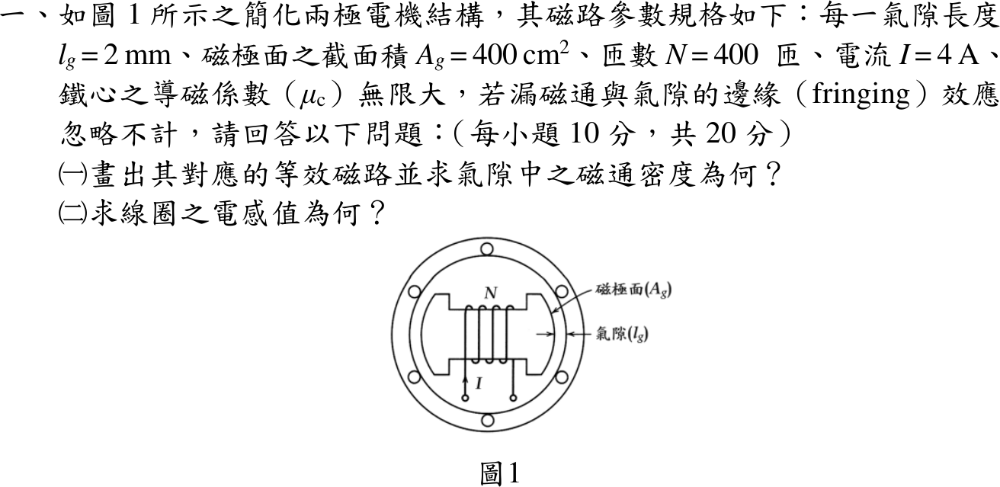
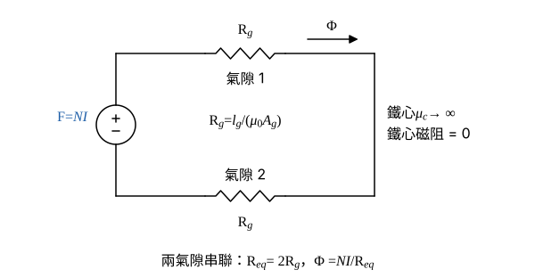

# 114 年電機機械第 1 題｜兩極電機氣隙磁路與電感

## 已知與所求

兩極結構，每一氣隙 \(l_g=2\ \mathrm{mm}\)、磁極面 \(A_g=400\ \mathrm{cm^2}=0.04\ \mathrm{m^2}\)，\(N=400\) 匝、\(I=4\ \mathrm A\)，\(\mu_c\to\infty\)，忽略漏磁與邊緣效應。求（一）等效磁路與氣隙磁通密度；（二）線圈電感。

## 考場標準作答

### 步驟 1：氣隙磁阻與等效磁阻

設鐵心 \(\mu_c\to\infty\)、磁路線性，忽略漏磁與邊緣效應，氣隙截面積等於磁極面積 \(A_g\)。磁通由線圈所在的內部磁極穿過一個氣隙進入外環，經外環（兩半並聯，磁阻皆為零）回到另一極，再穿過第二個氣隙，故等效磁路為 \(NI\) 串聯兩個相同的氣隙磁阻。

單位換算：\(l_g=2\ \mathrm{mm}=2\times10^{-3}\ \mathrm m\)，\(A_g=400\ \mathrm{cm^2}=400\times10^{-4}\ \mathrm{m^2}=0.04\ \mathrm{m^2}\)。

\(\mu_0A_g\)：
\[
\mu_0A_g=(4\pi\times10^{-7})(0.04)=5.0265\times10^{-8}\ \mathrm{H\cdot m}
\]
每一氣隙磁阻：
\[
\mathcal R_g=\frac{l_g}{\mu_0A_g}=\frac{2\times10^{-3}}{5.0265\times10^{-8}}=39\,789\ \mathrm{A\cdot t/Wb}
\]
兩氣隙串聯（鐵心磁阻為零）：
\[
\mathcal R_{eq}=2\mathcal R_g=2(39\,789)=79\,578\ \mathrm{A\cdot t/Wb}
\]

### （一）等效磁路與氣隙磁通密度（10 分）

畫法：

- 磁動勢源 \(\mathcal F=NI\)（線圈）。
- 串聯氣隙 1 與氣隙 2 的磁阻 \(\mathcal R_g\)；內部磁極鐵心與外環鐵心 \(\mu_c\to\infty\)，畫成導線（磁阻為零）。
- \(\Phi\) 沿迴路由磁動勢源 \(+\) 端流出。

磁動勢：
\[
\mathcal F=NI=400(4)=1600\ \mathrm{A\cdot t}
\]
磁通：
\[
\Phi=\frac{\mathcal F}{\mathcal R_{eq}}=\frac{1600}{79\,578}=0.020106\ \mathrm{Wb}
\]
氣隙磁通密度：
\[
B_g=\frac{\Phi}{A_g}=\frac{0.020106}{0.04}=0.50265\ \mathrm T
\]
\[
\boxed{B_g=0.50\ \mathrm T}
\]
（4 位有效數字：\(B_g=0.5027\ \mathrm T\)。）

### （二）線圈電感（10 分）

\(L=N\Phi/I=N^2/\mathcal R_{eq}\)，與電流大小無關（線性磁路）。

匝數平方：
\[
N^2=400^2=160\,000
\]
電感：
\[
L=\frac{N^2}{\mathcal R_{eq}}=\frac{160\,000}{79\,578}=2.0106\ \mathrm H
\]
\[
\boxed{L=2.01\ \mathrm H}
\]
（4 位有效數字：\(L=2.011\ \mathrm H\)。）

## 驗算

安培定律只計氣隙：\(NI=H_g(2l_g)\Rightarrow B_g=\mu_0NI/(2l_g)=(4\pi\times10^{-7})(1600)/(4\times10^{-3})=0.5027\ \mathrm T\)。磁鏈法：\(L=NB_gA_g/I=400(0.50265)(0.04)/4=2.0106\ \mathrm H\)，兩式一致。

## 失分點

- 只算一個氣隙，得 \(B_g=1.01\ \mathrm T\)、\(L=4.02\ \mathrm H\)。
- \(400\ \mathrm{cm^2}\) 誤換成 \(0.4\ \mathrm{m^2}\) 或 \(4\times10^{-4}\ \mathrm{m^2}\)；\(1\ \mathrm{cm^2}=10^{-4}\ \mathrm{m^2}\)，應為 \(0.04\ \mathrm{m^2}\)。
- 把外環兩半當成兩條需各算磁阻的並聯路徑：\(\mu_c\to\infty\) 時兩者磁阻皆為零，不影響結果。
