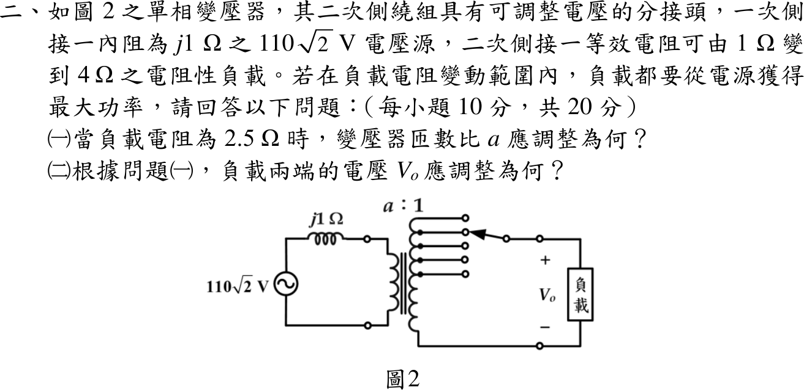
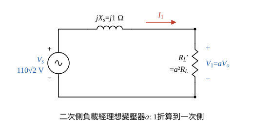

# 114 年電機機械第 2 題｜變壓器分接頭最大功率

## 已知與所求

一次側接 \(110\sqrt2\ \mathrm V\) 電源、內阻 \(j1\ \Omega\)；二次側電阻性負載 \(1\)～\(4\ \Omega\)，以分接頭調整匝數比 \(a=N_1:N_2\) 使負載恆得最大功率。求 \(R_L=2.5\ \Omega\) 時（一）\(a\)；（二）負載電壓 \(V_o\)。

## 考場標準作答

**解題邏輯**：前提為變壓器為理想（無損失、無激磁電流）；電源標示 \(110\sqrt2\ \mathrm V\) 取為 RMS（另一解讀見「條件與疑義」）。負載範圍 1～4 Ω 只說明 \(a\) 要隨負載調整，本題只算 \(R_L=2.5\ \Omega\)。
1. 理想變壓器 \(a:1\)（\(a=N_1/N_2\)）把二次側負載折算到一次側為 \(R_L'=a^2R_L\)，電路變成電源、內阻抗 \(jX_s=j1\ \Omega\) 與 \(R_L'\) 的單一串聯迴路（圖 1）。
2. （一）負載只能調整電阻大小（經 \(a\)），對 \(P(R_L')\) 求極值得 \(R_L'=|Z_s|=1\ \Omega\)，再解 \(a\)。
3. （二）由串聯迴路求 \(I_1\)、一次端電壓 \(V_1=I_1R_L'\)。
4. 再以 \(V_o=V_1/a\) 還原到二次側。

### （一）匝數比 \(a\)（10 分）

**邏輯**：折算後 \(P=|I_1|^2R_L'\)；內阻抗為純電抗 \(j1\ \Omega\)、負載為純電阻，只能調 \(R_L'\) 的大小，所以令 \(dP/dR_L'=0\)，得 \(R_L'=|Z_s|\)（不是共軛匹配）。

折算電阻：
\[
R_L'=a^2R_L
\]
一次側電流大小：
\[
|I_1|=\frac{V_s}{|R_L'+jX_s|}=\frac{V_s}{\sqrt{R_L'^2+1^2}}
\]
負載功率：
\[
P=|I_1|^2R_L'=\frac{V_s^2R_L'}{R_L'^2+1}
\]
對 \(R_L'\) 微分（商法則）：
\[
\frac{dP}{dR_L'}=V_s^2\frac{(R_L'^2+1)-R_L'(2R_L')}{(R_L'^2+1)^2}=V_s^2\frac{1-R_L'^2}{(R_L'^2+1)^2}
\]
令其為零：
\[
1-R_L'^2=0\ \Rightarrow\ R_L'=1\ \Omega=|Z_s|
\]
代回 \(R_L'=a^2R_L\)：
\[
a^2(2.5)=1\ \Rightarrow\ a^2=\frac{1}{2.5}=0.4
\]
\[
a=\sqrt{0.4}=0.632456
\]
\[
\boxed{a=0.63}
\]
（4 位有效數字：\(a=0.6325\)，即 \(N_1:N_2=0.6325:1\)。）

### （二）負載電壓 \(V_o\)（10 分）

**邏輯**：串聯迴路 \(|I_1|=V_s/|R_L'+j1|\)，\(R_L'\) 兩端電壓即理想變壓器一次電壓 \(V_1\)；理想變壓器 \(V_1/V_o=a\)，所以 \(V_o=V_1/a\)。

迴路阻抗大小（\(R_L'=1\ \Omega\)）：
\[
|R_L'+j1|=|1+j1|=\sqrt{1^2+1^2}=\sqrt2\ \Omega
\]
一次側電流（大小）：
\[
|I_1|=\frac{V_s}{\sqrt2}=\frac{110\sqrt2}{\sqrt2}=110\ \mathrm A
\]
（相位：\(1+j1=\sqrt2\angle45^\circ\)，\(I_1\) 落後 \(V_s\) \(45^\circ\)；求電壓大小只需大小。）

一次端電壓：
\[
|V_1|=|I_1|R_L'=110(1)=110\ \mathrm V
\]
還原到二次側（\(a<1\)，二次電壓高於一次）：
\[
|V_o|=\frac{|V_1|}{a}=\frac{110}{0.632456}=173.925\ \mathrm V
\]
\[
\boxed{|V_o|=173.93\ \mathrm V_{rms}}
\]

## 驗算

功率守恆：一次側 \(P=|I_1|^2R_L'=110^2(1)=12\,100\ \mathrm W\)；二次側 \(V_o^2/R_L=173.925^2/2.5=12\,100\ \mathrm W\)，一致。對 \(a\in[0.3,1.2]\) 掃描負載功率，最大值落在 \(a=0.6325\)。

## 失分點

- 把最大功率條件寫成 \(a^2R_L=Z_s^*=-j1\)：負載為純電阻、只能調 \(a\)，應取 \(R_L'=|Z_s|=1\ \Omega\)。
- 求出一次側 110 V 後忘了再除以 \(a\)（\(a<1\)，二次電壓高於一次）。
- 把 \(a\) 當成 \(N_2/N_1\)：題圖為 \(a:1\)，\(a=N_1/N_2\)，折算為 \(a^2R_L\)。

## 條件與疑義

題圖只標 \(110\sqrt2\) V，未註明 RMS 或峰值。主解採 RMS；若該值是峰值，RMS 電壓縮小 \(\sqrt2\) 倍，\(|V_o|=173.925/\sqrt2=122.984\ \mathrm V_{rms}\)（峰值 173.925 V）。匝數比 \(a=0.63\) 兩種解讀相同。
