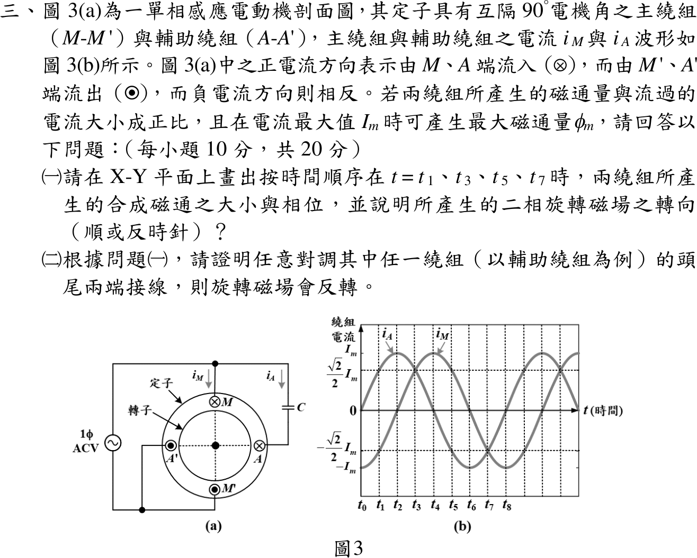
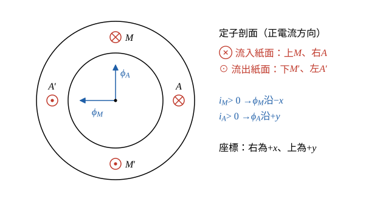
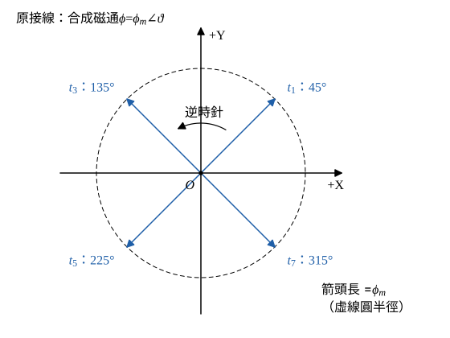
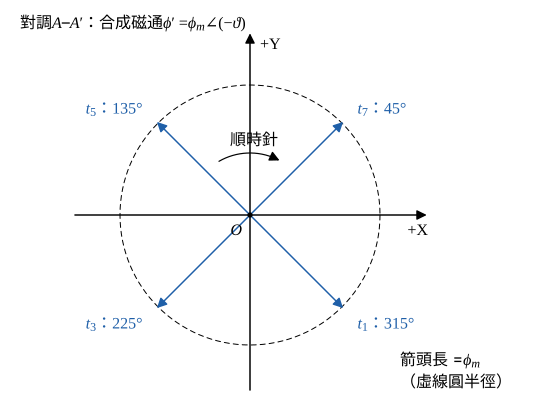

# 114 年電機機械第 3 題｜單相感應電動機二相旋轉磁場

## 已知與所求

主繞組 \(M\)（上，⊗）—\(M'\)（下，⊙）、輔助繞組 \(A\)（右，⊗）—\(A'\)（左，⊙），空間相隔 \(90^\circ\)；正電流由 \(M\)、\(A\) 流入。磁通與電流成正比，電流最大值 \(I_m\) 對應最大磁通 \(\phi_m\)。圖 3(b) 相鄰刻度相隔 \(45^\circ\) 電機角。求（一）\(t_1,t_3,t_5,t_7\) 的合成磁通大小、相位與轉向；（二）證明對調輔助繞組頭尾使旋轉磁場反轉。（每小題 10 分）

## 考場標準作答

### 步驟 1：兩繞組正電流的磁通方向

設磁路線性（磁通與電流成正比、不飽和），兩繞組產生的最大磁通同為 \(\phi_m\)；取紙面向右為 \(+x\)、向上為 \(+y\)，角度由 \(+x\) 軸逆時針量。

- 主繞組：正電流 \(i_M>0\) 由上方 \(M\) 流入紙面（⊗）、下方 \(M'\) 流出（⊙）。右手定則：流入紙面的導體周圍磁場為順時針，在其正下方（定子中心）指向左；流出紙面的 \(M'\) 磁場為逆時針，在其正上方也指向左，兩者同向，所以主繞組正電流的磁通 \(\phi_M\) 沿 \(-x\)。
- 輔助繞組：正電流 \(i_A>0\) 由右方 \(A\) 流入（⊗）、左方 \(A'\) 流出（⊙）。\(A\) 的順時針磁場在其左方（中心）指向上，\(A'\) 的逆時針磁場在其右方也指向上，所以輔助繞組正電流的磁通 \(\phi_A\) 沿 \(+y\)。

磁通與電流成正比（\(i=I_m\) 時磁通為 \(\phi_m\)），兩分量為：
\[
\phi_x=-\phi_m\frac{i_M}{I_m},\qquad \phi_y=+\phi_m\frac{i_A}{I_m}
\]

### 步驟 2：由圖 3(b) 讀出兩電流

- 每一刻度 \(45^\circ\)，令 \(\vartheta=45^\circ\times k\)（\(t_k\) 時刻）。
- \(i_A\)：\(t_0\) 為 0 且上升、\(t_2\) 到正峰值 \(I_m\)，故 \(i_A=I_m\sin\vartheta\)。
- \(i_M\)：\(t_0\) 為負峰值 \(-I_m\)、\(t_2\) 過零、\(t_4\) 到正峰值，故 \(i_M=-I_m\cos\vartheta\)（落後 \(i_A\) 共 \(90^\circ\)）。

代入步驟 1 的分量式：
\[
\phi_x=-\phi_m\frac{-I_m\cos\vartheta}{I_m}=\phi_m\cos\vartheta,\qquad \phi_y=\phi_m\frac{I_m\sin\vartheta}{I_m}=\phi_m\sin\vartheta
\]

### （一）\(t_1,t_3,t_5,t_7\) 的合成磁通與轉向（10 分）

四個時刻都是 \(|i_M|=|i_A|=\tfrac{\sqrt2}{2}I_m\)，磁通落在對角線上；相位依分量正負判象限，依時間順序看相位增減判斷轉向。

一般式的大小：
\[
|\boldsymbol\phi|=\sqrt{\phi_x^2+\phi_y^2}=\phi_m\sqrt{\cos^2\vartheta+\sin^2\vartheta}=\phi_m
\]
一般式的相位（\(\phi_x=\phi_m\cos\vartheta\)、\(\phi_y=\phi_m\sin\vartheta\)）：
\[
\angle\boldsymbol\phi=\vartheta
\]

以 \(t_1\)（\(\vartheta=45^\circ\)）逐步代入：
\[
i_M=-I_m\cos45^\circ=-0.7071I_m,\qquad i_A=I_m\sin45^\circ=0.7071I_m
\]
\[
\phi_x=-\phi_m(-0.7071)=0.7071\phi_m,\qquad \phi_y=\phi_m(0.7071)=0.7071\phi_m
\]
\[
|\boldsymbol\phi|=\sqrt{0.7071^2+0.7071^2}\,\phi_m=\sqrt{0.5000+0.5000}\,\phi_m=\phi_m
\]
\[
\angle\boldsymbol\phi=\tan^{-1}\frac{0.7071}{0.7071}=45^\circ\ \text{（第一象限）}
\]

其餘時刻同法（分量正負決定象限）：

| 時刻 | \(\vartheta\) | \(i_M/I_m\) | \(i_A/I_m\) | \(\phi_x/\phi_m\) | \(\phi_y/\phi_m\) | \(\lvert\boldsymbol\phi\rvert\) | 相位 | 方向 |
| --- | --- | --- | --- | --- | --- | --- | --- | --- |
| \(t_1\) | \(45^\circ\) | \(-0.7071\) | \(0.7071\) | \(0.7071\) | \(0.7071\) | \(\phi_m\) | \(45^\circ\) | t₁ ↗ 右上 |
| \(t_3\) | \(135^\circ\) | \(0.7071\) | \(0.7071\) | \(-0.7071\) | \(0.7071\) | \(\phi_m\) | \(135^\circ\) | t₃ ↖ 左上 |
| \(t_5\) | \(225^\circ\) | \(0.7071\) | \(-0.7071\) | \(-0.7071\) | \(-0.7071\) | \(\phi_m\) | \(225^\circ\) | t₅ ↙ 左下 |
| \(t_7\) | \(315^\circ\) | \(-0.7071\) | \(-0.7071\) | \(0.7071\) | \(-0.7071\) | \(\phi_m\) | \(315^\circ\) | t₇ ↘ 右下 |

X–Y 平面作圖（圖 2）：四支箭頭由原點出發、長度都是 \(\phi_m\)，依序指向 \(45^\circ\to135^\circ\to225^\circ\to315^\circ\)；時間每前進兩格（\(90^\circ\) 電機角），磁通向量逆時針轉 \(90^\circ\)，即 t₁ → t₃ → t₅ → t₇：逆時針。

\[
\boxed{|\boldsymbol\phi|=\phi_m\ \text{（大小不變）},\ \angle\boldsymbol\phi=45^\circ\to135^\circ\to225^\circ\to315^\circ,\ \text{逆時針旋轉}}
\]

### （二）對調輔助繞組頭尾使磁場反轉（10 分）

對調 \(A\)、\(A'\) 接線後，同一個 \(i_A\) 在剖面上改由左方流入、右方流出，輔助繞組磁通軸由 \(+y\) 變成 \(-y\)，主繞組不變；合成磁通相位隨時間遞減，即轉向由逆時針變為順時針。

對調後輔助繞組的磁通分量（右手定則：左方流入、右方流出，中心磁場向下）：
\[
\phi_y'=-\phi_m\frac{i_A}{I_m}=-\phi_m\sin\vartheta
\]
主繞組分量不變：
\[
\phi_x'=\phi_m\cos\vartheta
\]
合成磁通：
\[
\boldsymbol\phi'=\phi_m\cos\vartheta\,\hat x-\phi_m\sin\vartheta\,\hat y=\phi_m\angle(-\vartheta)
\]
大小仍為 \(\phi_m\)；相位 \(-\vartheta=-\omega(t-t_0)\)，對時間的變化率：
\[
\frac{d\angle\boldsymbol\phi'}{dt}=-\omega<0
\]
代入四個時刻：

| 時刻 | \(\phi_x'/\phi_m\) | \(\phi_y'/\phi_m\) | 相位 |
| --- | --- | --- | --- |
| \(t_1\) | \(0.7071\) | \(-0.7071\) | \(315^\circ\) |
| \(t_3\) | \(-0.7071\) | \(-0.7071\) | \(225^\circ\) |
| \(t_5\) | \(-0.7071\) | \(0.7071\) | \(135^\circ\) |
| \(t_7\) | \(0.7071\) | \(0.7071\) | \(45^\circ\) |

\[
\boxed{\angle\boldsymbol\phi'=315^\circ\to225^\circ\to135^\circ\to45^\circ,\ d\angle\boldsymbol\phi'/dt=-\omega\ \Rightarrow\ \text{旋轉磁場反轉為順時針}}
\]
同理，若改對調主繞組，\(x\) 分量反號，\(\boldsymbol\phi''=\phi_m\angle(180^\circ-\vartheta)\)，相位亦隨時間遞減，同樣反轉；所以任意對調其中一繞組都會使磁場反轉。

## 驗算

以向量式 \(\mathbf B\propto\hat{\mathbf I}\times\hat{\mathbf r}\)（\(\hat{\mathbf r}\) 由導體指向中心）重算軸向：\(M\) 在 \((0,1)\)、電流 \(-\hat z\)：\((-\hat z)\times(-\hat y)=-\hat x\)；\(A\) 在 \((1,0)\)：\((-\hat z)\times(-\hat x)=+\hat y\)，回流導體 \(M'\)、\(A'\) 貢獻同向，與步驟 1 一致。另取 \(t_2\)（\(\vartheta=90^\circ\)）：\(i_M=0\)、\(i_A=I_m\)，磁通 \(\phi_m\) 沿 \(+y\)（\(90^\circ\)），正好介於 \(t_1\) 的 \(45^\circ\) 與 \(t_3\) 的 \(135^\circ\) 之間，確認為逆時針連續旋轉。

## 失分點

- 把 \(t_1,t_3,t_5,t_7\) 讀成某一繞組峰值、另一繞組為零；圖上四點兩電流量值都是 \(\tfrac{\sqrt2}{2}I_m\)，磁通落在對角線。
- 把兩個互相垂直的分量代數相加成 \(\sqrt2\phi_m\) 或 \(2\phi_m\)。
- 第（二）小題只寫「相序改變」而沒寫出 \(y\) 分量反號、角速度變為 \(-\omega\)。
