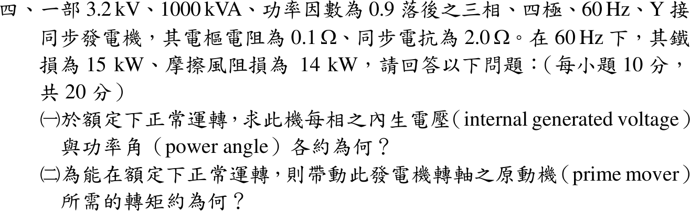
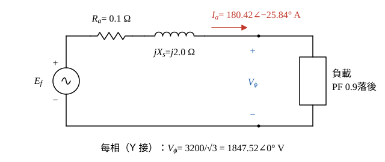
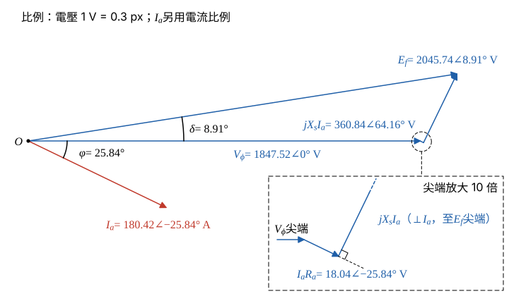

# 114 年電機機械第 4 題｜同步發電機內生電壓與原動機轉矩

## 已知與所求

三相 Y 接、四極、60 Hz 同步發電機：\(3.2\ \mathrm{kV}\)、\(1000\ \mathrm{kVA}\)、PF 0.9 落後，\(R_a=0.1\ \Omega\)、\(X_s=2.0\ \Omega\)；鐵損 15 kW、摩擦風阻損 14 kW。求額定運轉時（一）每相內生電壓與功率角；（二）原動機轉矩。（每小題 10 分）

## 考場標準作答

**解題邏輯**：（一）用每相等效電路的發電機方程 \(\underline E_f=\underline V_\phi+\underline I_a(R_a+jX_s)\)：先由額定 3.2 kV、1000 kVA、PF 0.9 落後求每相 \(V_\phi\) 與 \(\underline I_a\)，再把電阻壓降與同步電抗壓降相量加到 \(\underline V_\phi\) 上，取大小與相角即 \(|E_f|\) 與功率角 \(\delta\)。（二）穩態時原動機輸入的機械功率＝電輸出＋全部損失（電樞銅損、鐵損、摩擦風阻損），再除以同步機械角速度得轉矩。前提：額定運轉＝額定電壓、額定電流、PF 0.9 落後；Y 接，相電流＝線電流；\(\underline V_\phi\) 取為相位參考 \(0^\circ\)；雜散負載損失題目未給，不計。

### 步驟 1：每相等效電路與額定每相量

- 每相等效電路：內生電壓 \(\underline E_f\) 串聯 \(R_a=0.1\ \Omega\) 與 \(jX_s=j2.0\ \Omega\) 接到端點，端電壓 \(\underline V_\phi\)。
- 參考方向：\(\underline I_a\) 由發電機流向負載（輸出方向），所以 \(\underline E_f\) 等於端電壓加上阻抗壓降。

每相端電壓（Y 接，相電壓＝線電壓／\(\sqrt3\)）：
\[
V_\phi=\frac{V_L}{\sqrt3}=\frac{3200}{\sqrt3}=1847.52\ \mathrm V
\]
額定電樞電流：
\[
I_a=\frac{S}{\sqrt3\,V_L}=\frac{1\,000\,000}{\sqrt3(3200)}=180.42\ \mathrm A
\]
PF 0.9 落後，電流落後 \(\underline V_\phi\) 的角度：
\[
\varphi=\cos^{-1}0.9=25.84^\circ
\]
\[
\sin\varphi=\sqrt{1-0.9^2}=\sqrt{0.19}=0.43589
\]
\[
\underline I_a=180.42\angle-25.84^\circ\ \mathrm A
\]

化成直角座標（驗算段要用）：
\[
\underline I_a=180.42(0.9)-j180.42(0.43589)=162.38-j78.64\ \mathrm A
\]

### （一）每相內生電壓與功率角（10 分）

**邏輯**：發電機電流為輸出方向，對圖 1 迴路寫 KVL 得 \(\underline E_f=\underline V_\phi+\underline I_aR_a+jX_s\underline I_a\)；電阻壓降與 \(\underline I_a\) 同相，電抗壓降超前 \(\underline I_a\) 共 \(90^\circ\)，兩者分別化成直角座標後與 \(\underline V_\phi\) 相加，取大小得 \(|E_f|\)、取相角得 \(\delta\)。

對圖 1 迴路寫 KVL：
\[
\underline E_f=\underline V_\phi+\underline I_aR_a+jX_s\underline I_a
\]
電阻壓降（與 \(\underline I_a\) 同相，角度 \(-25.84^\circ\)）：
\[
\underline I_aR_a=180.42(0.1)\angle-25.84^\circ=18.04\angle-25.84^\circ\ \mathrm V
\]
\[
18.04\angle-25.84^\circ=18.04(0.9)-j18.04(0.43589)=16.24-j7.864\ \mathrm V
\]
同步電抗壓降（乘 \(j\) 使相角加 \(90^\circ\)：\(-25.84^\circ+90^\circ=64.16^\circ\)）：
\[
jX_s\underline I_a=180.42(2.0)\angle64.16^\circ=360.84\angle64.16^\circ\ \mathrm V
\]
化成直角座標（\(\cos64.16^\circ=\sin25.84^\circ=0.43589\)、\(\sin64.16^\circ=\cos25.84^\circ=0.9\)）：
\[
360.84\angle64.16^\circ=360.84(0.43589)+j360.84(0.9)=157.29+j324.76\ \mathrm V
\]
三項相加，實部：
\[
\operatorname{Re}\underline E_f=1847.52+16.24+157.29=2021.05\ \mathrm V
\]
虛部：
\[
\operatorname{Im}\underline E_f=0-7.864+324.76=316.90\ \mathrm V
\]
\[
\underline E_f=2021.05+j316.90\ \mathrm V
\]
大小：
\[
|E_f|=\sqrt{2021.05^2+316.90^2}=\sqrt{4\,084\,643.10+100\,425.61}=\sqrt{4\,185\,068.71}
\]
\[
\boxed{|E_f|=2045.74\ \mathrm{V/相}}
\]
相角（功率角＝\(\underline E_f\) 超前 \(\underline V_\phi\) 的角度）：
\[
\delta=\tan^{-1}\frac{316.90}{2021.05}=\tan^{-1}0.1568
\]
\[
\boxed{\delta=8.91^\circ}
\]

相量圖畫法（圖 2）：

- \(\underline V_\phi=1847.52\angle0^\circ\) 沿水平軸；\(\underline I_a\) 自原點畫在水平軸下方 \(25.84^\circ\)。
- 自 \(\underline V_\phi\) 尖端接 \(\underline I_aR_a=18.04\) V，方向平行 \(\underline I_a\)。
- 再接 \(jX_s\underline I_a=360.84\) V，方向垂直 \(\underline I_a\)、超前 \(90^\circ\)（\(64.16^\circ\)）。
- 原點連到最後尖端即 \(\underline E_f=2045.74\angle8.91^\circ\ \mathrm V\)；\(\delta>0\) 表示 \(\underline E_f\) 超前端電壓，符合發電機運轉。

### （二）原動機轉矩（10 分）

**邏輯**：穩態下原動機送進轉軸的機械功率全部轉成電輸出與各項損失（功率守恆），所以 \(P_{in}=P_o+P_{cu}+P_{core}+P_{fw}\)；原動機以同步轉速帶動轉子，轉矩＝\(P_{in}/\omega_m\)，\(\omega_m\) 用機械角速度（不是電氣角頻率 \(377\ \mathrm{rad/s}\)）。

額定電輸出：
\[
P_o=S\cos\varphi=1000(0.9)=900\ \mathrm{kW}
\]
三相電樞銅損（\(I_a^2=S^2/(3V_L^2)\)，代入後 3 約掉）：
\[
P_{cu}=3I_a^2R_a=3\left(\frac{S}{\sqrt3\,V_L}\right)^2R_a=\frac{S^2R_a}{V_L^2}
\]
\[
P_{cu}=\frac{(1\,000\,000)^2(0.1)}{3200^2}=\frac{100\,000\,000\,000}{10\,240\,000}=9765.625\ \mathrm W
\]
原動機輸入（輸出＋銅損＋鐵損＋摩擦風阻損）：
\[
P_{in}=P_o+P_{cu}+P_{core}+P_{fw}=900\,000+9765.625+15\,000+14\,000=938\,765.625\ \mathrm W
\]
同步轉速（四極、60 Hz）：
\[
n_s=\frac{120f}{P}=\frac{120(60)}{4}=1800\ \mathrm{rpm}
\]
機械角速度：
\[
\omega_m=\frac{2\pi n_s}{60}=\frac{2\pi(1800)}{60}=60\pi=188.4956\ \mathrm{rad/s}
\]
轉矩：
\[
T_{in}=\frac{P_{in}}{\omega_m}=\frac{938\,765.625}{188.4956}
\]
\[
\boxed{T_{in}=4980.31\ \mathrm{N\cdot m}\ (\approx4.98\ \mathrm{kN\cdot m})}
\]

## 驗算

由相量直接算氣隙功率（電抗不耗實功，\(\underline I_a^*=162.38+j78.64\)）：
\[
P_{gap}=3\operatorname{Re}(\underline E_f\underline I_a^*)=3(2021.05\times162.38-316.90\times78.64)=3(328\,178.10-24\,921.02)=909\,771\ \mathrm W\approx909.77\ \mathrm{kW}
\]
與 \(P_o+P_{cu}=900+9.766=909.77\ \mathrm{kW}\) 相等；再加 29 kW 鐵損與摩擦風阻損得 938.77 kW，與（二）一致。

## 失分點

- 套用電動機方程 \(\underline V-\underline I\underline Z\)，得 \(|E|\approx1704\ \mathrm V\) 且 \(\delta<0\)。
- 只加鐵損與摩擦風阻損、漏掉 9.77 kW 電樞銅損；或用電氣角頻率 \(377\ \mathrm{rad/s}\) 換算，轉矩少一半。
- 把 \(jX_s\underline I_a\) 與 \(\underline V_\phi\) 同相直接相加，功率角變成 0。
