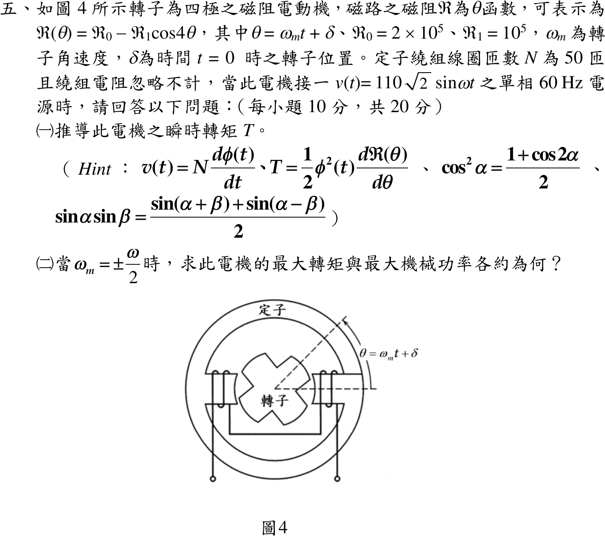

# 114 年電機機械第 5 題｜磁阻電動機轉矩

## 已知與所求

\(\mathcal R(\theta)=\mathcal R_0-\mathcal R_1\cos4\theta\)，\(\theta=\omega_mt+\delta\)，\(\mathcal R_0=2\times10^5\)、\(\mathcal R_1=10^5\ \mathrm{A\cdot t/Wb}\)；\(N=50\)，繞組電阻忽略，\(v(t)=110\sqrt2\sin\omega t\)、60 Hz。題示 \(v=N\,d\phi/dt\)、\(T=\tfrac12\phi^2\,d\mathcal R/d\theta\)。求（一）瞬時轉矩；（二）\(\omega_m=\pm\omega/2\) 時最大轉矩與最大機械功率。（每小題 10 分）

## 考場標準作答

**解題邏輯**：前提為週期穩態、磁通無直流偏置，轉矩正負號依題示公式。
1. （一）繞組電阻忽略，電源電壓全部用來改變磁通，積分 \(v=N\,d\phi/dt\) 得 \(\phi(t)\)。
2. 把 \(\mathcal R(\theta)\) 對 \(\theta\) 微分，連同 \(\phi^2\) 代入題示轉矩式，並以 \(\theta=\omega_mt+\delta\) 寫成時間函數。
3. （二）瞬時轉矩是 \(\cos^2\omega t\) 與 \(\sin(4\omega_mt+4\delta)\) 的乘積。轉子轉動（\(\omega_m\neq0\)）時，只有 \(\omega_m=\pm\omega/2\) 積化和差才會出現不隨時間變的項，一個電源週期的平均轉矩才不為零、能持續輸出機械功率；\(\omega_m=0\) 靜止時平均轉矩可不為零，但不輸出功率。
4. 平均轉矩對 \(\delta\) 取最大，再乘機械角速度 \(\omega_m\) 得最大機械功率。

### （一）瞬時轉矩（10 分）

**邏輯**：\(v=N\,d\phi/dt\) 積分得磁通為餘弦波；題示 \(T=\tfrac12\phi^2\,d\mathcal R/d\theta\)，需要 \(\phi^2\) 與 \(d\mathcal R/d\theta\) 兩個量。

積分 \(v=N\,d\phi/dt\)（無直流偏置，積分常數取 0）：
\[
\phi(t)=\frac1N\int110\sqrt2\sin\omega t\,dt=-\frac{110\sqrt2}{N\omega}\cos\omega t=-\Phi_m\cos\omega t
\]
磁通峰值，先算分子與分母：
\[
110\sqrt2=155.5635\ \mathrm V,\qquad \omega=2\pi(60)=376.9911\ \mathrm{rad/s},\qquad N\omega=50(376.9911)=18\,849.56\ \mathrm{rad/s}
\]
\[
\Phi_m=\frac{110\sqrt2}{N\omega}=\frac{155.5635}{18\,849.56}=8.2529\times10^{-3}\ \mathrm{Wb}
\]
磁阻對 \(\theta\) 的導數：
\[
\frac{d\mathcal R}{d\theta}=\frac{d}{d\theta}(\mathcal R_0-\mathcal R_1\cos4\theta)=4\mathcal R_1\sin4\theta
\]
磁通平方：
\[
\phi^2(t)=\Phi_m^2\cos^2\omega t
\]
代入題示轉矩式（正號），\(\tfrac12\times4=2\)，並以 \(\theta=\omega_mt+\delta\) 代入：
\[
T=\frac12\Phi_m^2\cos^2(\omega t)\cdot4\mathcal R_1\sin4\theta
\]
\[
\boxed{T(t)=+2\mathcal R_1\Phi_m^2\cos^2(\omega t)\sin(4\omega_mt+4\delta)}
\]

### （二）最大轉矩與最大機械功率（10 分）

**邏輯**：轉子轉動（\(\omega_m\neq0\)）時，只有轉子速度與磁通脈動同步（\(\omega_m=\pm\omega/2\)）瞬時轉矩才含非零的直流（平均）分量，能持續輸出機械功率（靜止時 \(\omega_m=0\) 雖有平均轉矩，功率為零），所以取一個電源週期的平均值；平均轉矩隨 \(\sin4\delta\) 變，\(|\sin4\delta|=1\) 時最大；機械功率＝平均轉矩 × \(\omega_m\)。

\(\omega_m=\omega/2\) 時 \(4\omega_mt=2\omega t\)，先用 \(\cos^2\omega t=\tfrac12(1+\cos2\omega t)\)：
\[
T=\mathcal R_1\Phi_m^2(1+\cos2\omega t)\sin(2\omega t+4\delta)
\]
第二項用 \(\cos u\sin v=\tfrac12[\sin(v+u)+\sin(v-u)]\)（\(u=2\omega t\)、\(v=2\omega t+4\delta\)）：
\[
\cos2\omega t\,\sin(2\omega t+4\delta)=\tfrac12\sin(4\omega t+4\delta)+\tfrac12\sin4\delta
\]
合併：
\[
T=\mathcal R_1\Phi_m^2\Big[\sin(2\omega t+4\delta)+\tfrac12\sin(4\omega t+4\delta)+\tfrac12\sin4\delta\Big]
\]
前兩項在一個電源週期內平均為零：
\[
T_{avg}=\tfrac12\mathcal R_1\Phi_m^2\sin4\delta
\]
\(\omega_m=-\omega/2\) 時 \(4\omega_mt=-2\omega t\)，同法取 \(u=2\omega t\)、\(v=-2\omega t+4\delta\)：\(\cos u\sin v=\tfrac12[\sin4\delta+\sin(-4\omega t+4\delta)]\)，平均後同樣只剩
\[
T_{avg}=+\frac{1}{2}\mathcal R_1\Phi_m^2\sin(4\delta)
\]
兩轉向同式。\(|\sin4\delta|=1\) 時最大，先算磁通平方：
\[
\Phi_m^2=(8.2529\times10^{-3})^2=6.8110\times10^{-5}\ \mathrm{Wb^2}
\]
\[
|T_{avg,max}|=\frac{1}{2}\mathcal R_1\Phi_m^2=\frac12(10^5)(6.8110\times10^{-5})=3.4055\ \mathrm{N\cdot m}
\]
\[
\boxed{|T_{avg,max}|=3.41\ \mathrm{N\cdot m}}
\]
最大機械功率 \(|P_{m,max}|=|T_{avg,max}|\,\omega/2\)。把 \(\Phi_m=110\sqrt2/(N\omega)\) 代回，化成不含捨入值的式子：
\[
|P_{m,max}|=\frac12\mathcal R_1\frac{(110\sqrt2)^2}{N^2\omega^2}\cdot\frac{\omega}{2}=\frac{\mathcal R_1(110\sqrt2)^2}{4N^2\omega}
\]
分子與分母：
\[
\mathcal R_1(110\sqrt2)^2=10^5(24\,200)=2.42\times10^9,\qquad 4N^2\omega=4(2500)(376.9911)=3\,769\,911
\]
\[
|P_{m,max}|=\frac{2.42\times10^9}{3\,769\,911}=641.92\ \mathrm W
\]
\[
\boxed{|P_{m,max}|=641.92\ \mathrm W\approx0.64\;\mathrm{kW}}
\]
此時 \(\omega_m=\omega/2=60\pi=188.50\ \mathrm{rad/s}\)（轉子 1800 rpm）。

## 驗算

功率另算：\(|T_{avg,max}|\,\omega_m=3.4055(188.4956)=641.92\ \mathrm W\)，與閉合式一致。量綱：\(\mathcal R\Phi^2\) 為 \((\mathrm{A/Wb})\mathrm{Wb}^2=\mathrm{A\cdot Wb}=\mathrm{J}\)，即 N·m/rad。功率的正負只隨轉向（\(\omega_m\) 正負）與 \(\delta\) 改變，大小相同。

## 失分點

- 把瞬時轉矩振幅 \(2\mathcal R_1\Phi_m^2=13.62\ \mathrm{N\cdot m}\) 或 \(\mathcal R_1\Phi_m^2=6.81\ \mathrm{N\cdot m}\) 當平均轉矩。
- 漏掉積分的 \(1/\omega\) 或微分的 4；功率用 \(\omega=377\) 而非 \(\omega/2\)，結果大一倍。

## 條件與疑義

- 官方 Hint 的 \(\sin\alpha\sin\beta=[\sin(\alpha+\beta)+\sin(\alpha-\beta)]/2\) 是誤植（取 \(\alpha=\beta=\pi/2\) 即不成立）；實際需要的是 \(\cos u\sin v\) 積化和差式，見（二）。
- 題面未給初始磁通。若保留直流偏置 \(\phi_{dc}\)，瞬時式多出常數與交叉項，但在 \(\omega_m=\pm\omega/2\) 的平均為零，最大平均轉矩與功率不變。
- 本解依題示公式取正號。若由磁能 \(W=\tfrac12\mathcal R\phi^2\) 在定磁通下以 \(T=-\partial W/\partial\theta\) 推導，轉矩式差一個負號，只使 \(\sin4\delta\) 對應的 \(\delta\) 換邊，最大轉矩與最大功率的大小不變。
