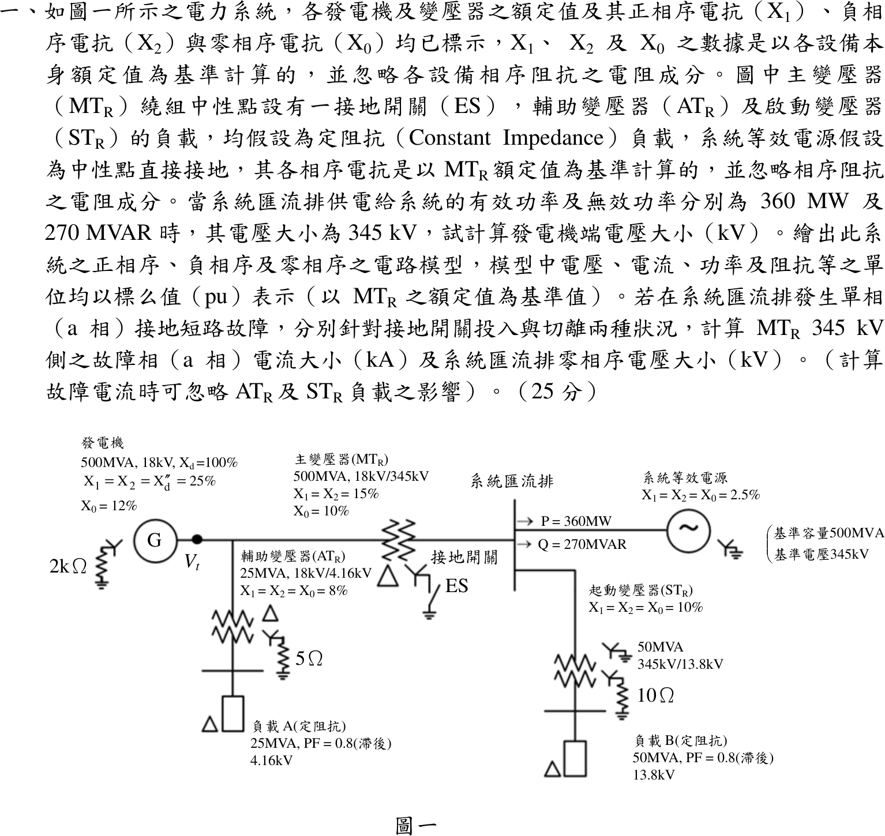
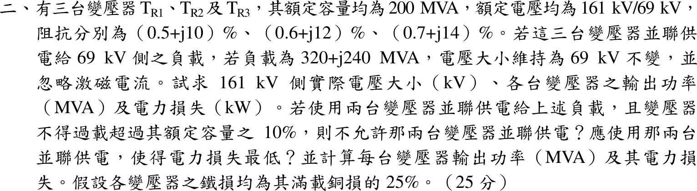
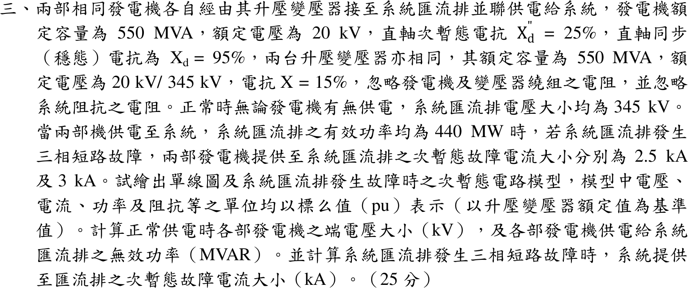
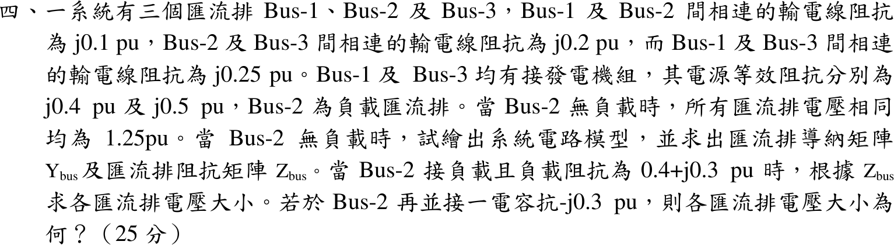

# 104 年電機工程技師｜電力系統逐題詳解

> 本頁由題級 canonical 筆記組合；每題保留官方裁切圖、校驗狀態與可追溯的推導。

## 題目導覽
- [[#一、104 年電力系統第 1 題｜序網與接地開關故障分析|第 1 題：序網與接地開關故障分析]]
- [[#二、104 年電力系統第 2 題｜並聯變壓器功率分擔與損失最佳化|第 2 題：並聯變壓器功率分擔與損失最佳化]]
- [[#三、104 年電力系統第 3 題｜兩發電機並聯三相故障|第 3 題：兩發電機並聯三相故障]]
- [[#四、104 年電力系統第 4 題｜三匯流排 $Y_{bus}$、$Z_{bus}$ 與電容補償|第 4 題：三匯流排 $Y_{bus}$、$Z_{bus}$ 與電容補償]]

---

## 一、104 年電力系統第 1 題｜序網與接地開關故障分析

> 題級識別：EE-104-05-1
> canonical 來源：[[canonical/EE-104-05-1.md]]
> 題級校驗狀態：needs_manual_review
> [!WARNING] 本題仍有官方資料缺口或事件定義歧義；請以 canonical 條件式解答為準。

### 已知與所求

各設備序電抗以自身額定為基準；標么基準取主變 \(MT_R\) 額定：500 MVA、345 kV（發電機側 18 kV）。系統匯流排電壓 345 kV，送往系統等效電源 \(P=360\ \mathrm{MW}\)、\(Q=270\ \mathrm{Mvar}\)。

| 設備 | 額定 | 序電抗 | 接線／接地 |
| --- | --- | --- | --- |
| 發電機 | 500 MVA、18 kV | \(X_d=100\%\)；\(X_1=X_2=X_d''=25\%\)、\(X_0=12\%\) | Y 經 \(2\ \mathrm{k}\Omega\) 接地 |
| \(MT_R\) | 500 MVA、18/345 kV | \(X_1=X_2=15\%\)、\(X_0=10\%\) | 18 kV 側 \(\Delta\)；345 kV 側 Y 經接地開關 ES 接地 |
| 系統等效電源 | 500 MVA、345 kV 基準 | \(X_1=X_2=X_0=2.5\%\) | Y 直接接地 |
| \(AT_R\)（接發電機端） | 25 MVA、18/4.16 kV | \(X_1=X_2=X_0=8\%\) | 18 kV 側 \(\Delta\)；4.16 kV 側 Y 經 \(5\ \Omega\) 接地 |
| \(ST_R\)（接系統匯流排） | 50 MVA、345/13.8 kV | \(X_1=X_2=X_0=10\%\) | 345 kV 側 Y 直接接地；13.8 kV 側 Y 經 \(10\ \Omega\) 接地 |
| 負載 A／負載 B | 25 MVA、4.16 kV／50 MVA、13.8 kV | PF 0.8 滯後、定阻抗 | 皆 \(\Delta\) 接 |

求：發電機端電壓（kV）；正、負、零序電路模型（pu）；系統匯流排 a 相單線接地時，ES 投入與切離兩種情況的 \(MT_R\) 345 kV 側故障相電流（kA）與匯流排零序電壓（kV）。原題 25 分未分子題，以下依所求順序編為（一）至（三）。

### 考場標準作答

#### 步驟 1：換算到共同基準

- 電抗換基準（電壓基準與設備額定電壓相同，只換容量）：\(X_{\mathrm{new}}=X_{\mathrm{old}}\dfrac{S_b}{S_{\mathrm{rated}}}\)。發電機、\(MT_R\)、系統等效電源已是 500 MVA 基準，數值不變。
\[
X_{AT}=0.08\times\frac{500}{25}=1.6,\qquad X_{ST}=0.10\times\frac{500}{50}=1.0
\]
- 定阻抗負載：在額定電壓下 \(Z=\dfrac{|V|^2}{S^*}=\dfrac{1}{0.8-j0.6}=0.8+j0.6\)（自身額定為基準），再換到 500 MVA：
\[
Z_A=(0.8+j0.6)\times\frac{500}{25}=16+j12,\qquad Z_B=(0.8+j0.6)\times\frac{500}{50}=8+j6
\]
- 中性點電阻：\(Z_b=\dfrac{V_b^2}{S_b}\)，各取所在側的電壓基準（18 kV、4.16 kV、13.8 kV）。
\[
R_{n,G}=\frac{2000}{18^2/500}=\frac{2000}{0.648}=3086.42,\qquad R_{n,AT}=\frac{5}{4.16^2/500}=\frac{5}{0.034611}=144.46,\qquad R_{n,ST}=\frac{10}{13.8^2/500}=\frac{10}{0.38088}=26.25
\]
（以上皆為 pu。）

#### （一）發電機端電壓（kV）

\(MT_R\) 電流為送往系統的電流加負載 B（經 \(ST_R\)）的電流；負載 A 接在發電機端，不流過 \(MT_R\)。送往系統的電流（\(S=VI^*\)，\(V=1\angle0^\circ\)）：
\[
I_{sys}=\left(\frac{S_{sys}}{V}\right)^*=\left(\frac{360+j270}{500}\right)^*=(0.72+j0.54)^*=0.72-j0.54
\]
負載 B 支路阻抗與電流：
\[
Z_{B,\mathrm{tot}}=jX_{ST}+Z_B=j1.0+8+j6=8+j7
\]
\[
I_B=\frac{V}{Z_{B,\mathrm{tot}}}=\frac{1}{8+j7}=\frac{8-j7}{8^2+7^2}=\frac{8-j7}{113}=0.070796-j0.061947
\]
\(MT_R\) 電流：
\[
I_{MT}=I_{sys}+I_B=(0.72+0.070796)-j(0.54+0.061947)=0.7908-j0.6019
\]
發電機端電壓：
\[
V_t=V+jX_{MT}I_{MT}=1+j0.15(0.7908-j0.6019)
\]
\[
j0.15\times0.7908=j0.11862,\qquad j0.15\times(-j0.6019)=0.090285
\]
\[
V_t=(1+0.090285)+j0.11862=1.0903+j0.1186
\]
大小與角度：
\[
|V_t|=\sqrt{1.0903^2+0.1186^2}=\sqrt{1.18875+0.01407}=\sqrt{1.20282}=1.09673\ \mathrm{pu}
\]
\[
\angle V_t=\tan^{-1}\frac{0.1186}{1.0903}=6.21^\circ
\]
換成 kV（發電機側基準 18 kV）：
\[
|V_t|=1.09673\times18=19.741\ \mathrm{kV}
\]
\[
\boxed{|V_t|=19.74\ \mathrm{kV}}
\]

#### （二）正、負、零序電路模型（pu）

正序網路（數值取自步驟 1 與（一））：

負序與零序網路的畫法：

- 負序：與圖 1 相同的電抗與負載阻抗，兩個電源短路接參考點。
- 零序，發電機：\(j0.12+3R_{n,G}=j0.12+3\times3086.42=j0.12+9259.26\) 接在發電機端節點與參考點之間；但 \(MT_R\) 與 \(AT_R\) 的發電機側都是 \(\Delta\)，此節點與其他零序網路不相通。
- 零序，\(MT_R\)（\(\Delta\)–Y 經 ES）：匯流排經 \(j0.10\) 與 ES 接參考點；ES 切離時此支路開路。
- 零序，系統等效電源（Y 直接接地）：匯流排經 \(j0.025\) 接參考點。
- 零序，\(ST_R\)（Y 接地–Y 經 \(10\ \Omega\)）：匯流排經 \(j1.0+3R_{n,ST}=j1.0+3\times26.25=j1.0+78.75\) 串到 13.8 kV 節點；負載 B 為 \(\Delta\)，沒有零序通路，此支路末端開路。
- 零序，\(AT_R\)（\(\Delta\)–Y 經 \(5\ \Omega\)）：4.16 kV 節點經 \(j1.6+3R_{n,AT}=j1.6+3\times144.46=j1.6+433.38\) 接參考點；\(\Delta\) 側開路、負載 A 為 \(\Delta\)，與其他網路隔離。

#### 步驟 2：匯流排看入的三序戴維寧阻抗（忽略 \(AT_R\)、\(ST_R\)）

依題意忽略 \(AT_R\)、\(ST_R\) 的負載；兩支路正、負序末端開路，\(ST_R\) 零序末端接 \(\Delta\) 負載亦開路，\(AT_R\) 零序被 \(\Delta\) 隔離，故連同兩變壓器略去，故障結果相同；各序阻抗忽略電阻，發電機 \(X_d\) 屬穩態模型，故障計算只用 \(X_d''\)。

正序：電源短路後，匯流排經系統 \(j0.025\) 到參考點，並聯經 \(MT_R\) 與發電機的 \(j(0.15+0.25)=j0.40\)：
\[
Z_1=j\frac{0.025\times0.40}{0.025+0.40}=j\frac{0.01}{0.425}=j0.023529
\]
負序：各設備 \(X_2=X_1\)，故
\[
Z_2=Z_1=j0.023529
\]
零序，ES 投入：系統 \(j0.025\) 並聯 \(MT_R\) 的 \(j0.10\)（發電機被 \(\Delta\) 隔開，不入）：
\[
Z_0^{\mathrm{on}}=j\frac{0.025\times0.10}{0.025+0.10}=j\frac{0.0025}{0.125}=j0.02
\]
零序，ES 切離：\(MT_R\) 支路開路，只剩系統：
\[
Z_0^{\mathrm{off}}=j0.025
\]

#### 步驟 3：345 kV 側基準電流與相電壓基準

（基準電流記作 \(I_{\mathrm{base}}\)，以免與 b 相電流 \(I_b\) 混淆。）

\[
I_{\mathrm{base}}=\frac{S_b}{\sqrt3\,V_b}=\frac{500}{\sqrt3\times345}=0.83674\ \mathrm{kA},\qquad V_{\mathrm{base},\phi}=\frac{345}{\sqrt3}=199.19\ \mathrm{kV}
\]

#### （三）單線接地故障：故障相電流與零序電壓

設故障前匯流排電壓 \(V_f=1.0\angle0^\circ\) pu（故障前負載電流不計入故障分量）。a 相接地時 \(I_b=I_c=0\)、\(V_a=0\)，三序網路串聯，\(I_{a1}=I_{a2}=I_{a0}\)，\(I_a=3I_{a1}\)，\(|V_{a0}|=|Z_0I_{a0}|\)；兩種情況只差 \(Z_0\)。

**ES 投入**

\[
Z_1+Z_2+Z_0^{\mathrm{on}}=j(0.023529+0.023529+0.02)=j0.067058
\]
\[
I_{a1}=\frac{V_f}{Z_1+Z_2+Z_0^{\mathrm{on}}}=\frac{1}{j0.067058}=-j14.912\ \mathrm{pu}
\]
\[
|I_a|=3|I_{a1}|=3\times14.912=44.736\ \mathrm{pu}
\]
\[
|I_a|=44.736\times0.83674=37.432\ \mathrm{kA}
\]
\[
\boxed{|I_a|=37.43\ \mathrm{kA}}
\]
\[
|V_{a0}|=|Z_0^{\mathrm{on}}|\,|I_{a0}|=0.02\times14.912=0.29824\ \mathrm{pu}
\]
\[
|V_{a0}|=0.29824\times199.19=59.406\ \mathrm{kV}
\]
\[
\boxed{|V_{a0}|=59.41\ \mathrm{kV}}
\]

**ES 切離**

\[
Z_1+Z_2+Z_0^{\mathrm{off}}=j(0.023529+0.023529+0.025)=j0.072058
\]
\[
I_{a1}=\frac{1}{j0.072058}=-j13.878\ \mathrm{pu}
\]
\[
|I_a|=3\times13.878=41.634\ \mathrm{pu}
\]
\[
|I_a|=41.634\times0.83674=34.837\ \mathrm{kA}
\]
\[
\boxed{|I_a|=34.84\ \mathrm{kA}}
\]
\[
|V_{a0}|=0.025\times13.878=0.34695\ \mathrm{pu}
\]
\[
|V_{a0}|=0.34695\times199.19=69.109\ \mathrm{kV}
\]
\[
\boxed{|V_{a0}|=69.11\ \mathrm{kV}}
\]

### 驗算

- 相域：\(I_b=I_{a0}+a^2I_{a1}+aI_{a2}=I_{a1}(1+a^2+a)=0\)，\(I_c\) 同理，符合只有 a 相接地。
- 零序電壓改用分流算（ES 投入）：\(I_{a0}\) 分到系統支路 \(I_{a0}\times\dfrac{0.10}{0.125}=0.8\times14.912=11.930\)，\(|V_{a0}|=0.025\times11.930=0.29825\ \mathrm{pu}\)，與上面 \(0.29824\) 相同（末位為進位差）。
- 趨勢：ES 切離使 \(Z_0\) 由 0.02 增為 0.025，故障電流變小（37.43 → 34.84 kA）、零序電壓變大（59.41 → 69.11 kV），方向合理。

### 失分點

- 求 \(V_t\) 時漏掉啟動變壓器負載 B（題目明示為定阻抗負載）會得 19.55 kV；負載 B 吸取 \(S_B=VI_B^*\times500=35.40+j30.97\ \mathrm{MVA}\)，要併入 \(MT_R\) 電流。
- 發電機側為 \(\Delta\)，發電機 \(X_0=12\%\) 與 \(2\ \mathrm{k}\Omega\) 接地電阻不入匯流排的零序戴維寧阻抗；誤把它串入會讓零序阻抗錯誤。
- ES 投入才有 \(MT_R\) 的 \(j0.10\) 零序接地支路；切離時零序只剩系統 \(j0.025\)。

### 條件與疑義

1. 題幹未明說 \(P,Q\) 是否含負載 B；本解依圖示讀為匯流排送往系統等效電源的功率，負載 B 另由主變供電。若不計負載 B，\(|V_t|=19.55\ \mathrm{kV}\)，故障部分不受影響。
2. 「345 kV 側之故障相電流」取故障點總電流。若指流過 \(MT_R\) 345 kV 繞組的 a 相電流，則依分流：正、負序流經 \(MT_R\) 支路的比例為 \(\dfrac{0.025}{0.425}=0.058824\)，零序（ES 投入）為 \(\dfrac{0.025}{0.125}=0.2\)。ES 投入 \(|I_{MT,a}|=(2\times14.912\times0.058824+0.2\times14.912)\times0.83674=3.963\approx3.96\) kA；ES 切離時零序不經 \(MT_R\)，\(|I_{MT,a}|=2\times13.878\times0.058824\times0.83674=1.366\approx1.37\) kA。

---

## 二、104 年電力系統第 2 題｜並聯變壓器功率分擔與損失最佳化

> 題級識別：EE-104-05-2
> canonical 來源：[[canonical/EE-104-05-2.md]]
> 題級校驗狀態：verified

### 已知與所求

三台變壓器 \(T_{R1},T_{R2},T_{R3}\)，各 200 MVA、161/69 kV，阻抗 \((0.5+j10)\%\)、\((0.6+j12)\%\)、\((0.7+j14)\%\)（各自額定基準，即 200 MVA）。負載 \(320+j240\ \mathrm{MVA}\)（\(|S_L|=400\) MVA），69 kV 側電壓維持 69 kV，忽略激磁電流。求三台並聯時 161 kV 側電壓、各台輸出功率（MVA）與電力損失（kW）；若只用兩台且每台不得過載超過額定的 10%（即 \(|S_i|\le1.1\times200=220\) MVA），不允許哪兩台並聯，哪兩台損失最低及其各台輸出與損失。每台鐵損 \(=25\%\) 其滿載銅損。

假設：負載電壓取 \(V_L=1\angle0^\circ\) pu 為參考相量；銅損以各台實際電流計，鐵損為定值（與負載無關）。原題 25 分未分子題，以下依所求順序編為（一）三台並聯、（二）兩台並聯。

### 考場標準作答

#### 步驟 1：標么化與等效電路

忽略激磁電流，每台變壓器只剩串聯阻抗 \(z_i\)；三台一次側同接 161 kV 匯流排、二次側同接 69 kV 匯流排，即三阻抗並聯於同一壓降 \(E-V_L\)。基準 \(S_b=200\) MVA，高壓側 \(V_b=161\) kV、低壓側 69 kV（等於變壓器額定，故百分阻抗不必換算）：
\[
z_1=0.005+j0.10,\qquad z_2=0.006+j0.12,\qquad z_3=0.007+j0.14\ \mathrm{pu}
\]
\[
S_L=\frac{320+j240}{200}=1.60+j1.20\ \mathrm{pu},\qquad |S_L|=\sqrt{320^2+240^2}=400\ \mathrm{MVA}
\]
負載電流（\(V_L=1\angle0^\circ\)）：
\[
I_L=\left(\frac{S_L}{V_L}\right)^*=(1.60+j1.20)^*=1.60-j1.20\ \mathrm{pu}
\]
\[
|I_L|=\sqrt{1.60^2+1.20^2}=\sqrt{4.00}=2.00\ \mathrm{pu},\qquad \angle I_L=-\tan^{-1}\frac{1.20}{1.60}=-36.87^\circ
\]

- 每台畫成 \(R_i\) 串 \(jX_i\)，左端共同接 161 kV 側（電壓 \(E\)），右端共同接 69 kV 側（電壓 \(V_L\)）再接負載。
- 電流參考方向：各台 \(I_i\) 由 161 kV 側流向 69 kV 側，\(I_L=\sum I_i\)。

#### 步驟 2：分流比與滿載銅損、鐵損

並聯各支路壓降相同，\(I_i=w_iI_L\)，\(w_i=\dfrac{1/z_i}{\sum_k 1/z_k}\)；三台 \(X/R\) 皆為 20（\(z_2=1.2z_1\)、\(z_3=1.4z_1\)），故 \(w_i\) 為實數，各台電流與 \(I_L\) 同相：

\[
\frac1{z_1}:\frac1{z_2}:\frac1{z_3}=\frac11:\frac1{1.2}:\frac1{1.4}
\]
同乘 42：
\[
=42:35:30,\qquad 42+35+30=107
\]

兩台組合同理：
\[
T_{R1}+T_{R2}:\ \frac11:\frac1{1.2}=6:5\ \Rightarrow\ w=\frac6{11},\ \frac5{11}
\]
\[
T_{R1}+T_{R3}:\ \frac11:\frac1{1.4}=7:5\ \Rightarrow\ w=\frac7{12},\ \frac5{12}
\]
\[
T_{R2}+T_{R3}:\ \frac1{1.2}:\frac1{1.4}=7:6\ \Rightarrow\ w=\frac7{13},\ \frac6{13}
\]

滿載（額定電流 1 pu）銅損 \(P_{cu,FL,i}=R_iS_b\)，鐵損 \(P_{fe,i}=0.25P_{cu,FL,i}\)：
\[
P_{cu,FL,1}=0.005\times200=1.00\ \mathrm{MW},\qquad P_{fe,1}=0.25\times1.00=0.25\ \mathrm{MW}
\]
\[
P_{cu,FL,2}=0.006\times200=1.20\ \mathrm{MW},\qquad P_{fe,2}=0.25\times1.20=0.30\ \mathrm{MW}
\]
\[
P_{cu,FL,3}=0.007\times200=1.40\ \mathrm{MW},\qquad P_{fe,3}=0.25\times1.40=0.35\ \mathrm{MW}
\]
實際銅損隨負載率平方：
\[
P_{cu,i}=\left(\frac{|S_i|}{S_b}\right)^2P_{cu,FL,i}
\]

#### （一）三台並聯：161 kV 側電壓、各台輸出功率與損失

**1. 各台輸出功率**
\[
|S_i|=w_i|S_L|=w_i\times400\ \mathrm{MVA}
\]
\[
|S_1|=\frac{42}{107}\times400=\frac{16800}{107}=157.0093\ \mathrm{MVA}
\]
\[
|S_2|=\frac{35}{107}\times400=\frac{14000}{107}=130.8411\ \mathrm{MVA}
\]
\[
|S_3|=\frac{30}{107}\times400=\frac{12000}{107}=112.1495\ \mathrm{MVA}
\]
\[
\boxed{|S_1|=157.01\ \mathrm{MVA},\quad |S_2|=130.84\ \mathrm{MVA},\quad |S_3|=112.15\ \mathrm{MVA}}
\]
（複功率 \(S_i=w_i(320+j240)\)，例如 \(S_1=\tfrac{42}{107}(320+j240)=125.61+j94.21\)；同法 \(S_2=104.67+j78.50\)、\(S_3=89.72+j67.29\) MVA，功率因數都是 0.8 落後；三台皆 < 220 MVA。）

**2. 161 kV 側電壓**
\[
z_{eq}=\frac{1}{\sum_k1/z_k}=w_1z_1=\frac{42}{107}(0.005+j0.10)
\]
\[
z_{eq}=\frac{0.21}{107}+j\frac{4.2}{107}=0.0019626+j0.039252\ \mathrm{pu}
\]
\[
E=V_L+z_{eq}I_L
\]
\[
z_{eq}I_L=\frac{42}{107}(0.005+j0.10)(1.60-j1.20)
\]
\[
(0.005+j0.10)(1.60-j1.20)=0.008-j0.006+j0.16+0.12=0.128+j0.154
\]
\[
z_{eq}I_L=\frac{42}{107}(0.128+j0.154)=\frac{5.376}{107}+j\frac{6.468}{107}=0.050243+j0.060449
\]
\[
E=1+0.050243+j0.060449=1.050243+j0.060449\ \mathrm{pu}
\]
（這條鏈最後要乘 161，保留 6 位有效數字才不影響末位。）
\[
|E|=\sqrt{1.050243^2+0.060449^2}=\sqrt{1.103010+0.003654}=\sqrt{1.106664}=1.051981\ \mathrm{pu}
\]
\[
\angle E=\tan^{-1}\frac{0.060449}{1.050243}=\tan^{-1}0.057557=3.29^\circ
\]
\[
|E_{161}|=|E|\times161=1.051981\times161=169.369\ \mathrm{kV}
\]
\[
\boxed{|E_{161}|=169.37\ \mathrm{kV}}
\]

**3. 各台損失**

負載率 \(\dfrac{|S_i|}{S_b}=\dfrac{w_i|S_L|}{S_b}=\dfrac{w_i\times400}{200}=2w_i\)：
\[
\frac{|S_1|}{S_b}=\frac{84}{107}=0.785047,\qquad \frac{|S_2|}{S_b}=\frac{70}{107}=0.654206,\qquad \frac{|S_3|}{S_b}=\frac{60}{107}=0.560748
\]
\[
P_{cu,1}=0.785047^2\times1.00=0.616299\times1.00=0.616299\ \mathrm{MW}=616.30\ \mathrm{kW}
\]
\[
P_{cu,2}=0.654206^2\times1.20=0.427985\times1.20=0.513582\ \mathrm{MW}=513.58\ \mathrm{kW}
\]
\[
P_{cu,3}=0.560748^2\times1.40=0.314438\times1.40=0.440213\ \mathrm{MW}=440.21\ \mathrm{kW}
\]
各台總損失 \(P_{loss,i}=P_{cu,i}+P_{fe,i}\)：
\[
P_{loss,1}=616.30+250=866.30\ \mathrm{kW}
\]
\[
P_{loss,2}=513.58+300=813.58\ \mathrm{kW}
\]
\[
P_{loss,3}=440.21+350=790.21\ \mathrm{kW}
\]
\[
\boxed{P_{loss,1}=866.30\ \mathrm{kW},\quad P_{loss,2}=813.58\ \mathrm{kW},\quad P_{loss,3}=790.21\ \mathrm{kW}}
\]
\[
\sum P_{loss}=866.30+813.58+790.21=2470.09\ \mathrm{kW}
\]
三台總損失 \(\boxed{2470.09\ \mathrm{kW}}\)。

| 變壓器 | 輸出 (MVA) | 銅損 (kW) | 鐵損 (kW) | 合計 (kW) |
| --- | --- | --- | --- | --- |
| \(T_{R1}\) | 157.01 | 616.30 | 250 | 866.30 |
| \(T_{R2}\) | 130.84 | 513.58 | 300 | 813.58 |
| \(T_{R3}\) | 112.15 | 440.21 | 350 | 790.21 |

#### （二）兩台並聯：不允許的組合與最低損失組合

**1. 各組合分擔與過載判斷**（\(|S_i|=w_i\times400\)）
\[
T_{R1}+T_{R2}:\ |S_1|=\frac6{11}\times400=218.18,\quad |S_2|=\frac5{11}\times400=181.82\ \mathrm{MVA}\quad(218.18\le220,\ \text{可})
\]
\[
T_{R1}+T_{R3}:\ |S_1|=\frac7{12}\times400=233.33,\quad |S_3|=\frac5{12}\times400=166.67\ \mathrm{MVA}\quad(233.33>220,\ \text{過載})
\]
\[
T_{R2}+T_{R3}:\ |S_2|=\frac7{13}\times400=215.38,\quad |S_3|=\frac6{13}\times400=184.62\ \mathrm{MVA}\quad(215.38\le220,\ \text{可})
\]
\[
\boxed{\text{不允許 }T_{R1}+T_{R3}\text{ 並聯（}T_{R1}\text{ 分得 }233.33\ \mathrm{MVA}>220\ \mathrm{MVA}\text{）}}
\]

**2. 容許組合的損失**（負載率 \(=w_i\times2\)，用精確分數平方）

\(T_{R1}+T_{R2}\)：負載率 \(\tfrac{12}{11}\)、\(\tfrac{10}{11}\)
\[
P_{loss,1}=\left(\frac{12}{11}\right)^2\times1.00+0.25=1.190083+0.25=1.440083\ \mathrm{MW}=1440.08\ \mathrm{kW}
\]
\[
P_{loss,2}=\left(\frac{10}{11}\right)^2\times1.20+0.30=\frac{120}{121}+0.30=0.991736+0.30=1.291736\ \mathrm{MW}=1291.74\ \mathrm{kW}
\]
\[
P_{loss}=1440.08+1291.74=2731.82\ \mathrm{kW}
\]

\(T_{R2}+T_{R3}\)：負載率 \(\tfrac{14}{13}\)、\(\tfrac{12}{13}\)
\[
P_{loss,2}=\left(\frac{14}{13}\right)^2\times1.20+0.30=1.159763\times1.20+0.30=1.391716+0.30=1.691716\ \mathrm{MW}
\]
\[
P_{loss,3}=\left(\frac{12}{13}\right)^2\times1.40+0.35=0.852071\times1.40+0.35=1.192899+0.35=1.542899\ \mathrm{MW}
\]
\[
P_{loss}=1.691716+1.542899=3.234615\ \mathrm{MW}=3234.62\ \mathrm{kW}
\]

比較：\(2731.82\ \mathrm{kW}<3234.62\ \mathrm{kW}\)，故應使用 \(\boxed{T_{R1}+T_{R2}}\)（TR1+TR2）並聯。

**3. 最佳組合各台輸出與損失**
\[
S_1=\frac6{11}(320+j240)=174.55+j130.91\ \mathrm{MVA},\qquad |S_1|=218.18\ \mathrm{MVA}
\]
\[
S_2=\frac5{11}(320+j240)=145.45+j109.09\ \mathrm{MVA},\qquad |S_2|=181.82\ \mathrm{MVA}
\]
\[
\boxed{|S_1|=218.18\ \mathrm{MVA},\ P_{loss,1}=1440.08\ \mathrm{kW};\quad |S_2|=181.82\ \mathrm{MVA},\ P_{loss,2}=1291.74\ \mathrm{kW}}
\]
\[
\boxed{P_{loss}=2.73\ \mathrm{MW}=2731.82\ \mathrm{kW}}
\]

### 驗算

壓降相等：\(|z_1||I_1|=0.100125\times0.785047=0.07860\)，\(|z_2||I_2|=0.120150\times0.654206=0.07860\)，\(|z_3||I_3|=0.140175\times0.560748=0.07860\) pu，三支路相同，分流正確。功率平衡：三台輸出 \(157.01+130.84+112.15=400.00\) MVA \(=|S_L|\)。銅損另以 \(\sum R_i|I_i|^2S_b\) 計：\(0.616+0.514+0.440=1.570\) MW，加鐵損 \(0.90\) MW 得 \(2.47\) MW，與（一）相符；\(T_{R1}+T_{R2}\) 銅損 \(1.190+0.992=2.182\) MW 加鐵損 \(0.55\) MW 得 \(2.73\) MW。

### 失分點

- \(T_{R1}\) 與 \(T_{R3}\) 並聯時 \(T_{R1}\) 分得 \(400\times\tfrac{7}{12}=233.33\) MVA，超過 220 MVA；其總損失 \((7/6)^2\times1.00+0.25+(5/6)^2\times1.40+0.35=2.933333\) MW 雖低於 \(T_{R2}+T_{R3}\)，仍必須剔除。
- 鐵損不隨負載變，每台只要投入就有 \(0.25R_iS_b\)；漏加鐵損時 \(T_{R1}+T_{R2}\) 只剩銅損 \(1.190083+0.991736=2.181818\) MW（少 0.55 MW），損失數值就錯。本題排序剛好不變（\(T_{R2}+T_{R3}\) 銅損 \(1.391716+1.192899=2.584615\) MW 仍較大），但數值仍會被扣分。
- 161 kV 側電壓要由 \(E=1+z_{eq}I_L\) 求（\(I_L=S_L^*/V_L^*\)），不能直接寫 161 kV，也不能把 \(z_{eq}\) 乘上 \(S_L\) 而不取共軛。

---

## 三、104 年電力系統第 3 題｜兩發電機並聯三相故障

> 題級識別：EE-104-05-3
> canonical 來源：[[canonical/EE-104-05-3.md]]
> 題級校驗狀態：verified

### 已知與所求

兩部相同發電機各 550 MVA、20 kV，\(X_d''=25\%\)、\(X_d=95\%\)；各經 550 MVA、20/345 kV、\(X_T=15\%\) 升壓變壓器接至 345 kV 系統匯流排，忽略電阻。正常時匯流排電壓 345 kV；題面「兩部機組各自供電至系統匯流排之有效功率均為 440 MW」，匯流排三相短路時兩機的次暫態故障電流分別為 \(2.5\ \mathrm{kA}\)、\(3\ \mathrm{kA}\)。求單線圖與次暫態電路、正常時各機端電壓與送至匯流排的無效功率，以及匯流排故障時的次暫態故障電流。基準取升壓變壓器額定：\(S_b=550\) MVA，\(V_b=345\) kV（高壓側）、20 kV（低壓側）。

假設：「均為 440 MW」讀為每部機各 440 MW（\(P_i=0.8\) pu）；系統側阻抗未給，故「系統提供至匯流排的故障電流」取兩部機組貢獻之相量和。原題 25 分未分子題，以下依所求順序編為（一）至（四）。

### 考場標準作答

#### 步驟 1：基準量

\[
I_b=\frac{S_b}{\sqrt3V_b}=\frac{550}{\sqrt3\times345}=0.920413\ \mathrm{kA}
\]
（本題後面有開根號後相減、再除以 0.40 的步驟，誤差會被放大，故中間值一律保留 6 位有效數字。）
\[
P_i=\frac{440}{550}=0.8\ \mathrm{pu},\qquad X_\Sigma''=X_d''+X_T=0.25+0.15=0.40\ \mathrm{pu}
\]

#### （一）單線圖與次暫態電路模型

每部機以 \(E_i''\) 串 \(jX_d''\) 再串 \(jX_T\) 接到 345 kV 匯流排；故障前 \(V_B=1\angle0^\circ\)（取為參考相量），三相短路時 \(V_B=0\)。同步電抗 \(X_d=95\%\) 屬穩態模型，次暫態與預故障計算皆不用。

#### 步驟 2：故障電流反算 \(E_i''\)

設次暫態電勢 \(E_i''\) 在故障瞬間不變（轉子磁鏈守恆），故由故障電流反算的 \(|E_i''|\) 即故障前運轉點的值。匯流排短路時 \(V_B=0\)，各機故障電流只由自己的 \(E_i''\) 推動 \(X_\Sigma''\)，題給 kA 值除以 \(I_b\) 即得標么值：

\[
|E_i''|=X_\Sigma''\frac{I_{f,i}}{I_b}
\]
\[
|E_1''|=0.40\times\frac{2.5}{0.920413}=\frac{1.0}{0.920413}=1.086469
\]
\[
\boxed{|E_1''|=1.09\ \mathrm{pu}}
\]
\[
|E_2''|=0.40\times\frac{3.0}{0.920413}=\frac{1.2}{0.920413}=1.303763
\]
\[
\boxed{|E_2''|=1.30\ \mathrm{pu}}
\]

#### 步驟 3：預故障電流與功率平衡

設機組送入匯流排的電流 \(I_i=0.8-jq_i\)（以 \(V_B=1\angle0^\circ\) 為參考），則 \(S_B=V_BI_i^*=0.8+jq_i\)，\(q_i\) 即送到匯流排的無效功率；令 \(|E_i''|\) 等於步驟 2 之值解 \(q_i\)：

\[
E_i''=1+j0.40(0.8-jq_i)=(1+0.40q_i)+j0.32
\]
取大小平方：
\[
|E_i''|^2=(1+0.40q_i)^2+0.32^2\quad\Rightarrow\quad 1+0.40q_i=\sqrt{|E_i''|^2-0.1024}
\]
（取正根，即正常小訊號穩定運轉的低功角分支；另一根 \(\delta>90^\circ\) 需吸收超過 2000 Mvar 且 \(dP/d\delta<0\)，捨去。）

機組 1：
\[
1+0.40q_1=\sqrt{1.086469^2-0.1024}=\sqrt{1.180415-0.1024}=\sqrt{1.078015}=1.038275
\]
\[
q_1=\frac{1.038275-1}{0.40}=\frac{0.038275}{0.40}=0.095688
\]
機組 2：
\[
1+0.40q_2=\sqrt{1.303763^2-0.1024}=\sqrt{1.699798-0.1024}=\sqrt{1.597398}=1.263882
\]
\[
q_2=\frac{1.263882-1}{0.40}=\frac{0.263882}{0.40}=0.659705
\]
各機 \(E_i''\) 超前匯流排的角度：
\[
\delta_1=\sin^{-1}\frac{0.32}{1.086469}=\sin^{-1}0.294532=17.13^\circ,\qquad \delta_2=\sin^{-1}\frac{0.32}{1.303763}=\sin^{-1}0.245443=14.21^\circ
\]

#### （二）正常供電時各機端電壓（kV）

\[
V_{t,i}=1+j0.15(0.8-jq_i)=(1+0.15q_i)+j0.12
\]
機組 1：
\[
V_{t,1}=(1+0.15\times0.095688)+j0.12=1.014353+j0.12
\]
\[
|V_{t,1}|=\sqrt{1.014353^2+0.12^2}=\sqrt{1.028912+0.0144}=\sqrt{1.043312}=1.021426\ \mathrm{pu}
\]
\[
|V_{t,1}|=1.021426\times20=20.43\ \mathrm{kV}
\]
\[
\boxed{|V_{t,1}|=20.43\ \mathrm{kV}}
\]
機組 2：
\[
V_{t,2}=(1+0.15\times0.659705)+j0.12=1.098956+j0.12
\]
\[
|V_{t,2}|=\sqrt{1.098956^2+0.12^2}=\sqrt{1.207704+0.0144}=\sqrt{1.222104}=1.105488\ \mathrm{pu}
\]
\[
|V_{t,2}|=1.105488\times20=22.11\ \mathrm{kV}
\]
\[
\boxed{|V_{t,2}|=22.11\ \mathrm{kV}}
\]

#### （三）各機供給系統匯流排之無效功率（MVAR）

\[
Q_{B,1}=q_1\times550=0.095688\times550=52.63\ \mathrm{Mvar}
\]
\[
\boxed{Q_{B,1}=52.63\ \mathrm{Mvar}}
\]
\[
Q_{B,2}=q_2\times550=0.659705\times550=362.84\ \mathrm{Mvar}
\]
\[
\boxed{Q_{B,2}=362.84\ \mathrm{Mvar}}
\]

#### （四）系統匯流排三相短路之次暫態故障電流（kA）

兩機故障電流相角不同，取相量和，\(I_{f,i}''=E_i''/(jX_\Sigma'')\)，\(E_i''\) 用步驟 3 的直角式：

\[
I_{f,1}''=\frac{1.038275+j0.32}{j0.40}=\frac{0.32}{0.40}-j\frac{1.038275}{0.40}=0.8-j2.595688
\]
\[
I_{f,2}''=\frac{1.263882+j0.32}{j0.40}=\frac{0.32}{0.40}-j\frac{1.263882}{0.40}=0.8-j3.159705
\]
相量和：
\[
I_f''=I_{f,1}''+I_{f,2}''=(0.8+0.8)-j(2.595688+3.159705)=1.6-j5.755393
\]
大小：
\[
|I_f''|=\sqrt{1.6^2+5.755393^2}=\sqrt{2.56+33.124548}=\sqrt{35.684548}=5.973655\ \mathrm{pu}
\]
換成 kA：
\[
|I_f''|=5.973655\times0.920413=5.4982\ \mathrm{kA}
\]
\[
\boxed{|I_f''|=5.50\text{ kA}}
\]

### 驗算

故障電流反算：\(|I_{f,1}''|=\sqrt{0.8^2+2.595688^2}\times0.920413=2.71617\times0.920413=2.50\) kA、\(|I_{f,2}''|=\sqrt{0.8^2+3.159705^2}\times0.920413=3.25941\times0.920413=3.00\) kA，與題給相同。另以功角公式檢查有功：\(P=\dfrac{|E_i''|V_B\sin\delta_i}{X_\Sigma''}\)，\(\dfrac{1.086469\times0.294532}{0.40}=0.80\)、\(\dfrac{1.303763\times0.245443}{0.40}=0.80\)，與 \(P_i=0.8\) pu 相符。

### 失分點

- 不可先假設 \(E''=1\) pu；題面給的 \(2.5/3.0\ \mathrm{kA}\) 正是反推各機 \(E''\) 的資料，也因此兩機的 \(Q\) 不同。
- \(P_i=0.8\) 是每部機各 440 MW 對 550 MVA 基準，不是兩部合計除以兩台。
- 最後是兩個故障電流相量相加 \(|I_{f,1}''+I_{f,2}''|\)（5.50 kA）；本題兩電流相角只差約 \(2.92^\circ\)（\(-72.87^\circ\) 與 \(-75.79^\circ\)），代數和 5.5 kA 只是巧合接近，作答仍須列相量式。

### 條件與疑義

題幹未給系統等效阻抗，故「系統提供至匯流排之故障電流」只能取兩部機組貢獻之相量和；若題意另含系統側貢獻，須補系統阻抗後再加。

---

## 四、104 年電力系統第 4 題｜三匯流排 $Y_{bus}$、$Z_{bus}$ 與電容補償

> 題級識別：EE-104-05-4
> canonical 來源：[[canonical/EE-104-05-4.md]]
> 題級校驗狀態：verified

### 已知與所求

三匯流排：Bus 1–2 線路 \(j0.1\)、Bus 2–3 線路 \(j0.2\)、Bus 1–3 線路 \(j0.25\)（pu）。Bus 1、Bus 3 各接發電機組，電源等效阻抗 \(j0.4\)、\(j0.5\)；Bus 2 為負載匯流排。Bus 2 無載時各匯流排電壓同為 \(1.25\) pu。求電路模型、\(Y_{bus}\)、\(Z_{bus}\)；Bus 2 接 \(0.4+j0.3\) pu 負載時依 \(Z_{bus}\) 求各匯流排電壓；再並接 \(-j0.3\) pu 電容抗後各匯流排電壓。假設：電源模型為等電壓 \(1.25\ \mathrm{pu}\) 串聯其等效電抗，電源阻抗視為接地支路；忽略線路電阻與並聯電納。原題 25 分未分子題，以下依所求順序編為（一）至（三）。

### 考場標準作答

#### （一）電路模型、\(Y_{bus}\) 與 \(Z_{bus}\)

兩電源電勢相等且同相（無載時各匯流排電壓皆 \(1.25\angle0^\circ\)，取為參考相量）。畫法：三匯流排以三條線路兩兩相連；Bus 1、Bus 3 各經電源電抗接電壓源 \(E=1.25\) 再接參考點；Bus 2 只留負載接點。

支路導納 \(y=\dfrac{1}{jx}=-j\dfrac1x\)：
\[
y_{12}=\frac{1}{j0.1}=-j10,\quad y_{23}=\frac{1}{j0.2}=-j5,\quad y_{13}=\frac{1}{j0.25}=-j4,\quad y_{g1}=\frac{1}{j0.4}=-j2.5,\quad y_{g3}=\frac{1}{j0.5}=-j2
\]
對角元：
\[
Y_{11}=y_{12}+y_{13}+y_{g1}=-j(10+4+2.5)=-j16.5
\]
\[
Y_{22}=y_{12}+y_{23}=-j(10+5)=-j15
\]
\[
Y_{33}=y_{13}+y_{23}+y_{g3}=-j(4+5+2)=-j11
\]
非對角元：\(Y_{12}=-y_{12}=j10\)、\(Y_{13}=-y_{13}=j4\)、\(Y_{23}=-y_{23}=j5\)。
\[
\boxed{Y_{bus}=\begin{bmatrix}-j16.5&j10&j4\\ j10&-j15&j5\\ j4&j5&-j11\end{bmatrix}\ \mathrm{pu}}
\]

求反矩陣：令 \(Y_{bus}=-jB\)，\(B=\begin{bmatrix}16.5&-10&-4\\-10&15&-5\\-4&-5&11\end{bmatrix}\)，則 \(Z_{bus}=(-jB)^{-1}=jB^{-1}=j\dfrac{\operatorname{adj}B}{\det B}\)。

行列式（沿第一列展開）：
\[
\det B=16.5(15\times11-25)+10\big[(-10)(11)-(-5)(-4)\big]-4\big[(-10)(-5)-15(-4)\big]
\]
\[
=16.5\times140+10\times(-130)-4\times110=2310-1300-440=570
\]
餘因子（\(B\) 對稱，伴隨矩陣也對稱）：
\[
C_{11}=15\times11-(-5)^2=140,\qquad C_{22}=16.5\times11-(-4)^2=165.5,\qquad C_{33}=16.5\times15-(-10)^2=147.5
\]
\[
C_{12}=-\big[(-10)(11)-(-5)(-4)\big]=130,\qquad C_{13}=(-10)(-5)-15(-4)=110,\qquad C_{23}=-\big[16.5(-5)-(-10)(-4)\big]=122.5
\]
\[
Z_{bus}=\frac{j}{570}\begin{bmatrix}140&130&110\\130&165.5&122.5\\110&122.5&147.5\end{bmatrix}\approx j\begin{bmatrix}0.24561&0.22807&0.19298\\0.22807&0.29035&0.21491\\0.19298&0.21491&0.25877\end{bmatrix}\ \mathrm{pu}
\]
分子分母同乘 2 化為整數：
\[
\boxed{Z_{bus}=\frac{j}{1140}\begin{bmatrix}280&260&220\\260&331&245\\220&245&295\end{bmatrix}\ \mathrm{pu}}
\]

#### （二）Bus 2 接 \(Z_L=0.4+j0.3\) 時各匯流排電壓

由 Bus 2 看入，網路等效為開路電壓 \(V^{(0)}=1.25\) 串 \(Z_{22}=j0.29035\)；接上 \(Z_L\) 求 \(I_L\)，再由疊加 \(V_k=V^{(0)}-Z_{k2}I_L\)（\(Z_{bus}\) 第 2 行）得各匯流排電壓。

負載電流：
\[
I_L=\frac{V^{(0)}}{Z_L+Z_{22}}=\frac{1.25}{0.4+j0.3+j0.29035}=\frac{1.25}{0.4+j0.59035}
\]
分母有理化：
\[
I_L=\frac{1.25(0.4-j0.59035)}{0.4^2+0.59035^2}=\frac{0.5-j0.73794}{0.16+0.34851}=\frac{0.5-j0.73794}{0.50851}=0.9833-j1.4512\ \mathrm{pu}
\]
電壓更新式（\(Z_{k2}=jz_{k2}\)）：
\[
V_k=V^{(0)}-Z_{k2}I_L=1.25-jz_{k2}(0.9833-j1.4512)=(1.25-1.4512\,z_{k2})-j0.9833\,z_{k2}
\]
Bus 1（\(z_{12}=0.22807\)）：
\[
1.4512\times0.22807=0.33098,\qquad 0.9833\times0.22807=0.22426
\]
\[
V_1=(1.25-0.33098)-j0.22426=0.91902-j0.22426
\]
\[
|V_1|=\sqrt{0.91902^2+0.22426^2}=\sqrt{0.84460+0.050293}=\sqrt{0.89489}=0.94599,\qquad \angle V_1=-\tan^{-1}\frac{0.22426}{0.91902}=-13.71^\circ
\]
Bus 2（\(z_{22}=0.29035\)）：
\[
1.4512\times0.29035=0.42136,\qquad 0.9833\times0.29035=0.28550
\]
\[
V_2=(1.25-0.42136)-j0.28550=0.82864-j0.28550
\]
\[
|V_2|=\sqrt{0.82864^2+0.28550^2}=\sqrt{0.68664+0.081510}=\sqrt{0.76815}=0.87644,\qquad \angle V_2=-\tan^{-1}\frac{0.28550}{0.82864}=-19.01^\circ
\]
Bus 3（\(z_{32}=0.21491\)）：
\[
1.4512\times0.21491=0.31188,\qquad 0.9833\times0.21491=0.21132
\]
\[
V_3=(1.25-0.31188)-j0.21132=0.93812-j0.21132
\]
\[
|V_3|=\sqrt{0.93812^2+0.21132^2}=\sqrt{0.88007+0.044656}=\sqrt{0.92473}=0.96163,\qquad \angle V_3=-\tan^{-1}\frac{0.21132}{0.93812}=-12.69^\circ
\]
\[
\boxed{|V_1|=0.95,\ |V_2|=0.88,\ |V_3|=0.96\ \mathrm{pu}}
\]

#### （三）再並接 \(-j0.3\) 電容抗後各匯流排電壓

電容與負載並聯，先合成 \(Z_{L\parallel C}\) 再與 \(Z_{22}\) 串聯；因電容抗 0.3 與 \(Z_{22}\) 的 0.29035 幾乎相消，兩者之差以精確分數計算，不用四捨五入值相減。

並聯合成：
\[
\frac{1}{0.4+j0.3}=\frac{0.4-j0.3}{0.4^2+0.3^2}=\frac{0.4-j0.3}{0.25}=1.6-j1.2,\qquad \frac{1}{-j0.3}=j3.3333
\]
\[
\frac{1}{Z_{L\parallel C}}=1.6-j1.2+j3.3333=1.6+j2.1333
\]
\[
Z_{L\parallel C}=\frac{1.6-j2.1333}{1.6^2+2.1333^2}=\frac{1.6-j2.1333}{2.56+4.5511}=\frac{1.6-j2.1333}{7.1111}=0.225-j0.3
\]
（精確值：\(2.1333=\tfrac{32}{15}\)，分母 \(=\tfrac{64}{9}\)，結果恰為 \(0.225-j0.3\)。）

與 \(Z_{22}=j\tfrac{165.5}{570}\) 串聯，\(0.3=\tfrac{171}{570}\)：
\[
Z_{L\parallel C}+Z_{22}=0.225-j\Big(\frac{171}{570}-\frac{165.5}{570}\Big)=0.225-j\frac{5.5}{570}=0.225-j0.0096491
\]
電流：
\[
I_{LC}=\frac{1.25}{0.225-j0.0096491}=\frac{1.25(0.225+j0.0096491)}{0.225^2+0.0096491^2}=\frac{0.28125+j0.012061}{0.050625+0.000093105}=\frac{0.28125+j0.012061}{0.050718}
\]
\[
I_{LC}=5.5454+j0.23781\ \mathrm{pu}
\]
電壓更新式：
\[
V_k=1.25-jz_{k2}(5.5454+j0.23781)=(1.25+0.23781\,z_{k2})-j5.5454\,z_{k2}
\]
Bus 1：
\[
0.23781\times0.22807=0.054237,\qquad 5.5454\times0.22807=1.2647
\]
\[
V_1=1.3042-j1.2647,\qquad |V_1|=\sqrt{1.3042^2+1.2647^2}=\sqrt{1.7009+1.5995}=\sqrt{3.3004}=1.8167,\qquad \angle V_1=-\tan^{-1}\frac{1.2647}{1.3042}=-44.12^\circ
\]
Bus 2：
\[
0.23781\times0.29035=0.069048,\qquad 5.5454\times0.29035=1.6101
\]
\[
V_2=1.3190-j1.6101,\qquad |V_2|=\sqrt{1.3190^2+1.6101^2}=\sqrt{1.7398+2.5924}=\sqrt{4.3322}=2.0814,\qquad \angle V_2=-\tan^{-1}\frac{1.6101}{1.3190}=-50.68^\circ
\]
Bus 3：
\[
0.23781\times0.21491=0.051108,\qquad 5.5454\times0.21491=1.1918
\]
\[
V_3=1.3011-j1.1918,\qquad |V_3|=\sqrt{1.3011^2+1.1918^2}=\sqrt{1.6929+1.4204}=\sqrt{3.1133}=1.7645,\qquad \angle V_3=-\tan^{-1}\frac{1.1918}{1.3011}=-42.49^\circ
\]
\[
\boxed{|V_1|=1.82,\ |V_2|=2.08,\ |V_3|=1.76\ \mathrm{pu}}
\]

### 驗算

節點電壓法（不用 \(Z_{bus}\)）：電源以諾頓電流 \(1.25y_{g1}\)、\(1.25y_{g3}\) 注入，負載導納加到 \(Y_{22}\)，直接解 \(Y_{bus}'V=I\)，兩種負載情況與上列電壓全相符（誤差 \(<10^{-9}\) pu）。另檢查 Bus 2 自身：\(V_2=I_L Z_L\)，\((0.9833-j1.4512)(0.4+j0.3)=0.39332+0.43536+j(0.29499-0.58048)=0.82868-j0.28549\)，與（二）的 \(V_2\) 相同（末位為進位差）。電容抗 0.30 與 Bus 2 戴維寧電抗 0.29035 幾乎相消，總阻抗只剩 \(0.225-j0.0096491\)，電流約 5.55 pu，電壓大幅上升屬並聯共振現象，非計算錯誤。

### 失分點

- \(Y_{bus}\) 對角項要含電源等效阻抗的接地支路：\(Y_{11}=-j(10+4+2.5)\)、\(Y_{33}=-j(4+5+2)\)；漏掉會得到奇異矩陣，無法求 \(Z_{bus}\)。
- 負載情況的開路電壓用 \(1.25\) pu（不是 1.0）；電壓下降量 \(Z_{k2}I_L\) 要用 \(Z_{bus}\) 第 2 行，三個匯流排都要更新。
- 並聯電容後要先把電容與負載合成 \(0.225-j0.3\) 再與 \(Z_{22}\) 串聯，不可把電容電流另外加上；\(0.3-0.29035\) 這種相近數相減要用精確值。

---
