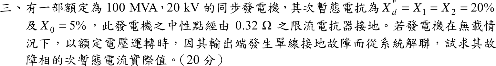
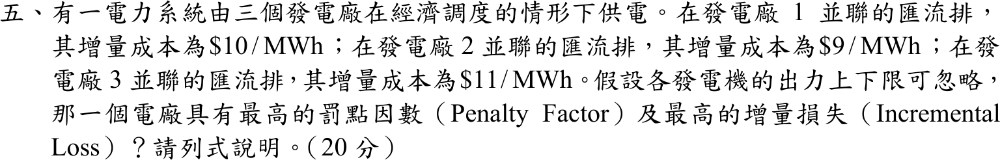

# 105 年電機工程技師｜電力系統逐題詳解

> 本頁由題級 canonical 筆記組合；每題保留官方裁切圖、校驗狀態與可追溯的推導。

## 題目導覽
- [[#一、105 年電力系統第 1 題|第 1 題：105 年電力系統第 1 題]]
- [[#二、105 年電力系統第 2 題｜三匯流排高斯–賽德潮流迭代|第 2 題：三匯流排高斯–賽德潮流迭代]]
- [[#三、105 年電力系統第 3 題|第 3 題：105 年電力系統第 3 題]]
- [[#四、105 年電力系統第 4 題｜再生能源併網與暫態穩定度|第 4 題：再生能源併網與暫態穩定度]]
- [[#五、105 年電力系統第 5 題｜經濟調度罰點因數與增量損失|第 5 題：經濟調度罰點因數與增量損失]]

---

## 一、105 年電力系統第 1 題

> 題級識別：EE-105-05-1
> canonical 來源：[[canonical/EE-105-05-1.md]]
> 題級校驗狀態：verified

### 已知與所求

論述題，無數據（20 分）。說明中、長程輸電線路串聯補償與並聯補償的主要目的，以及兩者如何實施。

### 考場標準作答

**解題邏輯**：兩種補償都從線路的兩條基本關係切入，前提是以「送電端匯流排—線路—受電端匯流排」單線路說明，傳輸功率式略去線路電阻，壓降式保留 \(R\)；中、長程線路的並聯充電電容不可忽略。
1. 傳輸功率 \(P=\dfrac{V_SV_R}{X}\sin\delta\)（由串聯電抗 \(X\) 決定上限）。
2. 壓降 \(\Delta V\approx\dfrac{RP+XQ}{V_R}\)（由線路輸送的無功 \(Q\) 決定電壓）。
3. 串聯補償改變的是 \(X\)，目的在提高傳輸容量與穩定度；並聯補償改變的是線路輸送的 \(Q\)，目的在控制電壓。
4. 每一種都依「目的（以公式說明）→ 實施方式（裝設位置、設備、保護與限制）」作答。

#### 步驟 1：線路的兩條基本關係與補償設備位置

**邏輯**：先寫出兩條公式，後面兩小題分別說明串聯、並聯元件改變的是哪一項。

- 送電端電壓 \(V_S\angle\delta\)、受電端電壓 \(V_R\angle0^\circ\)、線路串聯電抗 \(X_L\)（無補償時 \(X=X_L\)）：
\[
P=\frac{V_SV_R}{X}\sin\delta,\qquad P_{max}=\frac{V_SV_R}{X}\quad(\delta=90^\circ)
\]
- 受電端負載 \(P+jQ\)，線路電阻 \(R\)，小壓降近似：
\[
\Delta V=|V_S|-|V_R|\approx\frac{RP+XQ}{V_R}
\]
- 補償設備的接法：串聯電容器串在相導線上；並聯電容器、並聯電抗器接在匯流排與地之間（圖 1）。

#### （一）串聯補償：目的與實施方式

**邏輯**：串聯電容的容抗 \(X_C\) 與線路感抗 \(X_L\) 相減，直接縮小傳輸功率式的分母 \(X\)，所以主要目的是提高傳輸容量與穩定度。

**目的**：令補償度 \(k=X_C/X_L\)，補償後的有效串聯電抗：
\[
X_{eff}=X_L-X_C=X_L-kX_L=(1-k)X_L
\]
代回步驟 1 的 \(P_{max}\)：
\[
\boxed{P_{max}=\frac{V_SV_R}{X_{eff}}=\frac{V_SV_R}{(1-k)X_L}}
\]
與無補償 \(P_{max,0}=V_SV_R/X_L\) 相比：
\[
\frac{P_{max}}{P_{max,0}}=\frac{X_L}{(1-k)X_L}=\frac{1}{1-k}
\]
例如 \(k=0.5\)：\(\dfrac{1}{1-0.5}=\dfrac{1}{0.5}=2\)，傳輸極限加倍。由此得到串聯補償的目的：

1. 提高線路傳輸容量（靜態穩定極限 \(P_{max}\) 提高為 \(1/(1-k)\) 倍）。
2. 同一傳輸功率下功率角 \(\delta\) 變小，穩定裕度增加，暫態穩定度改善。
3. 壓降式中的 \(XQ\) 項變小，且容抗壓降隨負載電流自動增加，重載時電壓調整率改善。
4. 調整並聯線路的有效阻抗，改善各線路間的潮流分配。

**實施方式**：

- 將電容器組串聯於各相導線，裝在線路中點或兩端變電所（置於絕緣平台上）。
- 電容器組並聯保護：金屬氧化物變阻器（MOV）限制故障時電容器過電壓，觸發間隙與旁路開關（斷路器）在嚴重故障或維修時將電容器旁路（圖 1）。
- 補償度採部分補償，一般 \(k\approx0.25\sim0.70\)：補償度過高易與汽輪發電機軸系發生次同步共振（SSR），並使距離電驛量到的阻抗失真；需快速調整時可用閘流體控制串聯電容（TCSC）。

#### （二）並聯補償：目的與實施方式

**邏輯**：並聯元件不改變 \(X\)，而是就地供應或吸收無功，改變線路實際輸送的 \(Q\)，從壓降式的 \(XQ\) 項控制受電端電壓。

**目的**：受電端並聯元件供應 \(Q_c\) 後，線路只需輸送 \(Q-Q_c\)：
\[
\Delta V\approx\frac{RP+X(Q-Q_c)}{V_R}
\]

1. **重載（感性負載多）**：並聯電容器供應無功
\[
\boxed{Q_c=\frac{V^2}{X_c}}
\]
使 \(Q-Q_c\) 變小，\(\Delta V\) 減小而抬升受電端電壓；線路電流變小，\(I^2R\) 損失降低，功因改善。

2. **輕載或空載（線路充電無功過剩）**：中、長程線路的並聯電容產生充電無功，受電端電壓反而高於送電端（費蘭梯效應）。無損線路空載時：
\[
V_R=\frac{V_S}{\cos\beta\ell}>V_S\qquad(0<\beta\ell<90^\circ)
\]
此時接入並聯電抗器吸收無功 \(Q_r=V^2/X_r\)，抑制過電壓。

**實施方式**：

- 在變電所匯流排（受電端、中間開閉所）並接電容器組，依負載分段以開關投入或切離。
- 長程超高壓線路兩端裝設並聯電抗器（常直接接在線路側，隨線路一起投切），輕載時吸收充電無功。
- 需連續、快速調整時，採用靜態虛功補償器（SVC）、靜態同步補償器（STATCOM）或同步調相機。

### 驗算

- 串聯補償倍數：\(P_{max}/P_{max,0}=1/(1-k)\)，\(k=0.5\) 時為 2；\(k\to0\) 時回到 1（無補償），符號化簡與數值一致。
- 並聯電容升壓方向（一般示例，非題目數據）：送電端 \(1\) pu、線路 \(X=0.3\) pu、受電端負載 \(0.8+j0.4\) pu，解受電端電壓得 \(V_R=0.81\) pu；並聯電容 \(Q_c=0.4\) pu 投入後 \(V_R=0.97\) pu，與「重載並聯電容升壓」一致。
- 費蘭梯：\(0<\cos\beta\ell<1\) 時 \(1/\cos\beta\ell>1\)，空載受電端電壓高於送電端，需並聯電抗器的結論成立。

### 失分點

- 並聯電容器是「供應」無功（抵消感性負載的無功需求），不是「吸收」；空載過電壓要用並聯「電抗器」吸收，兩者方向寫反會被扣分。
- 串聯補償靠降低 \(X_{eff}\) 提高 \(P_{max}\) 與穩定度，並聯補償靠無功平衡控制電壓；兩者目的不可混為一談。
- 只答目的而漏寫實施方式：串聯補償要寫裝設位置、MOV／旁路保護與補償度限制（SSR），並聯補償要寫電容器／電抗器的投切與 SVC／STATCOM。

---

## 二、105 年電力系統第 2 題｜三匯流排高斯–賽德潮流迭代

> 題級識別：EE-105-05-2
> canonical 來源：[[canonical/EE-105-05-2.md]]
> 題級校驗狀態：verified

### 已知與所求

標么值系統：匯流排 ① 為搖擺匯流排，\(V_1=1.04\angle0^\circ\)；線路 \(y_{13}=-j8\)（①–③）、\(y_{23}=-j12\)（②–③），①②間無線路；負載 \(S_{D2}=0.6+j0.5\)、\(S_{D3}=0.9+j0.8\)。負載匯流排初值 \(V_2^{(0)}=V_3^{(0)}=1.0\angle0^\circ\)。求二次高斯–賽德疊代後 \(V_2,V_3\) 的大小與相角。圖中未標示並聯元件，假設無（\(Y_{ii}\) 只含線路導納）。

### 考場標準作答

**解題邏輯**：高斯–賽德法就是「每個負載匯流排輪流用自己的節點方程式，解出自己的電壓」；同一輪中，先算出的新電壓馬上給後面的匯流排使用。做法分四步：建 \(Y_{\mathrm{bus}}\)（步驟 1）→ 由 KCL 推出更新式（步驟 2）→ 代入本題並化簡成好算的形式（步驟 3）→ 依 ② → ③ 的順序疊代兩輪，再換成大小與相角。前提：搖擺匯流排 \(V_1=1.04\angle0^\circ\) 固定；負載匯流排初值 \(V_2^{(0)}=V_3^{(0)}=1\angle0^\circ\)；圖中未標示並聯元件，\(Y_{ii}\) 只含線路導納。

#### 步驟 1：建立導納矩陣元素

規則：自導納 \(Y_{ii}\) = 接到匯流排 \(i\) 的線路導納之和；互導納 \(Y_{ij}\) = 兩匯流排間線路導納的負值。

| 元素 | 接線 | 數值 |
| --- | --- | --- |
| \(Y_{22}\) | ② 只接 ②–③ 線 | \(y_{23}=-j12\) |
| \(Y_{33}\) | ③ 接 ①–③、②–③ 兩條線 | \(y_{13}+y_{23}=-j8-j12=-j20\) |
| \(Y_{23}=Y_{32}\) | ②–③ 線 | \(-y_{23}=+j12\) |
| \(Y_{31}\) | ①–③ 線 | \(-y_{13}=+j8\) |
| \(Y_{21}\) | ①② 間無線路 | \(0\) |

#### 步驟 2：更新式從哪裡來

匯流排 \(i\) 的注入電流由 KCL 為 \(I_i=\sum_j Y_{ij}V_j\)，注入複功率 \(S_i=V_iI_i^*\)，所以 \(I_i=\dfrac{S_i^*}{V_i^*}=\dfrac{P_i-jQ_i}{V_i^*}\)。把 \(I_i\) 的式子中自己那一項 \(Y_{ii}V_i\) 留在左邊，其餘移到右邊：
\[
V_i=\frac{1}{Y_{ii}}\left[\frac{P_i-jQ_i}{V_i^*}-\sum_{j\ne i}Y_{ij}V_j\right]
\]
右邊的 \(V_i^*\) 用上一輪的值；\(V_j\) 若本輪已算過，就用本輪的新值（這就是高斯–賽德與 Jacobi 法的差別）。

負載吸收功率，所以注入功率為負：
\[
S_2=-(0.6+j0.5),\quad P_2-jQ_2=-0.6+j0.5;\qquad S_3=-(0.9+j0.8),\quad P_3-jQ_3=-0.9+j0.8
\]

#### 步驟 3：代入本題並化簡

**匯流排 ②**：代入 \(Y_{22}=-j12\)、\(Y_{23}=+j12\)、\(Y_{21}=0\)：
\[
V_2=\frac{1}{-j12}\left[\frac{-0.6+j0.5}{V_2^*}-j12V_3\right]
\]
第二項 \(\dfrac{-j12V_3}{-j12}=V_3\)；第一項用 \(\dfrac{1}{-j12}=\dfrac{j}{12}\)，且 \(j(-0.6+j0.5)=-0.5-j0.6\)：
\[
\boxed{V_2=V_3-\frac{0.5+j0.6}{12\,V_2^*}}
\]
物理意義：② 只經 ②–③ 線取電，負載電流 \(I_{D2}=\left(\dfrac{S_{D2}}{V_2}\right)^*=\dfrac{0.6-j0.5}{V_2^*}\) 流過線路阻抗 \(z_{23}=\dfrac{1}{-j12}=\dfrac{j}{12}\)，壓降 \(z_{23}I_{D2}=\dfrac{j(0.6-j0.5)}{12V_2^*}=\dfrac{0.5+j0.6}{12V_2^*}\)。所以 \(V_2\) 就是「\(V_3\) 減去線路壓降」。

**匯流排 ③**：代入 \(Y_{33}=-j20\)、\(Y_{32}=+j12\)、\(Y_{31}=+j8\)、\(V_1=1.04\)：
\[
V_3=\frac{1}{-j20}\left[\frac{-0.9+j0.8}{V_3^*}-j12V_2-j8(1.04)\right]
\]
後兩項除以 \(-j20\) 得 \(\dfrac{12V_2+8(1.04)}{20}\)；第一項 \(j(-0.9+j0.8)=-0.8-j0.9\)：
\[
\boxed{V_3=\frac{12V_2+8.32}{20}-\frac{0.8+j0.9}{20\,V_3^*}}
\]
物理意義：第一項是兩個鄰近匯流排電壓依導納（12 與 8）的加權平均，第二項是負載把電壓往下拉的量。

#### 第一次疊代

**邏輯**：初值 \(V_2^{(0)}=V_3^{(0)}=1\)，所以分母的 \(V^*\) 都是 1；先算 \(V_2^{(1)}\)，再把它代入 \(V_3^{(1)}\)。

\[
V_2^{(1)}=V_3^{(0)}-\frac{0.5+j0.6}{12(1)}=1-(0.041667+j0.05)=0.958333-j0.05
\]
加權平均項：
\[
\frac{12V_2^{(1)}+8.32}{20}=\frac{(11.5-j0.6)+8.32}{20}=\frac{19.82-j0.6}{20}=0.991-j0.03
\]
負載項：
\[
\frac{0.8+j0.9}{20(1)}=0.04+j0.045
\]
\[
V_3^{(1)}=(0.991-j0.03)-(0.04+j0.045)=0.951-j0.075
\]

#### 第二次疊代

**邏輯**：同一組更新式，分母改用第一輪的共軛值；\(V_3^{(2)}\) 的加權平均項要用剛算出的 \(V_2^{(2)}\)。複數除法用「分子分母同乘分母的共軛」。

**\(V_2^{(2)}\)**：\((V_2^{(1)})^*=0.958333+j0.05\)。
\[
\frac{0.5+j0.6}{0.958333+j0.05}=\frac{(0.5+j0.6)(0.958333-j0.05)}{0.958333^2+0.05^2}
\]
分子實部 \(0.5\times0.958333+0.6\times0.05=0.479167+0.03=0.509167\)；虛部 \(0.6\times0.958333-0.5\times0.05=0.575-0.025=0.55\)；分母 \(0.918403+0.0025=0.920903\)：
\[
\frac{0.509167+j0.55}{0.920903}=0.552899+j0.597240
\]
除以 12 得壓降 \(0.046075+j0.049770\)，所以
\[
V_2^{(2)}=(0.951-j0.075)-(0.046075+j0.049770)=0.904925-j0.124770\approx0.90493-j0.12477
\]
\[
|V_2^{(2)}|=\sqrt{0.904925^2+0.124770^2}=\sqrt{0.818889+0.015568}=\sqrt{0.834457}=0.9135
\]
\[
\angle V_2^{(2)}=-\tan^{-1}\frac{0.124770}{0.904925}=-\tan^{-1}0.13788=-7.85^\circ
\]
\[
\boxed{V_2^{(2)}=0.91\angle-7.85^\circ\ \mathrm{pu}}
\]

**\(V_3^{(2)}\)**：加權平均項（用 \(V_2^{(2)}\)）：
\[
\frac{12(0.904925-j0.124770)+8.32}{20}=\frac{(10.85910-j1.49724)+8.32}{20}=\frac{19.17910-j1.49724}{20}=0.958955-j0.074862
\]
負載項：\((V_3^{(1)})^*=0.951+j0.075\)。
\[
\frac{0.8+j0.9}{0.951+j0.075}=\frac{(0.8+j0.9)(0.951-j0.075)}{0.951^2+0.075^2}
\]
分子實部 \(0.8\times0.951+0.9\times0.075=0.7608+0.0675=0.8283\)；虛部 \(0.9\times0.951-0.8\times0.075=0.8559-0.06=0.7959\)；分母 \(0.904401+0.005625=0.910026\)：
\[
\frac{0.8283+j0.7959}{0.910026}=0.910194+j0.874590
\]
除以 20 得 \(0.045510+j0.043730\)，所以
\[
V_3^{(2)}=(0.958955-j0.074862)-(0.045510+j0.043730)=0.913445-j0.118592
\]
\[
|V_3^{(2)}|=\sqrt{0.913445^2+0.118592^2}=\sqrt{0.834382+0.014064}=\sqrt{0.848446}=0.9211
\]
\[
\angle V_3^{(2)}=-\tan^{-1}\frac{0.118592}{0.913445}=-\tan^{-1}0.12983=-7.40^\circ
\]
\[
\boxed{V_3^{(2)}=0.92\angle-7.40^\circ\ \mathrm{pu}}
\]

#### 疊代結果整理

| 疊代 | \(V_2\) | \(V_3\) |
| --- | --- | --- |
| 初值 | \(1\) | \(1\) |
| 第 1 次 | \(0.958333-j0.05\) | \(0.951-j0.075\) |
| 第 2 次 | \(0.90493-j0.12477=0.9135\angle-7.85^\circ\) | \(0.913445-j0.118592=0.9211\angle-7.40^\circ\) |

### 驗算

- 化簡式與原式一致：用未化簡的原式算第一輪，\(V_2^{(1)}=\dfrac{(-0.6+j0.5)-j12(1)}{-j12}=\dfrac{-0.6-j11.5}{-j12}=\dfrac{11.5-j0.6}{12}=0.958333-j0.05\)，與化簡式結果相同。
- 合理性：兩個負載匯流排的電壓都低於搖擺匯流排的 1.04、相角為負（落後），符合「功率由 ① 流向負載」。
- 兩次疊代尚未收斂：以相同公式疊代到收斂得 \(V_2\approx0.73\angle-18.08^\circ\)、\(V_3\approx0.79\angle-13.14^\circ\)。題目問的是「二次疊代」的值，不可寫成收斂解。

### 失分點

- 分子是 \(P_i-jQ_i\)，且負載是負注入；若把負載當正注入，會得 \(V_2^{(1)}=1.04+j0.05\)（負載匯流排電壓反而高於 1 pu）。
- 同一輪要先算 \(V_2^{(2)}\)，再代入 \(V_3^{(2)}\)；\(V_3^{(2)}\) 若仍用 \(V_2^{(1)}\)，就變成 Jacobi 法。
- 互導納是線路導納的負值（\(Y_{23}=+j12\)、\(Y_{31}=+j8\)）；搖擺匯流排 \(V_1=1.04\) 要代入 \(V_3\) 的式子，漏掉會少 \(8.32\) 這一項。

---

## 三、105 年電力系統第 3 題

> 題級識別：EE-105-05-3
> canonical 來源：[[canonical/EE-105-05-3.md]]
> 題級校驗狀態：verified

### 已知與所求

發電機 100 MVA、20 kV，\(X_d''=X_1=X_2=20\%\)、\(X_0=5\%\)，中性點經 \(0.32\ \Omega\) 限流電抗器接地。無載、額定電壓運轉，輸出端發生單線接地故障（已與系統解聯，只有發電機本身），求故障相次暫態電流實際值（20 分）。故障前電壓取 \(1.0\) pu，故障阻抗為零。

### 考場標準作答

**解題邏輯**：以發電機額定（100 MVA、20 kV）為標么基準。無載額定電壓運轉，故障前端電壓 \(V_f=1.0\angle0^\circ\) pu 就等於次暫態電勢 \(E''\)；求次暫態電流，所以正序用 \(X_d''=X_1\)。單線接地時三序網路在故障點串聯，中性點電抗只出現在零序網路且要乘 3（中性點流的是 \(3I_{a0}\)）。主線：中性點電抗換成標么 → 三序阻抗相加求 \(I_{a1}\) → 故障相電流 \(I_a=3I_{a1}\) → 乘基準電流換成安培。

#### 步驟 1：基準量與中性點電抗標么值

\[
Z_b=\frac{V_b^2}{S_b}=\frac{20^2}{100}=4\ \Omega
\]
\[
X_n=\frac{0.32}{4}=0.08\ \mathrm{pu}
\]
\[
I_{\mathrm{base}}=\frac{S_b}{\sqrt3\,V_b}=\frac{100}{\sqrt3\times20}=2.8868\ \mathrm{kA}
\]

#### 步驟 2：三序網路串聯

- 正序：\(E''=1\angle0^\circ\) 串 \(jX_1=j0.20\)。
- 負序：只有 \(jX_2=j0.20\)，無電源。
- 零序：\(jX_0=j0.05\) 串 \(j3X_n\)；\(3X_n=3\times0.08=0.24\)。
- 單線接地（a 相）邊界條件 \(I_b=I_c=0\)、\(V_a=0\) ⇒ \(I_{a1}=I_{a2}=I_{a0}\)，三網路串聯成一個迴路。

#### 故障相次暫態電流實際值

**邏輯**：串聯迴路的總電抗是 \(X_1+X_2+X_0+3X_n\)，由 \(E''\) 推動得 \(I_{a1}\)；故障相電流是三個序電流之和 \(I_a=I_{a0}+I_{a1}+I_{a2}=3I_{a1}\)，最後乘 \(I_{\mathrm{base}}\)。

\[
I_{a1}=\frac{E''}{j(X_1+X_2+X_0+3X_n)}
\]
代入：
\[
X_1+X_2+X_0+3X_n=0.20+0.20+0.05+0.24=0.69
\]
\[
I_{a1}=\frac{1.0}{j0.69}=-j1.4493\ \mathrm{pu}
\]
故障相電流：
\[
I_a=3I_{a1}=\frac{3}{j0.69}=-j4.3478\ \mathrm{pu}
\]
換成實際值：
\[
|I_a|=4.3478\times2.8868=12.551\ \mathrm{kA}
\]
\[
\boxed{|I_a|=12.55\ \mathrm{kA}}
\]

### 驗算

改用實際歐姆值：\(Z_1=Z_2=0.20\times4=0.80\ \Omega\)，\(Z_0=0.05\times4=0.20\ \Omega\)，\(3X_n=3\times0.32=0.96\ \Omega\)，相電壓 \(20/\sqrt3=11.547\) kV：
\[
I_{a1}=\frac{11\,547}{0.80+0.80+0.20+0.96}=\frac{11\,547}{2.76}=4183.7\ \mathrm{A},\qquad I_a=3\times4183.7=12\,551\ \mathrm{A}=12.55\ \mathrm{kA}
\]
與標么法一致；中性點電流等於故障電流，中性點電壓 \(=12.551\times0.32=4.02\) kV。

### 失分點

- 圖中 \(X_0=5\%\)，不是 8%；若誤用 0.08（恰與 \(X_n\) 相同）會得 \(3/0.72=4.17\) pu、12.03 kA 的錯值。
- 中性點電抗在零序網要乘 3：\(3X_n=0.24\ \mathrm{pu}\)，漏乘 3 則總阻抗 0.53、電流 16.34 kA。
- 最後電流 \(I_a=3I_{a1}\)，不是 \(I_{a1}=1.45\) pu（4.18 kA）。

---

## 四、105 年電力系統第 4 題｜再生能源併網與暫態穩定度

> 題級識別：EE-105-05-4
> canonical 來源：[[canonical/EE-105-05-4.md]]
> 題級校驗狀態：verified

### 已知與所求

獨立電力系統兩種電源規劃：甲案 100% 傳統火力同步機；乙案 50% 火力＋50% 風力、太陽能。問正常運轉下何者較易發生暫態穩定度問題，並列舉兩種提升該方案暫態穩定度的方法（20 分）。假設風光經變流器併網，本身不提供同步慣量，其餘條件相同。

### 考場標準作答

**解題邏輯**：暫態穩定度是大擾動（如短路）後同步機能否維持同步，由搖擺方程式與功率–功角曲線決定。前提：兩案負載、網路、故障型態與保護清除時間相同；風光經變流器併網、不提供同步慣量；每部同步機在自身基準下的 \(H\) 相同。
1. 以系統容量 \(S_{sys}\) 為共同基準，比較兩案的同步慣量 \(H_{sys}\) 與同步機機械功率 \(P_m\)。
2. 由搖擺方程式得到 RoCoF（量化：同一 MW 擾動下加倍）與臨界清除時間 \(t_{cr}\) 的式子（\(H\)、\(P_m\) 同時減半，\(t_{cr}\) 只剩 \(\delta_{cr}-\delta_0\) 決定）。
3. 再以「同步機少、系統變弱」說明 \(\delta_{cr}-\delta_0\) 變小（定性）。
4. 判定乙案較差並提出對策。

#### 步驟 1：系統基準下的慣量與同步機出力

系統等效慣性常數以 \(S_{sys}\) 為基準：
\[
H_{sys}=\frac{\sum_i H_iS_i}{S_{sys}}
\]
甲案全部為同步機（每部自身基準 \(H\)）：
\[
H_A=\frac{H\times S_{sys}}{S_{sys}}=H
\]
乙案同步機占 \(0.5S_{sys}\)、變流器電源占 \(0.5S_{sys}\) 且 \(H_{ren}=0\)：
\[
H_B=\frac{H\times0.5S_{sys}+0\times0.5S_{sys}}{S_{sys}}=0.5H
\]
同步機的機械功率（同一負載 \(P_L\)，系統基準）：甲案由同步機全供，乙案同步機只供一半：
\[
P_{m,A}=P_L,\qquad P_{m,B}=0.5P_L
\]

#### 步驟 2：由搖擺方程式導出兩個指標

搖擺方程式（系統基準標么，\(\omega_s=2\pi f_0\)）：
\[
\frac{2H_{sys}}{\omega_s}\frac{d^2\delta}{dt^2}=P_m-P_e
\]

- 頻率變化率：\(\dfrac{d^2\delta}{dt^2}=\dfrac{d\omega}{dt}=2\pi\dfrac{df}{dt}\)，代入得 \(\dfrac{2H_{sys}}{2\pi f_0}\cdot2\pi\dfrac{df}{dt}=\Delta P\)，即
\[
\mathrm{RoCoF}=\frac{df}{dt}=\frac{f_0\,\Delta P}{2H_{sys}}\qquad(\Delta P=P_m-P_e)
\]
- 臨界清除時間：故障期間取 \(P_e\approx0\)（機組附近三相短路），\(\dfrac{d^2\delta}{dt^2}=\dfrac{\omega_sP_m}{2H_{sys}}=\dfrac{\pi f_0P_m}{H_{sys}}\)；由 \(\delta(0)=\delta_0\)、\(\dot\delta(0)=0\) 積分兩次：
\[
\delta(t)=\delta_0+\frac{\pi f_0P_m}{2H_{sys}}t^2
\]
令 \(\delta(t_{cr})=\delta_{cr}\)：
\[
t_{cr}=\sqrt{\frac{2H_{sys}(\delta_{cr}-\delta_0)}{\pi f_0P_m}}
\]

#### （一）判定與說明：乙案較易發生暫態穩定問題

**邏輯**：同一基準下比較兩個指標：RoCoF 只看 \(H_{sys}\)（同一 MW 擾動），可量化；\(t_{cr}\) 中 \(H_{sys}\) 與 \(P_m\) 同時減半而相消，差別落在 \(\delta_{cr}-\delta_0\)，要由系統強度（短路容量）定性說明；再補上變流器電源特有的弱點。

1. **同一 MW 擾動下 RoCoF 加倍（量化）**：在系統基準下兩案的 \(\Delta P\)（同一 MW）相同：
\[
\frac{\mathrm{RoCoF}_B}{\mathrm{RoCoF}_A}=\frac{f_0\Delta P/(2H_B)}{f_0\Delta P/(2H_A)}=\frac{H_A}{H_B}=\frac{H}{0.5H}=2
\]
頻率變化快一倍，頻率最低點更低，轉子角偏移更快。

2. **\(t_{cr}\) 不能只由 \(H\) 判斷**：把步驟 1 代入 \(t_{cr}\) 式中的 \(H_{sys}/P_m\)：
\[
\frac{H_A}{P_{m,A}}=\frac{H}{P_L},\qquad \frac{H_B}{P_{m,B}}=\frac{0.5H}{0.5P_L}=\frac{H}{P_L}
\]
兩案相同（等同於每部同步機在自身基準下的 \(H\)、\(P_m\) 都沒變），所以 \(t_{cr}\propto\sqrt{\delta_{cr}-\delta_0}\)，差別在角度裕度。

3. **系統變弱使角度裕度 \(\delta_{cr}-\delta_0\) 變小（定性）**：以每部同步機自身基準（\(P_m\) 不變，見第 2 點；與圖 1 相同）：同步機減半 → 短路容量下降，且變流器只提供受限的故障電流（見第 4 點），故障中與故障後同步機端電壓偏低、恢復慢 → 等效功角曲線峰值 \(P_{\max}\) 降低。由 \(P_m=P_{\max}\sin\delta_0\)，\(P_{\max}\) 降低使 \(\delta_0\) 增大；減速面積變小使 \(\delta_{cr}\) 減小，所以 \(\delta_{cr}-\delta_0\) 變小，\(t_{cr}\) 縮短。

4. **變流器電源的故障行為**：變流器故障電流受限（約 1.1–1.5 pu），故障時電壓支撐不足、跌落較深較久（這正是第 3 點 \(P_{\max}\) 降低的主因）；電壓驟降時若無法低電壓穿越（LVRT）而跳脫，會造成二次失去發電；弱電網下鎖相迴路（PLL）也可能失穩。

\[
\boxed{\text{乙案（50\% 火力＋50\% 風光）較容易發生暫態穩定度問題}}
\]

#### （二）兩種提升方法（任列兩種）

**邏輯**：對症下藥——乙案缺的是同步慣量、短路容量與故障瞬間的快速功率／電壓支援；方法要能提高 \(H_{sys}\) 或短路容量（拉高 \(P_{\max}\)、擴大 \(\delta_{cr}-\delta_0\)），或縮短實際清除時間。

- **加裝同步調相機**：旋轉質量直接提供慣量（提高 \(H_{sys}\)、降低 RoCoF）與短路容量（提高 \(P_{\max}\)），故障時維持電壓。
- **虛擬慣性控制／成形電網（grid-forming）變流器，搭配電池儲能（BESS）**：依頻率變化率快速注入有功、模擬慣量，降低 RoCoF 與轉子加速。
- 另可：具故障穿越能力的變流器、STATCOM 動態無功支援、縮短故障清除時間（高速保護與斷路器）。

### 驗算

代入假設數值（非題目所給，系統基準）\(H=5\ \mathrm{s}\)、\(f_0=60\ \mathrm{Hz}\)、\(\Delta P=0.1\)、\(P_L=1\)、\(\delta_{cr}-\delta_0=70^\circ=1.2217\ \mathrm{rad}\)（兩案先取相同裕度）：

- RoCoF：甲案 \(\dfrac{60\times0.1}{2\times5}=0.6\ \mathrm{Hz/s}\)，乙案 \(\dfrac{60\times0.1}{2\times2.5}=1.2\ \mathrm{Hz/s}\)，比值 2。
- \(t_{cr}\)：甲案 \(\sqrt{\dfrac{2\times5\times1.2217}{\pi\times60\times1}}=\sqrt{0.064813}=0.25458\ \mathrm{s}\)；乙案 \(\sqrt{\dfrac{2\times2.5\times1.2217}{\pi\times60\times0.5}}=\sqrt{0.064813}=0.25458\ \mathrm{s}\)。

裕度相同時兩案 \(t_{cr}\) 相同，證實 \(t_{cr}\) 的縮短來自乙案較小的 \(\delta_{cr}-\delta_0\)（系統變弱），不是來自 \(H\) 減半本身。

### 失分點

- 結論要明確寫「乙案」，並說明理由：同步慣量減半使 RoCoF 加倍、系統變弱使角度裕度變小；只列方法而無判定理由會失分。
- 比較 \(H\) 與 \(P_m\) 要用同一基準：系統基準下 \(H\) 與同步機 \(P_m\) 同時減半，不能只把 \(H\) 減半代入 \(t_{cr}\) 式得出「\(t_{cr}\) 為 0.71 倍」。
- 方法至少給兩種且各附一句作用機理（調相機補慣量與短路容量；儲能與成形變流器補快速有功）；若風光採同步機型併網，結論要另行評估。

---

## 五、105 年電力系統第 5 題｜經濟調度罰點因數與增量損失

> 題級識別：EE-105-05-5
> canonical 來源：[[canonical/EE-105-05-5.md]]
> 題級校驗狀態：verified

### 已知與所求

三座電廠經濟調度（考慮輸電損失），出力上下限可忽略。各電廠機組增量成本
\[
\text{IC}_1=10,\qquad \text{IC}_2=9,\qquad \text{IC}_3=11\quad\$/\mathrm{MWh}
\]
求何廠具有最高罰點因數 \(L\) 與最高增量損失 \(\mathrm{ITL}\)，並列式說明（20 分）。系統增量成本 \(\lambda\) 題目未給，視為共同未知量；\(\text{IC}_i\) 解讀為各廠 \(dF_i/dP_i\)。

### 考場標準作答

**解題邏輯**：含損失的經濟調度最佳條件是協調方程式 \(\text{IC}_iL_i=\lambda\)：每一廠「增量成本 × 罰點因數」都等於同一個系統增量成本 \(\lambda\)。前提：題給增量成本為各廠燃料成本對出力的導數 \(dF_i/dP_i\)；出力上下限忽略，三廠都在調度範圍內，協調方程式取等號；\(\lambda>0\)。
1. 由協調方程式得 \(L_i=\lambda/\text{IC}_i\)、\(\mathrm{ITL}_i=1-\text{IC}_i/\lambda\)。
2. 兩者都是 \(\text{IC}_i\) 的遞減函數，所以不必知道 \(\lambda\) 的數值。
3. 只要比較三廠 \(\text{IC}_i\) 的大小即可排序。

#### 步驟 1：協調方程式與兩個量的表示式

**邏輯**：以拉格朗日乘數法把「總燃料成本最小」與「發電 = 負載 + 損失」合成一式，對各廠出力偏微分即得協調方程式。

\[
\mathcal L=\sum_iF_i+\lambda\Big(P_D+P_L-\sum_iP_i\Big)
\]
\[
\frac{\partial\mathcal L}{\partial P_i}=\frac{dF_i}{dP_i}-\lambda\Big(1-\frac{\partial P_L}{\partial P_i}\Big)=0
\]
令 \(\mathrm{ITL}_i=\dfrac{\partial P_L}{\partial P_i}\)、\(L_i=\dfrac{1}{1-\mathrm{ITL}_i}\)，移項得協調方程式：
\[
\text{IC}_i\,L_i=\lambda
\]
所以
\[
L_i=\frac{\lambda}{\text{IC}_i},\qquad \mathrm{ITL}_i=1-\frac{1}{L_i}=1-\frac{\text{IC}_i}{\lambda}
\]

#### （一）最高罰點因數

**邏輯**：\(L_i=\lambda/\text{IC}_i\)，分子 \(\lambda\) 三廠相同，分母 \(\text{IC}_i\) 越小，\(L_i\) 越大。

\[
L_1=\frac{\lambda}{10},\qquad L_2=\frac{\lambda}{9},\qquad L_3=\frac{\lambda}{11}
\]
因 \(\lambda>0\) 且 \(\dfrac19>\dfrac1{10}>\dfrac1{11}\)：
\[
L_2>L_1>L_3
\]

#### （二）最高增量損失

**邏輯**：\(\mathrm{ITL}_i=1-\text{IC}_i/\lambda\)，減去的項 \(\text{IC}_i/\lambda\) 越小，\(\mathrm{ITL}_i\) 越大。

\[
\mathrm{ITL}_1=1-\frac{10}{\lambda},\qquad \mathrm{ITL}_2=1-\frac{9}{\lambda},\qquad \mathrm{ITL}_3=1-\frac{11}{\lambda}
\]
因 \(\lambda>0\) 且 \(9<10<11\)：
\[
\mathrm{ITL}_2>\mathrm{ITL}_1>\mathrm{ITL}_3
\]
（要使三廠的 \(\mathrm{ITL}_i\) 都為正，需 \(\lambda>11\ \$/\mathrm{MWh}\)，排序不受影響。）

綜合（一）（二）：
\[
\boxed{\text{發電廠 2 同時具最高罰點因數與最高增量損失}}
\]
排序為 \(L_2>L_1>L_3\)、\(\mathrm{ITL}_2>\mathrm{ITL}_1>\mathrm{ITL}_3\)。物理意義：發電廠 2 每多發 1 MW 所增加的損失最多（通常表示離負載中心較遠），所以它的機組增量成本必須最低，送到負載端的增量成本 \(\text{IC}_2L_2\) 才會與其他廠同為 \(\lambda\)。

### 驗算

- 兩兩相減，符號與 \(\lambda\) 無關：\(L_2-L_1=\lambda\!\left(\tfrac19-\tfrac1{10}\right)=\dfrac{\lambda}{90}>0\)，\(L_2-L_3=\lambda\!\left(\tfrac19-\tfrac1{11}\right)=\dfrac{2\lambda}{99}>0\)。
- 數值示例（任取 \(\lambda=12\ \$/\mathrm{MWh}\)）：\(L_1=1.2\)、\(L_2=1.333\)、\(L_3=1.091\)；\(\mathrm{ITL}_1=0.1667\)、\(\mathrm{ITL}_2=0.25\)、\(\mathrm{ITL}_3=0.08333\)，第 2 廠兩者皆最大。驗算腳本取 \(\lambda\) 由 11 掃到 200 逐點計算，結論恆成立。

### 失分點

- 罰點因數 \(L_i=\lambda/\text{IC}_i\)：增量成本最低的廠 \(L\) 最大，不是最高者最大；方向反了會選成第 3 廠。
- ITL 要用 \(1-1/L_i\)（或 \(1-\text{IC}_i/\lambda\)），不可與 \(L\) 直接當同一量比較數值。
- 排序題要寫出協調方程式 \(\text{IC}_iL_i=\lambda\)，只下結論不列式不得分（題目要求「列式說明」）。

### 條件與疑義

題目未給 \(\lambda\)，也未給損失係數；本題的判定只依賴協調方程式的單調性，結論對任何 \(\lambda>11\ \$/\mathrm{MWh}\) 成立。

---
